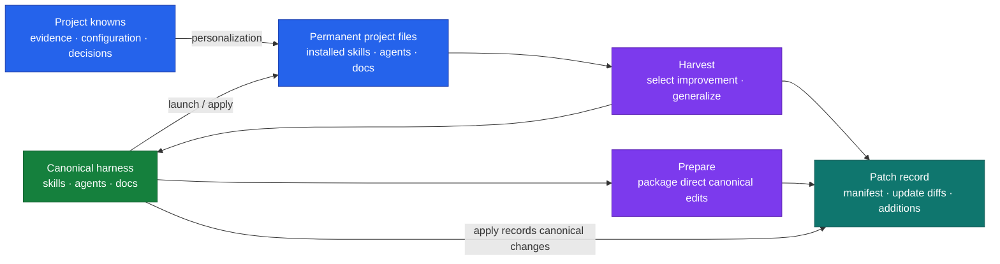
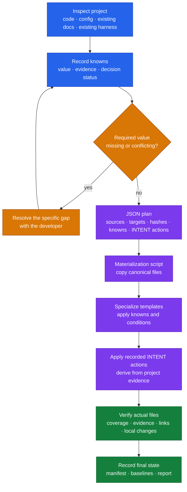
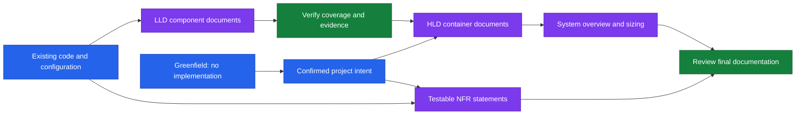

# Harness Bootstrap

The harness is a portable set of canonical skills, agents, and documentation templates. Launch installs a project-specific version of that set. Harvest and
apply keep the canonical sources and permanent project files connected afterward.

**Launch should be as deterministic as possible:** copy the canonical material,
apply known project facts, and derive only the content that needs project-specific
reasoning. The same source version, project evidence, and recorded decisions should
produce the same file selection, paths, substitutions, and required structure.
Derived prose still requires evidence checks; identical wording is not guaranteed.

This document explains the launch contract. JSON materialization checks are executable; semantic evidence and final-file verification remain the orchestrator’s responsibility.

## The canonical/ root

Everything the harness deploys or patches lives under one folder, `canonical/`,
holding `agents/`, `docs/`, `skills/`, provider runtime procedures, and the
`manifest.json`, `settings.json`, and `mcp.json` adapter inputs. It's the single tree `patch
harvest`, `patch prepare`, and `patch apply` read from and write into for portable
content (a narrow, documented set of package-internal exceptions — the package's
own entrypoints, references, changelog, and report template — travel as
`canonical-only` patch entries; see `references/patch/06-patch-state.md`). Every other
top-level item — `references/` (this process's own how-to), `scripts/`
(materializer tooling), `patch/` (immutable bundle history), `patterns/`
(bootstrap-authoring guidance), `reports/`, and the
root docs/entrypoints — is the bootstrap's own scaffolding, not deployable payload.

## Local toolkit and durable project state

Launch first selects one or more of Claude, Codex, and Copilot. The canonical manifest maps sources
to provider destinations; native settings and MCP declarations live beside it.
See [Provider launch](references/launch/08-provider-launch.md) for executable plan generation,
adaptation and verification. Permanent provider files remain editable project artifacts.

Launch answers, plans, receipts and reports live in `package:state/launch/`. Preserve
that directory across toolkit updates when retaining launch history and exclude it from release archives. Consumer
ignore rules cover the disposable package and its local state; this source repository tracks
the package itself. Patch inventory, baselines and operation records also live under the
installed package's `state/`. Import existing `.harness/` records as read-only migration
inputs with provenance; never write new data there.
Never record secret values.

## Four operations

| Command         | Purpose                                                         | Direction                   |
| --------------- | --------------------------------------------------------------- | --------------------------- |
| `launch`        | Install and adapt the harness for the first time                | Canonical → permanent       |
| `patch harvest` | Promote selected project improvements into reusable sources     | Permanent → canonical       |
| `patch prepare` | Package canonical sources already edited directly into a bundle | Canonical → portable bundle |
| `patch apply`   | Update a project from canonical sources or a supplied patch     | Canonical → permanent       |

`patch` alone asks for the direction. Packaging and recording changes are part of
harvest/prepare/apply, rather than separate modes. `prepare` is optional: `apply`
packages direct canonical edits itself when no `prepare` bundle exists for the
requested scope. Run `prepare` when the bundle needs to exist — for review, or to
carry to another project — before any permanent file is touched.

Canonical sources own shared behavior. Permanent files contain that behavior adapted
to a project, plus any explicitly retained local customizations. Harvest is the
deliberate promotion of an improvement into the canonical harness.

## Launch: Q&A → JSON → script → INTENT → verify

Launch starts with the material in this package. It does not redesign each skill,
agent, or documentation convention from scratch.

| Treatment  | When to use it                                            | Example                                                                     |
| ---------- | --------------------------------------------------------- | --------------------------------------------------------------------------- |
| Copy       | Content is independent of the project                     | A shared process pattern or documentation companion                         |
| Specialize | A canonical source declares substitutions or conditions   | Ticket prefix, build command, agent scope, enabled lifecycle                |
| Derive     | Actual project evidence is needed to populate the content | A component's responsibilities, integrations, or architecture documentation |

A single file can combine these treatments: preserve its canonical structure,
substitute the known identifiers, and derive its project-specific sections.
Companions and references belong to the same installation unit as their skill.

### Applying knowns

Read the repository before asking questions. Record each relevant value with its
source: configuration, code, an existing project decision, or a developer answer.
Distinguish verified facts from proposed interpretations. Resolve conflicting
evidence explicitly; do not silently choose whichever value was read last.

Use established values directly. Ask about missing requirements, ambiguous choices,
or conflicting evidence. Once resolved, reuse the decision throughout the run and
on resume. Unknown values remain in the run/design records; they must not become invented
facts or placeholders in published architecture. A value required for an executable instruction must be resolved before that
instruction is considered ready to use.

### Deriving project documentation

For an existing implementation, derive LLD from code and HLD from verified LLD,
using confirmed project intent where needed. Preserve the distinction between the
implemented state and intended future architecture, particularly during adoption.
For a greenfield project, publish confirmed design statements and keep unresolved
implementation details in the run/design records. An empty LLD directory is not evidence for a populated HLD.

Architecture uses HLD, LLD, and NFR Intent contracts. Published docs contain supported
statements, meaningful business/data flows and interaction sequences. UI mockups are
included when they clarify user-facing behavior. Questions and missing decisions stay
in working records. NFR statements identify scope, approved targets/controls, operating
conditions, and verification evidence; no arbitrary targets are invented.

## Native tracking and recovery

Available native trackers expose progress and, where supported, dependencies. The dated report and local operation
records preserve progress across sessions. A task is complete when its required
outputs have been verified, not merely when an agent returned a message.

The active provider assigns one agent to each confirmed layer or component. The orchestrator owns shared indexes, cross-document consistency, and final review. Do not model documentation as a separate workflow runtime.

Record the selected inputs, output paths, and outcome of each agent. On interruption,
verify completed outputs and resume unfinished work. A missing agent result is an
incomplete operation. Layer/component agents require implementation evidence; greenfield
work requires confirmed intent. If an agent is unavailable, report the limitation and
choose an explicit fallback before marking its work complete.

## Harvest, apply, and traceability

**Harvest:** compare permanent edits with their recorded baseline, select the reusable
improvements, generalize project values, reconcile against current canonical sources,
then verify and record the change. It does not automatically rewrite permanent files.

**Apply:** select current canonical sources or a supplied patch, reconcile canonical
changes, personalize with this project's knowns, preserve or resolve local edits,
then verify permanent outputs and update their deployment baselines.

- Manifests record operations, paths, rationale, dependencies, and hashes.
- Updated files travel as unified diffs; added files travel in full.
- Renames identify both paths; deletes are explicit operations.
- Update diffs require the expected canonical base or an explicit reconciliation.
- Baseline file contents and project-specific answers stay local to the project.
- Partial work stays partial; successful writes do not conceal failed outputs.

Launch establishes the initial baseline. Later harvest/apply operations use it to
distinguish canonical updates from permanent edits. Record the planned operation
before writes, and finalize baselines only after all intended changes—including
cleanup—have been verified.

## Implementation and verification boundary

`scripts/materialize-launch.mjs` validates and materializes the JSON plan. INTENT-guided
adaptation follows script completion; a materialized receipt does not mean launch is done.
Layer/component agents receive explicit documentation intent and evidence boundaries, return
coverage/evidence, and expose partial failures. The orchestrator verifies actual files.
Canonical INTENT defects are recorded as local plan exceptions, not silently rewritten.

The local materializer checks use an isolated project. Semantic agent behavior still needs a real launch.

## Process references

- [Skill entry point](SKILL.md)
- [Launch recipe](references/launch/01-launch.md)
- [Patch router](references/patch/03-patch.md)
- [Harvest recipe](references/patch/04-patch-harvest.md)
- [Prepare recipe](references/patch/07-patch-prepare.md)
- [Apply recipe](references/patch/05-patch-apply.md)
- [Manifest and state contract](references/patch/06-patch-state.md)

Installed runtime procedures are permanent copies. The bootstrap package may be
removed after verified launch without affecting skill/agent execution.

## Shared package discovery

This repository keeps the authoring source in `.canonical-implementation-harness/`.
The `.claude/skills/harness-bootstrap`, `.agents/skills/harness-bootstrap`, and
`.github/skills/harness-bootstrap`
symlinks are local discovery links for working on this source repository.

Consumer projects receive the released ZIP (`releases/harness-bootstrap/`), not a
copy of this authoring directory. Extract the ZIP into the consumer project's selected host skill directory, such as
`.agents/skills/` for Codex, `.claude/skills/` for Claude, or `.github/skills/` for Copilot. The archive creates the
`harness-bootstrap/` skill folder there. Record its
physical location as `package:`; all selected hosts can then share its state. See
[host capabilities](references/host-capabilities.md) for execution procedures.

## Copilot

Install the release ZIP under `.github/skills/`, invoke `/harness-bootstrap launch`
and select `copilot` in Q6. Claude and Codex may remain selected alongside it.
See [provider destinations](references/launch/08-provider-launch.md#copilot).
