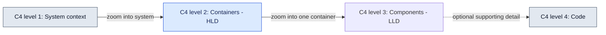

# HLD Intent

An HLD container document states the confirmed architecture at container resolution.
It explains responsibilities, boundaries and consequential interactions so a reader
can follow the design without reconstructing it from implementation details.

## Required abstraction: C4 containers

This harness requires **HLD at C4 level 2 (Container)**. The system overview shows
applications and data stores inside a system boundary, their responsibilities,
technology and labeled communication relationships. A container document explains
one such element and its immediate collaborators. A C4 container is not synonymous
with a Docker container, repository folder, team or infrastructure environment.

The illustration explains abstraction, not a project architecture to copy. Generated
HLD must include an actual container view: named boundaries, responsibilities,
technologies, and relationship purpose/protocol where known. System context is
supporting orientation; a context-only diagram does not satisfy HLD granularity.
Component/class inventories belong in LLD or code references. Deployment topology,
capacity and dynamic flows supplement rather than replace the container view.
Map repository layers to real C4 boundaries; document infrastructure/deployment
concerns explicitly without inventing a software container for every folder.

Separate the runtime container view from deployment and build/provisioning views.
For each container, identify its executable application or data-store boundary,
responsibility and meaningful incoming/outgoing relationships, including actors and
external systems. Deployment tools and artifacts belong in supporting views unless
they are themselves applications within the modeled system. Justify intentionally
isolated elements; repository ownership alone does not establish runtime boundaries.

Reject HLD that cannot explain responsibility distribution and communication at
container resolution.
This level is a harness requirement; C4 itself permits selecting useful views.
Sources: [C4 diagrams](https://c4model.com/diagrams) and
[Container view](https://c4model.com/diagrams/container).

## Required semantic coverage

Headings may vary; verify these five coverage keys rather than a fixed heading count.

| Key           | Required content                                                        |
| ------------- | ----------------------------------------------------------------------- |
| `scope`       | Container purpose, responsibilities, actors served and boundary         |
| `structure`   | Major collaborators, ownership and dependency relationships             |
| `flows`       | Relevant primary business, data or interaction sequence                 |
| `contracts`   | Boundary inputs/outputs, exchanged information and confirmed guarantees |
| `constraints` | Confirmed architectural decisions and applicable requirements           |

A default structure is Overview, Structure, Primary flows, Boundary contracts, and
Constraints. Combine sections when that makes the relationships clearer. Explicit
applicability belongs in the verification record; do not invent content to fill a key.

## Statements and evidence

- Describe approved target intent from requirements and decision records. Describe
  implemented behavior from verified LLD. Label current and target states explicitly
  wherever they differ; implementation alone does not establish a target requirement.
- Link sources for architectural claims, including relevant LLD, approved requirements
  and decisions. Greenfield architecture uses confirmed intent, not imagined code.
- State confirmed consequential choices directly. Explain rationale or alternatives
  only when supported by a decision source; never reconstruct why a choice won.
- Keep unknowns, unresolved decisions and missing evidence in the external launch,
  design or review record, per the certainty principle in 01 Principles.md.
- If essential evidence is missing, keep the output unready and resolve it externally.
  Omitting an essential contract is not a way to claim completion.

## Primary flows

Choose flows that explain the container's actual architectural role: business work,
data movement, cross-container interaction, or a combination. For each relevant flow,
state the trigger, participating actors, ordered steps, boundary crossings and data
exchanged, and the resulting outcome. Include failure, rejection or recovery paths
when supported by implementation evidence or confirmed design.

Show ordering and ownership, not just boxes connected by arrows. A sequence diagram
can explain request/response interactions; a flow diagram can explain branching or
business progression. A structural diagram complements these when boundaries need
explanation. Use colored Mermaid consistently with Documentation Principles.
Do not add irrelevant flow types or fabricate failure behavior for diagram symmetry.

## UI illustrations

When a key user interaction, layout or state transition materially explains the
architecture, include or link a concise UI mockup/illustration and connect its states
to the documented interaction. Base current UI on inspected evidence and target UI
on confirmed design; label which it depicts. A mockup is optional when it adds no
architectural information and is never evidence that a proposed UI is implemented.

## System sizing and capacity

System Sizing is a capacity exercise, not a source-code inventory. Establish the
workload boundary and confirmed planning assumptions, then calculate baseline and
peak demand. Select dimensions appropriate to this system: concurrent users or
jobs, arrival/event rates, payload sizes, processing cost, retained data, growth,
bandwidth, external quotas, recovery requirements and available capacity.

Show input value, unit, provenance and scenario; equations with units; resulting
capacity, headroom and the likely limiting resource. For example, arrival rate times
service time estimates average in-flight work under stated steady-state assumptions;
loads per time times bytes per load estimates transfer demand. Static content still
has download size, burst traffic and client resource constraints. Do not invent
server/database sizing for a system without those components.

Inspect actual artifact/config measurements where feasible. Separate measured
inputs, sourced limits and approved planning assumptions; estimates are not load-test
results. Propose missing assumptions and baseline/peak scenarios in the run/design
record for confirmation before publication. Compare demand with relevant limits and
NFR targets, explain sensitivity to uncertain inputs, and identify the next capacity
validation. Use consistent decimal or binary units and explicit conversions; compare
demand and limits over the same time window (monthly transfer against monthly
allowance, separately from peak transfer rate). Every published scenario assumption
needs confirmation evidence; unresolved assumptions stay in the external record and
block sizing acceptance. Record a dimension-specific reason for omitted capacity
dimensions in the review record; hosting models do not eliminate burst, bandwidth or
client constraints. Line counts and component counts alone never satisfy sizing coverage.

## Verification and related contracts

Keep container documents within the HLD budget in 01 Principles.md. Verify all five coverage keys, source links,
flow ordering and current/target distinctions before accepting the document.
System overviews and indexes have their own scope; do not force a container checklist
onto them. NFR pillar documents use their separate intent below.

- `04 LLD Intent.md` — implemented component detail.
- `05 NFR Intent.md` — approved requirements and acceptance evidence.
- `02 Structure.md` — document placement.
- `01 Principles.md` — presentation and diagram conventions.
