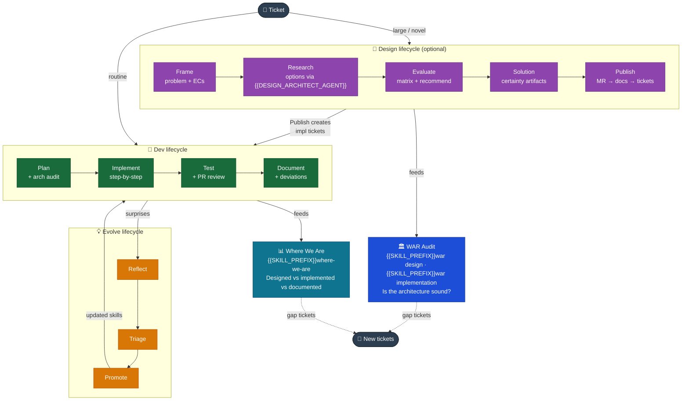

# Harness Bootstrap — Lifecycle Overview

_The four lifecycles, how they interact, and when to use each one._

Commands are written with a leading `{{SKILL_PREFIX}}` — your provider's skill-invocation
prefix. See `04 AI Coding Tool Compatibility.md` for the full provider mapping.

---

## The four lifecycles

| Lifecycle        | Orchestrator             | Phases                                                                                               |
| ---------------- | ------------------------ | ---------------------------------------------------------------------------------------------------- |
| **Dev**          | `{{SKILL_PREFIX}}dev`    | Context → Ceremony → Plan → Implement → Test → Document                                              |
| **Design**       | `{{SKILL_PREFIX}}design` | Frame → Research → Evaluate → Solution → Review Gate → Address Feedback → Publish                    |
| **Skill**        | — (no orchestrator)      | Reflect → Triage → Draft → Validate → Adopt                                                          |
| **Architecture** | — (standalone commands)  | `{{SKILL_PREFIX}}where-we-are` · `{{SKILL_PREFIX}}war design` · `{{SKILL_PREFIX}}war implementation` |

Each orchestrator runs its phases in order. Dev continues routine authorized work and pauses only for material decisions or required human actions; other lifecycles retain their own review gates. Individual phase commands (`{{SKILL_PREFIX}}dev plan`, `{{SKILL_PREFIX}}design frame`, etc.) run the requested stage or support resuming mid-flow.

---

## When to use which lifecycle

| Situation                                     | Use                                                           |
| --------------------------------------------- | ------------------------------------------------------------- |
| Any ticket — feature, bug fix, chore          | Dev lifecycle always                                          |
| Ticket is large, novel, or crosses containers | Design lifecycle first, then Dev                              |
| Something surprised you during a ticket       | Evolve lifecycle (Reflect)                                    |
| Observed harness friction                     | Evolve lifecycle (Triage)                                     |
| End of sprint / before planning               | Architecture lifecycle (`{{SKILL_PREFIX}}where-we-are`)       |
| After major HLD changes                       | Architecture lifecycle (`{{SKILL_PREFIX}}war design`)         |
| Before a major release                        | Architecture lifecycle (`{{SKILL_PREFIX}}war implementation`) |

**Design is optional.** Small, well-understood changes within a single container that introduce no new integrations or architecture decisions — skip Design, go straight to Dev.

---

## Cross-lifecycle invariants

- Follow each lifecycle's approval contract. Dev reuses existing authorization across routine phase transitions; unresolved material decisions still require human input.
- No code is written until the plan is approved and the architecture audit passes.
- Documentation is mandatory — tickets are not complete until `{{SKILL_PREFIX}}dev document` has run.
- Architecture deviations approved at plan time are tracked through to the Document phase.
- Reflections are not optional ceremony — they are how conventions accumulate.

→ See `Engineering Guide/03 Engineer Role.md` for how engineers and AI divide responsibility within these lifecycles.

---

## Lifecycle interactions

---

→ `01 Dev Lifecycle.md` — Context → Ceremony → Plan → Implement → Test → Document  
→ `02 Design Lifecycle.md` — Frame → Research → Evaluate → Solution → Review Gate → Address Feedback → Publish  
→ `03 Evolve Lifecycle.md` — Reflect → Triage → Draft → Validate → Adopt
→ `04 Architecture Lifecycle.md` — `{{SKILL_PREFIX}}where-we-are` · `{{SKILL_PREFIX}}war design` · `{{SKILL_PREFIX}}war implementation`  
→ `05 Documents Flow.md` — how docs are born, graduate, and reach their permanent home
