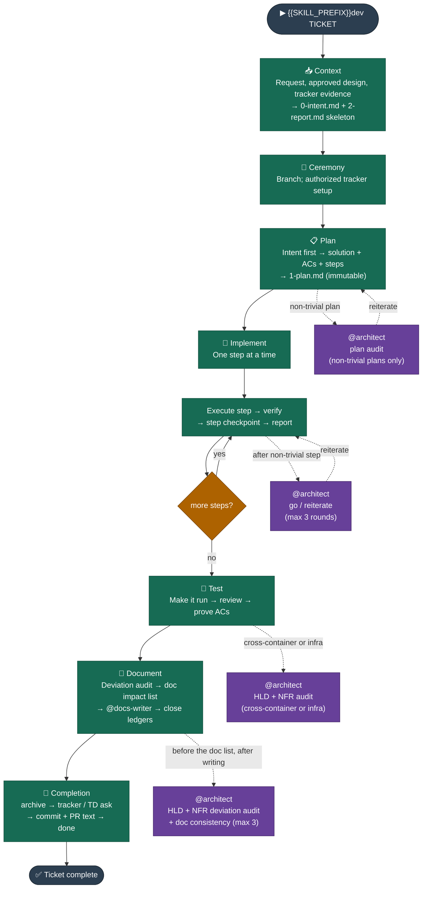

# Dev Lifecycle — Context → Ceremony → Plan → Implement → Test → Document → Completion

_Delivers a ticket or local change from request to documented, merged code._

Commands below are written with a leading `{{SKILL_PREFIX}}`; that is your provider's
skill-invocation prefix. Skill companions are referenced by their path inside the
installed skill bundle — see `04 AI Coding Tool Compatibility.md` for where each
provider puts that bundle.

---

## Intent

The Dev lifecycle is the core delivery workflow. Every ticket — feature, bug fix, chore — runs through it. Its job is to ensure that work is planned against the architecture, implemented step by step with observed verification, tested before merge, and documented before close.

---

## When to use it

Always. There is no ticket that bypasses this lifecycle. For large or novel work, run the Design lifecycle first; `{{SKILL_PREFIX}}design publish` produces the implementation tickets once the design is approved.

## When NOT to use it

There is no "skip Dev" path. Stages can run individually (`{{SKILL_PREFIX}}dev plan`, `{{SKILL_PREFIX}}dev implement`, …) or all at once (`{{SKILL_PREFIX}}dev`), but the sequence is always the same.

---

## Flow



## Stages

**Router:** `{{SKILL_PREFIX}}dev <TICKET> <problem statement>` — runs all seven stages in one session. Each phase ends the same way: sign-off, report, commit; the developer confirms the sign-off and runs the commit, nothing else stops. Bail out at any point and resume with the individual command.

| Stage          | Individual command                               | What it produces                                                                          |
| -------------- | ------------------------------------------------ | ----------------------------------------------------------------------------------------- |
| **Context**    | `{{SKILL_PREFIX}}dev context <TICKET> <problem>` | Story folder, `2-report.md` skeleton, metrics, `0-intent.md` (signed off)                 |
| **Ceremony**   | `{{SKILL_PREFIX}}dev ceremony <TICKET>`          | Feature branch; authorized tracker transition                                             |
| **Plan**       | `{{SKILL_PREFIX}}dev plan <TICKET>`              | `1-plan.md` — solution (+ diagram), acceptance criteria, numbered steps                   |
| **Implement**  | `{{SKILL_PREFIX}}dev implement <TICKET>`         | Code, one step at a time with a checkpoint each; notes in `2-report.md`; commits by block |
| **Test**       | `{{SKILL_PREFIX}}dev test <TICKET>`              | Checks, review findings and AC evidence in `2-report.md`                                  |
| **Document**   | `{{SKILL_PREFIX}}dev document <TICKET>`          | `## Documentation` impact table, docs written by `@docs-writer`, ledgers closed           |
| **Completion** | `{{SKILL_PREFIX}}dev complete <TICKET>`          | Story archived, metrics final, commit + PR text, tracker/TD offers, done message          |

All artifacts live in `Stories/[TICKET] name/impl/` (ASCII folder names only), alongside `stat.json`. The router's entry check finds that folder once, for every entry, and decides fresh vs. resume with one question.

---

## Invariants

**Context:**

- Capture the request, the approved design if one exists, and relevant tracker evidence in `impl/0-intent.md`, written against `interfaces/intent.md`: the questions it must answer, in the originator's own words, shape free. An approved `solution/` folder is the primary spec; tracker acceptance criteria supplement it, they do not override it.
- Create the story folder, the report skeleton and metrics as soon as the name is known, before the heavy reading, so the stage has real numbers.
- Write the intent even when context is incomplete; gaps go in as open questions. The stage ends with one sign-off on the written file; after that only open questions may be appended.

**Ceremony:**

- Inspect and reuse an existing feature branch before proposing one. Checkout is the developer's operation and the stage's sign-off; never discard unrelated local work.
- Tracker setup is delegated by state name, and only when authorized. A local DEV identifier does not imply a tracker record.

**Plan:**

- All Target Architecture reads go through the HLD README to resolve the active version — never hardcode a version name. Read the system overview, relevant container docs, and non-functional concerns within that version.
- Intent first: read `0-intent.md` in full, write it if missing, then derive the plan from it. Solution answers the intent's outcome, each AC traces to an outcome or boundary, each step serves the solution. Scope creep and gaps are named in the sign-off.
- Read the relevant System Architecture (LLD) and actual code before proposing anything.
- Steps are numbered and independently verifiable, with meaningful acceptance criteria and only checks the project actually has configured. Never assume a framework, test suite, linter or pre-commit hook exists.
- The plan has a `## Solution` section: the approach in a short paragraph, plus a Mermaid diagram of the target state whenever the plan changes how things are wired together and the step list alone would not make that obvious. The plan links the intent; it never repeats problem, outcome or scope.
- `1-plan.md` and `2-report.md` are strict templates; the intent is an interface. One fact lives in one document.
- Tests come first by default: when the project has a test setup for the touched layers, Step 1 writes one case per testable acceptance criterion in the existing framework, red for the expected reason; later steps turn them green. Skipping needs a stated reason in the plan.
- **Architecture audit (optional):** for non-trivial plans — new cross-layer integration, infrastructure change, data-flow change, or scope spanning more than one {{BUILD_UNIT_LABEL}} — audit the plan against the Target Architecture. Mechanical fixes are applied and recorded; anything else is carried into the one Plan sign-off, never a separate stop. Uses the **satellite-review** pattern. Skip for mechanical plans (single-layer rename, config value, dependency bump).
- Approved deviations are RF rows in `2-report.md`, referenced from the plan by ID; never a second table.
- The plan is immutable once approved. New authorized scope is an explicit addendum, never an edit.
- The plan is written to disk before approval is requested (**write-confirm**). The developer reviews the artifact in their editor, not in chat. One sign-off covers the persisted plan and the audit outcome; the commit is the stage's second stop.

**Implement:**

- Execute one logical step at a time with observed verification — not a claim that a step should work. The orchestrator runs the plan's verification commands itself through the metrics wrapper.
- Each step ends with an intelligent checkpoint: when every verification item was runnable and passed and nothing diverged from the plan, the step is auto-approved and the next one starts. The developer is asked mid-phase only for a check needing their eyes or access, a guarded command, or a divergence.
- After verification, follow **do → report → commit**: update `2-report.md` first (progress row, implementation note) and move on. The phase ends with one sign-off listing every step, what verified it and by whom, then the commits are proposed once, by step or logical block, and the developer runs them before the stage closes.
- Required checks passing is never optional; a self-run check is enough for a step checkpoint when a command can answer it, never for what only a human can see.
- **Satellite review:** after a non-trivial step, the worker invokes `@architect` read-only before presenting verification. Verdict is go or reiterate, at most three rounds, then escalate. Skip for mechanical steps.
- **Implementation notes:** a step that passed first try needs one line. A step that required troubleshooting needs the full record — initial error, each hypothesis ruled out, root cause, fix. A terse "fixed" is not acceptable for a troubleshooting chain. Notes go at the bottom in ascending step order.
- Surface deviations from the plan as they appear, rather than at the end.

**Test:**

- Three intelligent checkpoints, in order: **make it run** (build the changed scope, then the prerequisites the plan introduced such as migrations, queues or blobs, then the suites), **review** (component specialists, `@architect` when boundaries move, findings in the ledger, routine fixes applied, open findings decided with the developer right there), **prove the ACs** (evidence per criterion, manual ones asked as precise actions).
- Nothing runs on a broken build. Environment actions auto-approve only against local or disposable resources; a shared or guarded target goes to the developer with the exact command.
- Green tests are not an AC verdict; each criterion gets its own evidence. A failing required AC never reaches the sign-off as a surprise.
- The sign-off presents checks, findings and ACs with their evidence; nothing is deferred to it.

**Document:**

- Mandatory. The ticket is not complete until this stage and Completion have run.
- The stage owns **where** and **what**, the writer owns **how**: it reads the Documentation Structure article for tiers and placement, never restates the doc principles.
- **Deviation audit:** `@architect`, read-only, compares what was built against the active HLD and its NFRs, tagging each finding contradiction / extension / omission. LLD lag is a doc update, not a deviation. An intelligent checkpoint: anything critical, high or undecided is settled with the developer (fix / accept / retarget) before the docs are planned. Uses **review-gate**.
- **Doc impact list:** one table in `2-report.md` (`## Documentation`): doc or section, tier, action (new / updated / retired), why. Every row traces to the plan's Solution, an implementation note or a finding. Approved-design impacts are rows too. An HLD row that changes a settled decision needs an authorising finding.
- **Write:** the whole list goes to `@docs-writer` in one call, with the source material per row. It applies the doc principles and fixes navigation and references for retired docs.
- **Consistency review:** `@architect` cross-checks the written docs against each other, the HLD and the code; routine fixes go back through `@docs-writer`, at most three rounds, then the developer decides.
- Ends with one sign-off on the written table and the closed ledgers. Archiving is Completion's job.

**Completion:**

- The stage that makes "done" unambiguous. Closure checks (`quality validate`), then archive to `Stories/archive/[TICKET] name` keeping every artifact including `stat.json`, never overwriting an existing destination. Folder names stay ASCII: no emoji, no em dash.
- One combined ask for the external actions (move the ticket to its next status, create tracker tickets for tech debt; declining is fine), then metrics are finalised, then the archive commit and a ready-to-paste PR title and body built from real evidence are handed over in one message.
- Close with a clear "ticket complete" message. `{{SKILL_PREFIX}}dev complete <TICKET>` runs this stage alone for any story that reached Document but was never archived.

---

## One findings ledger

`2-report.md` holds a single `## Review Findings` table, defined by the dev skill's `patterns/review-gate.md`. Plan audits, implementation reviews, PR reviews, HLD audits and documentation consistency reviews all upsert into it using stable RF IDs — a recurring issue keeps one row and accumulates origin and evidence. Kind, deviation type, severity, classification and resolution are separate dimensions. Findings are recorded before any fix is applied.

Tech Debt is a separate linked ledger carrying ownership, next action and optional tracker task creation. A local TD entry survives a declined tracker creation; it cannot silently waive a required acceptance criterion. Before archival every finding must be fixed, accepted, moved to tech debt, or resolved by a doc update — each with evidence and any required attributed decision. Critical and high risks cannot be hidden in debt or accepted silently. Target decisions are never rewritten to excuse an implementation regression.

---

## Human decisions

The dev skill's `patterns/phase-sign-off.md`, `patterns/approval-sign-off.md` and `patterns/approval-intelligent.md` own the approval model. Every phase ends the same way: **sign-off → report → commit**. The sign-off shows what was done, what was verified and by whom, what was auto-approved and why, and asks one question. The commit is proposed, the developer runs it, the stage checks Git and only then closes, so the next phase starts on a clean worktree. `stage complete` is refused by the metrics CLI unless the sign-off is on record.

Inside a phase the agent keeps going. Routine reads, reversible local edits, self-run checks, report updates and stage transitions are authorised for the whole ticket. Steps use intelligent checkpoints: the auto-approval conditions are stated before looking at the content, met means continue with a one-line record, anything else means ask. It pauses mid-phase only for something only a human can do or decide: a check needing their eyes or access, a guarded command, a material scope or architecture choice, accepting a real risk, or an external mutation. It prepares the content first and asks once. Where the host offers a native planning mode, its approval is the Plan sign-off, not an extra stop.

---

## Patterns

Patterns are shared multi-step protocols co-located in the dev skill's `patterns/` folder. They are not registered in the root instruction file — each stage reference loads them on demand by explicit path. The pattern file owns the protocol; the stage reference owns the trigger condition and any local override.

| Pattern                   | Purpose                                                                    | Applied in                                                                   |
| ------------------------- | -------------------------------------------------------------------------- | ---------------------------------------------------------------------------- |
| `phase-sign-off.md`       | How the one sign-off stop works: summary, metrics calls, the reply         | End of every stage; Completion's external-actions ask                        |
| `approval-sign-off.md`    | What a sign-off is; manual operations; what self-run checks can cover      | All stages; the commit stop                                                  |
| `approval-intelligent.md` | State the conditions, auto-approve when met, escalate on doubt             | Ceremony tracker, Plan audit rework, Implement steps, Test 2–4, Document 2–5 |
| `review-gate.md`          | Stable finding identity, classification, evidence-backed closure           | Plan audit, Implement review, Test review, Document audits                   |
| `do-report-commit.md`     | Update the report before any commit is proposed                            | Implement steps, review fixes                                                |
| `write-confirm.md`        | Write the artifact to disk before asking for approval                      | Context (intent), Plan (plan)                                                |
| `satellite-review.md`     | Scoped read-only architecture review, at most three rounds                 | Plan (optional audit), Implement (non-trivial steps)                         |
| `announce-progress.md`    | Concise progress at completed units and stage transitions                  | Implement, Document, stage transitions, Completion's done message            |
| `session-continuity.md`   | After context compaction: re-read the reference, recover, don't redo       | All stage references (fresh vs. resume is the router's)                      |
| `task-tracking.md`        | Stage tasks and implementation step tasks over the host's tracker          | Router, Implement                                                            |
| `metrics.md`              | Observed timing, checks, token evidence, quality inventory, sign-off guard | All stages                                                                   |

**Principles:**

- Extract a pattern when three or more call sites share the same multi-step protocol.
- Co-locate it in the skill bundle; reference it by explicit path at the point of use.
- The pattern owns the rule text; the call site owns the trigger condition.
- Update the pattern file only when the protocol itself evolves, not for a local variation.

---

## Delivery and quality metrics

Each ticket keeps `impl/stat.json` beside `2-report.md`. The dependency-free Node.js CLI `scripts/timing.mjs` in the dev skill bundle requires an explicit `--dir` and records observed work, waits, attempts, verification outcomes and available runtime token deltas. Tracking starts in Context as soon as the story folder exists, before the heavy reading, so the first stage has real numbers. Every stop records a wait first; otherwise the reply time would count as work. Unknown measurements stay null. Recovery bounds interrupted work at its last checkpoint. A stage cannot complete without a developer-sourced `<Stage> sign-off` acceptance check in its current attempt. Direct-stage coverage is partial; Completion finalises the ticket.

`report` derives `quality` from Review Findings, Tech Debt and numerical test results, rendering one summary line beside Stage Metrics. Breakdowns cover kind, deviation type, impact severity, classification, resolution, PR-origin findings and debt disposition. Written tests are new cases from the diff; passed, failed and skipped are the latest runner case counts over non-overlapping scopes. Historical failed runs are tracked separately from case counts. Unknown counts stay unavailable, and regenerating the report does not increment them. These are recorded inventories, not a quality score or a ticket ranking.

Run `quality validate` before archival to check structural finding closure and recorded check outcomes. Humans and agents still verify evidence substance and acceptance coverage. Legacy reports are never rewritten or assigned invented counts.

---

## Example

```
{{SKILL_PREFIX}}dev {{PROJECT_KEY}}-042 Replace mock player data with real DB-backed data.
Thoughts: need a new service module, seed data, and a web API client.
```

The agent runs all seven stages, stopping at each phase's sign-off and commit, and finishes with a clear "ticket complete" message.
