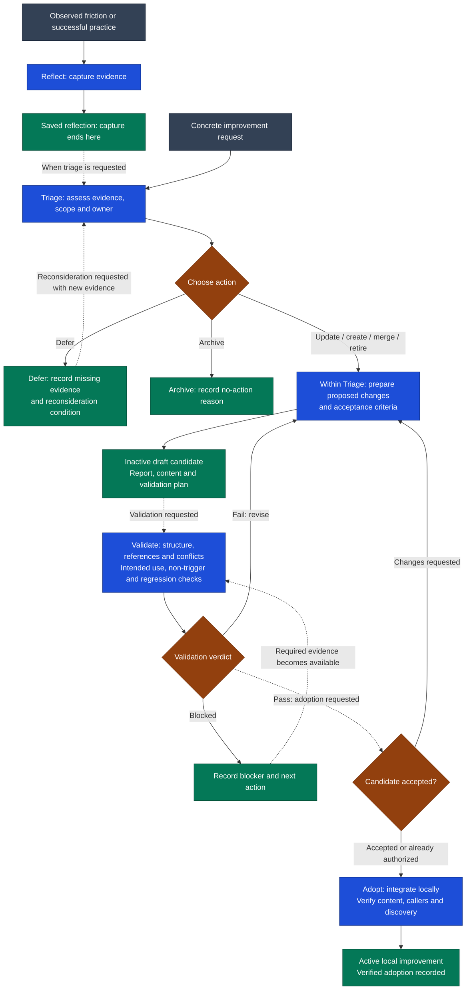

# Evolve Lifecycle

Evolve improves the harness from observed friction, successful practice or a concrete
improvement request. It covers skills, agents, workflows, conventions and supporting
scripts. Design decides what to build; Dev delivers it; Evolve improves how work is guided.

## Flow

Solid arrows show the full improvement flow. Dashed arrows require a later request
or a change in circumstances; reflection capture and local adoption do not trigger
the next lifecycle automatically.

| Command                         | Outcome                                                               |
| ------------------------------- | --------------------------------------------------------------------- |
| {{SKILL_PREFIX}}evolve reflect  | Save an attributed observation and stop                               |
| {{SKILL_PREFIX}}evolve triage   | Scope improvements and write inactive drafts, or archive observations |
| {{SKILL_PREFIX}}evolve validate | Record intended-use, non-trigger and regression evidence              |
| {{SKILL_PREFIX}}evolve adopt    | Integrate the accepted candidate and verify callers and discovery     |

Concrete improvement requests enter Triage, which checks ownership and duplication
and prepares drafts internally. Draft is not a command. Triage stops with inactive
candidates by default; validation and publishing through Adopt are requested later.
Native tasks track the current invocation. There is no session-continuation protocol.

## Stage responsibilities

### Reflect — capture experience

Record what happened, what helped or caused friction, the impact, and supporting
task evidence or user attribution. Distinguish observations from suggested fixes;
do not infer that an isolated experience is a universal rule. The stage ends with
a saved observation awaiting triage. It does not change the active harness.

### Triage — decide and prepare

Review saved observations or a direct request, identify the underlying concern and
scope, and inspect the existing owner and affected callers. Choose an action:

| Action  | Candidate or decision                                                              |
| ------- | ---------------------------------------------------------------------------------- |
| Update  | Revise the existing owner of the concern                                           |
| Create  | Add a skill, agent, convention or supporting script where no suitable owner exists |
| Merge   | Consolidate overlapping guidance and identify superseded content and callers       |
| Retire  | Propose removal with caller handling and rollback information                      |
| Defer   | Preserve the observation with missing evidence and a reconsideration condition     |
| Archive | Record why no harness change is warranted                                          |

For actionable items, prepare reviewable draft content, destination mappings and
acceptance criteria. Draft is a candidate state and an internal Triage activity,
not an executable command. An update or retirement is also a draft proposal; a
candidate does not have to be a new skill. Triage ends with inactive candidates or
recorded defer/archive decisions, without automatically validating or publishing.

### Validate — establish evidence

Check candidate structure, discovery metadata, references and instruction conflicts.
Exercise intended behavior, inappropriate triggers and affected existing callers,
using checks appropriate to the artifact type. Record inputs, expected and actual
outcomes, methods and limitations against the exact candidate content.

The verdict is pass, fail (needs revision), or blocked. Revisions return to the
internal drafting activity and invalidate affected checks. A blocked result records
what is needed to proceed. A pass makes the candidate eligible for adoption; it
does not publish it. Evidence, rather than elapsed time, determines readiness.

### Adopt — publish and integrate locally

Verify that the candidate is accepted, its validation still applies, and the active
destination has not changed since drafting. Publish the recorded changes, update
callers, discovery entries and lifecycle documentation, and retire superseded
content only where specified. Verify the installed content and its integration.

The stage ends with an active local improvement and its adoption evidence.
Failed integration is recorded as incomplete, with recovery details.

## Artifacts and ownership

Observations live in the configured provider's reflections directory. Candidates
live under its evolve/{id}/ directory: Report.md, candidate/ and Validation.md.
Report.md owns state, provenance, path mappings, content hashes, acceptance and next
action. Validation is based on demonstrated behavior, never a week-long waiting rule.

Adopt activates skills in name/SKILL.md layout, updates relevant callers and the
provider-selected root instruction file, and verifies installed content. Legacy
reflections and drafts remain readable; replacement of old commands occurs during
authorized deployment, not by deleting user history.

Evolve ends when local adoption and integration are verified.
