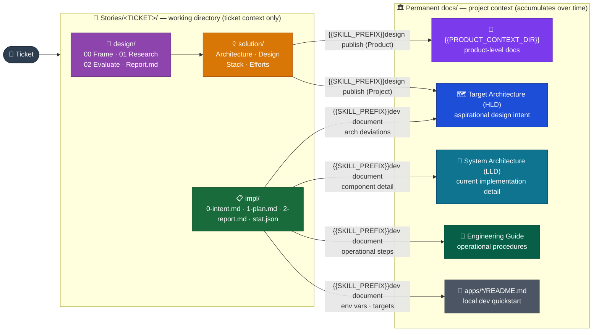

# Documents Flow

_How documentation is born, refined, and graduates to its permanent home._

---

## The pipeline

> _Context sources: Research and Evaluate phases read existing docs as context before producing options — Product designs read `{{PRODUCT_CONTEXT_DIR}}/`, Project designs read `Target Architecture (HLD)/`. The track is resolved once in Frame (`patterns/context-resolution.md`) and recorded in `Report.md`'s `## Context` section. This read direction is not shown above to keep the pipeline readable._

---

## Graduation rules

| Lifecycle phase                                          | Produces                                                        | Lives in                                                                       | Mutability                                            |
| -------------------------------------------------------- | --------------------------------------------------------------- | ------------------------------------------------------------------------------ | ----------------------------------------------------- |
| `{{SKILL_PREFIX}}dev context`                            | `0-intent.md`                                                   | `Stories/[TICKET] name/impl/`                                                  | Confirmed proto-spec — open questions may be appended |
| `{{SKILL_PREFIX}}dev plan`                               | `1-plan.md`                                                     | `Stories/[TICKET] name/impl/`                                                  | Immutable after approval                              |
| `{{SKILL_PREFIX}}dev context`                            | `2-report.md` (skeleton)                                        | `Stories/[TICKET] name/impl/`                                                  | Living through the ticket                             |
| `{{SKILL_PREFIX}}dev implement`                          | Code commits                                                    | Codebase                                                                       | —                                                     |
| `{{SKILL_PREFIX}}dev document`                           | LLD updates                                                     | `System Architecture (LLD)/`                                                   | Living                                                |
| `{{SKILL_PREFIX}}dev document`                           | Engineering Guide entries                                       | `Engineering Guide/`                                                           | Living                                                |
| `{{SKILL_PREFIX}}dev document`                           | App README updates                                              | `apps/*/README.md`                                                             | Living                                                |
| `{{SKILL_PREFIX}}dev document` (deviation path)          | Container or NFR updates within the active version              | `Target Architecture (HLD)/<active>/Containers/` or `Non-Functional Concerns/` | Living                                                |
| `{{SKILL_PREFIX}}design evaluate`                        | Recommendation + WAF assessment                                 | `Stories/[TICKET] name/design/02 Evaluate.md` + `Report.md`                    | Immutable in Story                                    |
| `{{SKILL_PREFIX}}design solution`                        | Certainty artifacts                                             | `Stories/[TICKET] name/solution/`                                              | Immutable after Publish gate                          |
| `{{SKILL_PREFIX}}design publish` (Product track)         | Product architecture content                                    | `{{PRODUCT_CONTEXT_DIR}}/<resolved subfolder>`                                 | Living — accumulates over the product lifetime        |
| `{{SKILL_PREFIX}}design publish` (Project track)         | Updates reviewed by `{{DESIGN_ARCHITECT_AGENT}}` (max 2 passes) | `{{DESIGN_DOCS_ROOT}}<resolved subfolder>`                                     | Living post-merge                                     |
| `{{SKILL_PREFIX}}dev complete` (archive)                 | Full Story folder                                               | `Stories/archive/`                                                             | Archived — no further edits                           |
| `{{SKILL_PREFIX}}where-we-are` · `{{SKILL_PREFIX}}war-*` | Architecture audit snapshots                                    | `LLD/where-we-are/` or `HLD/WAR/<version>/`                                    | Append-only — see Architecture Lifecycle invariants   |

---

## Lifecycle of a doc

**Creation** — delivery docs are born in `Stories/[TICKET] name/` (ASCII folder names only) as working drafts. No doc goes directly to HLD, LLD, or the Engineering Guide without passing through a ticket.

**Graduation** — content graduates at two points: during `{{SKILL_PREFIX}}dev document` (implementation outcomes) and during `{{SKILL_PREFIX}}design publish` (design outcomes). Only settled outcomes graduate — rationale, comparisons, and open questions stay in the Story. Where an implementation change lands is decided by the tiers in `Documentation/02 Structure.md`; the Document stage records that decision per doc in the report's `## Documentation` table before `@docs-writer` writes anything. Design graduation is track-routed, resolved once in Frame and recorded in `Report.md`'s `## Context` section: Product lands in `{{PRODUCT_CONTEXT_DIR}}/`; Project lands in `Target Architecture (HLD)/`.

**Update** — permanent docs (HLD, LLD, Engineering Guide) are updated by subsequent tickets, not by reopening the original Story.

**Supersession** — HLD is versioned. Creating a new version is a human and business decision — the lifecycle never creates one automatically. When the team decides to cut a new version, the old version folder is kept as history and the README router is updated to point to the new active version. In-progress deviations always land in the current active version.

**Archival** — `{{SKILL_PREFIX}}dev complete` archives a story after doc consistency review, evidence-backed terminal resolutions in the single Review Findings ledger, and passing required acceptance/checks. The archived folder keeps its original ASCII name (`[TICKET] name`); done status lives in the report, not the folder name. Routine LLD lag is a doc-update task; deviation auditing compares implementation to HLD only. Archived stories are read-only references.

---

## What does NOT graduate

| Content type                       | Stays in                                             |
| ---------------------------------- | ---------------------------------------------------- |
| Rationale, trade-offs              | `Stories/[TICKET] name/design/02 Evaluate.md`        |
| Rejected alternatives              | `Stories/[TICKET] name/design/02 Evaluate.md`        |
| Open questions                     | `Stories/[TICKET] name/design/02 Evaluate.md`        |
| WAF assessment                     | `Stories/[TICKET] name/design/Report.md` WAF section |
| Implementation notes (2-report.md) | `Stories/[TICKET] name/impl/2-report.md`             |
| Exploration drafts                 | `Stories/[TICKET] name/design/`                      |

## Harness improvement artifacts

Evolve reflections and candidate reports live in provider-local reflections/ and
evolve/ directories. Candidate evidence remains there; {{SKILL_PREFIX}}evolve adopt integrates
validated skills, agents and conventions into their recorded destinations. See
[the Evolve lifecycle](03%20Evolve%20Lifecycle.md).
