# <TICKET> — <title>

## Problem

<What is broken or missing — one paragraph. Why does this matter now.>

**Current state:**

```mermaid
graph TD
    classDef primary fill:#4A90D9,stroke:#2C5F8A,color:#fff
    classDef secondary fill:#7B68EE,stroke:#4B3AA8,color:#fff
    classDef external fill:#E8F4FD,stroke:#4A90D9,color:#2C5F8A
    classDef store fill:#F0F7EE,stroke:#5A8A5A,color:#2D4A2D
    classDef problem fill:#FFF0F0,stroke:#D9534F,color:#8B0000

    A[<actor or system>] --> B[<step with the problem>]
    %% highlight the pain point
```

## Success

### Known ECs

<Evaluation criteria stated in the tracker ticket — cleaned up, verbatim in intent.>

- EC1: ...
- EC2: ...

### Proposed ECs

<ECs the developer didn't think of. Look for: edge cases, NFRs (performance, security, GDPR), operational concerns (observability, rollback), future-proofing constraints. Label each [proposed] so the developer can accept or reject.>

- [proposed] EC: ...
- [proposed] EC: ...

## Boundaries

**In scope:** <what this design covers>

**Out of scope:** <what is explicitly excluded>

## Constraints

<Known deadlines, linked issues, regulatory requirements, architectural constraints from `{{DESIGN_DOCS_ROOT}}` that directly bound this decision.>

## Sizing _(omit if not applicable)_

| Dimension           | Estimate | Source          |
| ------------------- | -------- | --------------- |
| MAU / users         | ...      | ...             |
| Request volume      | ...      | ...             |
| Data volume         | ...      | ...             |
| Relevant NFR target | ...      | Requirements.md |

## Links

- Ticket: <TICKET>
- Related tickets: <linked {{PROJECT_KEY}} tickets if any>
- Reference docs: <any {{DESIGN_DOCS_ROOT}} docs referenced>
