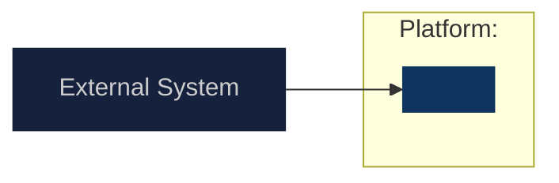
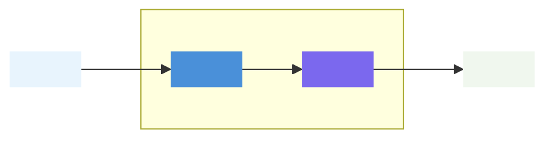
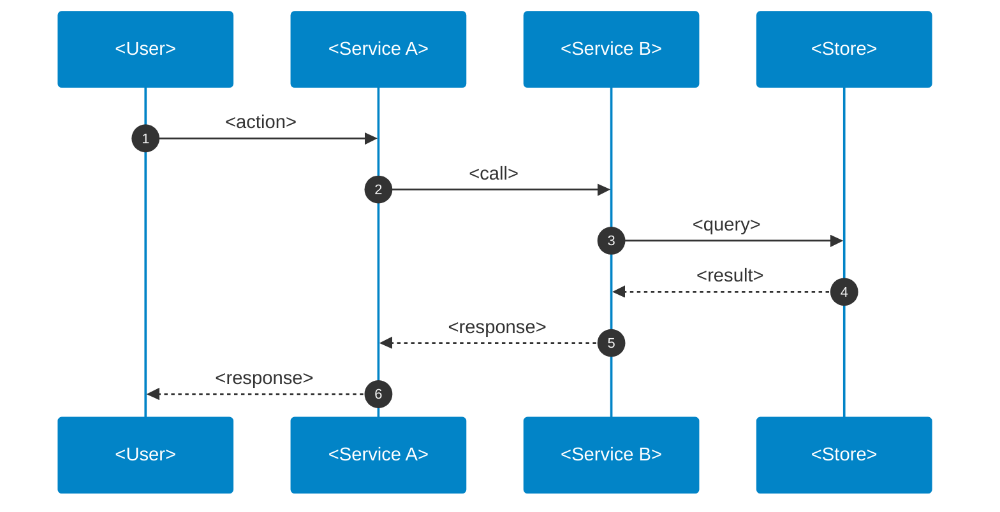

# <TICKET> — Architecture

<!-- DIAGRAM CONVENTIONS
  - System Context: colorful Mermaid flowchart (classDef + styled subgraphs). Never use C4Context.
  - Do NOT embed region names (e.g. eu-west-1) inside diagram nodes or subgraph titles.
  - For AWS service nodes: use official icons from aws-Icon-package via Mermaid @{ img } node syntax.
    Find icon paths in aws-Icon-package/registry.yaml; copy needed icons to docs/public/aws-icons/.
    Use emoji fallback only until VitePress @{ img } support is confirmed.
  - Minimise arrow intersections — prefer LR (left-to-right) layout for wide diagrams.
  - No cylinder node shapes (`[( )]`) — use plain rectangle nodes (`[ ]`) even for stores.
  - No stroke/border on flowchart nodes or subgraphs — set `stroke:none` in every classDef.
    Subgraph grouping itself is fine to keep; it's the visible border that's unwanted.
  - Human roles/titles (e.g. "CTO") do not appear as diagram nodes — sign-off/ownership facts
    belong in the Key Design Decisions table or prose.
  - If the chosen option already has a well-built, color-coded diagram from `design/01 Research*.md`,
    reuse it directly here (only trimming rejected-option nodes) rather than redrawing a simplified
    version from scratch — redrawing loses fidelity and causes rework.
  - Sequence diagrams get a "Flow" heading, not "Data Flow", and a leading mermaid `init` color
    block matching the theme below. Always declare participants with `participant Name as Label`,
    never `actor Name as Label` — Mermaid's stick-figure `actor` type doesn't get the `actorBkg`
    background rectangle, so a white `actorTextColor` renders as invisible white-on-white text.
-->

## System Context

## Component Design

## Flow

## Key Design Decisions

| Decision | Chosen approach | Consequence |
| -------- | --------------- | ----------- |
