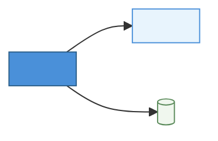
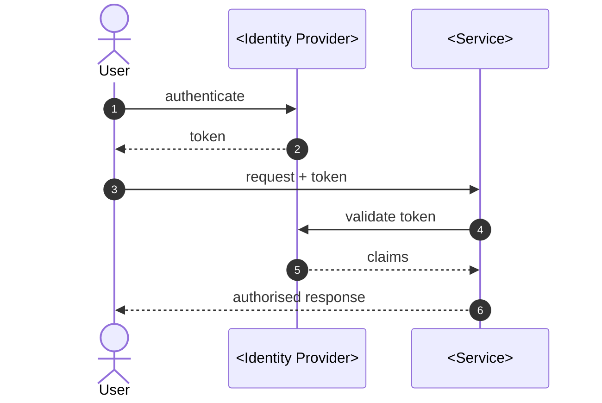

# <TICKET> — Implementation Design

## Approach

_One paragraph describing the implementation approach and the key patterns used._

## Integration Points

| System | Interface | Direction | Notes |
| ------ | --------- | --------- | ----- |

## Security Controls

| Control | Implementation |
| ------- | -------------- |

## Error Handling & Edge Cases

| Scenario | Handling |
| -------- | -------- |

## Observability

| Signal  | What to capture |
| ------- | --------------- |
| Metrics |                 |
| Logs    |                 |
| Traces  |                 |
| Alerts  |                 |

## Testing Strategy

| Layer       | Approach |
| ----------- | -------- |
| Unit        |          |
| Integration |          |
| E2E         |          |
