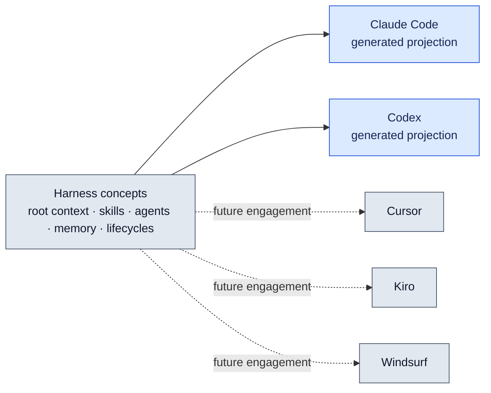

# AI Coding Tool Compatibility

_How the harness concepts map to each AI **coding agent's** primitives — not a comparison of LLM providers (Anthropic / OpenAI / Google)._

> ⚠️ Tool capabilities change rapidly. Verify against current tool docs before relying on this table. Last reviewed: 2026-08.

---

## Where this harness lives today



Claude and Codex are active, independently usable projections of the canonical `.harness/` harness. The other tools remain documented portability targets.

Never edit `CLAUDE.md`, `AGENTS.md`, `.claude/skills/`, `.claude/agents/`, `.agents/skills/`, or `.codex/` directly. Edit `.harness/`, then run:

```bash
# Both providers (default)
yarn harness:generate
yarn harness:check

# One provider only
yarn harness:generate --provider claude
yarn harness:generate --provider codex
yarn harness:check --provider codex
```

`--provider` is repeatable. Generation is deterministic; CI or local checks can use `harness:check` to reject drift across all providers or a selected provider.

---

## Concept map

| Harness concept             | What it does                                                       |
| --------------------------- | ------------------------------------------------------------------ |
| **Root context file**       | Loaded on every session; project instructions, rules, pointers     |
| **Skills / Slash commands** | Encode repeatable conventions; invoked explicitly by the developer |
| **Agents**                  | Specialised subagents with scoped tool access for specific tasks   |
| **Memory**                  | Persistent cross-session context about the project and team        |
| **Lifecycles**              | Multi-phase workflows with human confirmation gates                |

---

## Cross-tool comparison

| Feature                     |         Claude Code         |          Codex CLI          |             Cursor             |         Kiro          |       Windsurf        |
| --------------------------- | :-------------------------: | :-------------------------: | :----------------------------: | :-------------------: | :-------------------: |
| **Root context file**       |          CLAUDE.md          |          AGENTS.md          |     `.cursor/rules/*.mdc`      | `.kiro/steering/*.md` |   `.windsurfrules`    |
| **Slash commands / Skills** | `.claude/skills/*/SKILL.md` | `.agents/skills/*/SKILL.md` | `.cursor/rules/*.mdc` (static) | `.kiro/steering/*.md` | flat `.windsurfrules` |
| **Agents**                  |    `.claude/agents/*.md`    |   `.codex/agents/*.toml`    |      Agent mode (session)      |    `.kiro/hooks/`     |           —           |
| **Persistent memory**       |      `.claude/memory/`      |              —              |               —                |    steering files     |   Cascade Memories    |
| **Confirmation gates**      |   Skill + persisted state   |   Skill + persisted state   |       Prompt discipline        |  ✅ (task approval)   |   Prompt discipline   |
| **Event hooks**             |    ✅ (`settings.json`)     |             ❌              |               ❌               |          ✅           |          ❌           |
| **Template files**          |    ✅ (companion files)     |    ✅ (companion files)     |               ❌               |          ❌           |          ❌           |
| **Directory-scoped rules**  |  ✅ (`CLAUDE.md` cascade)   |  ✅ (`AGENTS.md` cascade)   |       ✅ (glob patterns)       |          ❌           |          ❌           |

---

## Canonical source and projections

`.harness/` is the only source of truth:

- `.harness/instructions.md` — shared project instructions
- `.harness/skills/` — complete skill bundles, including scripts, references, templates, and assets
- `.harness/agents/` — shared specialist-agent definitions
- `.harness/mcp.json` — shared MCP server declarations
- `.harness/manifest.json` — provider output mapping

The generator renders complete root instructions rather than pointer files, so safety and project rules do not depend on either tool following a cross-file reference. Claude skill invocations remain `/skill`; Codex projections use `$skill`. Canonical relative skill paths use `{{skills_root}}` and are resolved per provider.

The `dev`, `design`, and `discovery` orchestrators persist their resume state in repository artifacts. Both tools therefore use the same phase order, completion evidence, correction loops, and human confirmation gates without relying on conversation memory.

---

## Tool-specific notes

**Kiro** — the closest harness-native tool. Specs map to the Dev lifecycle: `requirements.md` ≈ `1-plan.md`, `tasks.md` ≈ the Progress table. Hooks fire on file save and test failure (similar to Claude Code's PostToolUse hooks). Steering files are always-loaded — use them for project conventions.

**Codex** — loads `AGENTS.md`, discovers `.agents/skills/`, and loads project custom agents from generated `.codex/agents/*.toml` files. Canonical read-only tools map to `sandbox_mode = "read-only"`; any write or shell capability maps to `workspace-write`. Because Codex does not expose Claude's per-agent tool allowlist, narrower role and path restrictions are also rendered into `developer_instructions`. MCP declarations are rendered into `.codex/config.toml`.

**Cursor** — rule files use YAML frontmatter (`description`, `globs`, `alwaysApply`). Slash commands are now supported. Confirmation gates are not native — lifecycle phases must be enforced by prompt discipline ("tell me to continue before I proceed").

**Claude Code** — loads `CLAUDE.md`, `.claude/skills/`, `.claude/agents/`, and `.mcp.json`. Hooks in `settings.json` remain a provider-specific enhancement.

**Windsurf** — `.windsurf/rules/` directory is supported alongside the flat `.windsurfrules`. No native agents or confirmation gates.

---

## Portability floor

The following work regardless of tool — they are file-system conventions, not tool-dependent:

- The `docs/` four-tier structure (HLD / LLD / Engineering Guide / Stories)
- The certainty principle
- The `Documentation/01 Principles.md` doc-type cheat sheet
- A single canonical root context file at `.harness/instructions.md`
- Canonical `SKILL.md` bundles at `.harness/skills/`
- Persisted workflow state and human approval gates in ordinary repository artifacts
