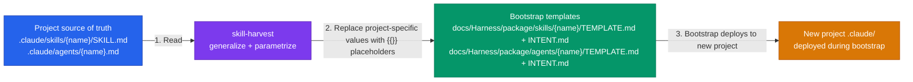

The developer wants to sync a modified project skill or agent back to the harness bootstrap templates. Here is their input:

---

## $ARGUMENTS

---

> ⚠️ Follow every step in order. Do not skip, summarize, or improvise. If you are unsure, ask before deviating.

## Overview

This skill ports improvements made in `.claude/` back into `docs/Harness/package/` so they can be deployed to future projects. The project's `.claude/` files are always the source of truth; the bootstrap holds the generic, parametrized form.



The rule: **project `.claude/` files are the source of truth for what the skill does; bootstrap files are the generic form that can be re-deployed to any project.**

---

## Step 1 — Determine target

Parse `$ARGUMENTS`:

- If a skill name (e.g. `dev-implement`): look for `.claude/skills/{name}/SKILL.md`
- If an agent name (e.g. `auth`): look for `.claude/agents/{name}.md`
- If a file path: read directly
- If no argument: ask the developer which skill or agent to harvest

If the target file does not exist in `.claude/`, check whether it was deleted:

> "The file `.claude/skills/{name}/SKILL.md` no longer exists. Was this skill deleted? (**yes — remove from bootstrap** / **no — file path was wrong**)"

**Stop and wait.**

---

## Step 2 — Read both sides

Read, in full:

1. **Project file**: `.claude/skills/{name}/SKILL.md` (or `.claude/agents/{name}.md`)
2. **Bootstrap TEMPLATE.md**: `docs/Harness/package/skills/{name}/TEMPLATE.md` — if it exists
3. **Bootstrap INTENT.md**: `docs/Harness/package/skills/{name}/INTENT.md` — if it exists

If neither bootstrap file exists → this is a **new skill** not yet in the bootstrap. Go to Step 3 (new) path.

If both exist → this is an **update**. Go to Step 3 (update) path.

---

## Step 3 — Generalize the project file

**New skill path:**

Create TEMPLATE.md and INTENT.md from scratch using the project file as the source:

- TEMPLATE.md = the project file with project-specific values replaced by `{{}}` placeholders (see substitution rules below)
- INTENT.md = the standard INTENT.md structure with:
  - Purpose derived from the skill's opening paragraph
  - Substitutions table listing every `{{}}` placeholder and where it comes from
  - Conditionals (if any are implied by the skill logic)
  - Verify checklist (key correctness checks for the skill's critical paths)

**Update path:**

Identify what changed between the current project file and the existing TEMPLATE.md:

1. Show a summary of what changed (additions, removals, rephrasings)
2. For each change, decide: is this **project-specific** (should become a `{{}}` placeholder in TEMPLATE.md) or **generic** (should be applied verbatim to TEMPLATE.md)?

**Substitution rules — replace with `{{}}` placeholders:**

| What you see in the project file                                     | Replace with                                                     |
| -------------------------------------------------------------------- | ---------------------------------------------------------------- |
| Project ticket prefix (e.g. `ADLC`, `ND`)                            | `{{PROJECT_KEY}}`                                                |
| Jira transition IDs (numeric, e.g. `4`, `721`)                       | `{{JIRA_TRANSITION_{NAME}}}`                                     |
| Specific agent names that are project-defined (e.g. `@auth`, `@web`) | `{{BACKEND_AGENT}}`, `{{FRONTEND_AGENT}}`, etc. — as appropriate |
| NX project names in build commands (e.g. `site lambda-auth`)         | `{{NX_BUILD_PROJECTS}}` or `{{NX_DB_MIGRATE_CMD}}`               |
| WAF framework name (e.g. "AWS Well-Architected Framework")           | `{{WAF_FRAMEWORK}}`                                              |
| WAF pillar table rows                                                | `{{WAF_PILLARS_TABLE}}`                                          |
| Confluence space or org-specific URLs                                | remove or genericize                                             |

**Keep verbatim (do not parametrize):**

- Structural patterns: stop-and-wait blocks, phase trackers, glob patterns, numbered step sequences
- Standard agent names that are always present: `@architect`
- File path patterns under `docs/` (these are harness-standard)
- All quoted developer-facing messages (exact wording matters)

---

## Step 3c — Determine the version bump

Apply the bootstrap template versioning rule — read `.claude/skills/skill-authoring.md` (rules 14–16, "Bootstrap template versioning").

Classify the aggregate of this harvest's changes and compute the new `metadata.version` for `TEMPLATE.md`'s frontmatter:

- **patch** — wording, clarification, typo fixes; no behavior change
- **minor** — new steps, new sections, new optional behavior; backward compatible
- **major** — renamed/removed frontmatter keys or `{{}}` placeholders, restructured steps that change what a deployed skill does

If `TEMPLATE.md` has no `metadata.version` yet (new skill, or predates this rule), start at `0.1.0`.

---

## Step 4 — Present proposed changes for confirmation

**Do not write any file yet.**

Present the proposed changes as a clear diff:

> "Here are the proposed updates to `docs/Harness/package/skills/{name}/`:
>
> **Version bump:** `<old version> → <new version>` (<patch|minor|major> — see `.claude/skills/skill-authoring.md`)
>
> **TEMPLATE.md changes:**
>
> ```diff
> - <line before>
> + <line after>
> ```
>
> **INTENT.md changes:**
>
> - Substitutions table: added/updated `{{PLACEHOLDER}}` — `{source}`
> - Verify checklist: added/removed check
>
> Do these look right? (**yes** to write / **no** to discuss)"

**Stop and wait for confirmation.** If the developer requests corrections, apply them and re-present before writing.

---

## Step 5 — Write the updated bootstrap files

After the developer confirms:

1. Write the updated `docs/Harness/package/skills/{name}/TEMPLATE.md`, including the bumped `metadata.version` from Step 3c
2. Write the updated `docs/Harness/package/skills/{name}/INTENT.md`

For the **deletion case** (project file was deleted and developer confirmed):

- Ask: "Remove `docs/Harness/package/skills/{name}/` entirely, or archive it? (**remove** / **archive**)"
- **Stop and wait.**
- If remove: present the command `rm -rf docs/Harness/package/skills/{name}/` and ask the developer to run it
- If archive: move to `docs/Harness/package/skills/archive/{name}/` using `git mv`

---

## Step 6 — Report back

Tell the developer:

- Which bootstrap files were updated (paths)
- A one-line summary of what changed
- If new `{{}}` placeholders were added: remind them that the bootstrap substitution algorithm will need to resolve these — check that they are covered by Q1–Q11 or that the INTENT.md instructs the bootstrap AI to ask a supplementary question

Then:

> "Bootstrap templates updated. Commit with:
>
> ````
> chore(harness): sync {name} bootstrap template
> ```"
> ````
