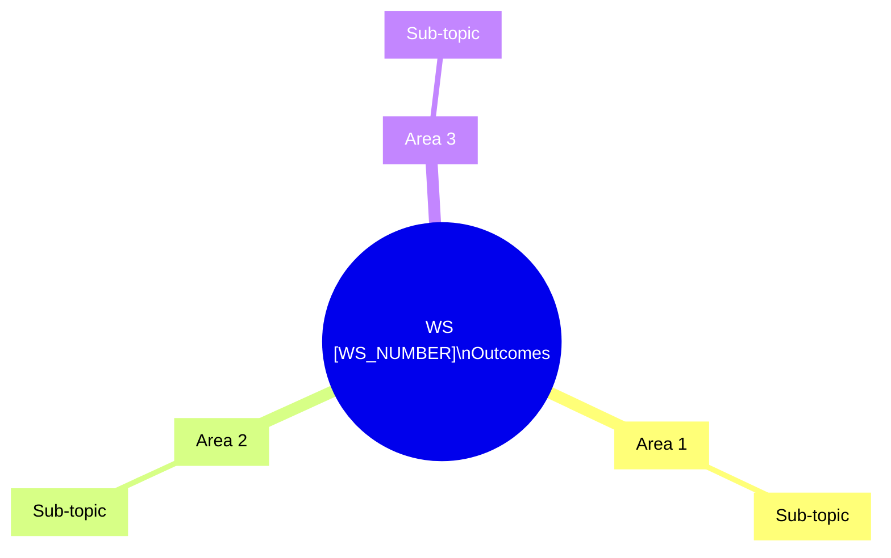
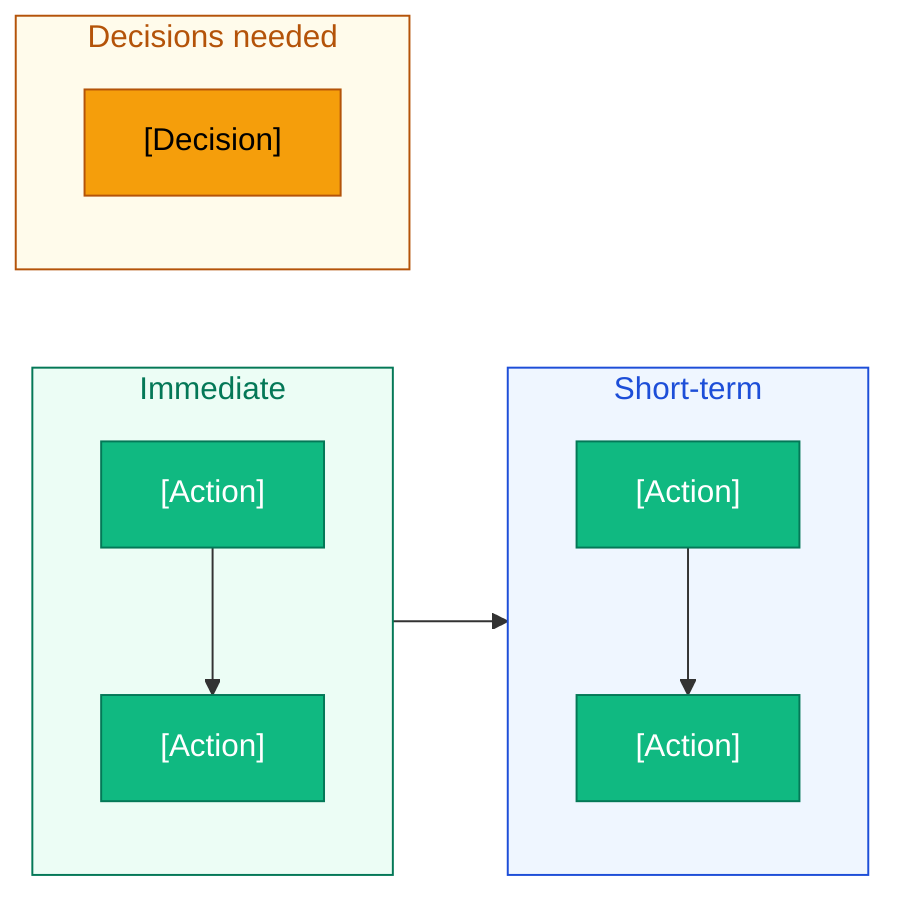

# Outcomes — [WS_NUMBER] · [DATE]

_Live capture during session + post-session synthesis._

---

## Summary

[3-5 sentence synthesis: what was covered, what the session established, what it did not reach.]

---

## Areas & Topics

_Captured live during the brainstorm._

| Legend | Reception                                             | Priority |
| ------ | ----------------------------------------------------- | -------- |
| 🟢     | Energised — team leaned in, asked follow-up questions | High     |
| 🟡     | Neutral — acknowledged, no strong reaction            | Med      |
| 🔴     | Flat — dismissed, felt abstract or irrelevant         | Low      |

| #   | Area / Topic | Reception    | Priority         |
| --- | ------------ | ------------ | ---------------- |
| 1   |              | 🟢 / 🟡 / 🔴 | High / Med / Low |

---

## Findings

_Post-session. One sub-section per area that generated signal._

### [Area Title]

[Narrative finding — what was learned, what was confirmed, what surprised. Add a flowchart below if a process or flow was discussed, otherwise remove the block.]

---

## Next Steps

| Legend   | Meaning                           |
| -------- | --------------------------------- |
| 🟢 Green | Immediate action — start now      |
| 🔵 Blue  | EFF6FF — short-term action        |
| 🟡 Amber | Decision needed before proceeding |

|                  | Item          | Owner | By  |
| ---------------- | ------------- | ----- | --- |
| ✅ Action        | [description] |       |     |
| 🔵 Decision      | [description] |       |     |
| 📋 Carry-forward | [description] |       |     |
