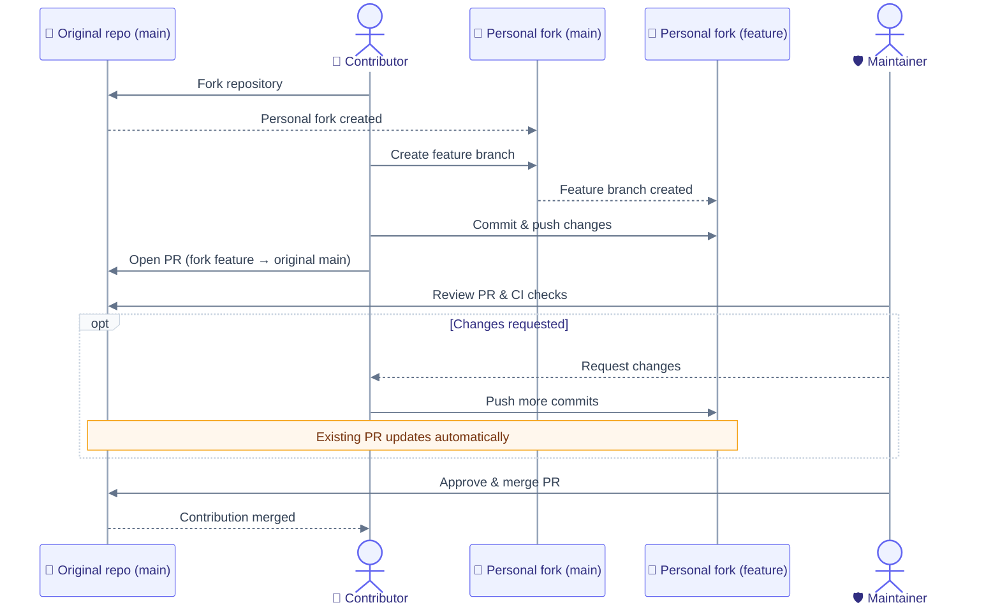

# Contributing

Thanks for considering a contribution. This project is DataArt's Artisyn Implementation Harness — an
AI-first engineering lifecycle system (skills, agents, and conventions). This repository
contains the harness itself, not client or application code; the harness can be installed
into other projects.

## Before you start

- For anything beyond a small fix, open an issue first to discuss the change. This
  avoids wasted work on something that doesn't fit the project's direction.
- Check `docs/Harness/` for the harness architecture and conventions before proposing
  changes to a skill, agent, or convention.

## Getting set up

```bash
nvm use              # picks up .nvmrc → Node 24
corepack enable       # activates Yarn 4 via packageManager field
yarn install          # installs all workspace deps
```

See `docs/Engineering Guide/05 Getting Started.md` for the full local setup and daily
commands.

## Fork workflow

If you do not have push access to this repository, contribute through a personal fork. In the diagram, **Original repo** means `dataart/artisyn-implementation-harness`; **Personal fork** means `{name}/artisyn-implementation-harness`.



Maintainers with push access can skip the fork and branch directly in this repo.

## Making a change

- Branch from `main`: `<type>/short-description` (e.g. `fix/skill-metadata-gap`).
- Commit format: `<type>(<scope>): <what changed>` — types: `feat`, `fix`, `docs`,
  `refactor`, `test`, `chore`, `ci`, `revert`. Summarize the change in the subject; explain the
  motivation in the commit body when needed.
- Keep a change scoped to one concern. Don't bundle an unrelated refactor with a fix.
- Run the same checks CI runs, scoped to what changed: `yarn nx affected --target=lint`
  and `yarn nx affected --target=typecheck`. See
  `docs/Engineering Guide/09 CI-CD.md` for the full pipeline.

## Versioning and patches

The harness package (`skills/implementation-harness/`) is the only thing this repository
releases. Its version and its changelog come from your commit messages, and you stamp them in
your PR. The release itself is built on merge and published after a maintainer approves it.

### Commits that touch the harness

A commit that changes `skills/implementation-harness/`, `.claude-plugin/`, `.agents/plugins/`
or `skills.sh.json` uses scope `harness`, for example `fix(harness): handle an empty state root`.
The commit hook and the `docs-gate` CI job check this. The type decides the next version:

| Commit                                              | Version bump | In the changelog   |
| --------------------------------------------------- | ------------ | ------------------ |
| `feat(harness): …`                                  | minor        | Features           |
| `fix(harness): …`                                   | patch        | Bug Fixes          |
| `feat(harness)!: …` or a `BREAKING CHANGE:` footer  | major        | ⚠ BREAKING CHANGES |
| `docs`, `refactor`, `chore`, `ci`, `test` (harness) | none         | not listed         |

Write the subject for the people who install the harness. It appears as is in the changelog and
in the GitHub Release notes.

### Stamping the version in your PR

1. Make your harness changes and commit them.
2. Run `yarn harness:version`. It works out the version from the latest harness tag and your
   commits. It writes it into the package `package.json`, `SKILL.md`, `plugin.json` and both
   marketplace files, and adds the changelog entry.
3. Commit the result as `chore(harness-release): <version>` and push.
4. If you add more harness commits later, run `yarn harness:version` again and commit. A re-run
   replaces the entry; it never adds a second one.

The `version-gate` CI job fails when the branch is not stamped with the version its commits call
for. It also fails while `main` carries a release that is still waiting for approval: wait for
that release, update your branch, then run `yarn harness:version` again. A PR that does not touch
the harness needs no stamp.

Don't edit the generated changelog entry by hand unless you are about to merge: the next
`yarn harness:version` run would replace your edit.

After the merge, the release workflow builds and attests the package. A maintainer approves the
`release` environment, and the workflow then tags the version and publishes it to its channels.
See `docs/Engineering Guide/08 Harness Release Runbook.md`.

### Patch bundles

Projects that installed the harness receive changes through patch bundles, not by reinstalling.
When you change the canonical sources, package the change with the harness skill:

| Command                                 | Use it when                                                                           |
| --------------------------------------- | ------------------------------------------------------------------------------------- |
| `/implementation-harness patch prepare` | You edited canonical files directly and want a bundle to review or carry to a project |
| `/implementation-harness patch harvest` | You improved this repo's deployed skills and want the improvement back in canonical   |
| `/implementation-harness patch apply`   | You want canonical changes deployed into a project (this repo or another one)         |

Each bundle is a folder in `skills/implementation-harness/patch/` with a row in
`patch/REGISTRY.md`. Commit the bundle together with the canonical change it describes. Bundles
are immutable: never edit one after it is committed; make a new bundle instead. Keep the slug in
the folder name short, because installed paths must stay under the Windows 260-character limit.
The procedures are in `skills/implementation-harness/references/patch/`.

## Submitting a pull request

- `main` is a protected branch. Every change — from a maintainer or an external
  contributor — merges through a pull request and requires an approving review before
  merge. Nobody merges their own PR unreviewed.
- CI must pass. A PR with failing checks won't be merged.
- Describe what changed and why in the PR description; link the issue it addresses.
  The pull request template walks through this.
- A change to the website also goes through the keyboard, reduced-motion and phone-width
  checks in [`ACCESSIBILITY.md`](ACCESSIBILITY.md).
- A maintainer may ask for changes or close a PR that doesn't fit the project's
  direction — that isn't a judgment on the contribution's quality.

## Reporting a security issue

Do not open a public issue for a security vulnerability. Email
`InfoSec.Helpdesk@dataart.com` (or `securityincident@dataart.com` for an active
incident) with what you found and how to reproduce it. See [`SECURITY.md`](SECURITY.md) for
reporting guidance.

## License

By contributing, you agree that your contribution is licensed under this repository's
`LICENSE.md`.
