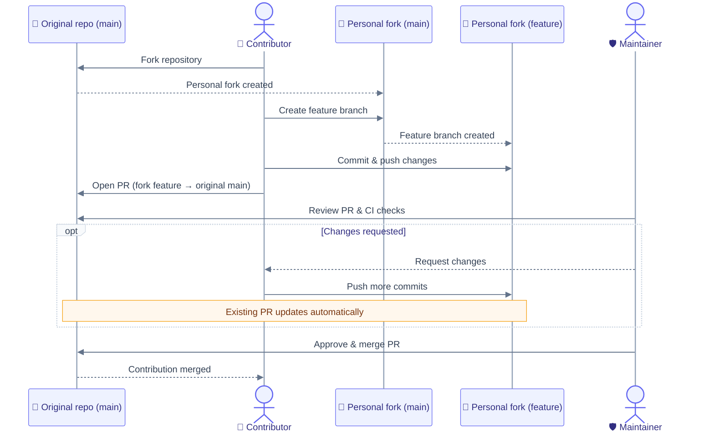

# Contributing

Thanks for considering a contribution. This project is DataArt's Artisyn Implementation Harness — an
AI-first engineering lifecycle system (skills, agents, and conventions). This repository
contains the harness itself, not client or application code; the harness can be installed
into other projects.

## Before you start

- For anything beyond a small fix, open an issue first to discuss the change. This
  avoids wasted work on something that doesn't fit the project's direction.
- Check `docs/Harness/` for the harness architecture and conventions before proposing
  changes to a skill, agent, or convention.

## Getting set up

```bash
nvm use              # picks up .nvmrc → Node 24
corepack enable       # activates Yarn 4 via packageManager field
yarn install          # installs all workspace deps
```

See `docs/Engineering Guide/05 Getting Started.md` for the full local setup and daily
commands.

## Fork workflow

If you do not have push access to this repository, contribute through a personal fork. In the diagram, **Original repo** means `dataart/artisyn-implementation-harness`; **Personal fork** means `{name}/artisyn-implementation-harness`.



Maintainers with push access can skip the fork and branch directly in this repo.

## Making a change

- Branch from `main`: `<type>/short-description` (e.g. `fix/skill-metadata-gap`).
- Commit format: `<type>(<scope>): <what changed>` — types: `feat`, `fix`, `docs`,
  `refactor`, `test`, `chore`. Summarize the change in the subject; explain the
  motivation in the commit body when needed.
- Keep a change scoped to one concern. Don't bundle an unrelated refactor with a fix.
- Run the same checks CI runs, scoped to what changed: `yarn nx affected --target=lint`
  and `yarn nx affected --target=typecheck`. See
  `docs/Engineering Guide/Infrastructure/03 CI-CD Pipeline.md` for the full pipeline.

## Submitting a pull request

- `main` is a protected branch. Every change — from a maintainer or an external
  contributor — merges through a pull request and requires an approving review before
  merge. Nobody merges their own PR unreviewed.
- CI must pass. A PR with failing checks won't be merged.
- Describe what changed and why in the PR description; link the issue it addresses.
- A maintainer may ask for changes or close a PR that doesn't fit the project's
  direction — that isn't a judgment on the contribution's quality.

## Reporting a security issue

Do not open a public issue for a security vulnerability. Email
`InfoSec.Helpdesk@dataart.com` (or `securityincident@dataart.com` for an active
incident) with what you found and how to reproduce it. See [`SECURITY.md`](SECURITY.md) for
reporting guidance.

## License

By contributing, you agree that your contribution is licensed under this repository's
`LICENSE.md`.
