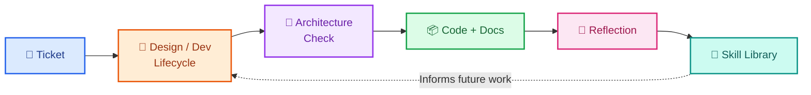
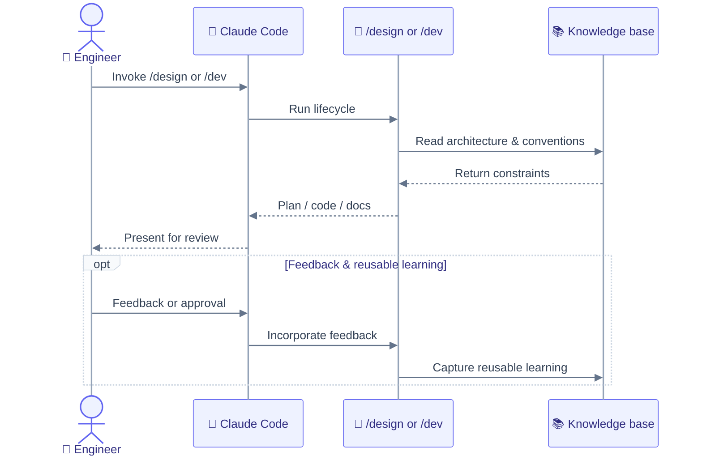

# Artisyn Implementation Harness

DataArt's AI-first engineering lifecycle system — a structured workflow layered on an AI coding assistant. Instead of prompting the assistant ad-hoc, work runs through specialised, lifecycle-aware agents governed by encoded conventions (skills) and feedback loops (reflections → skill library).

This repo is the harness's canonical source: it runs its own development through the harness, and the harness itself is portable — `.canonical-implementation-harness/` is the self-contained package that instantiates it in any project.

## The problem it solves

Ad-hoc prompting doesn't accumulate. Every ticket re-explains conventions, re-derives architecture, and re-learns mistakes the last ticket already made. This harness closes that loop: each ticket's decisions and corrections convert into skills and conventions the next ticket inherits.



The result is four benefits: **repeatability** (the same lifecycle steps run every ticket), **convergence** (conventions discovered on one ticket become skills inherited by the next), **architecture coherence** (planning is audited against target architecture before code is written), and **documentation consistency** (each ticket updates the same permanent docs, instead of drifting into one-off notes).

## Designed for the long run

Anthropic's research, [Harness design for long-running application development](https://www.anthropic.com/research/harness-design-long-running-apps), frames a spectrum — a minimal "solo" harness is fast and cheap per task; a "full" harness costs more time and compute up front (context management, review gates, convention enforcement) and earns that cost back across long-running, multi-session, compounding work.

This repo is built at the full-harness end of that spectrum, deliberately. It is not the right tool for a single quick throwaway prompt — reach for this when the work spans multiple tickets, multiple contributors, or a codebase that needs to stay coherent over time.

## How to work with it

New here? Run `@onboarding` inside Claude Code — a conversational, read-only walkthrough that orients you without running any commands.

Bring the harness into a new project:

```
/harness-bootstrap launch
```

Run a ticket through the harness:

```
/design TKT-XXX <topic>   # solution design
/dev TKT-XXX <task>        # implement a ticket
```



## Local setup

```bash
nvm use              # picks up .nvmrc → Node 24
corepack enable      # activates Yarn 4 via packageManager field
yarn install         # installs all workspace deps
```

Fill in your MCP credentials in `.claude/settings.local.json`'s `env` block, then launch Claude Code — no shell sourcing step needed:

```bash
claude
```

→ See `docs/Engineering Guide/05 Getting Started.md` for the full command reference and `docs/Engineering Guide/06 MCP Setup.md` for the credentials guide.

## Where to go next

| Doc                                                                                    | What it covers                                                  |
| -------------------------------------------------------------------------------------- | --------------------------------------------------------------- |
| [docs/Harness](docs/Harness/index.md)                                                  | The harness's own self-description                              |
| [docs/Harness/00 The Story](<docs/Harness/00 The Story/index.md>)                      | Why it exists — the industry-wide problem and the mindset shift |
| [docs/Harness/02 Quick Start](<docs/Harness/02 Quick Start/index.md>)                  | Bringing the harness into a project                             |
| [docs/Harness/03 Lifecycles](<docs/Harness/03 Lifecycles/00 Overview.md>)              | The four lifecycles that structure all work                     |
| [docs/Engineering Guide/01 Conventions.md](<docs/Engineering Guide/01 Conventions.md>) | Commit format, branch naming, portable conventions              |
| [docs/README.md](docs/README.md)                                                       | Full documentation index                                        |

## Contributing

Want to propose a change? See [`CONTRIBUTING.md`](CONTRIBUTING.md) for branching, commit format, and the PR process, and [`CODE_OF_CONDUCT.md`](CODE_OF_CONDUCT.md) for community expectations. Found a security issue? See [`SECURITY.md`](SECURITY.md).
