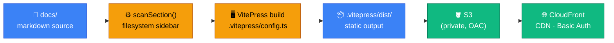

# web-docs

VitePress 1.x docs site serving `docs/` as this repo's documentation — the Harness itself,
Target Architecture (HLD), System Architecture (LLD), and Engineering Guide. Mermaid diagram
rendering included.



## Targets

| Target      | Command                          | Output                           |
| ----------- | -------------------------------- | -------------------------------- |
| `serve`     | `yarn nx run web-docs:serve`     | Dev server → localhost:5173      |
| `build`     | `yarn nx run web-docs:build`     | `apps/web-docs/.vitepress/dist/` |
| `preview`   | `yarn nx run web-docs:preview`   | Preview production build         |
| `typecheck` | `yarn nx run web-docs:typecheck` | TypeScript check (no emit)       |
| `lint`      | `yarn nx run web-docs:lint`      | ESLint on `.vitepress/**`        |

## Config

`.vitepress/config.ts` — sidebar auto-scanned via `scanSection()` at build time; numeric prefixes
stripped by `prettify()`. No config change needed when docs are added or removed.

`HLD_VERSION` in `config.ts` is the single variable to bump when a new Target Architecture version
is published.

## Run locally

```bash
yarn install
yarn nx run web-docs:serve    # → http://localhost:5173
```

## Links

→ `docs/Target Architecture (HLD)/v1/Containers/Web Docs.md` — HLD for this container (content structure, nav model, NFRs)
→ `docs/Target Architecture (HLD)/v1/Containers/Discuss.md` — HLD for the giscus comments integration
→ `docs/System Architecture (LLD)/Discuss/00. Overview.md` — LLD: theme component structure, giscus comments integration
