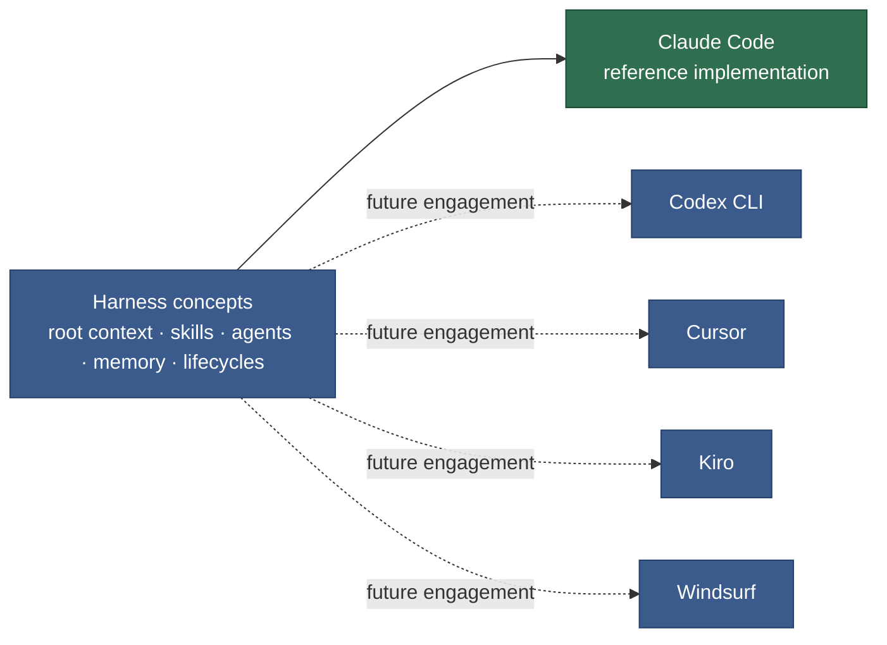

# AI Coding Tool Compatibility

_How the harness concepts map to each AI **coding agent's** primitives — not a comparison of LLM providers (Anthropic / OpenAI / Google)._

> ⚠️ Tool capabilities change rapidly. Verify against current tool docs before relying on this table. Last reviewed: 2026-08.

---

## Where this harness lives today

This project runs on Claude Code only (solid line). The other tools (dashed) are documented so the harness's design stays portable to a different coding agent if this project ever needs one — see [Portability floor](#portability-floor).

---

## Concept map

| Harness concept             | What it does                                                       |
| --------------------------- | ------------------------------------------------------------------ |
| **Root context file**       | Loaded on every session; project instructions, rules, pointers     |
| **Skills / Slash commands** | Encode repeatable conventions; invoked explicitly by the developer |
| **Agents**                  | Specialised subagents with scoped tool access for specific tasks   |
| **Memory**                  | Persistent cross-session context about the project and team        |
| **Lifecycles**              | Multi-phase workflows with human confirmation gates                |

---

## Cross-tool comparison

| Feature                     |         Claude Code         |        Codex CLI         |             Cursor             |         Kiro          |       Windsurf        |
| --------------------------- | :-------------------------: | :----------------------: | :----------------------------: | :-------------------: | :-------------------: |
| **Root context file**       |          CLAUDE.md          |        AGENTS.md         |     `.cursor/rules/*.mdc`      | `.kiro/steering/*.md` |   `.windsurfrules`    |
| **Slash commands / Skills** | `.claude/skills/*/SKILL.md` |   `skills/*/SKILL.md`    | `.cursor/rules/*.mdc` (static) | `.kiro/steering/*.md` | flat `.windsurfrules` |
| **Agents**                  |    `.claude/agents/*.md`    |            —             |      Agent mode (session)      |    `.kiro/hooks/`     |           —           |
| **Persistent memory**       |      `.claude/memory/`      |            —             |               —                |    steering files     |   Cascade Memories    |
| **Confirmation gates**      |          ✅ native          |            ❌            |               ❌               |  ✅ (task approval)   |          ❌           |
| **Event hooks**             |    ✅ (`settings.json`)     |            ❌            |               ❌               |          ✅           |          ❌           |
| **Template files**          |    ✅ (companion `.md`)     |            ❌            |               ❌               |          ❌           |          ❌           |
| **Directory-scoped rules**  |  ✅ (`CLAUDE.md` cascade)   | ✅ (`AGENTS.md` cascade) |       ✅ (glob patterns)       |          ❌           |          ❌           |

---

## CLAUDE.md — the canonical root (this project)

**This project is Claude-Code-only.** CLAUDE.md holds the real root-context content directly — there's no separate AGENTS.md wrapper or symlink to maintain.

The table below shows how each tool names and wires its own root context file, for reference if this harness is ever extended beyond Claude Code — not as active configuration in this repo:

| Tool        | Root context file     | How it would wire back to CLAUDE.md                                      |
| ----------- | --------------------- | ------------------------------------------------------------------------ |
| Claude Code | `CLAUDE.md`           | — (this is the canonical file)                                           |
| Codex CLI   | `AGENTS.md`           | `AGENTS.md` → one-liner: `→ See CLAUDE.md for project instructions.`     |
| Cursor      | `.cursor/rules/*.mdc` | `.cursor/rules/project.mdc` with `alwaysApply: true` → `→ See CLAUDE.md` |
| Kiro        | `.kiro/steering/*.md` | `.kiro/steering/project.md` → mirror CLAUDE.md's WHAT section            |
| Windsurf    | `.windsurfrules`      | First line → `See CLAUDE.md for project conventions.`                    |

---

## Tool-specific notes

**Kiro** — the closest harness-native tool. Specs map to the Dev lifecycle: `requirements.md` ≈ `1-plan.md`, `tasks.md` ≈ the Progress table. Hooks fire on file save and test failure (similar to Claude Code's PostToolUse hooks). Steering files are always-loaded — use them for project conventions.

**Codex CLI** — `AGENTS.md` files cascade up the directory tree. This enables per-layer rules: `apps/serving/bff/AGENTS.md` for BFF-specific conventions, without touching the root.

**Cursor** — rule files use YAML frontmatter (`description`, `globs`, `alwaysApply`). Slash commands are now supported. Confirmation gates are not native — lifecycle phases must be enforced by prompt discipline ("tell me to continue before I proceed").

**Claude Code** — the reference implementation. All harness concepts have direct primitives. Hooks in `settings.json` automate nudges (e.g. fire a reflection prompt when a commit is detected).

**Windsurf** — `.windsurf/rules/` directory is supported alongside the flat `.windsurfrules`. No native agents or confirmation gates.

---

## Portability floor

The following work regardless of tool — they are file-system conventions, not tool-dependent:

- The `docs/` four-tier structure (HLD / LLD / Engineering Guide / Stories)
- The certainty principle
- The `07 Documentation Principles.md` doc-type cheat sheet
- A single canonical root context file (`CLAUDE.md` in this project — would be `AGENTS.md` if this repo used Codex CLI instead)
- Skill files in `docs/Harness/package/skills/` (SKILL.md format is now cross-tool standard)
