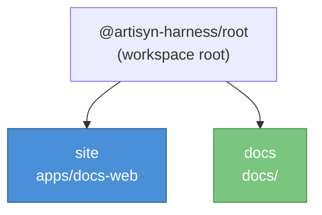

# Getting Started

_First-time setup and daily commands for the ADLC Discovery Tool monorepo._

---

## Workspace layout



| NX project | Path            | Stack     | Purpose                        |
| ---------- | --------------- | --------- | ------------------------------ |
| `site`     | `apps/docs-web` | VitePress | Documentation site             |
| `docs`     | `docs/`         | Markdown  | Content library (implicit dep) |

---

## Prerequisites

| Tool       | Version | Install           |
| ---------- | ------- | ----------------- |
| Node.js    | `>=24`  | `nvm install 24`  |
| Yarn       | `4.x`   | `corepack enable` |
| GitHub CLI | any     | `brew install gh` |

Authenticate `gh` once installed: `gh auth login`.

---

## First-time setup

```bash
nvm use              # picks up .nvmrc → Node 24
corepack enable      # activates Yarn 4 via packageManager field
yarn install         # installs all workspace deps
```

---

## Run apps

```bash
# Docs site — live reload dev server
yarn nx run site:serve

# Docs site — production build
yarn nx run site:build
```

---

## Code quality

```bash
yarn format             # format all files with Prettier
yarn format:check       # check formatting without writing
yarn lint               # ESLint across the workspace

yarn nx run site:typecheck          # TypeScript check — docs site
```

---

## Claude Code (AI assistant)

This project uses Claude Code with MCP servers for AWS, GitHub, and Atlassian access. Credentials live in `.claude/settings.local.json`'s `env` block (gitignored, per-developer) — fill them in once, then just launch:

```bash
claude
```

Claude Code loads `.claude/settings.local.json` on session start and resolves `.mcp.json`'s `${VAR}` references from it — no `.env` file or shell `source` step needed.

See `06 MCP Setup.md` for the full credentials guide.

---

## Common NX commands

| Command                                              | What it does                               |
| ---------------------------------------------------- | ------------------------------------------ |
| `yarn nx show projects`                              | List all registered projects               |
| `yarn nx graph`                                      | Open interactive dependency graph          |
| `yarn nx run <project>:<target>`                     | Run a target for one project               |
| `yarn nx run <project>:<target> --configuration=dev` | Run with environment config                |
| `yarn nx affected --target=<target>`                 | Run target on projects affected by changes |
| `yarn nx reset`                                      | Clear the local NX computation cache       |

---

→ See `01 Conventions.md` for commit format and branch naming.
→ See `03 Engineer Role.md` for the AI-assisted dev workflow.
→ See `04 AI Coding Tool Compatibility.md` for slash commands and agent roles.
→ See `06 MCP Setup.md` to connect Claude Code to AWS, GitHub, and Atlassian.
