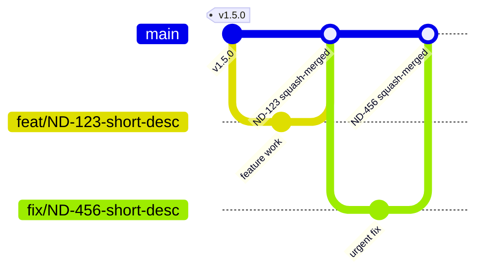

# Branching Strategy

The branching workflow is **trunk-based**, aligned with this project's actual CI/CD automation
(`ci.yml` on pull request, `cd.yml` on merge to `main`). There is one long-lived branch — `main` —
and all work happens on short-lived branches cut from it and merged straight back in. Nothing
reaches the deployed site without passing through the PR's required CI checks first.

## Flow

Each merge commit needs its own custom `id` — Mermaid's `gitGraph` rejects a duplicate commit id
across the whole diagram, so reusing a generic label like `"PR squash-merged"` for every merge fails
to render; scope the id to the actual branch or ticket.

## Environment Mapping

| Branch Type        | Environment Target | Notes                                                                                                                                                                                                                  |
| ------------------ | ------------------ | ---------------------------------------------------------------------------------------------------------------------------------------------------------------------------------------------------------------------- |
| `main`             | `dev`              | `cd.yml` runs on every merge, but its deploy step is currently a retirement stub (no-op) — the AWS deploy mechanism was removed with the Infrastructure container, and no replacement (GitHub Pages) deploy exists yet |
| `feat/*` / `fix/*` | None (PR only)     | Validated by `ci.yml`; no preview environment is provisioned per branch                                                                                                                                                |

There is no separate `develop`/`staging`/`production` branch or environment today — one GitHub
Actions environment (`dev`) backs the whole pipeline, though it currently deploys nothing. A Dev →
Staging → Prod promotion chain is a reasonable future addition, not a default.

## Naming Conventions

- **Branches:** `<type>/short-description` (e.g. `feat/ND-123-oidc-role-split`), per
  [`01 Conventions.md`](./01%20Conventions.md)
- **Commits:** [Conventional Commits](https://www.conventionalcommits.org/en/v1.0.0/#summary) —
  `<type>(<scope>): <what>`, per the same conventions doc
- **Tags:** `vX.Y.Z` — created automatically by `semantic-release` on every merge to `main` (`.github/workflows/release.yml`), driven by Conventional Commits; never created by hand

## CI/CD by Branch

| Trigger               | Runs                                                                                                                                                                |
| --------------------- | ------------------------------------------------------------------------------------------------------------------------------------------------------------------- |
| `feat/*` / `fix/*` PR | `ci.yml` — audit, lint, typecheck, test, build for affected projects. No AWS role assumption — the AWS OIDC auth step was removed with the Infrastructure container |
| `main` merge          | `cd.yml` — runs, but its deploy step is currently a retirement stub (no-op); no deploy mechanism exists until the GitHub Pages cutover lands                        |
| `main` merge          | `release.yml` — `semantic-release` computes the next version from Conventional Commits, tags, and publishes a GitHub release and `CHANGELOG.md` entry               |
| Hotfixes              | No separate branch type — a `fix/*` branch off `main`, same PR gate                                                                                                 |

See `.github/workflows/ci.yml` and `.github/workflows/cd.yml` for the current workflow definitions.

## Branch Protection

`.github/CODEOWNERS` is configured, but the `main` branch protection _rule_ that actually enforces
required reviews is not yet turned on in GitHub repo settings — a `CODEOWNERS` file with no
protection rule requiring it is advisory only, not enforced.

Recommended, once configured (Settings → Branches → branch protection rule for `main`):

| Branch | Restrictions                                                                                        |
| ------ | --------------------------------------------------------------------------------------------------- |
| `main` | Direct pushes disabled; at least one Code Owner approval required; squash merge only; no force-push |

Required status checks should mirror what `ci.yml` actually runs (audit, lint, typecheck, build) —
don't require a check the pipeline doesn't produce.

## Rollback Strategy

`semantic-release` still tags every merge to `main` with `vX.Y.Z`, giving each release a traceable
point in history and a generated `CHANGELOG.md` entry. `cd.yml` currently has no deploy to roll
back — its deploy step is a retirement stub pending the GitHub Pages cutover. A rollback strategy
for the actual deploy mechanism is undefined until that cutover lands.

## Related

- [`01 Conventions.md`](./01%20Conventions.md) — branch/commit naming format
- `.github/workflows/ci.yml` / `.github/workflows/cd.yml` — the CI/CD workflow implementation
  this doc describes
