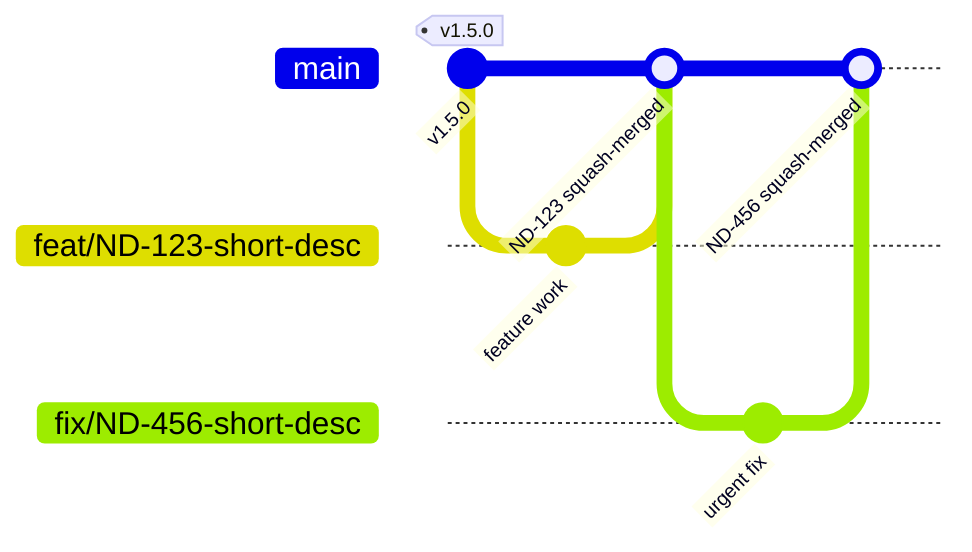

# Branching Strategy

The branching workflow is **trunk-based**, aligned with this project's actual CI/CD automation
(`ci.yml` on pull request, `cd.yml` on merge to `main`). There is one long-lived branch — `main` —
and all work happens on short-lived branches cut from it and merged straight back in. Every change
reaches `main`, and the deployed site, through a pull request.

## Flow

Each merge commit needs its own custom `id` — Mermaid's `gitGraph` rejects a duplicate commit id
across the whole diagram, so reusing a generic label like `"PR squash-merged"` for every merge fails
to render; scope the id to the actual branch or ticket.

## Environment Mapping

| Branch Type        | Environment Target  | Notes                                                                                               |
| ------------------ | ------------------- | --------------------------------------------------------------------------------------------------- |
| `main`             | `github-pages`      | `cd.yml` builds affected projects and deploys `apps/web-portal/dist` to GitHub Pages on every merge |
| `feat/*` / `fix/*` | `dev` (checks only) | `ci.yml`'s `ci` job runs in the `dev` environment and deploys nothing; no preview site per branch   |

There is no `develop`, `staging` or `production` branch. Two GitHub Actions environments exist:
`dev`, which the ruleset requires as a deployment on every PR, and `github-pages`, the live site.

## Naming Conventions

- **Branches:** `<type>/short-description` (e.g. `feat/ND-123-oidc-role-split`), per
  [`01 Conventions.md`](./01%20Conventions.md)
- **Commits:** [Conventional Commits](https://www.conventionalcommits.org/en/v1.0.0/#summary) —
  `<type>(<scope>): <what>`, per the same conventions doc
- **Tags:** two independent lanes, both automatic, never created by hand:
  - `vX.Y.Z` — the repository's own version, created by `semantic-release` on merge to `main` (`.github/workflows/release.yml`). Commits with scope `harness` or `harness-release` produce no `v*` release (`release.config.js` releaseRules).
  - `artisyn-implementation-harness-vX.Y.Z` — the harness package version. The PR picks and stamps it: the developer runs `yarn harness:version` on the branch and commits `chore(harness-release): <version>`. Nx Release bumps on commits that touch `skills/implementation-harness/` (`useCommitScope: false`, so Nx matches by path, not scope); the scope gate makes those commits `harness`-scoped. On merge, the harness release lane (`.github/workflows/release-harness.yml`) creates the tag through the API and publishes; it never pushes to `main`. Inert until the repository variable `HARNESS_RELEASE_ENABLED` is `true` — see `08 Harness Release Runbook.md`.

## CI/CD by Branch

A PR to `main` runs `ci.yml` and `gitleaks.yml`. A merge to `main` runs `cd.yml` (the GitHub Pages
deploy), `gitleaks.yml`, and both release lanes (`release.yml`, `release-harness.yml`). A hotfix is
a `fix/*` branch off `main` with the same PR gate. Workflows, jobs, required checks and how to run
each gate locally: [09 CI-CD](./09%20CI-CD.md).

## Branch Protection

`main` is protected by a repository **ruleset** (Settings → Rules → Rulesets), not a classic
branch protection rule. The ruleset is set up per `08 Harness Release Runbook.md`, step 1.
`.github/CODEOWNERS` is configured, but it stays advisory until the ruleset requires Code Owner
review.

| Branch | Ruleset restrictions                                                                                                                                                                                                                                                              |
| ------ | --------------------------------------------------------------------------------------------------------------------------------------------------------------------------------------------------------------------------------------------------------------------------------- |
| `main` | Pull request with 1 approval, last-push approval and resolved conversations; **squash merge only**; linear history; no deletion or force-push; `dev` deployment; required checks `ci`, `version-gate`, `rename-gate` with the branch up to date; bypass actor: GitHub Actions app |

Required status checks mirror job IDs `ci.yml` actually produces — don't require a check the
pipeline doesn't produce. The `harness-package` and `harness-cli` jobs run on every PR but are
advisory, not required. On 2026-11-16 the live ruleset had no required checks and no GitHub
Actions bypass yet; runbook step 1 lists what to add.

The harness lane needs no bypass: it never pushes to `main`, and branch rulesets do not cover the
tag it creates. The **GitHub Actions** app bypass is for the root lane only: `release.yml` pushes
its `chore(release)` commit with `GITHUB_TOKEN`, which cannot cross the ruleset without it (the
open part of TD-5). The live ruleset still lists the user who owned the old release PAT as a
bypass actor; releases no longer need it.

**Squash merges and the harness lane.** Every PR lands as one squash commit whose subject is the
PR title. The title does not decide the harness version: the PR's own commits do, and
`version-gate` checks that the branch is stamped with it. Still give a harness PR a
`harness`-scoped title (`feat(harness)!:` for a breaking change), so the root `v*` lane ignores
it. See `08 Harness Release Runbook.md`, step 4.

## Rollback Strategy

Roll the site back by reverting on `main`. Open a PR that reverts the bad change and merge it;
`cd.yml` builds and deploys the reverted tree like any other merge. `cd.yml` has no manual trigger
and no deploy-by-ref input. Re-running an earlier `cd.yml` run from the Actions tab rebuilds that
run's commit, but it uploads a site only if that commit affected `web-portal`, and the next merge
deploys over it.

Release tags are traceable points, not rollback switches. `semantic-release` tags root releases
`vX.Y.Z` with a `CHANGELOG.md` entry. The harness lane has no unpublish step: fix forward with
a new version through `yarn harness:version`.

## Related

- [`01 Conventions.md`](./01%20Conventions.md) — branch/commit naming format
- [`09 CI-CD.md`](./09%20CI-CD.md) — every workflow, its checks, and the two release lanes
