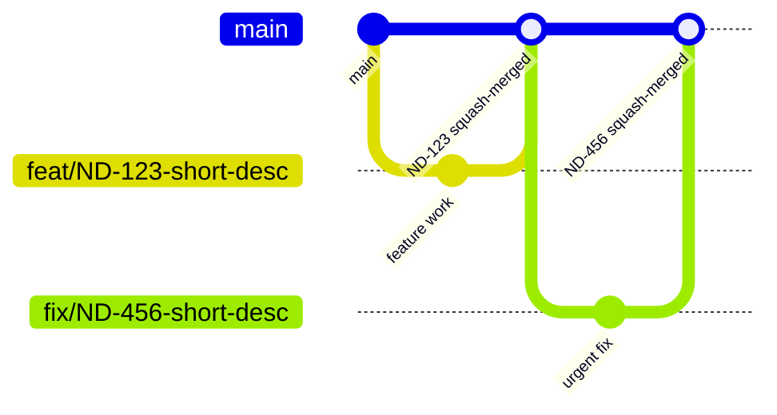

# Branching Strategy

The branching workflow is **trunk-based**, aligned with this project's actual CI/CD automation
(`ci.yml` on pull request, `deploy-web.yml` on every merge to `main`, deploying when the site is affected). There is one long-lived branch — `main` —
and all work happens on short-lived branches cut from it and merged straight back in. Every change
reaches `main`, and the deployed site, through a pull request.

## Flow

Each merge commit needs its own custom `id` — Mermaid's `gitGraph` rejects a duplicate commit id
across the whole diagram, so reusing a generic label like `"PR squash-merged"` for every merge fails
to render; scope the id to the actual branch or ticket.

## Environment Mapping

| Branch Type        | Environment Target  | Notes                                                                                                                                        |
| ------------------ | ------------------- | -------------------------------------------------------------------------------------------------------------------------------------------- |
| `main`             | `github-pages`      | `deploy-web.yml` runs on every merge, builds affected projects and deploys `apps/web-portal/dist` to GitHub Pages when the build produced it |
| `feat/*` / `fix/*` | `dev` (checks only) | `ci.yml`'s `build-and-test` job runs in the `dev` environment and deploys nothing; no preview site per branch                                |

There is no `develop`, `staging` or `production` branch. Three GitHub Actions environments exist:
`dev`, which the ruleset requires as a deployment on every PR; `github-pages`, the live site; and
`release`, whose required reviewers approve each harness publish. None maps to a branch.

## Naming Conventions

- **Branches:** `<type>/short-description` (e.g. `feat/ND-123-oidc-role-split`), per
  [`01 Conventions.md`](./01%20Conventions.md)
- **Commits:** [Conventional Commits](https://www.conventionalcommits.org/en/v1.0.0/#summary) —
  `<type>(<scope>): <what>`, per the same conventions doc
- **Tags:** one release lane, never created by hand. The repository itself is not
  versioned: there are no `vX.Y.Z` tags, and the root `CHANGELOG.md` is frozen history.
  - `artisyn-implementation-harness-vX.Y.Z` — the harness package version. The PR picks and stamps it: the developer runs `yarn harness:version` on the branch and commits `chore(harness-release): <version>`. Nx Release bumps on commits that touch `skills/implementation-harness/` (`useCommitScope: false`, so Nx matches by path, not scope); the scope gate makes those commits `harness`-scoped. On every merge, the harness release lane (`.github/workflows/release-harness.yml`) builds and attests the version. After a reviewer approves the `release` environment, it creates the tag through the API and publishes. It never pushes to `main` — see `08 Harness Release Runbook.md`.

## CI/CD by Branch

A PR to `main` runs `ci.yml` and `gitleaks.yml`. A merge to `main` runs `gitleaks.yml` and `deploy-web.yml` (the GitHub Pages deploy).
`deploy-web.yml` deploys only when Nx finds the site affected; otherwise it ends with a notice and
deploys nothing. A merge that
touches the harness also runs the harness release lane (`release-harness.yml`: build on merge,
publish after approval; the deploy does not wait for it). A hotfix is
a `fix/*` branch off `main` with the same PR gate. Workflows, jobs, required checks and how to run
each gate locally: [09 CI-CD](./09%20CI-CD.md).

## Branch Protection

`main` is protected by a repository **ruleset** (Settings → Rules → Rulesets), not a classic
branch protection rule. The ruleset is set up per `08 Harness Release Runbook.md`, step 1.
`.github/CODEOWNERS` is configured, but it stays advisory until the ruleset requires Code Owner
review.

| Branch | Ruleset restrictions                                                                                                                                                                                                                                                        |
| ------ | --------------------------------------------------------------------------------------------------------------------------------------------------------------------------------------------------------------------------------------------------------------------------- |
| `main` | Pull request with 1 approval, last-push approval and resolved conversations; **squash merge only**; linear history; no deletion or force-push; `dev` deployment; required checks `build-and-test`, `version-gate`, `docs-gate` with the branch up to date; no bypass actors |

Required status checks mirror job IDs `ci.yml` actually produces — don't require a check the
pipeline doesn't produce. The `harness-package` and `harness-cli` jobs run on every PR but are
advisory, not required. On 2026-11-16 the live ruleset had no required checks yet; runbook step 1
lists what to add.

The ruleset needs no bypass actors. No workflow pushes to `main`, and branch rulesets do not
cover the tag the harness lane creates. On 2026-11-16 the live ruleset still listed two bypass
actors, the GitHub Actions app and the user who owned the old release PAT; runbook step 1 says to
remove both.

**Squash merges and the harness lane.** Every PR lands as one squash commit whose subject is the
PR title. The title does not decide the harness version: the PR's own commits do, and
`version-gate` checks that the branch is stamped with it. Still give a harness PR a
`harness`-scoped title (`feat(harness)!:` for a breaking change), so harness changes stand apart
in history and the changelog. See `08 Harness Release Runbook.md`, step 4.

## Rollback Strategy

Roll the site back by reverting on `main`. Open a PR that reverts the bad change and merge it.
The revert affects the site, so `deploy-web.yml` builds and deploys the reverted tree like any
other site merge. `deploy-web.yml` has no manual trigger and no deploy-by-ref input. Re-running an
earlier `Deploy web` run from the Actions tab rebuilds and redeploys that run's push. The next
site merge deploys over it.

Harness release tags are traceable points, not rollback switches. The harness lane has no
unpublish step: fix forward with a new version through `yarn harness:version`. Package rollback
per channel: [Versioning and Releases](../Harness/09%20Distribution/03%20Versioning%20and%20Releases.md#rollback).

## Related

- [`01 Conventions.md`](./01%20Conventions.md) — branch/commit naming format
- [`09 CI-CD.md`](./09%20CI-CD.md) — every workflow, its checks, and the release lane
