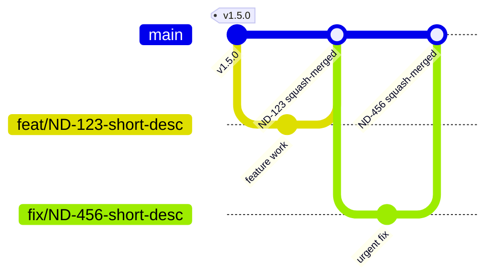

# Branching Strategy

The branching workflow is **trunk-based**, aligned with this project's actual CI/CD automation
(`ci.yml` on pull request, `cd.yml` on merge to `main`). There is one long-lived branch — `main` —
and all work happens on short-lived branches cut from it and merged straight back in. Nothing
reaches the deployed site without passing through the PR's required CI checks first.

## Flow

Each merge commit needs its own custom `id` — Mermaid's `gitGraph` rejects a duplicate commit id
across the whole diagram, so reusing a generic label like `"PR squash-merged"` for every merge fails
to render; scope the id to the actual branch or ticket.

## Environment Mapping

| Branch Type        | Environment Target  | Notes                                                                                |
| ------------------ | ------------------- | ------------------------------------------------------------------------------------ |
| `main`             | `dev` (auto-deploy) | Every merge triggers `cd.yml`; `nx affected --target=deploy` ships only what changed |
| `feat/*` / `fix/*` | None (PR only)      | Validated by `ci.yml`; no preview environment is provisioned per branch              |

There is no separate `develop`/`staging`/`production` branch or environment today — one GitHub
Actions environment (`dev`) backs the whole pipeline. A Dev → Staging → Prod promotion chain is a
reasonable future addition, not a default.

## Naming Conventions

- **Branches:** `<type>/short-description` (e.g. `feat/ND-123-oidc-role-split`), per
  [`01 Conventions.md`](./01%20Conventions.md)
- **Commits:** [Conventional Commits](https://www.conventionalcommits.org/en/v1.0.0/#summary) —
  `<type>(<scope>): <what>`, per the same conventions doc
- **Tags:** `vX.Y.Z` — created automatically by `semantic-release` on every merge to `main` (`.github/workflows/release.yml`), driven by Conventional Commits; never created by hand

## CI/CD by Branch

| Trigger               | Runs                                                                                                                                                  |
| --------------------- | ----------------------------------------------------------------------------------------------------------------------------------------------------- |
| `feat/*` / `fix/*` PR | `ci.yml` — audit, lint, typecheck, build for affected projects, using the SSM-read-only `CiReadRole`                                                  |
| `main` merge          | `cd.yml` — `nx affected --target=deploy`, using the write-scoped `DeployRole`                                                                         |
| `main` merge          | `release.yml` — `semantic-release` computes the next version from Conventional Commits, tags, and publishes a GitHub release and `CHANGELOG.md` entry |
| Hotfixes              | No separate branch type — a `fix/*` branch off `main`, same PR gate, same deploy path                                                                 |

See [`Infrastructure/03 CI-CD Pipeline.md`](./Infrastructure/03%20CI-CD%20Pipeline.md) for the full
workflow and the `CiReadRole`/`DeployRole` OIDC trust split.

## Branch Protection

`.github/CODEOWNERS` is configured, but the `main` branch protection _rule_ that actually enforces
required reviews is not yet turned on in GitHub repo settings — a `CODEOWNERS` file with no
protection rule requiring it is advisory only, not enforced. This matters beyond general hygiene:
the `CiReadRole`/`DeployRole` OIDC split only prevents an unreviewed PR from reaching deploy-grade
credentials — it assumes someone actually reviews and approves the PR before merge. Until the rule
is enabled, that assumption isn't backed by anything.

Recommended, once configured (Settings → Branches → branch protection rule for `main`):

| Branch | Restrictions                                                                                        |
| ------ | --------------------------------------------------------------------------------------------------- |
| `main` | Direct pushes disabled; at least one Code Owner approval required; squash merge only; no force-push |

Required status checks should mirror what `ci.yml` actually runs (audit, lint, typecheck, build) —
don't require a check the pipeline doesn't produce.

## Rollback Strategy

`semantic-release` now tags every merge to `main` with `vX.Y.Z`, giving each release a traceable
point in history and a generated `CHANGELOG.md` entry — but this does not by itself give tag-based
deploy rollback. `cd.yml` deploys via `nx affected --base=HEAD~1 --head=HEAD`, which computes what
changed in the single commit that triggered the run; checking out an old tag and re-running that
command would only redeploy the diff of its last commit, not reliably reconstruct the tag's full
state. In practice, a bad deploy is still rolled back by reverting the offending commit on `main`
and letting `cd.yml` redeploy the reverted state. A true tag-pinned redeploy would need a dedicated
"deploy this exact ref" path, not `cd.yml`'s diff-based one — not implemented today.

## Related

- [`01 Conventions.md`](./01%20Conventions.md) — branch/commit naming format
- [`Infrastructure/03 CI-CD Pipeline.md`](./Infrastructure/03%20CI-CD%20Pipeline.md) — the CI/CD
  workflow implementation this doc describes
