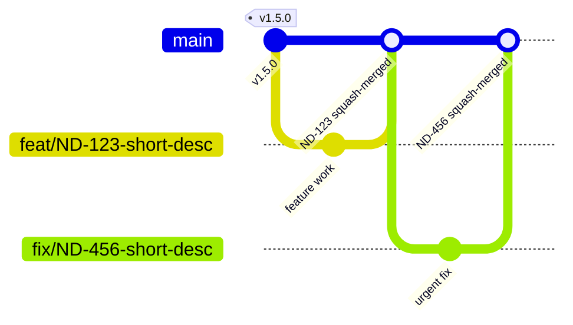

# Branching Strategy

The branching workflow is **trunk-based**, aligned with this project's actual CI/CD automation
(`ci.yml` on pull request, `cd.yml` on merge to `main`). There is one long-lived branch — `main` —
and all work happens on short-lived branches cut from it and merged straight back in. Nothing
reaches the deployed site without passing through the PR's required CI checks first.

## Flow

Each merge commit needs its own custom `id` — Mermaid's `gitGraph` rejects a duplicate commit id
across the whole diagram, so reusing a generic label like `"PR squash-merged"` for every merge fails
to render; scope the id to the actual branch or ticket.

## Environment Mapping

| Branch Type        | Environment Target | Notes                                                                                                                                                                                                                  |
| ------------------ | ------------------ | ---------------------------------------------------------------------------------------------------------------------------------------------------------------------------------------------------------------------- |
| `main`             | `dev`              | `cd.yml` runs on every merge, but its deploy step is currently a retirement stub (no-op) — the AWS deploy mechanism was removed with the Infrastructure container, and no replacement (GitHub Pages) deploy exists yet |
| `feat/*` / `fix/*` | None (PR only)     | Validated by `ci.yml`; no preview environment is provisioned per branch                                                                                                                                                |

There is no separate `develop`/`staging`/`production` branch or environment today — one GitHub
Actions environment (`dev`) backs the whole pipeline, though it currently deploys nothing. A Dev →
Staging → Prod promotion chain is a reasonable future addition, not a default.

## Naming Conventions

- **Branches:** `<type>/short-description` (e.g. `feat/ND-123-oidc-role-split`), per
  [`01 Conventions.md`](./01%20Conventions.md)
- **Commits:** [Conventional Commits](https://www.conventionalcommits.org/en/v1.0.0/#summary) —
  `<type>(<scope>): <what>`, per the same conventions doc
- **Tags:** two independent lanes, both automatic, never created by hand:
  - `vX.Y.Z` — the repository's own version, created by `semantic-release` on merge to `main` (`.github/workflows/release.yml`). Commits with scope `harness` or `harness-release` produce no `v*` release (`release.config.js` releaseRules).
  - `artisyn-implementation-harness-vX.Y.Z` — the harness package version, created by the harness release lane (`.github/workflows/release-harness.yml`, Nx Release). It bumps on commits that touch `skills/implementation-harness/` (`useCommitScope: false`, so Nx matches by path, not scope); the scope gate makes those commits `harness`-scoped. Its release commit is `chore(harness-release): <version> [skip ci]`. Inert until the repository variable `HARNESS_RELEASE_ENABLED` is `true` — see `08 Harness Release Runbook.md`.

## CI/CD by Branch

| Trigger               | Runs                                                                                                                                                                                                       |
| --------------------- | ---------------------------------------------------------------------------------------------------------------------------------------------------------------------------------------------------------- |
| `feat/*` / `fix/*` PR | `ci.yml` — audit, lint, typecheck, test, build for affected projects. No AWS role assumption — the AWS OIDC auth step was removed with the Infrastructure container                                        |
| `main` merge          | `cd.yml` — runs, but its deploy step is currently a retirement stub (no-op); no deploy mechanism exists until the GitHub Pages cutover lands                                                               |
| `main` merge          | `release.yml` — `semantic-release` computes the next version from Conventional Commits, tags, and publishes a GitHub release and `CHANGELOG.md` entry (scopes `harness`/`harness-release` excluded)        |
| `main` merge          | `release-harness.yml` — the harness package lane: Nx Release versions, stamps, tags `artisyn-implementation-harness-v*`, publishes npm + ZIP + attestations; off until `HARNESS_RELEASE_ENABLED` is `true` |
| Hotfixes              | No separate branch type — a `fix/*` branch off `main`, same PR gate                                                                                                                                        |

See `.github/workflows/ci.yml` and `.github/workflows/cd.yml` for the current workflow definitions.

## Branch Protection

`main` is protected by a repository **ruleset** (Settings → Rules → Rulesets), not a classic
branch protection rule. The ruleset is set up per `08 Harness Release Runbook.md`, step 1.
`.github/CODEOWNERS` is configured, but it stays advisory until the ruleset requires Code Owner
review.

| Branch | Ruleset restrictions                                                                                                                                |
| ------ | --------------------------------------------------------------------------------------------------------------------------------------------------- |
| `main` | Pull request required; required checks `ci`, `version-gate`, `rename-gate`; no force-push; bypass actors: Repository admin role, GitHub Actions app |

Required status checks mirror job IDs `ci.yml` actually produces — don't require a check the
pipeline doesn't produce. The `harness-package` and `harness-cli` jobs run on every PR but are
advisory, not required.

The **Repository admin** bypass is interim: it carries the release PAT (`HARNESS_RELEASE_TOKEN`)
and also lets any admin push to `main` directly, until an org GitHub App replaces it (TD-2 in the
runbook). The **GitHub Actions** app bypass lets `release.yml` push its `chore(release)` commit.

**Squash merges and the harness lane.** On a squash merge the PR title is the only commit that
lands on `main`, so for a harness PR it is the commit Nx scores. The CI scope check runs over the
PR's own commits, not the title, and the husky hook does not run on GitHub. Give a squash-merged
harness PR a `harness`-scoped title of the right type (`feat(harness)!:` for a breaking change).
See `08 Harness Release Runbook.md`, step 4.

## Rollback Strategy

`semantic-release` still tags every merge to `main` with `vX.Y.Z`, giving each release a traceable
point in history and a generated `CHANGELOG.md` entry. `cd.yml` currently has no deploy to roll
back — its deploy step is a retirement stub pending the GitHub Pages cutover. A rollback strategy
for the actual deploy mechanism is undefined until that cutover lands.

## Related

- [`01 Conventions.md`](./01%20Conventions.md) — branch/commit naming format
- `.github/workflows/ci.yml` / `.github/workflows/cd.yml` — the CI/CD workflow implementation
  this doc describes
