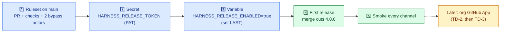

# Harness Release Runbook

One-time setup makes `release-harness.yml` able to push to the protected `main`; after that, releases are fully automatic. Do the steps in order — the enable flag comes last.

## 1. Ruleset on `main`

One ruleset (Settings → Rules → Rulesets) targets the default branch. It already exists; check it against this list and add what is missing:

| Rule                     | Setting                                                                                     | State on 2026-11-16 |
| ------------------------ | ------------------------------------------------------------------------------------------- | ------------------- |
| Pull request             | 1 approval, approval of the last push, conversations resolved; merge method **squash only** | set                 |
| Linear history           | required                                                                                    | set                 |
| Deletion, force push     | blocked                                                                                     | set                 |
| Deployment               | environment `dev` (the `ci` job deploys to it)                                              | set                 |
| Status checks            | `ci`, `version-gate`, `rename-gate` (job IDs from `ci.yml`)                                 | **missing — add**   |
| Bypass: PAT owner (user) | mode **Always** — the interim actor behind the release PAT (TD-2)                           | set                 |
| Bypass: GitHub Actions   | mode **Always** — lets the root `release.yml` push its `chore(release)` commit (RF-042)     | **missing — add**   |

The bypass actor is the **user who owns the PAT**, not the Repository admin role, so only that one account can push past the rules. If the bypass picker does not offer the GitHub Actions app, the root lane stays blocked until TD-5 removes its push.

`GITHUB_TOKEN` (`${{ github.token }}` in a workflow) never bypasses a ruleset unless the GitHub Actions app is a bypass actor. It can still create tags through the API, publish packages and create releases, because rulesets on branches do not cover those.

## 2. Secret: `HARNESS_RELEASE_TOKEN`

A fine-grained PAT of a repository admin, scoped to this repository only:

| Setting     | Value                                                   |
| ----------- | ------------------------------------------------------- |
| Permissions | Contents: read and write · Metadata: read               |
| Expiry      | 1 year at most — put the renewal date in a calendar now |
| Stored as   | Repository Actions secret `HARNESS_RELEASE_TOKEN`       |

The workflow reads it in exactly two steps (presence check and push); everything else runs with the default `GITHUB_TOKEN`. Leave the repository variable `HARNESS_RELEASE_BOT` **unset** until a GitHub App exists — it is the actor guard for the App's bot login, and setting it to anything else does nothing useful.

## 3. Enable the lane — last

Set the repository variable `HARNESS_RELEASE_ENABLED` to `true` only after the ruleset and the secret are in place. Until then the workflow is inert on every push.

## 4. First release: 4.0.0

The ruleset allows squash merges only, so the PR title becomes the one commit on `main` and is the commit Nx scores. Merge the distribution PR with exactly this title:

`feat(harness)!: rename the package to implementation-harness and keep its state in .harness/state`

The same holds for every harness PR: its title must be a `harness`-scoped Conventional Commit of the right type. The CI scope check (`check-commit-scope.mjs --range`, run by `ci.yml`) checks the PR's own commits, not the title, and the husky hook does not run on GitHub, so a wrong title goes unchecked.

With the breaking commit on `main`, the first run versions the harness from 3.5.0 to exactly 4.0.0, stamps the manifests, pushes `chore(harness-release): 4.0.0 [skip ci]` plus the tag, publishes npm, attaches the ZIP + `.sha256` and attests both artifacts. Two known windows exist until that run finishes (both accepted at plan sign-off, 2026-11-15):

- The marketplace manifests on `main` pin a tag that does not exist until the first release stamps it (RF-012) — marketplace installs work only after 4.0.0 is out.
- The committed 3.5.0 ZIPs are deleted, so no 3.5.0 ZIP is downloadable until 4.0.0 is released (RF-013); the files remain in git history.

A failed run is safe to re-run: it checks what is already published and finishes only the missing artifacts.

## 5. Per-channel smoke checklist

In a scratch consumer project (not this repo), after the release run goes green. The `npx` commands below are consumer-side, so the yarn-only rule for this repo does not apply to them:

| Channel     | Check                                                                                                                                                                    |
| ----------- | ------------------------------------------------------------------------------------------------------------------------------------------------------------------------ |
| npm         | `.npmrc` scope + `read:packages` token, then `npx @dataart/artisyn-implementation-harness init` places the package and prints the launch command                         |
| ZIP         | Download `artisyn-implementation-harness-v4.0.0.zip` + `.sha256` from the tag's Release, verify the checksum, install (unzip or the bundled CLI `init`)                  |
| Claude      | `claude plugin marketplace add DataArt/artisyn-implementation-harness` → `claude plugin install artisyn@dataart` → `/artisyn:implementation-harness launch` responds     |
| Codex       | Install `artisyn` from the Codex marketplace — the manifest values (`policy.authentication: NONE`, `git-subdir` source) are unverified on a real host; confirm them here |
| Copilot CLI | Install via the Copilot marketplace flow — Copilot's reading of the Claude manifest is unverified on a real host; confirm it here                                        |
| skills.sh   | `npx skills add DataArt/artisyn-implementation-harness --skill implementation-harness` installs exactly that skill                                                       |
| gh skill    | `gh skill install DataArt/artisyn-implementation-harness implementation-harness@artisyn-implementation-harness-v4.0.0 --scope project` (pinned form only)                |

The marketplace agent E2E (`yarn nx run harness-bootstrap-e2e:agent-e2e`) is a guarded command — it spends real agent budget, so the developer starts it; it never runs in CI.

## Follow-up: GitHub App (TD-2, TD-3)

The PAT is interim — creating a GitHub App needs organisation permissions. When an org owner is available:

1. Create the release GitHub App at org level, install it on this repository, and add it as the ruleset bypass actor (then remove the PAT owner's user bypass).
2. Switch the workflow to a run-time token (`actions/create-github-app-token`), set `HARNESS_RELEASE_BOT` to the App's bot login, and delete the PAT.
3. Split the workflow into a version job (contents write) and a publish job (contents write for `gh release create/upload`, packages, `id-token`, `attestations`) — today one job holds all four permissions for every step (TD-3).

## Alternative: tag-only release (TD-5)

The PAT, the App and the bypass exist only because the release pushes a commit to `main`. A release that never pushes to `main` needs none of them: stamp the versions in the runner, commit them on no branch, point the release tag at that commit through the API, and publish from the tag. Every step then runs with `GITHUB_TOKEN`. The trade-off is that `main` keeps the previous version in its manifests and changelog. This changes design decisions D-15, D-16 and D-17, so it needs its own design pass before any work.
