# Harness Release Runbook

The harness is versioned in the PR and published on merge. The developer stamps the version on the feature branch; after the squash merge, `release-harness.yml` tags that version and publishes it. The workflow never commits or pushes to `main`, so it needs no PAT, no GitHub App and no ruleset bypass (TD-5, agreed 2026-11-16).

```mermaid
flowchart LR
    subgraph SETUP ["  One-time setup  "]
        RS["1️⃣ Ruleset on main\nadd the 3 required checks"]:::setup
        BT["2️⃣ Push the baseline tag\nartisyn-implementation-harness-v3.5.0"]:::setup
        EN["3️⃣ Variable\nHARNESS_RELEASE_ENABLED=true"]:::setup
    end

    subgraph PR ["  Every harness PR  "]
        HV["4️⃣ yarn harness:version\ncommit chore(harness-release): v"]:::pr
        VG["version-gate\nversion-harness.mjs --check"]:::pr
    end

    subgraph MERGE ["  On merge to main  "]
        TAG["Tag via API\nGITHUB_TOKEN"]:::release
        PUB["Build · attest · publish\nnpm + GitHub Release"]:::release
        SMOKE["5️⃣ Smoke every channel"]:::release
    end

    RS --> BT --> EN --> HV --> VG -->|"squash merge"| TAG --> PUB --> SMOKE

    classDef setup fill:#DBEAFE,stroke:#2563EB,color:#1e3a8a
    classDef pr fill:#FEF3C7,stroke:#D97706,color:#78350f
    classDef release fill:#DCFCE7,stroke:#15803D,color:#14532D
    style SETUP fill:#EFF6FF,stroke:#2563EB
    style PR fill:#FFFBEB,stroke:#D97706
    style MERGE fill:#F0FDF4,stroke:#15803D
```



## 1. Ruleset on `main`

One ruleset (Settings → Rules → Rulesets) targets the default branch. It already exists; check it against this list and add what is missing:

| Rule                   | Setting                                                                                     | State on 2026-11-16 |
| ---------------------- | ------------------------------------------------------------------------------------------- | ------------------- |
| Pull request           | 1 approval, approval of the last push, conversations resolved; merge method **squash only** | set                 |
| Linear history         | required                                                                                    | set                 |
| Deletion, force push   | blocked                                                                                     | set                 |
| Deployment             | environment `dev` (the `ci` job deploys to it)                                              | set                 |
| Status checks          | `ci`, `version-gate`, `rename-gate` (job IDs from `ci.yml`); branch must be up to date      | **empty — add**     |
| Bypass: GitHub Actions | mode **Always** — lets the root `release.yml` push its `chore(release)` commit (RF-042)     | **missing — add**   |

The harness lane needs no bypass. Branch rulesets do not cover tags, packages or releases, so `GITHUB_TOKEN` can create the tag through the API, publish and create the Release.

The root lane still needs the GitHub Actions bypass: `release.yml` (semantic-release with `@semantic-release/git`) pushes `chore(release)` to `main` with `GITHUB_TOKEN`, and the ruleset blocks that push without it. This is the open part of TD-5. If the bypass picker does not offer the GitHub Actions app, the root lane stays blocked.

The live ruleset also has a user bypass for the account that owned the old release PAT. Releases no longer need it. Keep or remove it as you see fit.

## 2. Baseline tag

Nx computes each version from the latest `artisyn-implementation-harness-v*` tag reachable from HEAD. The baseline tag `artisyn-implementation-harness-v3.5.0` sits on `c8d82c9`, the tip of `main` before PR #20. Push it once, before `version-gate` can pass on PR #20 (`git push` is a guarded command; the developer runs it):

```bash
git push origin artisyn-implementation-harness-v3.5.0
```

## 3. Enable the lane

Set the repository variable `HARNESS_RELEASE_ENABLED` to `true`. Until then the workflow is inert on every push. No secret is needed.

The old flow used a `HARNESS_RELEASE_TOKEN` secret and a `HARNESS_RELEASE_BOT` variable. Nothing reads them now. Delete the secret if it was created; leave the variable unset.

## 4. Every harness PR: `yarn harness:version`

Before you open or merge a PR that changes the harness, stamp its version on the feature branch:

```bash
yarn harness:version
git commit -am "chore(harness-release): <version>"
```

Then push like any other commit. `scripts/release/version-harness.mjs` does the work:

| Step    | What it does                                                                                                                      |
| ------- | --------------------------------------------------------------------------------------------------------------------------------- |
| Compute | Latest harness tag reachable from HEAD + the conventional commits after it (Nx Release). A re-run gives the same version          |
| Stamp   | `skills/implementation-harness/package.json`, then every manifest through `stamp-harness-version.mjs`                             |
| Log     | Writes or replaces the changelog entry; drops entries for unreleased versions left by earlier runs. Entries link the PR's commits |
| No bump | When the commits call for no release, it changes nothing and says so                                                              |

The developer commits the version, not CI. A commit pushed with `GITHUB_TOKEN` starts no workflows, so the PR head would have no checks. The ruleset also requires approval of the last push.

`version-gate` in `ci.yml` runs `node scripts/release/version-harness.mjs --check` (full history, `fetch-depth: 0`). It fails when:

- the branch is not stamped with the computed version;
- the changelog has no entry for that version;
- the changelog has an entry for a version this branch does not release.

**Two PRs, one version.** The ruleset requires the branch to be up to date. When two PRs claim the same version, the first merges and gets the tag; the second must update from `main` and re-run `yarn harness:version`. If the second PR updates in the few seconds before the first merge's tag exists, its check can pass with the version the first PR already took. The merge workflow catches this: when the tag exists but the merged commit changes the harness after it, the run fails. Fix it with a new branch that runs `yarn harness:version` and merges the stamp.

**Squash title.** The version comes from the PR's own commits, which husky and the CI scope check (`check-commit-scope.mjs --range`) both check. The squash title no longer decides the version. Still give it a `harness`-scoped Conventional Commit subject, so the root `v*` lane ignores it.

Changelog entries link to the PR's commit hashes. After the squash merge those commits stay reachable on GitHub through the PR.

## 5. On merge: what the workflow does

On push to `main`, `release-harness.yml` reads the version from `skills/implementation-harness/package.json` at the pushed commit:

| Tag state          | Action                                                                                                   |
| ------------------ | -------------------------------------------------------------------------------------------------------- |
| Tag does not exist | Creates it on `GITHUB_SHA` through `gh api repos/$GITHUB_REPOSITORY/git/refs`, then builds and publishes |
| Tag exists         | A merge that did not change the harness, or a re-run: finishes only what that release is missing         |

It builds the tarball, the ZIP and its `.sha256`, attests both, publishes to GitHub Packages and creates the GitHub Release. A failed attestation blocks publish. A failed run is safe to re-run.

## 6. First release: 4.0.0

PR #20 is already stamped 4.0.0 (commit `c7f326b`). With steps 1–3 done, squash-merge it with a `harness`-scoped subject, for example:

`feat(harness)!: rename the package to implementation-harness and keep its state in .harness/state`

The workflow then tags `artisyn-implementation-harness-v4.0.0` and publishes 4.0.0. Two known windows exist until that run finishes (accepted at plan sign-off, 2026-11-15):

- The marketplace manifests on `main` pin a tag that does not exist until the workflow creates it (RF-012). Marketplace installs work once 4.0.0 is tagged.
- The committed 3.5.0 ZIPs are deleted, so no 3.5.0 ZIP is downloadable until 4.0.0 is released (RF-013); the files remain in git history.

## 7. Per-channel smoke checklist

In a scratch consumer project (not this repo), after the release run goes green. The `npx` commands below are consumer-side, so the yarn-only rule for this repo does not apply to them:

| Channel     | Check                                                                                                                                                                    |
| ----------- | ------------------------------------------------------------------------------------------------------------------------------------------------------------------------ |
| npm         | `.npmrc` scope + `read:packages` token, then `npx @dataart/artisyn-implementation-harness init` places the package and prints the launch command                         |
| ZIP         | Download `artisyn-implementation-harness-v4.0.0.zip` + `.sha256` from the tag's Release, verify the checksum, install (unzip or the bundled CLI `init`)                  |
| Claude      | `claude plugin marketplace add DataArt/artisyn-implementation-harness` → `claude plugin install artisyn@dataart` → `/artisyn:implementation-harness launch` responds     |
| Codex       | Install `artisyn` from the Codex marketplace — the manifest values (`policy.authentication: NONE`, `git-subdir` source) are unverified on a real host; confirm them here |
| Copilot CLI | Install via the Copilot marketplace flow — Copilot's reading of the Claude manifest is unverified on a real host; confirm it here                                        |
| skills.sh   | `npx skills add DataArt/artisyn-implementation-harness --skill implementation-harness` installs exactly that skill                                                       |
| gh skill    | `gh skill install DataArt/artisyn-implementation-harness implementation-harness@artisyn-implementation-harness-v4.0.0 --scope project` (pinned form only)                |

The marketplace agent E2E (`yarn nx run harness-bootstrap-e2e:agent-e2e`) is a guarded command — it spends real agent budget, so the developer starts it; it never runs in CI.

## Decision record

Versioning in the PR replaces the release commit that design decisions D-15, D-16 and D-17 put on `main` (TD-5, 2026-11-16). It also resolves TD-2 and TD-3: with no push to `main`, the PAT, the planned GitHub App and the version/publish job split have no purpose.
