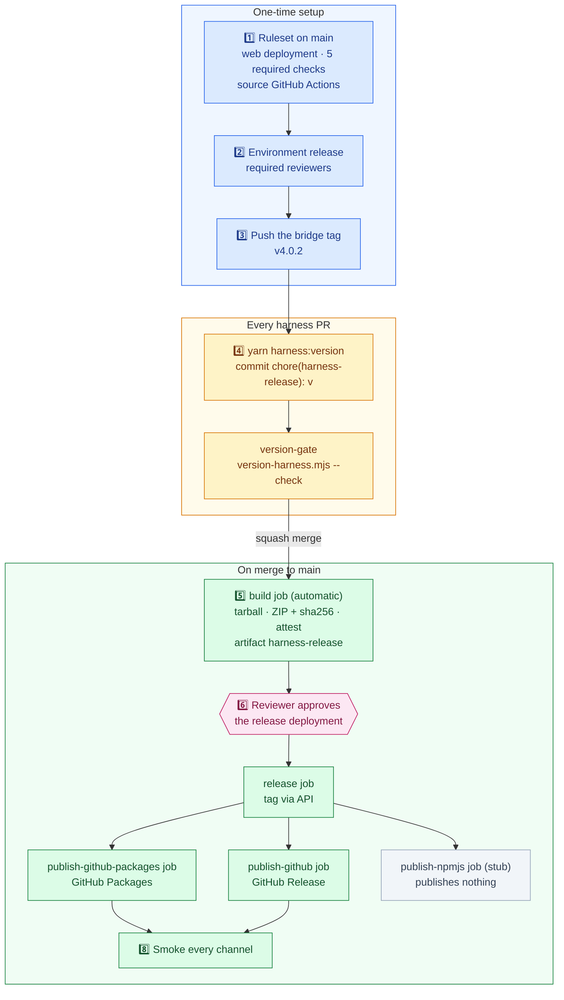

# Harness Release Runbook

The harness is versioned in the PR, built on merge and published after a reviewer approves. The developer stamps the version on the feature branch. After the squash merge, `deploy-harness.yml` builds and attests that version automatically. The `release` job then waits in the `release` environment; once a reviewer approves, it creates the tag, and `publish-github-packages` and `publish-github` publish to every channel at once. It is the repository's only release lane. No workflow commits or pushes to `main`, so releases need no PAT, no GitHub App and no ruleset bypass (TD-5, agreed 2026-11-16).



## 1. Ruleset on `main`

One ruleset (Settings → Rules → Rulesets) targets the default branch. To set it up from scratch, or to audit it, compare it with this list. Live values checked on 2026-11-17:

| Rule                 | Setting                                                                                                                                                                                           | Live on 2026-11-17                                          |
| -------------------- | ------------------------------------------------------------------------------------------------------------------------------------------------------------------------------------------------- | ----------------------------------------------------------- |
| Pull request         | 1 approval, approval of the last push, conversations resolved; merge method **squash only**                                                                                                       | set                                                         |
| Linear history       | required                                                                                                                                                                                          | set                                                         |
| Deletion, force push | blocked                                                                                                                                                                                           | set                                                         |
| Deployment           | environment `web` (the `build-and-test` job deploys to it)                                                                                                                                        | set                                                         |
| Status checks        | `build-and-test`, `docs-gate` (`ci-web.yml`); `version-gate`, `harness-package`, `harness-unit` (`ci-harness.yml`); branch up to date. Not `harness-cli (<os>)` or `gitleaks`: they stay advisory | set, each with source GitHub Actions (integration_id 15368) |
| Bypass actors        | The repository owner, mode "always" — an accepted exception, below                                                                                                                                | set                                                         |

**Check source.** Set each required check's source to **GitHub Actions**. Without a source, anyone with write access can post a commit status with the same name and turn the check green.

**Branch up to date** (`strict_required_status_checks_policy: true`) applies only while at least one check is required. With the five checks in place it is enforced, so the "Two PRs, one version" protection in step 4 holds.

D-17 named three required checks; on 2026-11-17 the set was extended with `harness-package` and `harness-unit`. Like `version-gate`, both run on harness PRs (and when `changes` fails) and are skipped on other PRs, where a skipped job reports success.

**The bypass actor: an accepted exception.** No workflow pushes to `main`, and branch rulesets do not cover tags, packages or releases, so the release lane needs no bypass: `GITHUB_TOKEN` creates the tag through the API, publishes and creates the Release. The ruleset still keeps one bypass actor, the repository owner, with mode "always". This was decided on 2026-11-17 so the owner can push straight to `main` when needed, and it is an accepted deviation from NFR-14's "no bypass actors". A direct push skips every PR check. The `gitleaks` job of `ci-web.yml` scans it on push to `main`, but only detects a secret after the fact: the repository is public, so the secret is exposed at once ([09 CI-CD](./09%20CI-CD.md)).

**The `web` environment.** `web` has no protection rules. It is the deployment the ruleset requires, and it holds the variables `VITE_GITHUB_ORG`, `VITE_GITHUB_REPO`, `VITE_GISCUS_REPO_ID` and `VITE_GISCUS_CATEGORY_ID` that `ci-web.yml` and `deploy-web.yml` build the site with (values: [Giscus Setup](./Infrastructure/04%20Giscus%20Setup.md)). The repository has no repository-level variables; the environments are exactly `github-pages`, `release` and `web`.

**Open developer item.** GitHub native secret scanning and push protection are disabled (Settings → Code security). They are free on a public repository and would block a push that carries a secret, which the `gitleaks` push scan only detects after the fact. Enabling them is the developer's call.

**Cutover record (2026-11-17).** The CI split merged as PR #22. Around that merge, `web` was created with the four variables, the ruleset's required deployment was switched from `dev` to `web`, the five required checks were added with source GitHub Actions, and the repository-level `VITE_*` variables and the `dev` environment were deleted. PR #18, the only other open PR, was closed without merging. The first runs on `main` passed: Deploy web ran `build` then `deploy`, Deploy harness found 4.0.2 already published and skipped `release`, and CI web on push ran only `gitleaks`.

The release needs no secret. The old flow used a `HARNESS_RELEASE_TOKEN` secret and a `HARNESS_RELEASE_BOT` variable; nothing reads them now. The secret is deleted; leave the variable unset. Deleting the secret does not revoke the token behind it: its owner revokes it under Settings → Developer settings → Personal access tokens.

**Trusted publisher.** Only if a trusted publisher was ever configured for the package on npmjs.com: it must name `deploy-harness.yml` (step 6). `publish-npmjs` is a stub, so usually there is nothing to change.

## 2. The `release` environment

The `release` job runs in the environment `release`; its required reviewers are the approval gate. Create it before PR #20 merges. If it does not exist, GitHub creates it on first use with no protection, and the release runs without approval.

| Setting (Settings → Environments → `release`) | Value                                          | Live on 2026-11-17       |
| --------------------------------------------- | ---------------------------------------------- | ------------------------ |
| Required reviewers                            | The maintainers who may release the harness    | The repository owner     |
| Prevent self-review                           | Optional: the person who merged cannot approve | Off: self-review allowed |
| Deployment branches and tags                  | Selected branches, `main` only                 | `main` only              |

The branch rule matters because `deploy-harness.yml` can be started by hand from any branch. Without it, an approved run from a branch would tag that branch's commit and publish its version. With it, a run from any other branch fails before anyone is asked to approve.

Also recommended: enable immutable releases (Settings → General → Releases). The `publish-github` job creates the Release as a draft, uploads the ZIP and `.sha256`, and only then publishes it, so the assets are in place before the Release becomes immutable.

## 3. Baseline and bridge tags

Nx computes each version from the latest `v*` tag reachable from HEAD (`releaseTag.pattern` `v{version}` in `nx.json`). From the release after 4.0.2, every release is tagged `v<version>`, e.g. `v4.1.0` (decided 2026-11-17). Releases up to 4.0.2 keep their long tags, `artisyn-implementation-harness-v<version>`; nothing is renamed.

**Bridge tag `v4.0.2`.** Without it, the newest `v*` tag would be the old `v1.1.1` from before the current release scheme, and Nx would compute the next version from 1.1.1. Create `v4.0.2` on the commit that `artisyn-implementation-harness-v4.0.2` points to, and push it once (`git push` is a guarded command; the developer runs it):

```bash
git tag v4.0.2 'artisyn-implementation-harness-v4.0.2^{}'
git push origin v4.0.2
```

The bridge tag has no GitHub Release of its own. With it in place, the next release is computed from 4.0.2; a `feat(harness)` commit makes it 4.1.0.

**History.** The first computation started from the long baseline tag `artisyn-implementation-harness-v3.5.0` on `c8d82c9`, the tip of `main` before PR #20.

The release workflow has no enable switch: it runs on a push to `main` that touches `skills/implementation-harness/`, `skills/.claude-plugin/`, `.claude-plugin/`, `.agents/plugins/`, `.github/plugin/`, `skills.sh.json` or the workflow itself (a site-only merge starts nothing), or a manual run. Finish steps 1 to 3 before the first harness PR merges.

## 4. Every harness PR: `yarn harness:version`

Before you open or merge a PR that changes the harness, stamp its version on the feature branch:

```bash
yarn harness:version
git commit -am "chore(harness-release): <version>"
```

Then push like any other commit. `scripts/release/version-harness.mjs` does the work:

| Step    | What it does                                                                                                                      |
| ------- | --------------------------------------------------------------------------------------------------------------------------------- |
| Compute | Latest harness tag reachable from HEAD + the conventional commits after it (Nx Release). A re-run gives the same version          |
| Stamp   | `skills/implementation-harness/package.json`, then every manifest through `stamp-harness-version.mjs`                             |
| Log     | Writes or replaces the changelog entry; drops entries for unreleased versions left by earlier runs. Entries link the PR's commits |
| No bump | When the commits call for no release, it changes nothing and says so                                                              |

The developer commits the version, not CI. A commit pushed with `GITHUB_TOKEN` starts no workflows, so the PR head would have no checks. The ruleset also requires approval of the last push.

`version-gate` in `ci-harness.yml` runs `node scripts/release/version-harness.mjs --check` (full history, `fetch-depth: 0`) on every PR that touches the harness paths of its `changes` job; on other PRs it is skipped. It fails when:

- the branch is not stamped with the computed version;
- the changelog has no entry for that version;
- the changelog has an entry for a version this branch does not release.

**Two PRs, one version.** The ruleset requires the branch to be up to date (GitHub applies this because required checks exist; see step 1). When two PRs claim the same version, the first merges and, once approved, gets the tag; the second must update from `main` and re-run `yarn harness:version`. The tag exists only after approval, so while a release waits, `version-gate` fails every PR that changes the harness: `main` carries a version that is not released yet. Approve the waiting release, then re-run the check and `yarn harness:version`. PRs that don't touch the harness are not blocked. As a backstop, the `build` and `release` jobs stop when the version's tag already exists and the commit changes the harness after it.

**Plugin and marketplace changes.** Nx Release counts only commits that touch `skills/implementation-harness/`. A PR that changes only `skills/.claude-plugin/plugin.json` or a marketplace file gets no new version. Hosts still read `main`'s marketplace files, and those point at the release tag. So ship a plugin layout or marketplace source change in a harness release: include a real `fix(harness)` or `feat(harness)` change inside the package. Otherwise hosts fetch a tag that does not match the new layout.

**Squash title.** The version comes from the PR's own commits, which husky and the CI scope check (`check-commit-scope.mjs --range`) both check. The squash title no longer decides the version. Still give it a `harness`-scoped Conventional Commit subject, so harness changes stand apart in history and the changelog.

**The changelog entry.** `scripts/release/changelog-renderer.mjs` writes it in the format semantic-release used (the root `CHANGELOG.md` has old examples):

```markdown
## [4.1.0](https://github.com/DataArt/artisyn-implementation-harness/compare/v4.0.2...v4.1.0) (2026-11-20)

### Features

- **harness:** <subject> ([abc1234](https://github.com/DataArt/artisyn-implementation-harness/commit/<hash>))
```

Sections come in this order: `⚠ BREAKING CHANGES`, `Features`, `Bug Fixes`, `Performance Improvements`, `Reverts`. Bullets are sorted by scope, then subject. Commits of hidden types (refactor, docs, chore, ci, test, …) are left out. Re-running `yarn harness:version` replaces the entry of the same version.

Changelog entries link to the PR's commit hashes. After the squash merge those commits stay reachable on GitHub through the PR.

## 5. On merge: the build job

On each run, the `build` job reads the version from `skills/implementation-harness/package.json` at the pushed commit and decides what to do:

| State                                                                                 | Action                                                                                                                                      |
| ------------------------------------------------------------------------------------- | ------------------------------------------------------------------------------------------------------------------------------------------- |
| Tag exists and the commit changes `skills/implementation-harness` after it            | Fails: a PR merged a version that is already released                                                                                       |
| GitHub Packages has the version and a non-draft Release carries the ZIP and `.sha256` | Prints "fully published" and ends green; the later jobs are skipped, no approval is asked                                                   |
| Anything is missing                                                                   | Builds the tarball, the ZIP and its `.sha256`, attests both, keeps them as artifact `harness-release`; the `release` job waits for approval |
| The changelog has no entry for the version                                            | Fails: `release-notes.md` is extracted from that entry                                                                                      |

A merge that does not change the harness carries a released version, so it ends in the second row. A failed attestation fails the build, and nothing is published.

## 6. Approve the publish

Approve the `release` deployment to publish. Open the run in Actions, choose **Review deployments**, select `release` and approve. One approval starts four jobs:

| Job                       | What it does                                                                                                                                                                                                                                                                                                                     |
| ------------------------- | -------------------------------------------------------------------------------------------------------------------------------------------------------------------------------------------------------------------------------------------------------------------------------------------------------------------------------- |
| `release`                 | Creates the tag `v<version>` on the merged commit through the API. Stops if another run released this version from a different commit while it waited                                                                                                                                                                            |
| `publish-github-packages` | After `release`: downloads the `harness-release` artifact, packs the package again and fails if it differs from the attested tarball (`cmp`), runs `yarn workspace @dataart/artisyn-implementation-harness npm publish --tolerate-republish`, then fails unless the registry's `dist.integrity` is the attested tarball's sha512 |
| `publish-github`          | After `release`: downloads the `harness-release` artifact, creates a draft Release with the version's changelog entry as its notes (`release-notes.md`), uploads the ZIP and `.sha256`, then publishes it                                                                                                                        |
| `publish-npmjs` (stub)    | After `release`: publishes nothing; prints a notice that npmjs.com publishing is not set up                                                                                                                                                                                                                                      |

The three publish jobs run in parallel. The tag appears only now, so npm on GitHub Packages, the Release ZIP, the marketplace, `gh skill` and skills.sh pins all open at the same moment.

Until approval, the marketplace manifests on `main` pin a tag that does not exist yet. Marketplace and `gh skill` installs of the new version fail in that window (accepted 2026-11-16). The site deploy (`deploy-web.yml`) does not wait for the approval.

**Re-run.** A failed or rejected run is safe to re-run; it finishes only what is missing. An existing tag stays, GitHub Packages skips a version that is already there, and an already-published Release keeps its assets. When only one publish job fails, use **Re-run failed jobs**: it re-runs that job alone, without a new approval.

**npmjs.com (future).** `publish-npmjs` is not a channel. The harness still ships through five channels, and npm installs come from GitHub Packages. To make the job publish:

1. The `@dataart` scope exists on npmjs.com, owned by DataArt.
2. This repository and `deploy-harness.yml` are a trusted publisher of the package on npmjs.com. The setting names the workflow file, so it must say `deploy-harness.yml`. If a publisher was ever set up under the old `release-harness.yml` name, update it. No token is stored: the job gets `id-token: write` and publishes with provenance.
3. The job publishes to `https://registry.npmjs.org`, overriding the package's `publishConfig` registry (GitHub Packages) for that job only.

Then update the distribution docs and the smoke checklist (step 8).

## 7. First release: 4.0.0

PR #20 is already stamped 4.0.0 (commit `c7f326b`). With steps 1 to 3 done, squash-merge it with a `harness`-scoped subject, for example:

`feat(harness)!: ship implementation-harness through five channels and keep its state in .harness/state`

The build job builds and attests 4.0.0. Approve the `release` deployment (step 6); the `release` job tags `artisyn-implementation-harness-v4.0.0` (the long tag format used up to 4.0.2) and the publish jobs publish. Two known windows exist until it finishes (accepted at plan sign-off, 2026-11-15):

- The marketplace manifests on `main` pin a tag that does not exist until the `release` job creates it (RF-012). Marketplace installs work once 4.0.0 is tagged.
- The committed 3.5.0 ZIPs are deleted, so no 3.5.0 ZIP is downloadable until 4.0.0 is released (RF-013); the files remain in git history.

## 8. Per-channel smoke checklist

In a scratch consumer project (not this repo), after `publish-github-packages` and `publish-github` go green. The `npx` commands below are consumer-side, so the yarn-only rule for this repo does not apply to them:

| Channel               | Check                                                                                                                                                                                                                                                                             |
| --------------------- | --------------------------------------------------------------------------------------------------------------------------------------------------------------------------------------------------------------------------------------------------------------------------------- |
| npm (GitHub Packages) | `.npmrc` scope + `read:packages` token, then `npx @dataart/artisyn-implementation-harness init` places the package and prints the launch command                                                                                                                                  |
| ZIP                   | Download `artisyn-implementation-harness-v4.1.0.zip` + `.sha256` from the `v4.1.0` Release, verify the checksum, install (unzip or the bundled CLI `init`)                                                                                                                        |
| Claude                | `claude plugin marketplace add DataArt/artisyn-implementation-harness --scope project` → `claude plugin install artisyn@dataart --scope project` → `/artisyn:implementation-harness launch` responds                                                                              |
| Codex                 | Install `artisyn` from the Codex marketplace — the manifest values (`policy.authentication: NONE`, `git-subdir` source with `path: "skills"`) are unverified on a real host; confirm them here                                                                                    |
| Copilot CLI           | Install via the Copilot marketplace flow — Copilot reads `.github/plugin/marketplace.json` (`github` source with `path: "skills"`); this is unverified on a real host; confirm it here                                                                                            |
| skills.sh             | `npx skills add DataArt/artisyn-implementation-harness --skill implementation-harness` installs exactly that skill                                                                                                                                                                |
| Attestations          | `gh attestation verify artisyn-implementation-harness-v4.1.0.zip --repo DataArt/artisyn-implementation-harness` passes; so does the npm tarball fetched with `npm pack @dataart/artisyn-implementation-harness@4.1.0` (the release job already proved it is the attested tarball) |
| gh skill              | `gh skill install DataArt/artisyn-implementation-harness implementation-harness@v4.1.0 --scope project` (pinned form only)                                                                                                                                                        |

The marketplace agent E2E (`yarn nx run implementation-harness-e2e:agent-e2e`) is a guarded command — it spends real agent budget, so the developer starts it; it never runs in CI.

## Decision record

Versioning in the PR replaces the release commit that design decisions D-15, D-16 and D-17 put on `main` (TD-5, 2026-11-16). It also resolves TD-2 and TD-3: with no push to `main`, the PAT and the planned GitHub App have no purpose.

The root semantic-release lane is retired (2026-11-16): `release.yml`, `release.config.js` and the semantic-release packages are deleted. With it gone, TD-5 is fully done and the GitHub Actions bypass that RF-042 asked for is no longer needed.

The release splits into an automatic build job and an approved `release` job behind the `release` environment, followed by two publish jobs (agreed with the developer 2026-11-16). This replaces the fully automatic publish of design answer D4-Q2: the site deploy and the package release stay separate, and a reviewer decides when a built version reaches the channels.
