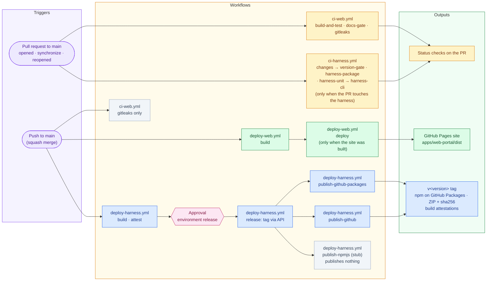
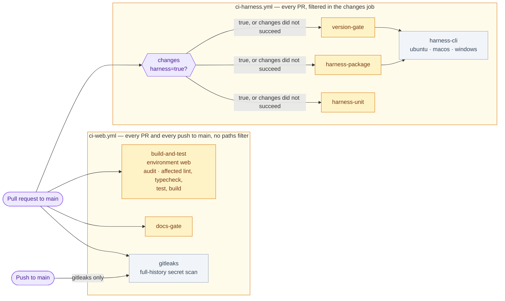

# CI/CD

Pull requests to `main` run the checks; a merge to `main` that affects the site deploys it to GitHub Pages and, separately, builds the harness release, which publishes only after a reviewer approves. Four workflows in `.github/workflows/` do all of it. Nothing deploys or publishes from a branch, and no workflow pushes to `main`.

Every job that installs dependencies uses the composite action `.github/actions/setup`: Node 24, `corepack enable`, a Yarn cache keyed on `yarn.lock`, then `yarn install --immutable`.

## Workflows

### `ci-web.yml` and `ci-harness.yml` — pull request checks

Two workflows check every pull request to `main` (`opened`, `synchronize`, `reopened`), side by side: `ci-web.yml` (workflow name `CI web`) runs all its jobs on every PR, and also runs on every push to `main` (no paths filter), where only `gitleaks` runs; `ci-harness.yml` (`CI harness`) runs its checks only when the PR touches the harness. A job cannot wait for a job in another workflow, so neither waits for the other. Both have workflow permission `contents: read` and read no secrets. Every job checks out full history (`fetch-depth: 0`) except `harness-unit` and `harness-cli`.

| Workflow         | Concurrency group                                                  | Cancel in progress                                                                                              |
| ---------------- | ------------------------------------------------------------------ | --------------------------------------------------------------------------------------------------------------- |
| `ci-harness.yml` | `ci-harness-<PR number>`                                           | Yes: a new push to the PR cancels the run for the commit it replaces                                            |
| `ci-web.yml`     | `ci-web-<PR number>`, or `ci-web-<commit sha>` on a push to `main` | Only on `pull_request`: a new push to a PR cancels the superseded run; a push-to-`main` scan is never cancelled |

| Job               | Workflow         | Needs                             | Runner                    | What it checks                                                                                                                                                                                                                                                                                                                                                                 |
| ----------------- | ---------------- | --------------------------------- | ------------------------- | ------------------------------------------------------------------------------------------------------------------------------------------------------------------------------------------------------------------------------------------------------------------------------------------------------------------------------------------------------------------------------ |
| `build-and-test`  | `ci-web.yml`     | —                                 | ubuntu, environment `web` | `yarn npm audit --all --severity moderate`; `nx affected` lint, typecheck, test and build (`--configuration=ci`) against `origin/<base>`. The build gets the four `VITE_*` variables of the `web` environment, so a PR builds the site the way the deploy does                                                                                                                 |
| `docs-gate`       | `ci-web.yml`     | —                                 | ubuntu                    | `check-docs.mjs` (install instructions pinned, no `/releases/latest` links; the full name `artisyn-implementation-harness` is never a skill, folder or command, across `docs`, the READMEs, `CLAUDE.md`, `skills`, `.claude`, `.agents`, `.claude-plugin`, `.github`); `check-commit-scope.mjs --range origin/<base>..HEAD` (commits touching the harness use scope `harness`) |
| `gitleaks`        | `ci-web.yml`     | —                                 | ubuntu                    | Downloads the MIT gitleaks binary at a pinned version (`GITLEAKS_VERSION`), verifies its `GITLEAKS_SHA256` with `sha256sum -c`, then runs `gitleaks git --config .gitleaks.toml --redact --log-opts="--all"` over the full history, on every PR and every push to `main`. The official gitleaks action is not used: it needs a license key for organization repos              |
| `changes`         | `ci-harness.yml` | —                                 | ubuntu                    | Lists the PR's files (`git diff --no-renames --name-only origin/<base>...HEAD`) and outputs `harness=true` when any matches the harness paths below. `--no-renames` lists both sides of a rename, so a file moved out of a harness path still counts; plain `--name-only` lists only the new path. A git error also gives `harness=true`                                       |
| `version-gate`    | `ci-harness.yml` | `changes`                         | ubuntu                    | `stamp-harness-version.mjs --check` (every manifest carries the `package.json` version); `version-harness.mjs --check` (the branch is stamped with the version its commits call for, with a matching changelog entry)                                                                                                                                                          |
| `harness-package` | `ci-harness.yml` | `changes`                         | ubuntu                    | `ci/check-pack.mjs` (package contents match the allowlist); `validate-plugin.mjs` with a pinned `@anthropic-ai/claude-code` via `yarn dlx`; `nx release version --dry-run` for the harness project                                                                                                                                                                             |
| `harness-unit`    | `ci-harness.yml` | `changes`                         | ubuntu                    | `yarn nx run implementation-harness-e2e:unit`: the deterministic unit specs, including the workflow and release-script specs                                                                                                                                                                                                                                                   |
| `harness-cli`     | `ci-harness.yml` | `version-gate`, `harness-package` | ubuntu, macOS, Windows    | `yarn nx run implementation-harness-e2e:unit-cli`: the Vitest specs for the install CLI and the state root. On Windows a first step runs `git config --system core.longpaths true`, because patch bundle paths exceed 260 characters                                                                                                                                           |

`version-gate`, `harness-package` and `harness-unit` run when `!cancelled() && (needs.changes.result != 'success' || needs.changes.outputs.harness == 'true')`. On a PR that touches none of the harness paths, all four harness jobs are skipped. `harness-cli` is advisory and needs `version-gate` and `harness-package`, so it runs after them. When `changes` itself fails, `harness-cli` may not run at all; the exact skip propagation in that case is not verified.

| Harness paths (`changes`)                                                                                                                                                      | Why they count                                                                                                                                                                                       |
| ------------------------------------------------------------------------------------------------------------------------------------------------------------------------------ | ---------------------------------------------------------------------------------------------------------------------------------------------------------------------------------------------------- |
| `skills/` (all of it), `.claude-plugin/`, `.agents/plugins/`, `.github/plugin/`, `skills.sh.json`                                                                              | The harness files of `deploy-harness.yml` and the commit scope rule; all of `skills/`, because `package-smoke.spec.ts` (run by `unit-cli`) checks that `skills/` holds only `implementation-harness` |
| `.claude/skills/`                                                                                                                                                              | The same spec checks that every `.claude/skills/*/SKILL.md` stays `metadata.internal: true`                                                                                                          |
| `scripts/release/`, `scripts/ci/check-pack.mjs`, `scripts/validate-plugin.mjs`, `scripts/check-commit-scope.mjs`, `scripts/check-docs.mjs`, `apps/implementation-harness-e2e/` | What the harness jobs run or test                                                                                                                                                                    |
| `.github/workflows/`, `.github/actions/`                                                                                                                                       | The workflows the unit specs pin, and the setup action the CLI matrix installs with                                                                                                                  |
| `nx.json`, `package.json`, `yarn.lock`, `.yarnrc.yml`, `.yarn/` (repo root)                                                                                                    | The toolchain                                                                                                                                                                                        |

Why the filter is built this way:

| Choice                                         | Reason                                                                                                                                                                                               |
| ---------------------------------------------- | ---------------------------------------------------------------------------------------------------------------------------------------------------------------------------------------------------- |
| Filter in a job, not in `on: paths`            | A workflow skipped by `on: paths` never starts, so the required checks `version-gate`, `harness-package` and `harness-unit` stay pending and block the merge. A job skipped by `if:` reports success |
| Gates also run when `changes` does not succeed | A job skipped because a job it needs failed also reports success. Without this, a broken `changes` job would pass the three required harness checks unchecked                                        |
| `harness-unit` beside ci-web's affected `test` | Nx does not count `.github/` or the root `scripts/` as inputs of `implementation-harness-e2e`. On a PR that changes only those, ci-web's affected test run skipped the workflow and release specs    |
| `docs-gate` in `ci-web.yml`, unfiltered        | It checks install instructions and commit scopes across the whole repo, so every PR needs it                                                                                                         |

**Known risk: the npm registry.** `harness-package` is a required check and depends on the npm registry: it downloads `@anthropic-ai/claude-code@2.1.311` through `yarn dlx` and runs an Nx Release dry run. A registry outage blocks harness merges until it passes again.

The `web` environment on `build-and-test` is the deployment the ruleset requires on every PR, and it holds the site's build variables. The job deploys nothing.

`gitleaks` scans the full history on every PR and again on every push to `main`. `build-and-test` and `docs-gate` have `if: github.event_name == 'pull_request'`, so a push to `main` runs only `gitleaks`. The push run is the after-the-fact check on `main`: it catches a secret that reached `main` without a clean PR scan, either a direct push by the ruleset's bypass actor or a merge past a red PR scan (on PRs `gitleaks` is advisory). No other workflow scans: there is no `gitleaks.yml`, and `deploy-web.yml` and `deploy-harness.yml` run no scan.

The repository is public, so a secret pushed to `main` is exposed at once; the push scan only detects it after the fact. GitHub native secret scanning and push protection, free on public repositories, would block such a push. The ruleset keeps one bypass actor, the repository owner, with mode "always", an accepted exception decided on 2026-11-17 ([runbook](./08%20Harness%20Release%20Runbook.md) step 1). Native secret scanning and push protection are disabled; enabling them is an open item for the developer. Until then the push scan is the only check on a direct push, and it detects a secret only after the fact.

`--log-opts="--all"` scans every fetched branch, not only the PR or `main`. A secret on any branch fails every scan, on every PR and push, until it is removed from history or allowlisted in `.gitleaks.toml`.

### `deploy-web.yml` — Deploy web

`deploy-web.yml` (workflow name `Deploy web`) runs on every push to `main`. Nx decides what to build, and the workflow deploys only when the build produced the site. Workflow permission is `contents: read`. Concurrency group `pages` never cancels a run in progress, but it keeps only one pending run: the next push replaces it.

| Job      | Runs                                      | Environment    | Permissions                       | What it does                                                                                                                                                                                                                                                                                                                                                                                                                                                                                                                                           |
| -------- | ----------------------------------------- | -------------- | --------------------------------- | ------------------------------------------------------------------------------------------------------------------------------------------------------------------------------------------------------------------------------------------------------------------------------------------------------------------------------------------------------------------------------------------------------------------------------------------------------------------------------------------------------------------------------------------------------ |
| `build`  | Every push to `main`                      | `web`          | `contents: read`, `actions: read` | Finds the head SHA of the last successful `deploy-web.yml` push run on `main` (`gh run list … --status success`); `yarn nx affected --target=build --configuration=ci --head=HEAD`, with `--base` set to that SHA (or the push's `before` commit as fallback) and the four `VITE_*` variables; sets output `built` to true when `apps/web-portal/dist` exists, otherwise logs the notice "The site is not affected by this push; nothing to deploy."; uploads `apps/web-portal/dist` with `actions/upload-pages-artifact@v4` only when `built` is true |
| `deploy` | `needs: build`, only when `built` is true | `github-pages` | `pages: write`, `id-token: write` | `actions/configure-pages@v5`, then `actions/deploy-pages@v4`                                                                                                                                                                                                                                                                                                                                                                                                                                                                                           |

The build reads `VITE_GITHUB_ORG`, `VITE_GITHUB_REPO`, `VITE_GISCUS_REPO_ID` and `VITE_GISCUS_CATEGORY_ID` from the `web` environment. Vite inlines them at build time; the `ci` build configuration loads no `.env` file. See [Giscus Setup](./Infrastructure/04%20Giscus%20Setup.md) for their values.

Nx decides whether the site is affected. A change to anything the site depends on makes `web-portal` affected: the web apps, `docs/`, `package.json`, shared config. Then the build produces `apps/web-portal/dist` and the run deploys. `web-portal:build` depends on `web-explorer:build` and `web-docs:build`, so the whole site is rebuilt. Pages replaces everything it serves on each deploy, so it needs the full tree.

When the push does not affect `web-portal`, there is no `dist`. The upload and the `deploy` job are skipped and the run ends with the notice above. The run does not fail.

The affected range starts at the last successful deploy, not at this push. `--base` is the head SHA of the last successful `deploy-web.yml` push run on `main`. A replaced pending run and a failed run deploy nothing, so a range that started at the push's `before` commit could leave a site change from such a push off the site for good. When there is no successful run, or its SHA is not an ancestor of `HEAD`, `--base` falls back to the push's `before` commit. Either way a multi-commit push is built in full, not only its last commit. How the tree is assembled: [Web Portal LLD](../System%20Architecture%20%28LLD%29/Web%20Portal/00.%20Overview.md).

### `deploy-harness.yml` — harness release lane

`deploy-harness.yml` (workflow name `Deploy harness`) builds the harness version that `main` carries on a push to `main` that touches `skills/implementation-harness/`, `skills/.claude-plugin/`, `.claude-plugin/`, `.agents/plugins/`, `.github/plugin/`, `skills.sh.json` or the workflow itself (a site-only merge starts nothing), or a manual run, and publishes it after a reviewer approves the `release` environment. The PR already chose that version: the developer runs `yarn harness:version` on the branch, and `version-gate` checks it. The workflow never commits or pushes to `main`. Top-level `permissions: {}`; each job gets only what it needs. Concurrency group `deploy-harness`, no cancel.

| Job                       | Runs                                                                  | Permissions                                                          | What it does                                                                                                                                                                                                                                                                                                                                                                                                                                                                                                    |
| ------------------------- | --------------------------------------------------------------------- | -------------------------------------------------------------------- | --------------------------------------------------------------------------------------------------------------------------------------------------------------------------------------------------------------------------------------------------------------------------------------------------------------------------------------------------------------------------------------------------------------------------------------------------------------------------------------------------------------- |
| `build`                   | A harness push to `main` or a manual run                              | `contents: read`, `packages: read`, `id-token`, `attestations` write | First step "Only main is released" fails any run whose ref is not `refs/heads/main`, before anything is built or attested (a manual run can start from any branch; this complements the `release` environment's `main`-only branch policy). Reads the version from `skills/implementation-harness/package.json`; skips when GitHub Packages has it and a non-draft Release carries the ZIP and `.sha256`; otherwise builds the tarball, the ZIP and `.sha256`, attests both, uploads artifact `harness-release` |
| `release`                 | `needs: build`, only when something is missing; environment `release` | `contents: write`                                                    | Waits for approval; creates the tag `v<version>` (`TAG_PREFIX: v`) on `GITHUB_SHA` through `gh api`; stops if another run released this version from a different commit while it waited                                                                                                                                                                                                                                                                                                                         |
| `publish-github-packages` | `needs: [build, release]`                                             | `contents: read`, `packages: write`                                  | Downloads artifact `harness-release`; packs again and fails unless the pack is byte-identical (`cmp`) to the attested tarball; `yarn workspace … npm publish --tolerate-republish` to GitHub Packages; fails unless the registry's `dist.integrity` is the attested sha512                                                                                                                                                                                                                                      |
| `publish-github`          | `needs: [build, release]`; no checkout                                | `contents: write`                                                    | Downloads artifact `harness-release`; creates a draft Release titled with the tag, uploads the ZIP and `.sha256` (named with `ASSET_PREFIX: artisyn-implementation-harness-v`), publishes it                                                                                                                                                                                                                                                                                                                    |
| `publish-npmjs` (stub)    | `needs: [build, release]`; no checkout                                | `contents: read`                                                     | Publishes nothing; prints a notice that npmjs.com publishing is not set up. Not a channel: npm installs come from GitHub Packages                                                                                                                                                                                                                                                                                                                                                                               |

The three publish jobs run in parallel after the one approval. What makes `publish-npmjs` real: [runbook](./08%20Harness%20Release%20Runbook.md) step 6.

| Item        | Value                                                                                                                                                                                                       |
| ----------- | ----------------------------------------------------------------------------------------------------------------------------------------------------------------------------------------------------------- |
| Credentials | `GITHUB_TOKEN` only (as `GITHUB_PACKAGES_TOKEN` and `GH_TOKEN`); checkout with `persist-credentials: false`                                                                                                 |
| Re-run      | Finishes only what is missing: an existing tag stays, GitHub Packages skips a published version, an already-published Release keeps its assets. **Re-run failed jobs** re-runs one failed publish job alone |
| Failure     | When the tag exists but the merged commit changes `skills/implementation-harness` after it, `build` fails: a PR merged a version that was already released                                                  |

Fix that failure with a new branch that runs `yarn harness:version` and merges the stamp. Step-by-step operation: [08 Harness Release Runbook](./08%20Harness%20Release%20Runbook.md). Internals: [Harness Release Pipeline LLD](../System%20Architecture%20%28LLD%29/Harness%20Release%20Pipeline/00.%20Overview.md).

`deploy-web.yml` and `deploy-harness.yml` are independent. A site change deploys on merge whether or not the release is approved.

## Environments

There are exactly three GitHub Actions environments; only `release` gates a job on a person.

| Environment    | Used by                                                         | Holds                                                                                             | Protection                                                                                                                                                                                                                                                                            |
| -------------- | --------------------------------------------------------------- | ------------------------------------------------------------------------------------------------- | ------------------------------------------------------------------------------------------------------------------------------------------------------------------------------------------------------------------------------------------------------------------------------------- |
| `web`          | `ci-web.yml` job `build-and-test`; `deploy-web.yml` job `build` | Variables `VITE_GITHUB_ORG`, `VITE_GITHUB_REPO`, `VITE_GISCUS_REPO_ID`, `VITE_GISCUS_CATEGORY_ID` | None; the ruleset requires a deployment to it on every PR. Neither job deploys anything                                                                                                                                                                                               |
| `github-pages` | `deploy-web.yml` job `deploy`                                   | —                                                                                                 | The live site                                                                                                                                                                                                                                                                         |
| `release`      | `deploy-harness.yml` job `release`                              | —                                                                                                 | Required reviewers (the repository owner, self-review allowed): the tag and every publish job wait for approval. Deployment branches: `main` only, so a run started by hand from another branch fails before approval. Setup: [runbook](./08%20Harness%20Release%20Runbook.md) step 2 |

The site's build variables live only in `web`; the repository has no repository-level variables (checked 2026-11-17). The old `dev` environment was deleted in the 2026-11-17 cutover ([runbook](./08%20Harness%20Release%20Runbook.md) step 1).

`release` must exist with reviewers before the first harness merge. GitHub creates a missing environment on first use with no protection, and the release would run without approval.

## Required and advisory checks

The required checks on `main` are five job IDs: `build-and-test` and `docs-gate` from `ci-web.yml`, and `version-gate`, `harness-package` and `harness-unit` from `ci-harness.yml`. Design decision D-17 named the first three; on 2026-11-17 the set was extended with `harness-package` and `harness-unit`. Everything else reports on the PR but does not block the merge. The three `ci-harness.yml` checks run on harness PRs, and also when `changes` fails. On other PRs they are skipped, and a skipped job reports success, so they do not block.

| Check                                                                        | Workflow         | Status   | Why                                                      |
| ---------------------------------------------------------------------------- | ---------------- | -------- | -------------------------------------------------------- |
| `build-and-test`                                                             | `ci-web.yml`     | required |                                                          |
| `docs-gate`                                                                  | `ci-web.yml`     | required |                                                          |
| `version-gate`                                                               | `ci-harness.yml` | required |                                                          |
| `harness-package`                                                            | `ci-harness.yml` | required | Added 2026-11-17                                         |
| `harness-unit`                                                               | `ci-harness.yml` | required | Added 2026-11-17                                         |
| `harness-cli (<os>)` — three matrix runs, e.g. `harness-cli (ubuntu-latest)` | `ci-harness.yml` | advisory | One flaky macOS or Windows runner must not block a merge |
| `gitleaks` (PR run; also runs on push to `main`)                             | `ci-web.yml`     | advisory |                                                          |
| `changes`                                                                    | `ci-harness.yml` | advisory | Only decides which harness jobs run                      |

Checked on 2026-11-17: the live ruleset on `main` requires all five, each with source GitHub Actions (integration_id 15368), so no one can satisfy a check with a hand-posted commit status. It also requires the `web` deployment, squash-only merges and linear history. `strict_required_status_checks_policy: true` (branch up to date with `main`) applies because checks are required. It keeps one bypass actor, the repository owner, as an accepted exception ([runbook](./08%20Harness%20Release%20Runbook.md) step 1). Full ruleset: [07 Branching Strategy](./07%20Branching%20Strategy.md#branch-protection).

## Local vs CI

Husky runs two hooks on every commit; everything else runs only in CI unless you run it yourself. `yarn install` installs the hooks (`postinstall: husky`).

| Hook         | What it runs                                                                                                                             |
| ------------ | ---------------------------------------------------------------------------------------------------------------------------------------- |
| `pre-commit` | `yarn lint-staged`: `eslint --fix` + `prettier --write` on staged `ts/tsx/js/mjs`; `prettier --write` on `json/md/yaml/yml`              |
| `commit-msg` | `node scripts/check-commit-scope.mjs --message-file "$1"`: a commit touching harness paths must use scope `harness` or `harness-release` |

Reproduce each CI gate locally from the repo root with Node 24. The package manager is `yarn`; never use `npm` or `npx` in this repo.

| Gate              | Local command                                                                                                                                                                                                                   |
| ----------------- | ------------------------------------------------------------------------------------------------------------------------------------------------------------------------------------------------------------------------------- |
| `build-and-test`  | `yarn npm audit --all --severity moderate` · `yarn nx affected --target=lint --base=origin/main --head=HEAD` (same for `typecheck`, `test`, and `build --configuration=ci`)                                                     |
| `version-gate`    | `git fetch --tags` · `node scripts/release/stamp-harness-version.mjs --check` · `node scripts/release/version-harness.mjs --check`                                                                                              |
| `docs-gate`       | `node scripts/check-docs.mjs` · `node scripts/check-commit-scope.mjs --range origin/main..HEAD`                                                                                                                                 |
| `harness-package` | `node scripts/ci/check-pack.mjs` · `CLAUDE_CMD="yarn dlx --quiet -p @anthropic-ai/claude-code@2.1.311 claude" node scripts/validate-plugin.mjs` · `yarn nx release version --projects=artisyn-implementation-harness --dry-run` |
| `harness-unit`    | `yarn nx run implementation-harness-e2e:unit`                                                                                                                                                                                   |
| `harness-cli`     | `yarn nx run implementation-harness-e2e:unit-cli`                                                                                                                                                                               |
| gitleaks          | A local gitleaks binary: `gitleaks git --config .gitleaks.toml --redact --log-opts="--all" .`                                                                                                                                   |

`version-harness.mjs --check` needs the harness tags locally; it computes the version from the latest `v*` tag reachable from HEAD (the `v4.0.2` bridge tag until 4.1.0 is released; see [runbook](./08%20Harness%20Release%20Runbook.md) step 3).

## One release lane

The harness lane is the repository's only release lane. The repository itself is not versioned: every `v*` tag from `v4.0.2` on is a harness version (the old `v1.1.1` predates the current release scheme), and the root `CHANGELOG.md` is frozen history.

| Aspect           | Harness lane                                                                                                                                                                                         |
| ---------------- | ---------------------------------------------------------------------------------------------------------------------------------------------------------------------------------------------------- |
| Workflow         | `deploy-harness.yml`                                                                                                                                                                                 |
| Tool             | Nx Release (`nx.json` `release` block) via `version-harness.mjs`                                                                                                                                     |
| Version decided  | In the PR, by `yarn harness:version`; checked by `version-gate`                                                                                                                                      |
| Commits counted  | Commits touching `skills/implementation-harness/` (by path, `useCommitScope: false`)                                                                                                                 |
| Tag              | `vX.Y.Z`, e.g. `v4.1.0` (releases up to 4.0.2 keep the long tag `artisyn-implementation-harness-vX.Y.Z`); assets keep the name `artisyn-implementation-harness-vX.Y.Z.zip` / `.tgz`                  |
| Changelog        | Harness `CHANGELOG.md`, written in the PR by `scripts/release/changelog-renderer.mjs` in the semantic-release format                                                                                 |
| Outputs          | npm on GitHub Packages, ZIP + `.sha256`, build attestations, GitHub Release                                                                                                                          |
| Release notes    | The version's changelog entry, extracted by `build` as `release-notes.md` and passed with `--notes-file`                                                                                             |
| Writes to `main` | No: tag created through the API                                                                                                                                                                      |
| Runs             | `build` on a push to `main` that touches the harness (paths filter) or by hand, no enable switch; `release`, `publish-github-packages`, `publish-github` and the `publish-npmjs` stub after approval |

No workflow pushes to `main`, so the release lane needs no bypass actor; the ruleset's one bypass actor exists for the owner's direct pushes, not for releases. Branch rulesets do not cover tags, packages or releases. The `harness` / `harness-release` scope rule stays so harness changes stand apart in history and the changelog.

## Guarded commands

CI never runs a guarded command; the developer starts each one.

- `yarn nx run implementation-harness-e2e:agent-e2e` spends real agent budget. It never runs in CI.
- `git push`, including the runbook's one-time bridge tag push (`git push origin v4.0.2`).

A region is deployment configuration only. Never hardcode one in a workflow, script or doc.

## Related

- [07 Branching Strategy](./07%20Branching%20Strategy.md) — branch flow, naming, the `main` ruleset, rollback
- [08 Harness Release Runbook](./08%20Harness%20Release%20Runbook.md) — one-time setup, per-PR versioning, approval, smoke checks
- [Harness Release Pipeline LLD](../System%20Architecture%20%28LLD%29/Harness%20Release%20Pipeline/00.%20Overview.md) — harness lane internals and gate scripts
- [Web Portal LLD](../System%20Architecture%20%28LLD%29/Web%20Portal/00.%20Overview.md) — the composed Pages artifact
- [Web Docs LLD](../System%20Architecture%20%28LLD%29/Web%20Docs/00.%20Overview.md) — the VitePress build
- [Giscus Setup](./Infrastructure/04%20Giscus%20Setup.md) — the `VITE_` values
- [01 Conventions](./01%20Conventions.md) — commit and branch format
