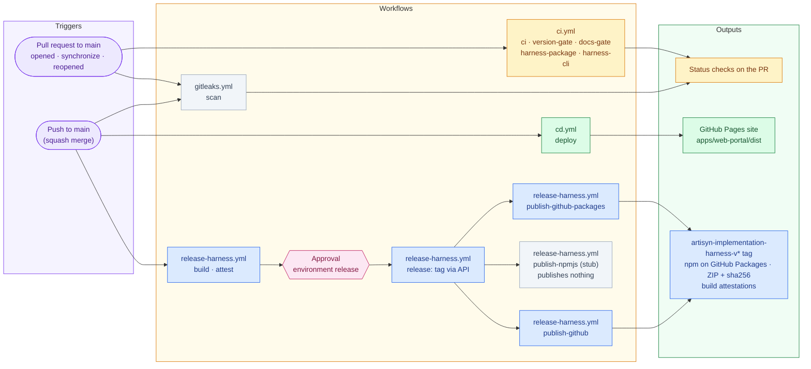

# CI/CD

Pull requests to `main` run the checks; a merge to `main` deploys the site to GitHub Pages and, separately, builds the harness release, which publishes only after a reviewer approves. Four workflows in `.github/workflows/` do all of it. Nothing deploys or publishes from a branch, and no workflow pushes to `main`.

Every job that installs dependencies uses the composite action `.github/actions/setup`: Node 24, `corepack enable`, a Yarn cache keyed on `yarn.lock`, then `yarn install --immutable`.

## Workflows

### `ci.yml` — pull request checks

`ci.yml` runs on every pull request to `main` (`opened`, `synchronize`, `reopened`). Workflow permission is `contents: read`. It reads no secrets and no repository variables. Every job checks out full history (`fetch-depth: 0`) except `harness-cli`.

| Job               | Runner                    | What it checks                                                                                                                                                                                                                                                                                                                                                                 |
| ----------------- | ------------------------- | ------------------------------------------------------------------------------------------------------------------------------------------------------------------------------------------------------------------------------------------------------------------------------------------------------------------------------------------------------------------------------ |
| `ci`              | ubuntu, environment `dev` | `yarn npm audit --all --severity moderate`; `nx affected` lint, typecheck, test and build (`--configuration=ci`) against `origin/<base>`; `yarn nx run log-hub:verify` (Log Hub canonical isolation)                                                                                                                                                                           |
| `version-gate`    | ubuntu                    | `stamp-harness-version.mjs --check` (every manifest carries the `package.json` version); `version-harness.mjs --check` (the branch is stamped with the version its commits call for, with a matching changelog entry)                                                                                                                                                          |
| `docs-gate`       | ubuntu                    | `check-docs.mjs` (install instructions pinned, no `/releases/latest` links; the full name `artisyn-implementation-harness` is never a skill, folder or command, across `docs`, the READMEs, `CLAUDE.md`, `skills`, `.claude`, `.agents`, `.claude-plugin`, `.github`); `check-commit-scope.mjs --range origin/<base>..HEAD` (commits touching the harness use scope `harness`) |
| `harness-package` | ubuntu                    | `ci/check-pack.mjs` (package contents match the allowlist); `validate-plugin.mjs` with a pinned `@anthropic-ai/claude-code` via `yarn dlx`; `nx release version --dry-run` for the harness project                                                                                                                                                                             |
| `harness-cli`     | ubuntu, macOS, Windows    | Vitest specs for the install CLI and the state root (`vitest.unit.config.ts`). On Windows a first step runs `git config --system core.longpaths true`, because patch bundle paths exceed 260 characters                                                                                                                                                                        |

The `dev` environment on the `ci` job exists for the ruleset's "deployment to `dev`" rule. The job deploys nothing.

### `gitleaks.yml` — secret scan

`gitleaks.yml` scans the full git history on every pull request to `main` and every push to `main`. One job, `scan`, with `contents: read`. It downloads the MIT gitleaks binary at a pinned version (`GITLEAKS_VERSION`), verifies its `GITLEAKS_SHA256` with `sha256sum -c`, then runs `gitleaks git --config .gitleaks.toml --redact --log-opts="--all"`. The official gitleaks action is not used: it needs a license key for organization repos. No secrets.

### `cd.yml` — GitHub Pages deploy

`cd.yml` builds the site and deploys it to GitHub Pages on every push to `main`. One job, `deploy`, in the `github-pages` environment, with `contents: read`, `pages: write` and `id-token: write`. Concurrency group `pages` queues deploys and never cancels one in progress.

| Step            | What it does                                                                                                   |
| --------------- | -------------------------------------------------------------------------------------------------------------- |
| Build site      | `yarn nx affected --target=build --configuration=ci --base=HEAD~1 --head=HEAD`, with four repository variables |
| Configure Pages | `actions/configure-pages@v5`                                                                                   |
| Upload artifact | `actions/upload-pages-artifact@v4`, path `apps/web-portal/dist` (the composed Web Explorer + Web Docs tree)    |
| Deploy          | `actions/deploy-pages@v4`                                                                                      |

The build reads repository variables `VITE_GITHUB_ORG`, `VITE_GITHUB_REPO`, `VITE_GISCUS_REPO_ID` and `VITE_GISCUS_CATEGORY_ID`. Vite inlines them at build time; the `ci` build configuration loads no `.env` file. See [Giscus Setup](./Infrastructure/04%20Giscus%20Setup.md) for their values.

The build covers only projects affected by the merged commit (`--base=HEAD~1`). `apps/web-portal/dist` exists only when `web-portal` was affected; `web-portal` is affected whenever Web Explorer or Web Docs changes. How the tree is assembled: [Web Portal LLD](../System%20Architecture%20%28LLD%29/Web%20Portal/00.%20Overview.md).

### `release-harness.yml` — harness release lane

`release-harness.yml` builds the harness version that `main` carries on every push to `main`, and publishes it after a reviewer approves the `release` environment. The PR already chose that version: the developer runs `yarn harness:version` on the branch, and `version-gate` checks it. The workflow never commits or pushes to `main`. Top-level `permissions: {}`; each job gets only what it needs. Concurrency group `release-harness`, no cancel.

| Job                       | Runs                                                                  | Permissions                                                          | What it does                                                                                                                                                                                                                                                        |
| ------------------------- | --------------------------------------------------------------------- | -------------------------------------------------------------------- | ------------------------------------------------------------------------------------------------------------------------------------------------------------------------------------------------------------------------------------------------------------------- |
| `build`                   | Every push to `main`, no condition                                    | `contents: read`, `packages: read`, `id-token`, `attestations` write | Reads the version from `skills/implementation-harness/package.json`; skips when GitHub Packages has it and a non-draft Release carries the ZIP and `.sha256`; otherwise builds the tarball, the ZIP and `.sha256`, attests both, uploads artifact `harness-release` |
| `release`                 | `needs: build`, only when something is missing; environment `release` | `contents: write`                                                    | Waits for approval; creates `artisyn-implementation-harness-v<version>` on `GITHUB_SHA` through `gh api`; stops if another run released this version from a different commit while it waited                                                                        |
| `publish-github-packages` | `needs: [build, release]`                                             | `contents: read`, `packages: write`                                  | `yarn workspace … npm publish --tolerate-republish` to GitHub Packages                                                                                                                                                                                              |
| `publish-github`          | `needs: [build, release]`; no checkout                                | `contents: write`                                                    | Downloads artifact `harness-release`; creates a draft Release, uploads the ZIP and `.sha256`, publishes it                                                                                                                                                          |
| `publish-npmjs` (stub)    | `needs: [build, release]`; no checkout                                | `contents: read`                                                     | Publishes nothing; prints a notice that npmjs.com publishing is not set up. Not a channel: npm installs come from GitHub Packages                                                                                                                                   |

The three publish jobs run in parallel after the one approval. What makes `publish-npmjs` real: [runbook](./08%20Harness%20Release%20Runbook.md) step 6.

| Item        | Value                                                                                                                                                                                                       |
| ----------- | ----------------------------------------------------------------------------------------------------------------------------------------------------------------------------------------------------------- |
| Credentials | `GITHUB_TOKEN` only (as `GITHUB_PACKAGES_TOKEN` and `GH_TOKEN`); checkout with `persist-credentials: false`                                                                                                 |
| Re-run      | Finishes only what is missing: an existing tag stays, GitHub Packages skips a published version, an already-published Release keeps its assets. **Re-run failed jobs** re-runs one failed publish job alone |
| Failure     | When the tag exists but the merged commit changes `skills/implementation-harness` after it, `build` fails: a PR merged a version that was already released                                                  |

Fix that failure with a new branch that runs `yarn harness:version` and merges the stamp. Step-by-step operation: [08 Harness Release Runbook](./08%20Harness%20Release%20Runbook.md). Internals: [Harness Release Pipeline LLD](../System%20Architecture%20%28LLD%29/Harness%20Release%20Pipeline/00.%20Overview.md).

`cd.yml` and `release-harness.yml` are independent. The site deploys on merge whether or not the release is approved.

## Environments

Three GitHub Actions environments exist; only `release` gates a job on a person.

| Environment    | Used by                             | Protection                                                                                                                          |
| -------------- | ----------------------------------- | ----------------------------------------------------------------------------------------------------------------------------------- |
| `dev`          | `ci.yml` job `ci`                   | None; the ruleset requires a deployment to it on every PR. The job deploys nothing                                                  |
| `github-pages` | `cd.yml` job `deploy`               | The live site                                                                                                                       |
| `release`      | `release-harness.yml` job `release` | Required reviewers: the tag and every publish job wait for approval. Setup: [runbook](./08%20Harness%20Release%20Runbook.md) step 2 |

`release` must exist with reviewers before the first harness merge. GitHub creates a missing environment on first use with no protection, and the release would run without approval.

## Required and advisory checks

The target required checks on `main` are `ci`, `version-gate` and `docs-gate`. They are the job IDs `ci.yml` produces. Everything else reports on the PR but does not block the merge.

| Check                                    | Status   |
| ---------------------------------------- | -------- |
| `ci`                                     | required |
| `version-gate`                           | required |
| `docs-gate`                              | required |
| `harness-package`                        | advisory |
| `harness-cli (<os>)` — three matrix runs | advisory |
| gitleaks `scan`                          | advisory |

On 2026-11-16 the live ruleset on `main` had an empty required-check list. [Runbook](./08%20Harness%20Release%20Runbook.md) step 1 says to add the three checks and remove the bypass actors. The same ruleset already enforces squash-only merges, linear history, a branch up to date with `main`, and a successful deployment to `dev`. Full ruleset: [07 Branching Strategy](./07%20Branching%20Strategy.md#branch-protection).

## Local vs CI

Husky runs two hooks on every commit; everything else runs only in CI unless you run it yourself. `yarn install` installs the hooks (`postinstall: husky`).

| Hook         | What it runs                                                                                                                             |
| ------------ | ---------------------------------------------------------------------------------------------------------------------------------------- |
| `pre-commit` | `yarn lint-staged`: `eslint --fix` + `prettier --write` on staged `ts/tsx/js/mjs`; `prettier --write` on `json/md/yaml/yml`              |
| `commit-msg` | `node scripts/check-commit-scope.mjs --message-file "$1"`: a commit touching harness paths must use scope `harness` or `harness-release` |

Reproduce each CI gate locally from the repo root with Node 24. The package manager is `yarn`; never use `npm` or `npx` in this repo.

| Gate              | Local command                                                                                                                                                                                                                   |
| ----------------- | ------------------------------------------------------------------------------------------------------------------------------------------------------------------------------------------------------------------------------- |
| `ci`              | `yarn npm audit --all --severity moderate` · `yarn nx affected --target=lint --base=origin/main --head=HEAD` (same for `typecheck`, `test`, and `build --configuration=ci`) · `yarn nx run log-hub:verify`                      |
| `version-gate`    | `git fetch --tags` · `node scripts/release/stamp-harness-version.mjs --check` · `node scripts/release/version-harness.mjs --check`                                                                                              |
| `docs-gate`       | `node scripts/check-docs.mjs` · `node scripts/check-commit-scope.mjs --range origin/main..HEAD`                                                                                                                                 |
| `harness-package` | `node scripts/ci/check-pack.mjs` · `CLAUDE_CMD="yarn dlx --quiet -p @anthropic-ai/claude-code@2.1.311 claude" node scripts/validate-plugin.mjs` · `yarn nx release version --projects=artisyn-implementation-harness --dry-run` |
| `harness-cli`     | `yarn workspace @artisyn-harness/implementation-harness-e2e vitest run --config vitest.unit.config.ts src/tests/unit/cli src/tests/unit/state-root.spec.ts`                                                                     |
| gitleaks          | A local gitleaks binary: `gitleaks git --config .gitleaks.toml --redact --log-opts="--all" .`                                                                                                                                   |

`version-harness.mjs --check` needs the harness tags locally; it computes the version from the latest `artisyn-implementation-harness-v*` tag reachable from HEAD.

## One release lane

The harness lane is the repository's only release lane. The repository itself is not versioned: there are no `v*` tags, and the root `CHANGELOG.md` is frozen history.

| Aspect           | Harness lane                                                                                                                                          |
| ---------------- | ----------------------------------------------------------------------------------------------------------------------------------------------------- |
| Workflow         | `release-harness.yml`                                                                                                                                 |
| Tool             | Nx Release (`nx.json` `release` block) via `version-harness.mjs`                                                                                      |
| Version decided  | In the PR, by `yarn harness:version`; checked by `version-gate`                                                                                       |
| Commits counted  | Commits touching `skills/implementation-harness/` (by path, `useCommitScope: false`)                                                                  |
| Tag              | `artisyn-implementation-harness-vX.Y.Z`                                                                                                               |
| Changelog        | Harness `CHANGELOG.md`, written in the PR by `scripts/release/changelog-renderer.mjs` in the semantic-release format                                  |
| Outputs          | npm on GitHub Packages, ZIP + `.sha256`, build attestations, GitHub Release                                                                           |
| Release notes    | The version's changelog entry, extracted by `build` as `release-notes.md` and passed with `--notes-file`                                              |
| Writes to `main` | No: tag created through the API                                                                                                                       |
| Runs             | `build` on every push to `main`, no enable switch; `release`, `publish-github-packages`, `publish-github` and the `publish-npmjs` stub after approval |

Nothing pushes to `main`, so the ruleset needs no bypass actor. Branch rulesets do not cover tags, packages or releases. The `harness` / `harness-release` scope rule stays so harness changes stand apart in history and the changelog.

## Guarded commands

CI never runs a guarded command; the developer starts each one.

- `yarn nx run implementation-harness-e2e:agent-e2e` spends real agent budget. It never runs in CI.
- `git push`, including the runbook's baseline tag push.

A region is deployment configuration only. Never hardcode one in a workflow, script or doc.

## Related

- [07 Branching Strategy](./07%20Branching%20Strategy.md) — branch flow, naming, the `main` ruleset, rollback
- [08 Harness Release Runbook](./08%20Harness%20Release%20Runbook.md) — one-time setup, per-PR versioning, approval, smoke checks
- [Harness Release Pipeline LLD](../System%20Architecture%20%28LLD%29/Harness%20Release%20Pipeline/00.%20Overview.md) — harness lane internals and gate scripts
- [Web Portal LLD](../System%20Architecture%20%28LLD%29/Web%20Portal/00.%20Overview.md) — the composed Pages artifact
- [Web Docs LLD](../System%20Architecture%20%28LLD%29/Web%20Docs/00.%20Overview.md) — the VitePress build
- [Giscus Setup](./Infrastructure/04%20Giscus%20Setup.md) — the `VITE_` values
- [01 Conventions](./01%20Conventions.md) — commit and branch format
