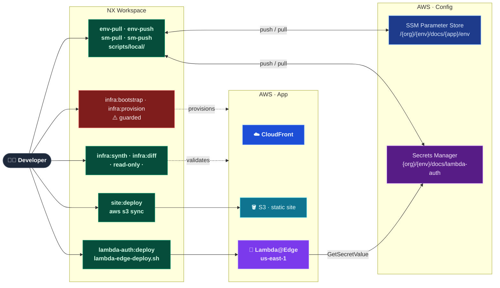

# Configuration & Secrets

_Principles for how environment configuration and secrets flow from source to runtime._

---

## Principle

Environment-specific values are never hardcoded in source. They flow through three tiers, each
matched to its sensitivity and lifecycle:



| Tier                    | What lives here                                                                      | How it reaches the app                                                                        |
| ----------------------- | ------------------------------------------------------------------------------------ | --------------------------------------------------------------------------------------------- |
| **Shell env**           | AWS identity (`AWS_PROFILE`, `AWS_REGION`)                                           | Developer sets in `~/.zshrc`; CI injects via OIDC / GitHub Actions                            |
| **SSM Parameter Store** | App build config — names, IDs, endpoints (`SM_SECRET_NAME`, `CF_DISTRIBUTION_ID`, …) | `env-pull` writes `.env.<env>`; NX loads via `envFile`                                        |
| **Secrets Manager**     | Runtime secrets — hashes, tokens, API keys (`DOCS_BASIC_AUTH_HASH`, …)               | `sm-pull` writes `.secrets.<env>` for local dev; Lambda reads via `GetSecretValue` at runtime |

---

## App ownership

**Each app owns the config and secrets it produces.** The team responsible for an app is the only
one that pushes to its SSM parameters and SM secrets. Consumers read at runtime via IAM — they never
push.

```
apps/lambda-auth/   ← owns {org}/dev/docs/lambda-auth (SM)
                          and /{org}/dev/docs/lambda-auth/env (SSM)
apps/docs-web/      ← owns /{org}/dev/docs/site/env (SSM)
apps/infra/         ← owns /{org}/dev/docs/infra/env (SSM)
```

An app's IAM execution role references its **exact** secret ARN — never a wildcard. Grouping
unrelated apps under one secret violates least privilege. See `01 Conventions.md` → "Secrets
management: sm-push / sm-pull" for the naming convention and IAM boundaries.

---

## Push/pull target pattern

All four targets are defined once in `nx.json` `targetDefaults`. Each `project.json` only carries
`configurations` — no per-app boilerplate.

| Target     | Store               | Direction     | Typical invocation                 |
| ---------- | ------------------- | ------------- | ---------------------------------- |
| `env-push` | SSM Parameter Store | local → cloud | `yarn nx run <app>:env-push:<env>` |
| `env-pull` | SSM Parameter Store | cloud → local | `yarn nx run <app>:env-pull:<env>` |
| `sm-push`  | Secrets Manager     | local → cloud | `yarn nx run <app>:sm-push:<env>`  |
| `sm-pull`  | Secrets Manager     | cloud → local | `yarn nx run <app>:sm-pull:<env>`  |

**`env-push` targets do not use `envFile`** — the script reads the source file directly via
`ENV_SOURCE_FILE`. Only `sm-push` / `sm-pull` need `envFile` to resolve `SM_SECRET_NAME`.

**Developer onboarding flow (one-time per environment):**

```bash
yarn nx run <app>:env-pull:dev      # SSM → .env.dev      (config)
yarn nx run <app>:sm-pull:dev       # SM  → .secrets.dev  (secrets, if app owns any)
```

SSM pull is always first — it is bootstrap-safe (no infrastructure provisioning required, only IAM).

---

## File conventions

Each app ships two committed templates and two gitignored local copies:

```
apps/<name>/
  .env.example       ← committed; all keys, non-secret defaults pre-filled
  .secrets.example   ← committed; all keys blank; generation instructions in comments
  .env.dev           ← gitignored; pulled from SSM via env-pull
  .secrets.dev       ← gitignored; pulled from SM via sm-pull
```

**Rules:**

- `.env.<env>` — build config only; no credentials. Loaded by NX `envFile`.
- `.secrets.<env>` — credentials only; pushed to SM via `sm-push`, read at runtime via SDK.
- Both are gitignored via `.gitignore` at the repo root (`*.env.*`, `*.secrets.*` patterns).
- `.env.example` and `.secrets.example` are always committed — a new developer can bootstrap by
  copying them and pulling from the stores.
- `SM_SECRET_NAME` is never stored inside the secret it names — no circular reference.

---

## CI/CD

CI pipelines never read `.env.*` or `.secrets.*` files from disk. Configuration reaches pipelines
via AWS OIDC (short-lived credentials) and GitHub Actions variables (SSM parameter paths and
bootstrap region only).

See `Infrastructure/03 CI-CD Pipeline.md` for the full pipeline reference: OIDC flow, CI/CD
workflow steps, SSM env-fetch pattern, GitHub variables table, and guarded operations.

---

## What never goes in source

| Value                    | Reason                                                    |
| ------------------------ | --------------------------------------------------------- |
| AWS account IDs          | Environment-specific; changes between accounts            |
| Region strings in config | Must come from `AWS_REGION` (not hardcoded)               |
| AWS profile names        | Developer-local; meaningless in CI                        |
| Secret names or ARNs     | Environment-specific; belong in `.env.<env>` via SSM pull |
| Secret values            | Use Secrets Manager; never in source                      |
| Access keys / tokens     | Use named profiles locally, OIDC in CI                    |

**One AWS-imposed exception:** Lambda@Edge viewer-request functions must be deployed in `us-east-1` — an AWS constraint, not an architectural choice. The CDK infrastructure uses a dedicated `EdgeStack` scoped to `us-east-1` for this purpose; the main `DocsStack` and all other resources remain region-agnostic.
