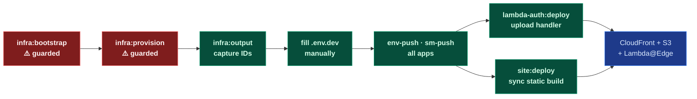

# Local Provisioning Runbook

_Step-by-step sequence for provisioning a fresh environment and deploying all apps from a local workstation._

---

## Overview



---

## Step 1 — Bootstrap CDK (one-time per account/region)

Run manually — this is a guarded command:

```
yarn nx run infra:bootstrap:dev
```

Provisions the CDK toolkit stack in the target AWS account. Only needed once per account and region pair. Skip on all subsequent deploys.

---

## Step 2 — Deploy infrastructure (guarded)

Run manually — this is a guarded command:

```
yarn nx run infra:provision:dev
```

Creates CloudFront distribution, S3 bucket (with Origin Access Control), Lambda IAM roles, Secrets Manager secret, and all CDK constructs. Skip on subsequent deploys unless infra has changed.

> **Important:** any `infra:provision` resets the CloudFront Lambda@Edge association to the CDK placeholder. Always follow immediately with Step 6 (`lambda-auth:deploy`) to restore the real handler.

---

## Step 3 — Capture infrastructure outputs

```bash
yarn nx run infra:output:dev
```

Copy the printed values into the matching env files:

| Output key             | Destination file                                       |
| ---------------------- | ------------------------------------------------------ |
| `CF_DISTRIBUTION_ID`   | `apps/lambda-auth/.env.dev` · `apps/docs-web/.env.dev` |
| `LAMBDA_FUNCTION_NAME` | `apps/lambda-auth/.env.dev`                            |
| `S3_BUCKET_NAME`       | `apps/docs-web/.env.dev`                               |
| `AuthSecretName`       | `apps/lambda-auth/.env.dev` → `SM_SECRET_NAME`         |

---

## Step 4 — Push config to SSM

```bash
yarn nx run infra:env-push:dev
yarn nx run lambda-auth:env-push:dev
yarn nx run site:env-push:dev
```

Writes each app's `.env.dev` into SSM Parameter Store under `/{org}/dev/docs/{app}/env`.

---

## Step 5 — Push lambda-auth secret to Secrets Manager

```bash
yarn nx run lambda-auth:sm-push:dev
```

Writes `DOCS_BASIC_AUTH_HASH` into Secrets Manager at `{org}/dev/docs/lambda-auth`. The Lambda@Edge handler reads this at cold-start via `GetSecretValue`.

---

## Step 6 — Deploy Lambda@Edge handler

```bash
yarn nx run lambda-auth:deploy:dev
```

Builds, zips, and uploads the handler; publishes a new version; updates the CloudFront viewer-request association. **Always run after any `infra:provision`** — see the note in Step 2.

---

## Step 7 — Deploy the static site

```bash
yarn nx run site:deploy:dev
```

Runs the VitePress build and syncs the output to S3. CloudFront serves it immediately.

---

## Subsequent deploys

After the environment is provisioned, only run the steps that correspond to what changed:

| What changed             | Steps to run                   |
| ------------------------ | ------------------------------ |
| Infra config (CDK)       | Step 2, then Step 6            |
| Lambda@Edge handler only | Step 6                         |
| Site content only        | Step 7                         |
| SSM config changed       | Step 4 for the affected app(s) |
| Secrets changed          | Step 5 for the affected app(s) |

---

## Adding a new environment

Follow the same sequence from Step 1, replacing `:dev` with the new environment suffix (e.g. `:prod`). Ensure the matching `.env.prod` files are populated before running push targets.
