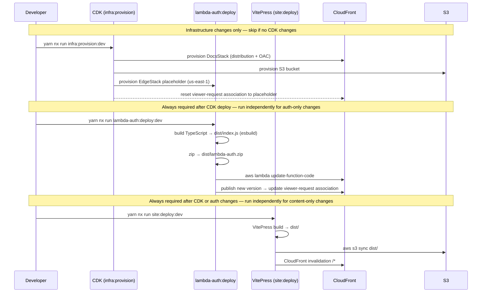

# Deploy Lifecycle

_Full sequence from code change to live site — infrastructure, auth handler, and site content._

---

## Full deploy sequence



CDK deploy is only required when infrastructure changes. `lambda-auth:deploy` and `site:deploy` can run independently for code-only or content-only changes.

---

## Infrastructure deploy (CDK)

Two stacks are deployed in order:

| Stack       | Region                                             | Contents                                                   |
| ----------- | -------------------------------------------------- | ---------------------------------------------------------- |
| `EdgeStack` | `us-east-1` (hard AWS requirement for Lambda@Edge) | Placeholder Lambda function for viewer-request association |
| `DocsStack` | Deployment region                                  | CloudFront distribution, S3 bucket, IAM/OAC                |

The `EdgeStack` placeholder Lambda returns `event.Records[0].cf.response` unchanged. It exists solely to establish the CloudFront viewer-request association. The real handler is deployed via `lambda-auth:deploy`.

Operational coupling: any `cdk deploy` touching `DocsStack` resets the CloudFront Lambda@Edge association back to the CDK placeholder version. `lambda-auth:deploy` must always run after a CDK deploy.

```sh
# Guarded — present to developer, do not run directly
# yarn nx run infra:provision:dev
```

---

## Auth handler deploy (`lambda-auth:deploy`)

The CI script `scripts/ci/lambda-edge-deploy.sh` runs four steps in sequence:

| Step | Action                                                                            |
| ---- | --------------------------------------------------------------------------------- |
| 1    | Build TypeScript handler and bundle with esbuild → `dist/index.js`                |
| 2    | Zip bundle → `dist/lambda-auth.zip`                                               |
| 3    | `aws lambda update-function-code` with the new zip                                |
| 4    | Publish a new Lambda version and update the CloudFront viewer-request association |

```sh
# Guarded — present to developer, do not run directly
# yarn nx run lambda-auth:deploy:dev
```

---

## Site deploy (`site:deploy`)

| Step | Action                               |
| ---- | ------------------------------------ |
| 1    | VitePress build → `dist/`            |
| 2    | `aws s3 sync dist/` to the S3 bucket |
| 3    | CloudFront invalidation on `/*`      |

```sh
# Guarded — present to developer, do not run directly
# yarn nx run site:deploy:dev
```

---

For first-time environment setup (bootstrap, env files, secrets), see `01 Local Provisioning Runbook.md`.

For the automated CI/CD pipeline (GitHub Actions, OIDC, `nx affected` deploy), see `03 CI-CD Pipeline.md`.
