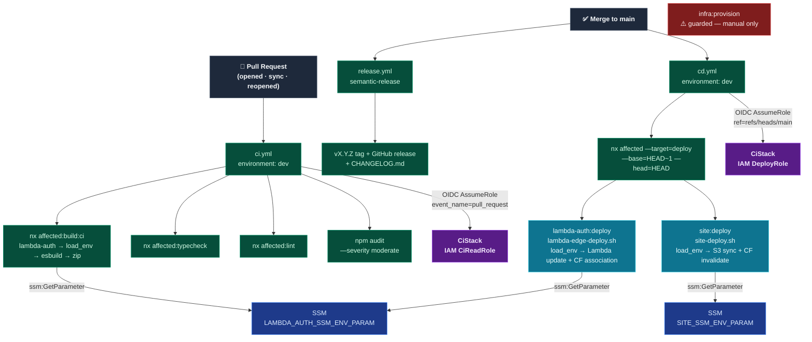

# CI/CD Pipeline

_Automated quality gate (CI) and deployment (CD) via GitHub Actions and AWS OIDC — no long-lived credentials._

---

## Overview

CI runs on every pull request: audit, lint, typecheck, build.
CD runs on merge to `main`: `nx affected --target=deploy` deploys only what changed.

Both workflows authenticate to AWS using OIDC — `CiStack` issues short-lived credentials via STS
from two separate IAM roles, one per workflow. No access keys exist in GitHub.

## Target state



---

## CI workflow (`ci.yml`)

Trigger: `pull_request` (opened, synchronize, reopened) targeting `main`.

| Step | Command                                         | Purpose                                                         |
| ---- | ----------------------------------------------- | --------------------------------------------------------------- |
| 0    | `.github/actions/aws-auth` composite            | OIDC AssumeRole — establishes AWS credentials for all steps     |
| 1    | `yarn npm audit --all --severity moderate`      | Fail on moderate-or-higher vulnerabilities                      |
| 2    | `nx affected --target=lint`                     | ESLint on changed projects                                      |
| 3    | `nx affected --target=typecheck`                | TypeScript type errors on changed projects                      |
| 4    | `nx affected --target=build --configuration=ci` | Build changed projects — lambda-auth fetches SSM before esbuild |

Affected base: `origin/<base-branch>` → `HEAD` (GitHub Actions resolves the PR target branch at runtime).

---

## CD workflow (`cd.yml`)

Trigger: `push` to `main`.

Runs a single NX step:

```
yarn nx affected --target=deploy --configuration=ci --base=HEAD~1 --head=HEAD
```

NX determines which projects changed in the merge commit. Each project's `deploy` target calls a
self-sufficient script:

| Project       | Script                             | What it does                                                                   |
| ------------- | ---------------------------------- | ------------------------------------------------------------------------------ |
| `site`        | `scripts/ci/site-deploy.sh`        | Fetches site SSM env → S3 sync + CloudFront invalidation                       |
| `lambda-auth` | `scripts/ci/lambda-edge-deploy.sh` | Fetches lambda-auth SSM env → Lambda update + version publish + CF association |

`infra` has no `deploy` target — CDK deploy is renamed `provision` and excluded from `nx affected`.
See [Guarded operations](#guarded-operations).

---

## OIDC authentication

Both workflows run in `environment: dev`, which resolves `vars.*` — but `environment: dev` is
identical on both workflows, so it cannot be used to tell a PR run from a post-merge run apart.
Each workflow assumes a different role, scoped by a GitHub OIDC token claim that does vary by
trigger. The `.github/actions/aws-auth` composite calls `aws-actions/configure-aws-credentials`:

1. GitHub generates an OIDC token scoped to the repo, workflow run, triggering event, and ref
2. STS validates against `CiStack`'s OIDC provider:
   - `aud = sts.amazonaws.com`
   - sub matches `repo:{githubOrg}@{githubOrgId}/{githubRepo}@{githubRepoId}:*` — numeric IDs required for repos created after June 2026
   - `ci.yml` assumes `CiReadRole`, additionally gated on `event_name = pull_request`
   - `cd.yml` assumes `DeployRole`, additionally gated on `ref = refs/heads/main`
3. STS returns short-lived credentials valid for the job duration

`CiReadRole` can only `ssm:GetParameter`. Only `DeployRole` can write to S3, CloudFront, or the
auth Lambda — so an unreviewed PR run, even one editing `ci.yml` itself, can never reach
deploy-grade credentials before merge.

---

## SSM env-fetch pattern

Each build/deploy script has a `load_env()` function that fetches its SSM parameter and exports the
values into the current shell:

```bash
load_env() {
  eval "$(aws ssm get-parameter \
    --region "$AWS_REGION" \
    --name "${<APP>_SSM_ENV_PARAM:?not set}" \
    --query Parameter.Value --output text \
  | jq -r 'to_entries[] | "export \(.key)=\(.value | @sh)"')"
}

[[ "${GITHUB_ACTIONS:-false}" == "true" ]] && load_env
```

The `GITHUB_ACTIONS` guard means the same script works:

- **Locally** — NX `envFile` already loaded `.env.<env>`; `load_env` is skipped
- **CI/CD** — `load_env` fetches SSM; each app runs in its own NX subprocess so values are isolated

No `$GITHUB_ENV` export step is needed in the workflow YAML.

---

## GitHub Actions environment variables

All values live in the `dev` GitHub Actions environment (Settings → Environments → dev → Variables):

| Variable                    | Description                                                                                      |
| --------------------------- | ------------------------------------------------------------------------------------------------ |
| `CI_ROLE_ARN`               | `CiStack` CloudFormation output (`CiRoleArn`) — SSM-read-only, used by `ci.yml`                  |
| `DEPLOY_ROLE_ARN`           | `CiStack` CloudFormation output (`DeployRoleArn`) — S3/CloudFront/Lambda write, used by `cd.yml` |
| `AWS_REGION`                | Deployment region — used for OIDC auth and SSM `GetParameter` calls                              |
| `SITE_SSM_ENV_PARAM`        | SSM path for site config, e.g. `/{org}/dev/docs/site/env`                                        |
| `LAMBDA_AUTH_SSM_ENV_PARAM` | SSM path for lambda-auth config, e.g. `/{org}/dev/docs/lambda-auth/env`                          |

No bucket names, distribution IDs, or function names are stored as GitHub variables — those live in
SSM and are fetched at runtime by each script.

---

## Guarded operations

`infra:provision` (CDK deploy) is **never** run by the CD pipeline — it provisions infrastructure
and must be run manually by a developer with appropriate AWS credentials:

> `yarn nx run infra:provision:dev` — guarded; run manually after reviewing `infra:diff:dev`

The CD pipeline deploys app artefacts only (code + content). Infrastructure changes (stacks,
CloudFront config, IAM) always go through a manual `infra:provision`. See `02 Deploy Lifecycle.md`
for the full manual deploy sequence.

---

## Release workflow (`release.yml`)

Trigger: `push` to `main` (same trigger as `cd.yml`, runs independently).

`semantic-release` (`release.config.js`) analyzes Conventional Commit messages since the last
release, computes the next `vX.Y.Z`, generates release notes, updates `CHANGELOG.md` and
`package.json`'s `version`, commits both back to `main` as `chore(release): vX.Y.Z [skip ci]`, tags
the commit, and publishes a GitHub release. `npmPublish` is disabled — nothing is pushed to a
registry. Uses the default `GITHUB_TOKEN`, not the OIDC AWS roles — no AWS access needed.

`[skip ci]` in the release commit message means it does not re-trigger `ci.yml`, `cd.yml`, or
`release.yml` itself. See `../07%20Branching%20Strategy.md` for tag naming and the rollback caveat
this introduces.
