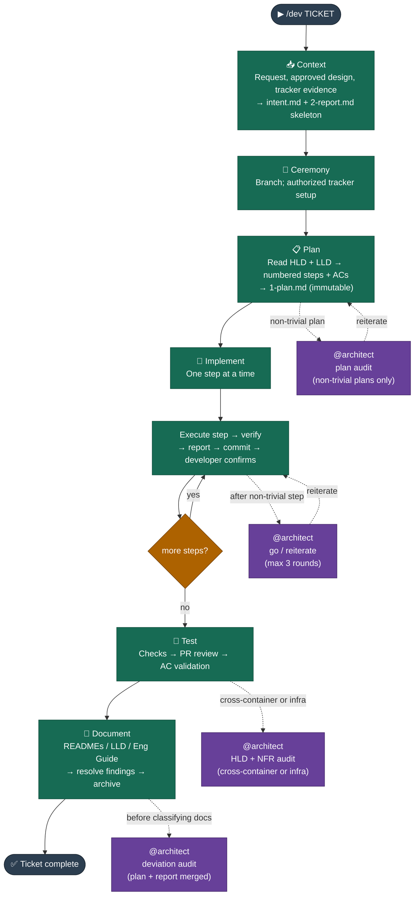

# Dev Lifecycle — Context → Ceremony → Plan → Implement → Test → Document

_Delivers a ticket or local change from request to documented, merged code._

Commands below are written with a leading `/`; that is your provider's
skill-invocation prefix. Skill companions are referenced by their path inside the
installed skill bundle — see `04 AI Coding Tool Compatibility.md` for where each
provider puts that bundle.

---

## Intent

The Dev lifecycle is the core delivery workflow. Every ticket — feature, bug fix, chore — runs through it. Its job is to ensure that work is planned against the architecture, implemented step by step with observed verification, tested before merge, and documented before close.

---

## When to use it

Always. There is no ticket that bypasses this lifecycle. For large or novel work, run the Design lifecycle first; `/design publish` produces the implementation tickets once the design is approved.

## When NOT to use it

There is no "skip Dev" path. Stages can run individually (`/dev plan`, `/dev implement`, …) or all at once (`/dev`), but the sequence is always the same.

---

## Flow



## Stages

**Router:** `/dev <TICKET> <problem statement>` — runs all six stages in one session, pausing at each boundary. Bail out at any point and resume with the individual command.

| Stage         | Individual command                | What it produces                                               |
| ------------- | --------------------------------- | -------------------------------------------------------------- |
| **Context**   | `/dev context <TICKET> <problem>` | `impl/intent.md` + `2-report.md` skeleton; metrics initialized |
| **Ceremony**  | `/dev ceremony <TICKET>`          | Feature branch; authorized tracker transition                  |
| **Plan**      | `/dev plan <TICKET>`              | `1-plan.md` — numbered steps, acceptance criteria, checks      |
| **Implement** | `/dev implement <TICKET>`         | Code commits, one step at a time; notes in `2-report.md`       |
| **Test**      | `/dev test <TICKET>`              | Check results; PR review appended to `2-report.md`             |
| **Document**  | `/dev document <TICKET>`          | Updated READMEs / LLD / Engineering Guide; story archived      |

All artifacts live in `Stories/<TICKET>/impl/`, alongside `stat.json`.

---

## Invariants

**Context:**

- Capture the request, the approved design if one exists, and relevant tracker evidence in `impl/intent.md`. An approved `solution/` folder is the primary spec; tracker acceptance criteria supplement it, they do not override it.
- Ask only about material missing or conflicting intent. Open questions may be appended later.

**Ceremony:**

- Inspect and reuse an existing feature branch before creating one; never discard unrelated local work.
- Tracker setup is delegated by state name, and only when authorized. A local DEV identifier does not imply a tracker record.

**Plan:**

- All Target Architecture reads go through the HLD README to resolve the active version — never hardcode a version name. Read the system overview, relevant container docs, and non-functional concerns within that version.
- Read the relevant System Architecture (LLD) and actual code before proposing anything.
- Steps are numbered and independently verifiable, with meaningful acceptance criteria and only checks the project actually has configured. Never assume a framework, test suite, linter or pre-commit hook exists.
- Add a Mermaid diagram of the target state above the steps whenever the plan changes how things are wired together and the step list alone would not make that obvious.
- **Architecture audit (optional):** for non-trivial plans — new cross-layer integration, infrastructure change, data-flow change, or scope spanning more than one NX project — audit the plan against the Target Architecture before final sign-off. Uses the **satellite-review** pattern. Skip for mechanical plans (single-layer rename, config value, dependency bump).
- Record justified deviations in `1-plan.md` under `## Architecture Deviations`.
- The plan is immutable once approved. New authorized scope is an explicit addendum, never an edit.
- The plan is written to disk before approval is requested (**write-confirm**). The developer reviews the artifact in their editor, not in chat.

**Implement:**

- Execute one logical step at a time with observed verification — not a claim that a step should work.
- After verification, follow **do → report → commit**: update `2-report.md` first (progress row, implementation note, efforts row), then present the commit message, then wait for commit confirmation before the next step.
- Add or update tests where they earn their place, choosing unit, integration, load or other types to fit the work and the project's actual setup. Test-first is optional; required checks passing is not.
- **Satellite review:** after a non-trivial step, the worker invokes `@architect` read-only before presenting verification. Verdict is go or reiterate, at most three rounds, then escalate. Skip for mechanical steps.
- **Implementation notes:** a step that passed first try needs one line. A step that required troubleshooting needs the full record — initial error, each hypothesis ruled out, root cause, fix. A terse "fixed" is not acceptable for a troubleshooting chain. Notes go at the bottom in ascending step order.
- Surface deviations from the plan as they appear, rather than at the end.

**Test:**

- Check the build before running tests. Do not run tests against a broken build.
- Validate each acceptance criterion explicitly — green tests are not an AC verdict.
- PR review uses the **review-gate** pattern: write every finding to `2-report.md` first, classify each one, stop for developer confirmation, then apply fixes one at a time, each through the do → report → commit loop.
- **@architect audit:** for work touching infrastructure, introducing a cross-layer integration, or spanning more than one container, run a read-only audit against HLD boundaries, NFRs and layer practices before writing the PR Review table.
- Preserve test evidence; rerun affected checks after each fix.

**Document:**

- Mandatory. The ticket is not complete until this stage runs and the story is archived.
- Read documentation principles and placement rules first. Include implemented impacts from an approved design in the same update list.
- **Deviation audit:** before classifying what to document, read `1-plan.md` and `2-report.md` in full, merge them, and have `@architect` surface every decision — planned or emergent — that diverges from or is absent from HLD and LLD. Compare against HLD contracts, boundaries and NFRs only; LLD lag before this stage is a normal doc-update task, not a deviation. Uses **review-gate**.
- **Placement:** HLD hit → update the relevant container or NFR doc within the active version, and record the detail in the LLD. HLD miss → create a minimal new HLD entry and capture full detail in the LLD. HLD changes require settled, authorized target decisions; routine LLD updates describe actual built behavior.
- Update each documentation item using **write-confirm**.
- **Consistency review:** after all doc updates, `@architect` cross-checks modified docs for contradictions and stale references. Uses **review-gate** with tri-choice: fix / tech-debt / skip. Escalate after three unsuccessful rounds rather than looping.
- Archive preserves every story artifact, including `stat.json`, and never overwrites an existing destination. The router owns tracker completion exactly once; direct-stage entry reports only its own result.

---

## One findings ledger

`2-report.md` holds a single `## Review Findings` table, defined by the dev skill's `patterns/review-gate.md`. Plan audits, implementation reviews, PR reviews, HLD audits and documentation consistency reviews all upsert into it using stable RF IDs — a recurring issue keeps one row and accumulates origin and evidence. Kind, deviation type, severity, classification and resolution are separate dimensions. Findings are recorded before any fix is applied.

Tech Debt is a separate linked ledger carrying ownership, next action and optional tracker task creation. A local TD entry survives a declined tracker creation; it cannot silently waive a required acceptance criterion. Before archival every finding must be fixed, accepted, moved to tech debt, or resolved by a doc update — each with evidence and any required attributed decision. Critical and high risks cannot be hidden in debt or accepted silently. Target decisions are never rewritten to excuse an implementation regression.

---

## Human decisions

The dev skill's `patterns/approval-sign-off.md` and `patterns/approval-intelligent.md` own authorization boundaries. Routine context reads, reversible local edits, checks, report updates and stage transitions continue within scope, and existing authorization carries across steps and sessions.

Pause for a material scope or architecture decision, real risk acceptance or deferral, verification only a human can perform, or an unauthorized external or destructive action. Prepare the concrete result first and combine related decisions into one ask. Respect the project's guarded commands. Update the report before any commit; a developer-run commit does not block unrelated local work. Where the host offers a native planning mode, use it and respect its write and approval restrictions; where it does not, prepare the same reviewable plan and require the same explicit sign-off.

---

## Patterns

Patterns are shared multi-step protocols co-located in `.claude/skills/dev/patterns/`. They are not registered in `CLAUDE.md` — each stage reference loads them on demand by explicit path. The pattern file owns the protocol; the stage reference owns the trigger condition and any local override.

| Pattern                   | Purpose                                                           | Applied in                                                  |
| ------------------------- | ----------------------------------------------------------------- | ----------------------------------------------------------- |
| `approval-sign-off.md`    | Fixed, unconditional human sign-off gates across the flow         | All stages                                                  |
| `approval-intelligent.md` | Optional auto-approve for designated non-material checkpoints     | Plan rework and other designated checkpoints                |
| `review-gate.md`          | Stable finding identity, classification, evidence-backed closure  | Test (PR review), Document (deviation + consistency audits) |
| `do-report-commit.md`     | Update the report before presenting any commit message            | Implement (per step), review-gate fixes, Document wrap-up   |
| `write-confirm.md`        | Write the artifact to disk before asking for approval             | Plan (plan draft), Document (per doc item)                  |
| `satellite-review.md`     | Scoped read-only architecture review, at most three rounds        | Plan (optional audit), Implement (non-trivial steps)        |
| `announce-progress.md`    | Concise progress at completed units and stage transitions         | Implement, Document, stage transitions                      |
| `session-continuity.md`   | Resume current state and authorization without replaying work     | All stage references                                        |
| `task-tracking.md`        | Stage tasks and implementation step tasks over the host's tracker | Router, Implement                                           |
| `metrics.md`              | Observed timing, checks, token evidence and quality inventory     | All stages                                                  |

**Principles:**

- Extract a pattern when three or more call sites share the same multi-step protocol.
- Co-locate it in the skill bundle; reference it by explicit path at the point of use.
- The pattern owns the rule text; the call site owns the trigger condition.
- Update the pattern file only when the protocol itself evolves, not for a local variation.

---

## Delivery and quality metrics

Each ticket keeps `impl/stat.json` beside `2-report.md`. The dependency-free Node.js CLI `scripts/dev-metrics.mjs` in the dev skill bundle requires an explicit `--dir` and records observed work, waits, attempts, verification outcomes and available runtime token deltas. Unknown measurements stay null. Recovery bounds interrupted work at its last checkpoint. Direct-stage coverage is partial; the router finalizes full-flow completion.

`report` derives `quality` from Review Findings, Tech Debt and numerical test results, rendering one summary line beside Stage Metrics. Breakdowns cover kind, deviation type, impact severity, classification, resolution, PR-origin findings and debt disposition. Written tests are new cases from the diff; passed, failed and skipped are the latest runner case counts over non-overlapping scopes. Historical failed runs are tracked separately from case counts. Unknown counts stay unavailable, and regenerating the report does not increment them. These are recorded inventories, not a quality score or a ticket ranking.

Run `quality validate` before archival to check structural finding closure and recorded check outcomes. Humans and agents still verify evidence substance and acceptance coverage. Legacy reports are never rewritten or assigned invented counts.

---

## Example

```
/dev ND-042 Replace mock player data with real DB-backed data.
Thoughts: need a new service module, seed data, and a web API client.
```

The agent guides all six stages, pausing at each boundary.
