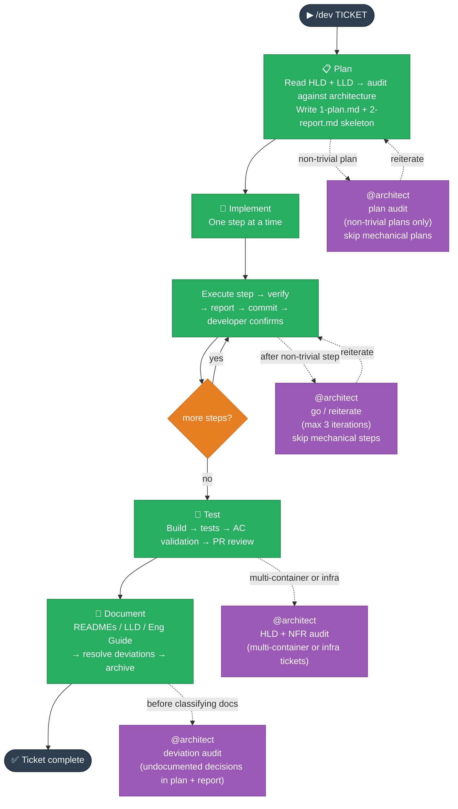

# Dev Lifecycle — Plan → Implement → Test → Document

_Delivers a ticket from problem statement to documented, merged code._

---

## Intent

The Dev lifecycle is the core delivery workflow. Every ticket — feature, bug fix, chore — runs through it. Its job is to ensure that code is planned against the architecture, implemented step-by-step with verification, tested before merge, and documented before close.

---

## When to use it

Always. There is no ticket that bypasses this lifecycle. For large or novel tickets, run the Design lifecycle first; `/design-publish` creates the Dev tickets when design is approved.

## When NOT to use it

There is no "skip Dev" path. The phases can be run individually (`/dev-plan`, `/dev-implement`, `/dev-test`, `/dev-document`) or all at once (`/dev`), but the sequence is always the same.

---

## Flow



## Phases

**Orchestrator:** `/dev <TICKET> <problem statement>` — runs all four phases in one session, stopping at each boundary for confirmation. Bail out at any point and resume with the individual command.

| Phase         | Individual command             | What it produces                                                               |
| ------------- | ------------------------------ | ------------------------------------------------------------------------------ |
| **Plan**      | `/dev-plan <TICKET> <problem>` | `1-plan.md` (immutable) + `2-report.md` (skeleton) in `Stories/<TICKET>/impl/` |
| **Implement** | `/dev-implement <TICKET>`      | Code commits, one step at a time; findings captured in `2-report.md`           |
| **Test**      | `/dev-test <TICKET>`           | Build + test + lint results; PR review appended to `2-report.md`               |
| **Document**  | `/dev-document <TICKET>`       | Updated READMEs / LLD / Engineering Guide; story archived                      |

---

## Invariants

**Plan:**

- All Target Architecture reads go through the README to resolve the active version — never hardcode a version name. Read `System Overview.md`, relevant `Containers/<Name>.md` files, and `Non-Functional Concerns/` within that version.
- Read System Architecture (LLD) before proposing anything.
- If an approved design exists (`solution/` folder for the ticket), use it as the primary spec. Jira ACs supplement; they do not override the solution.
- **Architecture audit (optional):** for non-trivial plans — new cross-layer integration, infra/IAM change, data-flow change, or multi-NX-project scope — audit the plan against the Target Architecture before saving. Uses the satellite-review pattern. Violations require rework or justification. Skip for mechanical plans (single-layer rename, config value, dependency bump).
- Record justified deviations in `1-plan.md` under `## Architecture Deviations`.
- `1-plan.md` is immutable once saved — never edited after creation.
- Write the plan file before asking for approval (write-confirm pattern). The developer reviews in their editor, not in chat.

**Implement:**

- Execute one step at a time. Hard stop after each step — do not write any file until the developer confirms verification passed.
- After verification: follow the **do → report → commit** pattern — update `2-report.md` first (progress row, implementation note, efforts row), then present the commit message, then wait for commit confirmation before starting the next step.
- Surface architecture deviations from the plan at the start of the phase.
- **Satellite review:** after completing any non-trivial step, the worker agent invokes `@architect` as a read-only reviewer before presenting verification. Verdict is go or reiterate. Maximum 3 iterations; escalate to the developer if unresolved. Skip for mechanical steps (rename, config value, dependency bump).
- **Implementation notes:** if a step passed first try, a one-liner is enough. If validation surfaced errors or required multi-step troubleshooting, write a full incident record — initial error, each hypothesis ruled out, final root cause and fix. A terse "fixed" entry is not acceptable for a troubleshooting chain. Notes added at the bottom, in ascending step order.
- **TD triage:** when the developer resolves a tech debt item now, invoke `/dev-plan` but skip to Step 6 (bypass Jira/context setup — context is already established). Append TD steps to the existing `1-plan.md`.

**Test:**

- Check the build before running tests. Do not run tests against a broken build.
- Validate each acceptance criterion explicitly — do not assume pass from "tests are green".
- Include a layer-delegated PR review using the **review-gate** pattern: write all findings to `2-report.md` first, classify each finding, stop for developer confirmation, then apply fixes one at a time (each fix follows the do → report → commit loop).
- **@architect audit:** for any plan touching infrastructure, introducing a new cross-layer integration, or spanning more than one container — spawn `@architect` (read-only) to audit against HLD boundaries, NFRs, and layer best practices before writing the PR Review table.

**Document:**

- Mandatory. The ticket is not complete until this phase runs and the story is archived.
- Resolve every architecture deviation: update Target Architecture or create a tech debt ticket.
- Update each documentation item using the **write-confirm** pattern — write the file, ask for review, stop, wait for confirmation before the next item.
- **Deviation audit:** before classifying what to document, read both `1-plan.md` and `2-report.md` in full, merge the context, and feed it to `@architect` (read-only) to surface every decision — planned or emergent — that diverges from or is absent from the Target Architecture and LLD docs. Uses the **review-gate** pattern: write findings to `2-report.md` as `## Deviation Audit`, stop, confirm, then proceed.
- **Satellite consistency review:** after all doc updates, spawn `@architect` (read-only) to cross-check all modified docs for contradictions and stale references. Uses the **review-gate** pattern with tri-choice: fix / tech-debt ticket / skip.
- **Placement:** use the HLD/LLD matrix to decide where each change lands. HLD hit → update the relevant HLD container or NFR doc (settled outcome only) and record detail in the LLD. HLD miss → create a minimal new HLD entry and capture full detail in the LLD.

---

## Patterns

Patterns are shared multi-step protocols co-located in `.claude/skills/dev/`. They are not registered in `CLAUDE.md` — each workflow skill loads them on-demand via explicit path reference. The pattern file is the single source of truth for the protocol; the workflow skill owns only the trigger condition and any local overrides.

| Pattern                  | File                            | What it enforces                                                                                                                                                                  | Applied in                                                                           |
| ------------------------ | ------------------------------- | --------------------------------------------------------------------------------------------------------------------------------------------------------------------------------- | ------------------------------------------------------------------------------------ |
| **do → report → commit** | `pattern-do-report-commit.md`   | Update `2-report.md` before presenting any commit message. Report and commit history must stay in sync.                                                                           | Implement (per step), review-gate Stage 2 (per fix), Document (phase wrap-up)        |
| **review-gate**          | `pattern-review-gate.md`        | Write all agent findings to `2-report.md` first → classify → STOP → per-fix loop with individual validation. Never apply a fix before the developer sees the full findings table. | Test (PR review), Document (deviation audit, satellite review)                       |
| **write-confirm**        | `pattern-write-confirm.md`      | Write the file to disk before asking for approval. Developer reviews the artifact in their editor, not in chat. Loop until explicitly confirmed.                                  | Plan (plan draft), Document (per doc item)                                           |
| **announce-progress**    | `pattern-announce-progress.md`  | After each completed unit: `✅ Done / 🔜 Next in this phase / 📋 After this phase`. Keeps scope visible mid-session and surfaces omissions before they become regressions.        | Implement (after each step), Document (after each item), phase transitions in `/dev` |
| **satellite-review**     | `pattern-satellite-review.md`   | Worker agent invokes `@architect` (read-only) after completing a step. Verdict: go or reiterate. Max 3 iterations; escalate to developer if unresolved.                           | Implement (worker agents — non-trivial steps), Plan (architecture audit — optional)  |
| **session-continuity**   | `pattern-session-continuity.md` | On resume after compaction: re-read the current phase SKILL.md. On phase exit: re-read `dev/SKILL.md` and resume the orchestrator from the next phase.                            | All four phase skills                                                                |

**Principles:**

- Extract a pattern when 3+ workflow skills share the same multi-step protocol.
- Co-locate under `.claude/skills/dev/` — not in `CLAUDE.md` registry, not in `skills/drafts/`.
- Reference by explicit file path at the point of use in the workflow skill.
- The pattern owns the rule text; the workflow skill owns the trigger condition and any local overrides.
- Update the pattern file only when the protocol itself evolves — not for local variations.

---

## Example

```
/dev {{PROJECT_KEY}}-042 Replace mock player data with real DB-backed data.
Thoughts: need new BFF module, seed data, web API client.
```

Claude guides through all four phases, stopping at each boundary.
