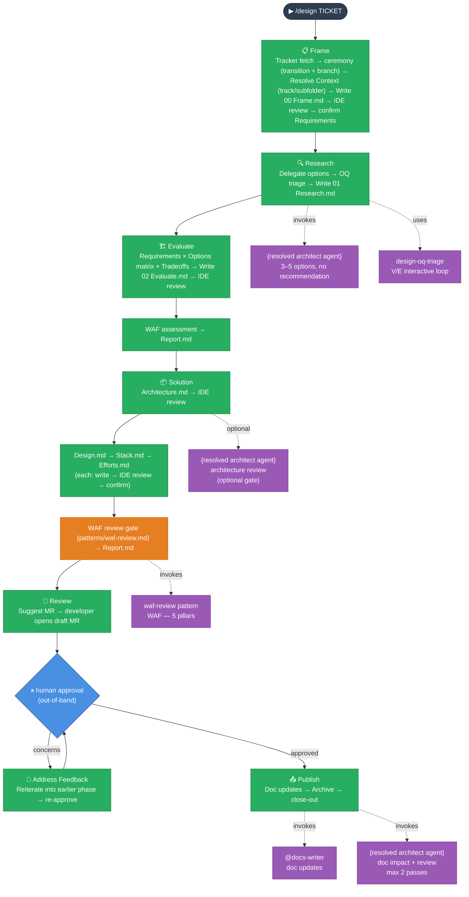

# Design Lifecycle — Frame → Research → Evaluate → Solution → Review → Address Feedback → Publish

_Produces an approved architectural design before implementation begins._

---

## Intent

The Design lifecycle front-loads the hard thinking. It frames the problem, researches options without bias, surfaces trade-offs across WAF pillars, makes a falsifiable recommendation, specifies integration and security detail, runs a WAF gate, and requires out-of-band human approval before any code is written.

The output is a `solution/` folder that serves as the implementation spec for the Dev tickets created at Publish.

**Two tracks, one flow.** `/design` covers both **Product** design (cross-project product architecture — `docs/Harness/`) and **Project** design (this repo's own target architecture — `docs/Target Architecture (HLD)/`). The track is resolved exactly once, in Frame, and recorded in `Report.md`'s `## Context` section (source docs, dest docs, subfolder, architect agent). Every later phase reads it from there — no phase re-derives or branches on track; the diagram and tables below use `{resolved architect agent}` / `{dest docs}` for that reason, since the actual value differs by track (`@product-architect` / `docs/Harness/` for Product, `@architect` / `docs/Target Architecture (HLD)/` for Project — see `.claude/skills/design/patterns/context-resolution.md`).

One skill (`design`) owns all seven phases as `references/01-frame.md` … `references/07-publish.md`; there is no separate installable skill per phase, and no separate Ceremony phase — Frame's own Step 3 handles the ticket's tracker transition and branch checkout, positioned after the tracker fetch/title resolution since the branch slug isn't known any earlier.

---

## When to use it

- Ticket is large or spans multiple sprints
- A new container or integration is being introduced
- Non-functional concerns (security, reliability, cost) are meaningfully affected
- The team is uncertain about the right approach

## When NOT to use it

Small, well-understood changes within a single container that introduce no new integrations or architecture decisions. Use `/dev` directly.

---

## Flow

## Phases

**Router:** `/design <TICKET>` — runs all seven phases in one session, stopping at each boundary for confirmation. Bail out at any point and resume with the individual command. One skill (`design`) owns all seven phases; Review, Address Feedback, and Publish stay independently invocable and resumable the same way they always did: `/design review-gate` opens the draft MR and the session pauses; `/design address-feedback` only runs if the approver raises concerns (loops back to an earlier phase, then re-approves); `/design publish` runs once the gate is approved.

| Phase                | Individual command                  | What it produces                                                                                                                            |
| -------------------- | ----------------------------------- | ------------------------------------------------------------------------------------------------------------------------------------------- |
| **Frame**            | `/design frame <TICKET>`            | Tracker transition + branch checkout (ceremony); problem statement, known + proposed evaluation criteria, boundaries → `design/00 Frame.md` |
| **Research**         | `/design research <TICKET>`         | 3–5 neutral options via `{resolved architect agent}` — no recommendation → `design/01 Research.md`                                          |
| **Evaluate**         | `/design evaluate <TICKET>`         | Requirements × Options matrix, tradeoffs, recommendation, WAF assessment → `design/02 Evaluate.md`                                          |
| **Solution**         | `/design solution <TICKET>`         | Certainty-principle artifacts → `solution/Architecture.md`, `Design.md`, `Stack.md`, `Efforts.md`                                           |
| **Review**           | `/design review-gate <TICKET>`      | Draft MR opened, gate recorded in `Report.md`, session pauses for out-of-band human approval                                                |
| **Address Feedback** | `/design address-feedback <TICKET>` | Only if the approver raises concerns — reiterates into the traced-to phase, then waits for re-approval                                      |
| **Publish**          | `/design publish <TICKET>`          | `{dest docs}` updated, story archived                                                                                                       |

---

## Invariants

**Frame:** Owns the ticket's start-of-work ceremony (tracker transition + branch checkout), positioned after the tracker fetch/title resolution since the branch slug isn't known any earlier. The track (Product or Project) and its subfolder are resolved once, via `patterns/context-resolution.md`, and written to `Report.md`'s `## Context` section before requirements are drafted — no later phase re-asks or re-derives this. Requirements must include both known (from ticket) and proposed (gaps found by AI — NFRs, observability, GDPR). Proposed requirements are labelled `[proposed]` and must be explicitly accepted or rejected by the developer before the phase saves. These requirements become the evaluation criteria rows in the Requirements × Options matrix during Evaluate.

**Research:** `{resolved architect agent}` returns options only — no recommendation. At least one "minimal change" option and at least one industry-standard approach must be included. No judgment is made here. Open questions from `{resolved architect agent}` are triaged interactively — one at a time — as **(V) Viability** (would disqualify an option) or **(E) Evaluation-input** (affects cost/detail only). All `(V)` OQs must be resolved before Research saves. See `patterns/design-oq-triage.md`. If Frame implied more than one independent decision, this phase loops once per decision — see `patterns/multi-decision-split.md`.

**Evaluate:** Every requirement from `00 Frame.md` and every WAF pillar must be addressed. The recommendation must be falsifiable: it states which assumption, if wrong, would change the recommendation. Open questions are resolved with the developer before Solution begins. A closing WAF assessment runs on the recommended option only. `02 Evaluate.md` is written to disk for IDE review before the WAF assessment runs. Loops per decision under the same multi-decision policy as Research.

**Solution:** Certainty principle applies. `Architecture.md` is the authoritative integrated end-to-end solution record: it carries every settled decision from Frame, Research, Evaluate, developer clarification, WAF and review feedback, with affected flows, consequences and verification obligations. `solution/` files contain only settled decisions and their direct consequences — no rationale, rejected alternatives or open questions. `Design.md`, `Stack.md` and `Efforts.md` provide supporting detail and must not introduce a material decision absent from or conflicting with Architecture.md. Each file is written to disk for IDE review as it is completed. After `Architecture.md` is confirmed, an optional `{resolved architect agent}` read-only review gate checks structural completeness before `Design.md` is started (see `patterns/design-architect-review.md`). A WAF review gate (`patterns/waf-review.md`, target `solution`) runs after all four files are confirmed. `Efforts.md` must include an Operational Costs section (ongoing infra consumption at expected scale). Under the multi-decision policy, `Design.md` loops per decision but `Architecture.md` stays a single integrated file — one section per decision. Publish and `/dev` consume Architecture.md as the solution source of truth.

**Review:** The AI suggests the MR title/body but does not open it. The developer opens the MR and pastes the URL. Session ends here — this is a genuine session boundary, not just a phase transition, since it waits on an out-of-band human approval.

**Address Feedback:** Only runs if the approver raises concerns. The AI identifies which phase/step the concern traces to and suggests a named reiterate path (e.g. "Reiterate from Evaluate, Step 4"); it does not decide the fix unilaterally. The MR must be re-approved before Publish proceeds.

**Publish:** The AI does not approve its own gate — a human must approve the MR out-of-band, with no unresolved concerns, before this phase runs. `{resolved architect agent}` identifies `{dest docs}` that need updating; `@docs-writer` applies the updates and `{resolved architect agent}` reviews (max 2 passes). After that review is clean, a single wrap-up stop asks one question — publish the implementation tickets from `Efforts.md` to the tracker? — then ticket publication (delegated to `@scrum-master` if yes), archive, and the design ticket's tracker sync (worklog effort derived from the design metrics + transition to Done, delegated to `@scrum-master` by state name) run straight through to a one-message close-out with the suggested commit.

---

## Patterns

Patterns are shared multi-step protocols co-located in `.claude/skills/design/patterns/`. They are not registered in `CLAUDE.md` — each stage reference loads them on-demand via explicit path reference.

| Pattern                             | File                         | What it enforces                                                                                                                                                              | Applied in                                                                                                        |
| ----------------------------------- | ---------------------------- | ----------------------------------------------------------------------------------------------------------------------------------------------------------------------------- | ----------------------------------------------------------------------------------------------------------------- |
| **context-resolution**              | `context-resolution.md`      | Resolves Product/Project track, source/dest docs, subfolder, and architect agent exactly once                                                                                 | Frame Step 4                                                                                                      |
| **multi-decision-split**            | `multi-decision-split.md`    | Default per-decision file-split policy when Frame implies multiple independent decisions                                                                                      | Research Step 1, Evaluate Step 1, Solution Step 3                                                                 |
| **do → report → commit** _(design)_ | `do-report-commit.md`        | Update Report.md tracker → append Efforts row → present commit → STOP → announce next phase                                                                                   | End of Frame, Research, Evaluate, Solution                                                                        |
| **announce-progress** _(design)_    | `announce-progress.md`       | `✅ Done / 📋 After this phase` at every phase boundary                                                                                                                       | `design/SKILL.md` phase transitions (incl. Review, Address Feedback)                                              |
| **design-oq-triage**                | `design-oq-triage.md`        | Two-tier OQ classification (V/E), interactive one-at-a-time loop, persist as Assumptions in Report.md                                                                         | Research Step 3b, Evaluate Step 1b                                                                                |
| **design-architect-review**         | `design-architect-review.md` | `{resolved architect agent}` read-only gate after Architecture.md; max 2 iterations; excludes doc gaps from scope                                                             | Solution Step 2b                                                                                                  |
| **satellite-review** _(design)_     | `satellite-review.md`        | `{resolved architect agent}` read-only reviewer of design artifacts; OK / corrections; max 2 iterations                                                                       | Solution Step 2b (via `design-architect-review.md`), Publish Step 4                                               |
| **write-confirm** _(design)_        | `write-confirm.md`           | Write file to disk before asking for approval; developer reviews in IDE; iterate until confirmed                                                                              | Every stage (per artifact)                                                                                        |
| **session-continuity** _(design)_   | `session-continuity.md`      | Re-read SKILL.md on resume; re-read router on phase exit (Publish: lifecycle closed)                                                                                          | All seven stage references                                                                                        |
| **waf-review**                      | `waf-review.md`              | Parameterized WAF assessment (`frame`/`research`/`evaluate`/`solution` targets, `--pillars=` filter); appends to Report.md — never a standalone file                          | Solution Step 7b only (Evaluate keeps its own separate inline assessment; Publish keeps its own satellite review) |
| **task-tracking** _(design)_        | `task-tracking.md`           | The host's available progress tracker over the seven stages via the installed `runtime/task-tracking.md` procedure, with `Report.md` as the durable source of truth on resume | `design` router (one task per stage)                                                                              |

---

## What lives where

| Content                        | Lives in                                                              |
| ------------------------------ | --------------------------------------------------------------------- |
| Options, trade-offs, rationale | `Stories/<TICKET>/design/` — never graduates                          |
| WAF assessment                 | `design/Report.md` WAF section — never graduates                      |
| Chosen approach (outcome only) | `Stories/<TICKET>/solution/` → drives `{dest docs}` update at Publish |
| Implementation spec            | `Stories/<TICKET>/solution/` → guides Dev tickets                     |

## Design delivery metrics

Each story owns `design/stat.json` alongside `design/Report.md`. The design metrics
CLI captures seven stage attempts, observed work and waits, review evidence, feedback
rework, blockers, and actual runtime token deltas. Review approval waits persist across
sessions; approval without concerns explicitly skips Address Feedback. Publish completes
metrics after required archive work and before any dev hand-off. Design and dev
records remain separate. See the design skill's `patterns/metrics.md` for exact commands,
recovery, approval recording, and the schema. The design CLI and its constants install independently of other flows.
