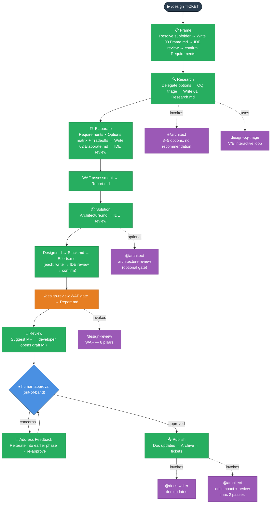

# Design Lifecycle — Frame → Research → Elaborate → Solution → Review → Address Feedback → Publish

_Produces an approved architectural design before implementation begins._

---

## Intent

The Design lifecycle front-loads the hard thinking. It frames the problem, researches options without bias, surfaces trade-offs across WAF pillars, makes a falsifiable recommendation, specifies integration and security detail, runs a WAF gate, and requires out-of-band human approval before any code is written.

The output is a `solution/` folder that serves as the implementation spec for the Dev tickets created at Publish.

`/design` covers this repo's own target architecture — `docs/Target Architecture (HLD)/`. The subfolder is resolved once, in Frame, and recorded in `Report.md`'s `## Context` section.

---

## When to use it

- Ticket is large or spans multiple sprints
- A new container or integration is being introduced
- Non-functional concerns (security, reliability, cost) are meaningfully affected
- The team is uncertain about the right approach

## When NOT to use it

Small, well-understood changes within a single container that introduce no new integrations or architecture decisions. Use `/dev` directly.

---

## Flow

## Phases

**Orchestrator:** `/design <TICKET>` — runs all seven phases in one session, stopping at each boundary for confirmation. Bail out at any point and resume with the individual command. Review, Address Feedback, and Publish are three separate skills so each stays independently invocable and resumable: `/design-review-gate` opens the draft MR and the session pauses; `/design-address-feedback` only runs if the approver raises concerns (loops back to an earlier phase, then re-approves); `/design-publish` runs once the gate is approved.

| Phase                | Individual command                  | What it produces                                                                                       |
| -------------------- | ----------------------------------- | ------------------------------------------------------------------------------------------------------ |
| **Frame**            | `/design-frame <TICKET>`            | Problem statement, known + proposed requirements, boundaries → `design/00 Frame.md`                    |
| **Research**         | `/design-research <TICKET>`         | 3–5 neutral options via `@architect` — no recommendation → `design/01 Research.md`                     |
| **Elaborate**        | `/design-elaborate <TICKET>`        | Requirements × Options matrix, tradeoffs, recommendation, WAF assessment → `design/02 Elaborate.md`    |
| **Solution**         | `/design-solution <TICKET>`         | Certainty-principle artifacts → `solution/Architecture.md`, `Design.md`, `Stack.md`, `Efforts.md`      |
| **Review**           | `/design-review-gate <TICKET>`      | Draft MR opened, gate recorded in `Report.md`, session pauses for out-of-band human approval           |
| **Address Feedback** | `/design-address-feedback <TICKET>` | Only if the approver raises concerns — reiterates into the traced-to phase, then waits for re-approval |
| **Publish**          | `/design-publish <TICKET>`          | `docs/Target Architecture (HLD)/` updated, implementation tickets created, story archived              |

---

## Invariants

**Frame:** The subfolder under `docs/Target Architecture (HLD)/` is resolved once and written to `Report.md`'s `## Context` section before requirements are drafted — no later phase re-asks or re-derives this. Requirements must include both known (from ticket) and proposed (gaps found by AI — NFRs, observability, GDPR). Proposed requirements are labelled `[proposed]` and must be explicitly accepted or rejected by the developer before the phase saves. These requirements become the evaluation criteria rows in the Requirements × Options matrix during Elaborate.

**Research:** `@architect` returns options only — no recommendation. At least one "minimal change" option and at least one industry-standard approach must be included. No judgment is made here. Open questions from `@architect` are triaged interactively — one at a time — as **(V) Viability** (would disqualify an option) or **(E) Elaboration-input** (affects cost/detail only). All `(V)` OQs must be resolved before Research saves. See `pattern-design-oq-triage.md`. If Frame implied more than one independent decision, this phase loops once per decision — see `pattern-multi-decision-split.md`.

**Elaborate:** Every requirement from `00 Frame.md` and every WAF pillar must be addressed. The recommendation must be falsifiable: it states which assumption, if wrong, would change the recommendation. Open questions are resolved with the developer before Solution begins. A closing WAF assessment runs on the recommended option only. `02 Elaborate.md` is written to disk for IDE review before the WAF assessment runs. Loops per decision under the same multi-decision policy as Research.

**Solution:** Certainty principle applies. `solution/` files contain only settled decisions and their direct consequences — no rationale, no rejected alternatives, no open questions. Each file is written to disk for IDE review as it is completed. After `Architecture.md` is confirmed, an optional `@architect` read-only review gate checks structural completeness before `Design.md` is started (see `pattern-design-architect-review.md`). A `/design-review` WAF gate runs after all four files are confirmed. `Efforts.md` must include an Operational Costs section (ongoing infra consumption at expected scale). Under the multi-decision policy, `Design.md` loops per decision but `Architecture.md` stays a single integrated file — one section per decision. These files drive `docs/Target Architecture (HLD)/` updates (Publish) and implementation (`/dev`).

**Review:** The AI suggests the MR title/body but does not open it. The developer opens the MR and pastes the URL. Session ends here — this is a genuine session boundary, not just a phase transition, since it waits on an out-of-band human approval.

**Address Feedback:** Only runs if the approver raises concerns. The AI identifies which phase/step the concern traces to and suggests a named reiterate path (e.g. "Reiterate from Elaborate, Step 4"); it does not decide the fix unilaterally. The MR must be re-approved before Publish proceeds.

**Publish:** The AI does not approve its own gate — a human must approve the MR out-of-band, with no unresolved concerns, before this phase runs. `@architect` identifies `docs/Target Architecture (HLD)/` that need updating; `@docs-writer` applies the updates and `@architect` reviews (max 2 passes). Archive and implementation-ticket creation happen after that review is clean.

---

## Patterns

Patterns are shared multi-step protocols co-located in `.claude/skills/design/`. They are not registered in `CLAUDE.md` — each workflow skill loads them on-demand via explicit path reference.

| Pattern                             | File                                 | What it enforces                                                                                      | Applied in                                                                                                 |
| ----------------------------------- | ------------------------------------ | ----------------------------------------------------------------------------------------------------- | ---------------------------------------------------------------------------------------------------------- |
| **multi-decision-split**            | `pattern-multi-decision-split.md`    | Default per-decision file-split policy when Frame implies multiple independent decisions              | Research Step 1, Elaborate Step 1, Solution Step 3                                                         |
| **do → report → commit** _(design)_ | `pattern-do-report-commit.md`        | Update Report.md tracker → append Efforts row → present commit → STOP → announce next phase           | End of Frame, Research, Elaborate, Solution                                                                |
| **announce-progress** _(design)_    | `pattern-announce-progress.md`       | `✅ Done / 📋 After this phase` at every phase boundary                                               | `design/SKILL.md` phase transitions (incl. Review, Address Feedback); `pattern-do-report-commit.md` step 4 |
| **design-oq-triage**                | `pattern-design-oq-triage.md`        | Two-tier OQ classification (V/E), interactive one-at-a-time loop, persist as Assumptions in Report.md | Research Step 3b, Elaborate Step 1b                                                                        |
| **design-architect-review**         | `pattern-design-architect-review.md` | `@architect` read-only gate after Architecture.md; max 2 iterations; excludes doc gaps from scope     | Solution Step 2b                                                                                           |
| **satellite-review** _(design)_     | `pattern-satellite-review.md`        | `@architect` read-only reviewer of design artifacts; OK / corrections; max 2 iterations               | Solution Step 2b (via `pattern-design-architect-review.md`), Publish Step 4                                |
| **write-confirm** _(design)_        | `pattern-write-confirm.md`           | Write file to disk before asking for approval; developer reviews in IDE; iterate until confirmed      | All phases (per artifact)                                                                                  |
| **session-continuity** _(design)_   | `pattern-session-continuity.md`      | Re-read SKILL.md on resume; re-read orchestrator on phase exit (Publish: lifecycle closed)            | All seven phase skills                                                                                     |

---

## What lives where

| Content                        | Lives in                                                                                  |
| ------------------------------ | ----------------------------------------------------------------------------------------- |
| Options, trade-offs, rationale | `Stories/<TICKET>/design/` — never graduates                                              |
| WAF assessment                 | `design/Report.md` WAF section — never graduates                                          |
| Chosen approach (outcome only) | `Stories/<TICKET>/solution/` → drives `docs/Target Architecture (HLD)/` update at Publish |
| Implementation spec            | `Stories/<TICKET>/solution/` → guides Dev tickets                                         |
