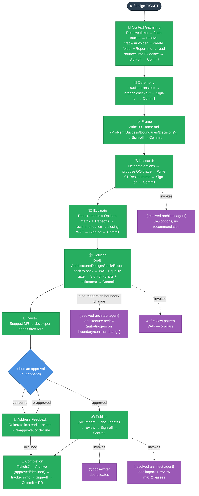

# Design Lifecycle — Context Gathering → Ceremony → Frame → Research → Evaluate → Solution → Review → Address Feedback → Publish → Completion

_Produces an approved architectural design before implementation begins._

---

## Intent

The Design lifecycle front-loads the hard thinking. It frames the problem, researches options without bias, surfaces trade-offs across WAF pillars, makes a falsifiable recommendation, specifies integration and security detail, runs a WAF gate, and requires out-of-band human approval before any code is written.

The output is a `solution/` folder that serves as the implementation spec for the Dev tickets created at Completion.

**Two tracks, one flow.** `/design` covers both **Product** design (cross-project product architecture — `docs/Harness/`) and **Project** design (this repo's own target architecture — `docs/Target Architecture (HLD)/`). The track is resolved exactly once, in Context Gathering, and recorded in `Report.md`'s `## Context` section (source docs, dest docs, subfolder, architect agent). Every later phase reads it from there — no phase re-derives or branches on track; the diagram and tables below use `{resolved architect agent}` / `{dest docs}` for that reason.

One skill (`design`) owns all ten phases as `references/01-context-gathering.md` … `references/10-completion.md`; there is no separate installable skill per phase. **Context Gathering and Ceremony are two separate stages**, mirroring the `dev` skill's own split: Context Gathering only reads and resolves (ticket, tracker, track/subfolder) and creates the story folder; Ceremony is the only stage that mutates the tracker or checks out a branch. Frame is separately its own stage again — not part of that dev-mirrored split — and writes the framing content using what Context Gathering resolved.

**Two stops per phase, both at its end** — same model as the dev lifecycle: a sign-off (`patterns/phase-sign-off.md`), then the commit. Steps inside a phase use intelligent checkpoints (`patterns/approval-intelligent.md`) and keep going when the content qualifies; anything they would have asked about is carried into the one sign-off. Review Gate and Address Feedback are the exception — their stop waits on the real external MR-approval fact, not an agent decision.

**Design-lifecycle artifacts live under `{stories root}`** — `docs/Stories/design/` for a Project design, `docs/Stories/product-design/` for a Product design, resolved once by Context Gathering and never re-derived. Active at `{stories root}[{TICKET}] {name}/`, archived at `{stories root}approved/[{TICKET}] {name}/` or `{stories root}declined/[{TICKET}] {name}/` — either way separate from the dev skill's `docs/Stories/[{TICKET}] {name}/impl/`, and the two design roots never mix in the same parent folder.

---

## When to use it

- Ticket is large or spans multiple sprints
- A new container or integration is being introduced
- Non-functional concerns (security, reliability, cost) are meaningfully affected
- The team is uncertain about the right approach

## When NOT to use it

Small, well-understood changes within a single container that introduce no new integrations or architecture decisions. Use `/dev` directly.

---

## Flow

## Phases

**Router:** `/design <TICKET>` — runs all ten phases in one session, stopping once per phase (sign-off, then commit) for confirmation. Bail out at any point and resume with the individual command. One skill (`design`) owns all ten phases; Review, Address Feedback, Publish, and Completion stay independently invocable and resumable the same way they always did: `/design review-gate` opens the draft MR and the session pauses; `/design address-feedback` is the next invocation — it confirms the outcome and, only if the approver raised concerns, loops back to an earlier phase, re-approves, or declines; `/design publish` runs once the gate is approved; `/design complete` runs alone for a design whose docs landed (or that was declined) but was never archived.

| Phase                 | Individual command                   | What it produces                                                                                                                      |
| --------------------- | ------------------------------------ | ------------------------------------------------------------------------------------------------------------------------------------- |
| **Context Gathering** | `/design context-gathering <TICKET>` | Ticket/local ID resolved, tracker context fetched, track/subfolder resolved; story folder + `design/Report.md` created                |
| **Ceremony**          | `/design ceremony <TICKET>`          | Tracker transition + branch checkout confirmed                                                                                        |
| **Frame**             | `/design frame <TICKET>`             | Problem statement, known + proposed evaluation criteria, boundaries, multi-decision breakdown if any → `design/00 Frame.md`           |
| **Research**          | `/design research <TICKET>`          | 3–5 neutral options via `{resolved architect agent}` — no recommendation → `design/01 Research.md`                                    |
| **Evaluate**          | `/design evaluate <TICKET>`          | Requirements × Options matrix, tradeoffs, recommendation, WAF assessment → `design/02 Evaluate.md`                                    |
| **Solution**          | `/design solution <TICKET>`          | Certainty-principle artifacts → `solution/Architecture.md`, `Design.md`, `Stack.md`, `Efforts.md`                                     |
| **Review**            | `/design review-gate <TICKET>`       | Draft MR opened, gate recorded in `Report.md`, session pauses for out-of-band human approval                                          |
| **Address Feedback**  | `/design address-feedback <TICKET>`  | Confirms the outcome; on concerns, reiterates into the traced-to phase and re-approves, or records a decline and routes to Completion |
| **Publish**           | `/design publish <TICKET>`           | `{dest docs}` updated — skipped entirely for a declined design                                                                        |
| **Completion**        | `/design complete <TICKET>`          | Implementation tickets optionally published, story archived to `approved/` or `declined/`, tracker synced, commit + PR handed over    |

---

## Invariants

**Context Gathering:** Read-only. Resolves the ticket number or a local `DESIGN-YYYYMMDD-XXXX` ID, fetches tracker/Confluence context, and — this stage's responsibility — identifies the track (Product or Project), its subfolder, and the Stories root that follows from it, once, via `patterns/context-resolution.md`, writing it to `Report.md`'s `## Context` section — no later phase re-asks or re-derives this. Creates the story folder (under the resolved Stories root) and `design/Report.md` (so Ceremony has something to update), then reads the relevant docs under the resolved Source docs path and records each one in `Report.md`'s `## Evidence` table — the lifecycle's one context-reading pass. Writes no framing content.

**Ceremony:** The only stage that mutates anything external. Tracker transition (assign + move to In Progress) is an intelligent checkpoint; auto-approved when unassigned-or-self-assigned, pre-work status, and In Progress is the obvious next transition, otherwise a sign-off. Branch checkout is always a sign-off — the AI proposes the exact `git checkout -b` command but never runs it; the developer confirms once they're on it.

**Frame:** Writes `design/00 Frame.md` using what Context Gathering already resolved — no re-fetching, no re-resolving track/subfolder. Requirements must include both known (from ticket) and proposed (gaps found by AI — NFRs, observability, GDPR). Proposed requirements are labelled `[proposed]`; these are confirmed at the phase sign-off, not asked about piecemeal. Frame also has its own dedicated step checking the Problem for bundled independent decisions (`patterns/multi-decision-split.md`, Step 2): at most one decision needs no section and no stop; two or more get a `## Decisions` section, written by `@docs-writer`, and their own sign-off right there — a material structural choice, since it decides how many times Research through Solution loop, not a content detail to fold into the main sign-off. These requirements become the evaluation criteria rows in the Requirements × Options matrix during Evaluate.

**Research:** Reads context from `Report.md`'s `## Evidence` table — populated once, in Context Gathering — rather than re-reading the source docs itself. `{resolved architect agent}` returns options only — no recommendation. At least one "minimal change" option and at least one industry-standard approach must be included. No judgment is made here. Open questions from `{resolved architect agent}` are proposed a V/E classification by the agent — **(V) Viability** (would disqualify an option) or **(E) Evaluation-input** (affects cost/detail only) — confirmed or corrected at the phase sign-off, not in a separate round. See `patterns/design-oq-triage.md`. If Frame's confirmed Decisions section lists more than one decision, only the content steps loop (one `design/01 Research - {Decision}.md` per decision) — the phase still closes with exactly one Sign-off → Report → Commit, per `references/00-decision-router.md`.

**Evaluate:** Every requirement from `00 Frame.md` and every WAF pillar must be addressed. The recommendation must be falsifiable: it states which assumption, if wrong, would change the recommendation. A closing WAF assessment runs on the recommended option only, and any P1 finding is carried into the phase sign-off as a named decision rather than its own stop. Loops per decision under the same multi-decision policy as Research.

**Solution:** Certainty principle applies. `Architecture.md` is the authoritative integrated end-to-end solution record: it carries every settled decision from Frame, Research, Evaluate, developer clarification, WAF and review feedback, with affected flows, consequences and verification obligations. `solution/` files contain only settled decisions and their direct consequences — no rationale, rejected alternatives or open questions. `Design.md`, `Stack.md` and `Efforts.md` provide supporting detail and must not introduce a material decision absent from or conflicting with Architecture.md. All four are drafted back to back with no stop between them; the `{resolved architect agent}` architecture review auto-triggers (no permission ask) when a boundary, contract, infra resource, or cross-container data flow changed (see `patterns/design-architect-review.md`). The WAF review gate (`patterns/waf-review.md`, target `solution`) and the design quality gate run after drafting, with any P1 or failing check carried into the one phase sign-off — which also asks the developer to fill in `Efforts.md`'s Estimate column, since that is the one thing only they can supply. An operational-cost model is one of `interfaces/efforts.md`'s optional ways to express the design, included when it adds value, not a required section. Under the multi-decision policy, `Design.md` loops per decision but `Architecture.md` stays a single integrated file — one section per decision. Publish and `/dev` consume Architecture.md as the solution source of truth.

**Review:** The AI suggests the MR title/body but does not open it. The developer opens the MR and pastes the URL. Session ends here — this is a genuine session boundary, not just a phase transition, since it waits on an out-of-band human approval. Confirming that approval is Address Feedback's opening concern, not this phase's.

**Address Feedback:** Always the next invocation after Review parks for approval — its own Step 1 is what confirms the outcome (**approved**, **concerns**, or **declined**), so this phase decides whether there's anything for it to do rather than Review deciding that for it. **Approved** skips this phase and continues to Publish; **declined** skips this phase and Publish, routing straight to Completion. Only on **concerns** does it actually run: the AI identifies which phase/step the concern traces to and suggests a named reiterate path (e.g. "Reiterate from Evaluate, Step 4"); it does not decide the fix unilaterally. The same three-way question is asked again after each rework round: **re-approved** (continue to Publish), **still concerns** (loop), or **declined**. A decline records the reason in `Report.md`'s `## Gate` section, skips Publish entirely (no permanent docs to update), and routes straight to Completion for an archive under `declined/` instead of `approved/`.

**Publish:** The AI does not approve its own gate — a human must approve the MR out-of-band, with no unresolved concerns, before this phase runs (and it is skipped entirely for a declined design). `{resolved architect agent}` identifies `{dest docs}` docs that need updating — auto-approved when every row is unambiguous, otherwise a sign-off; `@docs-writer` applies the updates and `{resolved architect agent}` reviews (max 2 passes) before the one phase sign-off.

**Completion:** The final stage, and also directly invocable for a design whose docs landed (or that was declined) but was never archived. Branches on the gate's recorded outcome: **approved** publishes the WBS from `Efforts.md` to the tracker (auto-approved when unambiguous), archives to `{stories root}approved/[{TICKET}] {name}`, syncs the tracker to Done, and hands over the commit plus suggested PR title/body. **Declined** skips ticket publication, archives to `{stories root}declined/[{TICKET}] {name}`, syncs the tracker to its rejected/won't-do status, and ends with a neutral close — no PR, since no permanent docs were ever updated. Either way the worklog effort is derived from the design metrics, delegated to `@scrum-master` by state name, and recorded before the one phase sign-off.

---

## Patterns

Patterns are shared multi-step protocols co-located in the design skill's `patterns/` folder. They are not registered in CLAUDE.md — each stage reference loads them on-demand via explicit path reference.

| Pattern                             | File                         | What it enforces                                                                                                                                                                                                                                                                                                                                                                                                                                                                                                                                                                                                                                                                                                                                                                                                                                                             | Applied in                                                                                                                 |
| ----------------------------------- | ---------------------------- | ---------------------------------------------------------------------------------------------------------------------------------------------------------------------------------------------------------------------------------------------------------------------------------------------------------------------------------------------------------------------------------------------------------------------------------------------------------------------------------------------------------------------------------------------------------------------------------------------------------------------------------------------------------------------------------------------------------------------------------------------------------------------------------------------------------------------------------------------------------------------------- | -------------------------------------------------------------------------------------------------------------------------- |
| **context-resolution**              | `context-resolution.md`      | Resolves Product/Project track, source/dest docs, Stories root, subfolder, and architect agent exactly once — an intelligent checkpoint, auto-approved when the track is unambiguous; then reads the resolved Source docs into `Report.md`'s `## Evidence` table (Two-track only — single-track modes read sources via `Apply `.claude/skills/design/patterns/context-resolution.md`— resolve which track this is (Product or Project), then which subfolder within it, and write the resolved Track, Source docs, Dest docs, Stories root, Subfolder, Architect agent, and Implementation note into the`## Context`section of`design/Report.md` (created in this same step, at the resolved Stories root). The pattern also reads the resolved Source docs path and records into Evidence — see its own final paragraph.` instead, since there's no pattern file to own it) | Context Gathering Step 3                                                                                                   |
| **multi-decision-split**            | `multi-decision-split.md`    | Default per-decision file-split policy, confirmed once at its own dedicated sign-off (only when 2+ decisions), applied silently from Research onward                                                                                                                                                                                                                                                                                                                                                                                                                                                                                                                                                                                                                                                                                                                         | Frame Step 2, Research Step 1, Evaluate Step 1, Solution Step 3                                                            |
| **decision-router** _(not a stage)_ | `00-decision-router.md`      | Loop boundary for a multi-decision stage: which steps repeat per decision, which close once regardless of count — never one Sign-off/Report/Commit per decision; also tracks each decision as a child task (one per decision, native-tool progress visibility), the same shape `dev`'s Implement uses for plan steps                                                                                                                                                                                                                                                                                                                                                                                                                                                                                                                                                         | Applied by Research, Evaluate, Solution when 2+ decisions                                                                  |
| **phase-sign-off**                  | `phase-sign-off.md`          | One sign-off per phase, everything to decide in one message; how the stop works                                                                                                                                                                                                                                                                                                                                                                                                                                                                                                                                                                                                                                                                                                                                                                                              | Every stage's Sign-off step                                                                                                |
| **approval-sign-off**               | `approval-sign-off.md`       | What a sign-off is, its three shapes (content / manual operation / external confirmation); sign-offs used sparingly                                                                                                                                                                                                                                                                                                                                                                                                                                                                                                                                                                                                                                                                                                                                                          | Named sign-off and manual-operation steps across every stage                                                               |
| **approval-intelligent**            | `approval-intelligent.md`    | Auto-approve a checkpoint when stated conditions hold; escalate to a sign-off on any doubt                                                                                                                                                                                                                                                                                                                                                                                                                                                                                                                                                                                                                                                                                                                                                                                   | Every named intelligent-approval checkpoint                                                                                |
| **do → report → commit** _(design)_ | `do-report-commit.md`        | Report and Commit are routine after the sign-off; Commit is its own stop (manual operation); announce and continue, no separate "ready to continue?" ask                                                                                                                                                                                                                                                                                                                                                                                                                                                                                                                                                                                                                                                                                                                     | End of every stage                                                                                                         |
| **announce-progress** _(design)_    | `announce-progress.md`       | `✅ Done / 📋 After this phase` after an auto-approved checkpoint or a phase boundary                                                                                                                                                                                                                                                                                                                                                                                                                                                                                                                                                                                                                                                                                                                                                                                        | `design/SKILL.md` phase transitions, in-phase checkpoints                                                                  |
| **design-oq-triage**                | `design-oq-triage.md`        | Two-tier OQ classification (V/E) protocol; the agent proposes, the developer confirms at the phase sign-off                                                                                                                                                                                                                                                                                                                                                                                                                                                                                                                                                                                                                                                                                                                                                                  | Research Step 3b, Evaluate Step 1b                                                                                         |
| **design-architect-review**         | `design-architect-review.md` | `{resolved architect agent}` read-only review of Architecture.md; max 2 iterations; excludes doc gaps from scope                                                                                                                                                                                                                                                                                                                                                                                                                                                                                                                                                                                                                                                                                                                                                             | Solution Step 2b (auto-triggered)                                                                                          |
| **satellite-review** _(design)_     | `satellite-review.md`        | `{resolved architect agent}` read-only reviewer of design artifacts; OK / corrections; max 2 iterations                                                                                                                                                                                                                                                                                                                                                                                                                                                                                                                                                                                                                                                                                                                                                                      | Solution Step 2b (via `design-architect-review.md`), Publish Step 4                                                        |
| **write-confirm** _(design)_        | `write-confirm.md`           | Write file to disk and say so; review happens once, at the phase sign-off, not per file                                                                                                                                                                                                                                                                                                                                                                                                                                                                                                                                                                                                                                                                                                                                                                                      | Every stage (per artifact)                                                                                                 |
| **session-continuity** _(design)_   | `session-continuity.md`      | Fresh vs. resume decided once by the router's Resume Detection; this pattern only covers losing context mid-stage                                                                                                                                                                                                                                                                                                                                                                                                                                                                                                                                                                                                                                                                                                                                                            | All ten stage references                                                                                                   |
| **waf-review**                      | `waf-review.md`              | Parameterized WAF assessment (`frame`/`research`/`evaluate`/`solution` targets, `--pillars=` filter); appends to Report.md — never a standalone file                                                                                                                                                                                                                                                                                                                                                                                                                                                                                                                                                                                                                                                                                                                         | Solution Step 7 only (Evaluate keeps its own separate inline assessment; Publish keeps its own satellite review)           |
| **design-quality-gate**             | `design-quality-gate.md`     | Mechanical quality checks before Review Gate; result carried into the phase sign-off, never its own stop                                                                                                                                                                                                                                                                                                                                                                                                                                                                                                                                                                                                                                                                                                                                                                     | Solution Step 7                                                                                                            |
| **task-tracking** _(design)_        | `task-tracking.md`           | The host's available progress tracker over the ten stages via the installed `runtime/task-tracking.md` procedure, with `Report.md` as the durable source of truth on resume                                                                                                                                                                                                                                                                                                                                                                                                                                                                                                                                                                                                                                                                                                  | `design` router (one task per stage); also Research/Evaluate/Solution (one task per decision, via `00-decision-router.md`) |

Retired: `compact-between-phases.md` — its proactive-compaction job was redundant with `session-continuity.md`'s reactive one.

---

## What lives where

| Content                        | Lives in                                                                                        |
| ------------------------------ | ----------------------------------------------------------------------------------------------- |
| Options, trade-offs, rationale | `{stories root}<TICKET>/design/` — never graduates                                              |
| WAF assessment                 | `design/Report.md` WAF section — never graduates                                                |
| Chosen approach (outcome only) | `{stories root}<TICKET>/solution/` → drives `{dest docs}` update at Publish                     |
| Implementation spec            | `{stories root}<TICKET>/solution/` → guides Dev tickets, published to the tracker at Completion |

Active designs live at `{stories root}[{TICKET}] {name}/`; archived designs move to
`{stories root}approved/[{TICKET}] {name}/` (the normal outcome) or
`{stories root}declined/[{TICKET}] {name}/` (rejected at Address Feedback).
`{stories root}` is `Stories/design/` for a Project design or
`Stories/product-design/` for a Product design — either way separate from the
dev skill's own `Stories/[{TICKET}] {name}/impl/`.

## Design delivery metrics

Each story owns `design/stat.json` alongside `design/Report.md`. The design metrics
CLI captures ten stage attempts, observed work and waits, review evidence, feedback
rework, blockers, and actual runtime token deltas. Review approval waits persist across
sessions; approval without concerns explicitly skips Address Feedback. Every sign-off-gated
stage (Context Gathering, Ceremony, Frame, Research, Evaluate, Solution, Publish,
Completion) mechanically refuses `stage complete` without a recorded passing
"`<Stage> sign-off`" acceptance check in the current attempt — Review Gate and
Address Feedback are exempt, since their stop is the external MR-approval fact, not
a phase sign-off. Completion, not Publish, is the stage that finalizes metrics and
gates ticket completion, after required archive/tracker work and before any dev
hand-off. Design and dev records remain separate. See the design skill's
`patterns/metrics.md` for exact commands, recovery, approval recording, and the
schema. The design CLI and its constants install independently of other flows.
