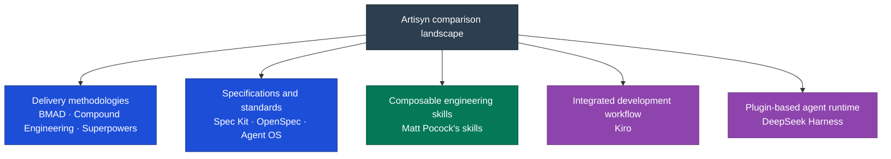

# Competitors and Related Tools

_Research snapshot: 17 September 2026. Based on official repositories and documentation; no hands-on benchmark. Overlap and positioning are our assessment, not verified performance rankings._

**Artisyn is primarily an implementation and technical-design harness operating within persistent project architecture.** Its strongest supported distinction is context wired into the process: explicit HLD/LLD ownership, architecture-deviation handling, documentation reconciliation, reports and history, executable lifecycle statistics, and reviewed process improvement through Evolve. These are documented mechanisms, not proof of better delivery outcomes.

Start with the [feature comparison](<./02 Feature Comparison.md>) for competitor tables, then the [capability audit](<./03 Artisyn Capability Audit.md>) for the complete functional inventory, evidence, limitations, and implementation gaps.

The usual entry is an existing ticket or supplied engineering intent. Artisyn can clarify that intent, propose acceptance criteria, and create implementation tickets from technical design; it does **not** provide a complete product-discovery, prioritisation, and PRD lifecycle. Calling it unable to create any requirements would also be inaccurate.

## Three tiers of adoption

The [Story's adoption model](<../../The Story/00 Software Development Lifecycle.md#5-where-teams-get-stuck>) explains why repeatable execution and maintained project context matter. These tiers describe a team's operating practices, not fixed rankings of the tools below.

| Tier            | Adoption focus                                                        | Question to ask when evaluating a tool                                                 |
| --------------- | --------------------------------------------------------------------- | -------------------------------------------------------------------------------------- |
| **Code AI**     | Assistance with individual coding tasks.                              | Does it improve the immediate output?                                                  |
| **Workflow AI** | Repeatable steps from intent through implementation and verification. | Does it reliably carry work through a complete delivery cycle?                         |
| **Assisted AI** | Persistent team context and practices that improve over time.         | Does it preserve architecture decisions, conventions, and lessons for subsequent work? |

A skill library can support persistent context; a full workflow can still run with stale information. Evaluate how a team installs, maintains, and uses each option. Artisyn's ambition is the third tier; the comparison below identifies overlapping capabilities and evidence still needed.

For the wider organisational target beyond one project, continue to [Target Agentic SDLC Setup](<../../The Story/05 Target Agentic SDLC Setup.md>).

## Landscape

## Comparison

Project links point to the primary sources used for this snapshot. The final column describes our interpretation of the overlap.

| Project                                                                         | Documented capabilities                                                                                                                                                      | Relevance to Artisyn                                                                                                                                                                                                                                                    |
| ------------------------------------------------------------------------------- | ---------------------------------------------------------------------------------------------------------------------------------------------------------------------------- | ----------------------------------------------------------------------------------------------------------------------------------------------------------------------------------------------------------------------------------------------------------------------- |
| [BMAD Method](https://github.com/bmad-code-org/BMAD-METHOD)                     | Product planning, architecture, implementation, review, and learning; specialized perspectives and optional modules.                                                         | Closest overall methodology comparison: Design and Dev lifecycles, durable context, and project adoption.                                                                                                                                                               |
| [Compound Engineering](https://github.com/EveryInc/compound-engineering-plugin) | Brainstorm, plan, build, simplify, review, and capture learning in reusable solution documents.                                                                              | Closest match to the convergence principle: knowledge from one change informs the next. Compare directly with Evolve.                                                                                                                                                   |
| [Superpowers](https://github.com/obra/superpowers)                              | Composable skills for design clarification, planning, test-driven development, debugging, and agent execution with review.                                                   | Strong alternative for teams primarily seeking consistent day-to-day engineering practices.                                                                                                                                                                             |
| [GitHub Spec Kit](https://github.com/github/spec-kit)                           | Project principles, specifications, technical plans, tasks, implementation, and convergence; extensions, presets, workflows, and bundles.                                    | Competes with structured planning, documented outcomes, and reusable process packaging.                                                                                                                                                                                 |
| [OpenSpec](https://github.com/Fission-AI/OpenSpec)                              | Change proposals with requirements, design, and tasks; implementation and archival update specifications. Shared planning Stores are in beta.                                | Relevant to existing-system changes, documentation flow, and shared product context across repositories.                                                                                                                                                                |
| [Agent OS](https://github.com/buildermethods/agent-os/releases)                 | Version 3 focuses on discovering and injecting standards, shaping specifications, and sharing standards through profiles.                                                    | Competes with convention capture and reuse; deliberately delegates more implementation orchestration to the host agent.                                                                                                                                                 |
| [Matt Pocock's skills](https://github.com/mattpocock/skills/tree/main)          | Adaptable engineering skills for requirements clarification, domain modeling, specifications, tickets, implementation, TDD, debugging, review, and architecture improvement. | A composable alternative to adopting a full methodology, and a potential source of individual practices for Artisyn.                                                                                                                                                    |
| [Kiro](https://kiro.dev/docs/specs/)                                            | Integrated requirements, design documents, and executable task plans for features and bug fixes.                                                                             | An adjacent product: it can host a team's workflow while replacing some externally supplied planning machinery.                                                                                                                                                         |
| [DeepSeek Harness](https://github.com/deepseek-ai/deepseek-harness/tree/master) | Open-source agent harness with an everything-is-a-plugin architecture, Cordis runtime, local Web UI and plugin discovery. It is explicitly a developer preview.              | Adjacent runtime/platform comparison, not a directly equivalent SDLC methodology. Its plugin architecture could host workflows like Artisyn, but the reviewed README does not establish Artisyn-style HLD/LLD governance, Evolve loop, reports or lifecycle statistics. |

## DeepSeek Harness: what it is

[DeepSeek Harness (`dsh`)](https://github.com/deepseek-ai/deepseek-harness/tree/master) is an open-source, plugin-oriented agent runtime from DeepSeek AI. The repository describes an “everything is a plugin” architecture powered by Cordis, a local Web UI launched through `npx @deepseek-ai/dsh web`, and a developer-preview status with compatibility-breaking changes expected. It is therefore closer to the execution platform underneath a workflow than to Artisyn's governed SDLC layer.

The fair comparison is architectural: DeepSeek Harness provides a composable runtime and plugin surface; Artisyn provides lifecycle contracts, project-context documents, architecture governance, evidence records and process-improvement workflows. DeepSeek Harness may be able to host comparable plugins, but the repository README and reviewed public documentation do not establish those features as built-in. We should not score “not mentioned” as “missing” without a deeper plugin and documentation audit.

| Question               | DeepSeek Harness                                                                                  | Artisyn                                                                          |
| ---------------------- | ------------------------------------------------------------------------------------------------- | -------------------------------------------------------------------------------- |
| Primary abstraction    | Plugin-based agent runtime and Web UI                                                             | Governed technical-design and implementation harness                             |
| Context model          | Plugin/runtime architecture; details depend on installed plugins                                  | HLD, LLD, conventions, reports, history and code wired into lifecycle steps      |
| SDLC method            | Not established by the reviewed README                                                            | Design and Dev workflows with explicit document outputs                          |
| Process evolution      | Plugin extensibility is documented; Evolve-style reflect/triage/validate/adopt is not established | Evolve explicitly separates observation, triage, validation and adoption         |
| Statistics and reports | Not established by the reviewed README                                                            | Executable lifecycle timing, checks, waits, quality and work reports             |
| Maturity signal        | Developer preview; breaking changes expected                                                      | More specialized source-level workflow, with known contract and portability gaps |

DeepSeek Harness belongs in the comparison as a **runtime/platform adjacent tool**, alongside Kiro, rather than as a direct competitor to Artisyn's HLD-to-implementation governance. A meaningful follow-up would inspect its plugin APIs, built-in plugins, agent state model, permissions, persistence and benchmark suite before assigning feature-level RAG cells.

## Matt Pocock's skills: a closer look

The repository emphasizes small, editable skills that engineers can compose and adapt. Its [README](https://github.com/mattpocock/skills/tree/main) describes clarification and domain documentation, spec and ticket creation, implementation, testing, review, and architecture surveys.

For Artisyn, the useful comparison is adoption granularity: can a team take one practice without adopting all four lifecycles? The architecture-improvement skills also make this a relevant comparison beyond coding technique. Treat individual skills as candidates for evaluation, with local validation before incorporation.

## Positioning hypotheses

The following are opportunities to validate, not claims of exclusive functionality.

| Artisyn capability                                                        | Potential distinction                                                                                      | Evidence needed                                                                              |
| ------------------------------------------------------------------------- | ---------------------------------------------------------------------------------------------------------- | -------------------------------------------------------------------------------------------- |
| [Architecture lifecycle](<../03 Lifecycles/04 Architecture Lifecycle.md>) | Reconcile designed, implemented, and documented states, alongside architecture quality reviews.            | Show that reviews catch consequential drift missed by a simpler workflow.                    |
| [Evolve lifecycle](<../03 Lifecycles/03 Evolve Lifecycle.md>)             | Turn observations into inactive candidates, validate behavior, then adopt changes into the active harness. | Demonstrate safer, reusable workflow improvements beyond saving lessons for later retrieval. |
| [Documents flow](<../03 Lifecycles/05 Documents Flow.md>)                 | Give architecture, implementation documentation, conventions, and work records explicit ownership.         | Measure whether documentation remains accurate across successive changes and projects.       |

A positioning statement to test: **Artisyn helps engineering teams keep AI-delivered changes aligned with their architecture, documentation, and validated engineering practices across projects.**

## Lessons for the roadmap

| Finding                                                                                                                                                         | Implication                                                                                              |
| --------------------------------------------------------------------------------------------------------------------------------------------------------------- | -------------------------------------------------------------------------------------------------------- |
| [Compound Engineering](https://github.com/EveryInc/compound-engineering-plugin) already captures lessons that future planning reads.                            | Demonstrate the additional value of validating and adopting changes to the engineering workflow itself.  |
| [Agent OS v3](https://github.com/buildermethods/agent-os/releases) retired implementation orchestration and task breakdown in favor of host-agent capabilities. | Reassess scaffolding as coding agents improve; retain steps with demonstrated value.                     |
| [Matt Pocock's skills](https://github.com/mattpocock/skills/tree/main) emphasize composition and adaptation.                                                    | Make individual Artisyn practices understandable and adoptable without requiring the entire methodology. |

## Proposed evaluation

Run Artisyn, BMAD, Compound Engineering, and Superpowers against the same existing-codebase change: an architectural decision, implementation, tests, documentation, and a follow-up ticket. Include Matt Pocock's skills as a baseline for selective adoption.

| Measure              | Question                                                                |
| -------------------- | ----------------------------------------------------------------------- |
| Human interventions  | How often must an engineer correct scope, assumptions, or process?      |
| Constraint adherence | Which requirements or architecture rules are missed?                    |
| Documentation drift  | Do code, specifications, and architecture records agree after delivery? |
| Reuse of learning    | Does the follow-up ticket benefit from the first change?                |
| Process cost         | How much time and agent usage does the workflow add?                    |

Record repository revisions and host-agent versions when running the comparison. Refresh this snapshot before making an adoption decision.
