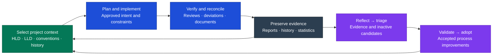

# Feature Comparison

_Research snapshot: 17 September 2026. Artisyn baseline `8b8625181434ca199275f5686264b3b5628982bc`. Source-level assessment, not a comparative execution benchmark._

**Artisyn’s strongest supported proposition is project context wired into the delivery process:** select approved context, constrain implementation, review deviations, reconcile documents, preserve reports/history/statistics, and improve the process through Evolve. Persistent files alone are not the distinction; the prescribed connections between these activities are.

“Always consistent context” is the intended outcome, **not an established guarantee**. Agents can miss context, documents can lag, and the [audit found inconsistent handoffs](<./03 Artisyn Capability Audit.md#implementation-gaps>). Use **“a process designed to maintain and reconcile project context”** until live evidence supports a stronger claim.

## Consolidated feature matrix

All nine tools appear in one matrix, grouped by the six SDLC stages plus **Other / cross-cutting** capabilities. The Other group covers governance, approvals, reports, statistics, history, skill evolution and harness management that support several stages but are not themselves SDLC activities. This is the consolidated functional inventory from the audit plus competitor-specific differentiators, not an exhaustive catalog of every upstream plugin or runtime feature.

| Icon | Meaning                                                                                                                          |
| ---- | -------------------------------------------------------------------------------------------------------------------------------- |
| 🟢 D | **Documented:** explicit mechanism covers the stated feature. May be agent instructions; not necessarily executable enforcement. |
| 🟠 P | **Partial/conditional:** narrower coverage, manual integration, external host, or known implementation limitations.              |
| 🔴 O | **Outside demonstrated core / explicitly unmet:** affirmative scope boundary or contradiction, not merely missing evidence.      |
| ⚪ ? | **Unestablished:** reviewed evidence is insufficient. Not “absent”; do not count as a loss.                                      |

Letters make the ratings readable without relying on color. RAG measures **coverage**, not the M1–M3 capability depth in the [six-stage diagram](<./04 SDLC Tool Coverage.md>). A green workflow can be less mature operationally than an amber integrated capability.

**Winner rule:** the last column names the best-supported _documented fit for that exact feature_, based on specificity, lifecycle integration and executable evidence where applicable. “Shared” means several credible implementations; “unresolved” means evidence is too uneven. No points are assigned to colors and no overall winner is calculated: this inventory contains more fine-grained Artisyn evidence than competitor evidence, so green totals would bias the result. A named leader is provisional, not proof of unique capability or superior outcomes.

Column abbreviations: **Art** Artisyn; **BMD** BMAD; **SP** Superpowers; **CE** Compound Engineering; **SK** Spec Kit; **OS** OpenSpec; **AOS** Agent OS v3; **Matt** Matt Pocock’s skills. Sources and scope limits follow the table. Scroll horizontally to compare all tools. **DeepSeek Harness is covered separately as an adjacent plugin runtime** in [Competitors and Related Tools](<./01 Competitors and Related Tools.md#deepseek-harness-what-it-is>); its README does not provide enough SDLC feature evidence for honest row-by-row RAG scoring yet.

| SDLC stage            | Feature                               | Description / assessment boundary                                                                   | Art  | BMD  | SP   | CE   | SK   | OS   | AOS  | Matt | Kiro | Best-supported fit / winner                                                                    |
| --------------------- | ------------------------------------- | --------------------------------------------------------------------------------------------------- | ---- | ---- | ---- | ---- | ---- | ---- | ---- | ---- | ---- | ---------------------------------------------------------------------------------------------- |
| Analysis              | Product discovery                     | Product brief/PRD workflow before an engineering ticket.                                            | 🔴 O | 🟢 D | 🟠 P | 🟠 P | 🟠 P | 🟠 P | 🟠 P | 🟠 P | 🟠 P | BMAD — explicit upstream workflow                                                              |
| Analysis              | Intent clarification                  | Resolve supplied problem, scope, constraints and open questions.                                    | 🟢 D | 🟢 D | 🟢 D | 🟢 D | 🟢 D | 🟢 D | 🟢 D | 🟢 D | 🟢 D | Shared                                                                                         |
| Analysis              | Acceptance criteria                   | Make supplied requirements checkable.                                                               | 🟢 D | 🟢 D | 🟢 D | 🟢 D | 🟢 D | 🟢 D | 🟠 P | 🟢 D | 🟠 P | Shared                                                                                         |
| Analysis              | Requirement identities                | Stable identifiers linking requirements to downstream work.                                         | ⚪ ? | 🟢 D | ⚪ ? | 🟢 D | 🟢 D | 🟢 D | ⚪ ? | ⚪ ? | ⚪ ? | BMAD / Compound / Spec Kit / OpenSpec                                                          |
| Analysis              | Tracker intake                        | Read existing work items and linked context through configured integrations.                        | 🟠 P | ⚪ ? | ⚪ ? | ⚪ ? | ⚪ ? | ⚪ ? | ⚪ ? | ⚪ ? | ⚪ ? | Unresolved; Artisyn integration is explicit                                                    |
| Analysis              | Tracker-free entry                    | Start from local supplied intent rather than require a tracker.                                     | 🟠 P | 🟢 D | 🟢 D | 🟢 D | 🟢 D | 🟢 D | 🟢 D | 🟢 D | 🟢 D | Shared; Artisyn Design handoff has a gap                                                       |
| Analysis              | Create delivery tickets               | Turn supplied intent/design into implementation work items.                                         | 🟠 P | 🟢 D | 🟢 D | 🟠 P | 🟠 P | 🟠 P | 🟠 P | 🟢 D | 🟠 P | BMAD / Matt — explicit decomposition                                                           |
| Design                | Options and tradeoffs                 | Research alternatives and explain a technical choice.                                               | 🟢 D | 🟢 D | 🟢 D | 🟢 D | 🟢 D | 🟠 P | 🟠 P | 🟢 D | 🟠 P | Artisyn / BMAD — structured design focus                                                       |
| Design                | Project architecture                  | Maintain system boundaries and decisions beyond one feature.                                        | 🟢 D | 🟢 D | 🟠 P | 🟢 D | 🟠 P | 🟠 P | 🟢 D | 🟢 D | 🟠 P | Artisyn / BMAD — architecture is central                                                       |
| Design                | HLD and LLD separation                | Distinct approved container architecture and code-backed component records.                         | 🟢 D | ⚪ ? | ⚪ ? | ⚪ ? | ⚪ ? | ⚪ ? | ⚪ ? | ⚪ ? | ⚪ ? | Artisyn — explicit separate contracts                                                          |
| Design                | Decision provenance                   | Preserve why a solution was chosen and link its consequences.                                       | 🟢 D | 🟢 D | 🟢 D | 🟢 D | 🟢 D | 🟢 D | 🟠 P | 🟢 D | 🟢 D | Shared; different artifact models                                                              |
| Design                | Domain language and ADRs              | Maintain bounded-context vocabulary and consequential decisions.                                    | 🟠 P | ⚪ ? | ⚪ ? | ⚪ ? | ⚪ ? | ⚪ ? | ⚪ ? | 🟢 D | ⚪ ? | Matt — explicit domain-modeling practice                                                       |
| Design                | NFR and sizing evidence               | State targets, operating conditions and sourced capacity assumptions.                               | 🟢 D | 🟠 P | 🟠 P | 🟠 P | 🟠 P | 🟠 P | ⚪ ? | ⚪ ? | ⚪ ? | Artisyn — explicit evidence contract                                                           |
| Design                | Design review and approval            | Review a proposed solution before implementation.                                                   | 🟢 D | 🟢 D | 🟢 D | 🟢 D | 🟢 D | 🟢 D | 🟠 P | 🟠 P | 🟠 P | Shared                                                                                         |
| Design                | Adaptive solution artifacts           | Select only relevant design outputs for the change.                                                 | 🟠 P | 🟢 D | 🟢 D | 🟢 D | 🟠 P | 🟢 D | 🟠 P | 🟢 D | 🟠 P | No single leader; Artisyn handoff inconsistency                                                |
| Implementation        | Context wired into steps              | Workflow explicitly selects relevant project rules/specs and uses them during delivery.             | 🟢 D | 🟢 D | 🟢 D | 🟢 D | 🟢 D | 🟢 D | 🟠 P | 🟢 D | 🟢 D | Artisyn / BMAD / Compound — different context loops                                            |
| Implementation        | Approved execution plan               | Persist scope, tasks, dependencies and verification approach.                                       | 🟢 D | 🟢 D | 🟢 D | 🟢 D | 🟢 D | 🟢 D | 🟠 P | 🟢 D | 🟢 D | Shared                                                                                         |
| Implementation        | Controlled plan changes               | Preserve approved baseline and record subsequent changes explicitly.                                | 🟢 D | ⚪ ? | ⚪ ? | ⚪ ? | ⚪ ? | ⚪ ? | ⚪ ? | ⚪ ? | ⚪ ? | Artisyn — baseline/addendum contract                                                           |
| Implementation        | Vertical ticket slicing               | Organise independently useful end-to-end slices rather than only layer tasks.                       | 🟠 P | ⚪ ? | ⚪ ? | ⚪ ? | ⚪ ? | ⚪ ? | ⚪ ? | 🟢 D | ⚪ ? | Matt — explicit tracer-bullet slicing                                                          |
| Implementation        | Specialist delegation                 | Separate implementation and relevant specialist responsibilities.                                   | 🟢 D | 🟢 D | 🟢 D | 🟢 D | ⚪ ? | ⚪ ? | ⚪ ? | ⚪ ? | ⚪ ? | Shared; host-dependent                                                                         |
| Implementation        | Task progress and resume              | Durable execution state supports continuation after interruption.                                   | 🟢 D | 🟢 D | 🟢 D | 🟠 P | 🟠 P | 🟢 D | ⚪ ? | 🟠 P | 🟠 P | No single leader established                                                                   |
| Implementation        | Low-ceremony task execution           | Continue approved work without mandatory human signoff on every step.                               | 🟠 P | 🟠 P | 🟢 D | 🟠 P | 🟠 P | 🟠 P | ⚪ ? | 🟢 D | 🟠 P | Superpowers / Matt — fewer prescribed step gates                                               |
| Implementation        | Layer-specific conventions            | Apply relevant project/layer standards to implementation.                                           | 🟢 D | 🟢 D | 🟠 P | 🟢 D | 🟢 D | 🟠 P | 🟠 P | 🟢 D | 🟠 P | Shared; Agent OS supplies standards to host                                                    |
| QA                    | TDD by default                        | Test-first implementation is an explicit default practice.                                          | 🟠 P | 🟠 P | 🟢 D | 🟠 P | 🟠 P | 🟠 P | ⚪ ? | 🟢 D | 🟠 P | Superpowers / Matt                                                                             |
| QA                    | Real project checks                   | Run applicable tests, build, lint or type checks.                                                   | 🟢 D | 🟢 D | 🟢 D | 🟢 D | 🟢 D | 🟠 P | ⚪ ? | 🟢 D | 🟢 D | Shared                                                                                         |
| QA                    | Separate review perspectives          | Check spec correctness and code quality with distinct review perspectives.                          | 🟠 P | 🟢 D | 🟢 D | 🟢 D | ⚪ ? | ⚪ ? | ⚪ ? | ⚪ ? | ⚪ ? | Superpowers — explicit two-review execution loop                                               |
| QA                    | Browser verification                  | Exercise relevant web behavior through browser tooling.                                             | 🟠 P | ⚪ ? | ⚪ ? | ⚪ ? | ⚪ ? | ⚪ ? | ⚪ ? | ⚪ ? | ⚪ ? | Unresolved; external tools required                                                            |
| QA                    | Architecture-deviation ledger         | Track explicit departures, dispositions and approved exceptions.                                    | 🟢 D | ⚪ ? | ⚪ ? | ⚪ ? | ⚪ ? | ⚪ ? | ⚪ ? | ⚪ ? | ⚪ ? | Artisyn — named persistent mechanism                                                           |
| QA                    | Finding and debt accounting           | Structured findings with classification, resolution and debt ownership.                             | 🟢 D | ⚪ ? | ⚪ ? | ⚪ ? | ⚪ ? | ⚪ ? | ⚪ ? | ⚪ ? | ⚪ ? | Artisyn — explicit record/schema                                                               |
| QA                    | Code/spec convergence                 | Review whether implementation matches intended behavior/design.                                     | 🟢 D | 🟢 D | 🟢 D | 🟢 D | 🟢 D | 🟢 D | ⚪ ? | 🟢 D | 🟠 P | Shared                                                                                         |
| QA                    | Architecture pillar assessment        | Review design or implementation against configured quality pillars.                                 | 🟢 D | ⚪ ? | ⚪ ? | ⚪ ? | ⚪ ? | ⚪ ? | ⚪ ? | ⚪ ? | ⚪ ? | Artisyn — dedicated /war workflow                                                              |
| QA                    | Check outcome records                 | Persist command success, failure, error and cancellation distinctly.                                | 🟢 D | ⚪ ? | ⚪ ? | ⚪ ? | ⚪ ? | ⚪ ? | ⚪ ? | ⚪ ? | ⚪ ? | Artisyn — executable recorder                                                                  |
| QA                    | Always-consistent context guarantee   | Mechanically guarantee all relevant prose, code and decisions agree at all times.                   | 🔴 O | ⚪ ? | ⚪ ? | ⚪ ? | ⚪ ? | ⚪ ? | ⚪ ? | ⚪ ? | ⚪ ? | None established; Artisyn does not guarantee this                                              |
| QA                    | Skill behavioral tests                | Exercise a skill on representative tasks; record actual behavior, not only inspect its text.        | 🟠 P | ⚪ ? | 🟢 D | ⚪ ? | ⚪ ? | ⚪ ? | ⚪ ? | ⚪ ? | ⚪ ? | Superpowers has explicit practice; Artisyn has the validation procedure but no presented suite |
| QA                    | Skill baseline and pressure tests     | Observe failure without the skill; test compliance under adversarial pressure or rationalisation.   | 🟠 P | ⚪ ? | 🟢 D | ⚪ ? | ⚪ ? | ⚪ ? | ⚪ ? | ⚪ ? | ⚪ ? | Superpowers — explicit RED/GREEN pressure testing                                              |
| QA                    | Skill negative-trigger tests          | Check that an unrelated task does not incorrectly invoke the skill.                                 | 🟠 P | ⚪ ? | 🟠 P | ⚪ ? | ⚪ ? | ⚪ ? | ⚪ ? | ⚪ ? | ⚪ ? | Artisyn specifies the case; no presented suite                                                 |
| QA                    | Skill regression tests                | Retest affected callers and previously working behavior after a skill changes.                      | 🟠 P | ⚪ ? | 🟢 D | ⚪ ? | ⚪ ? | ⚪ ? | ⚪ ? | ⚪ ? | ⚪ ? | Superpowers; Artisyn procedure exists without presented suite                                  |
| QA                    | Skill test evidence and verdict       | Record method, inputs, outcomes and pass/fail/blocked; distinguish walkthroughs from runtime tests. | 🟠 P | ⚪ ? | 🟠 P | ⚪ ? | ⚪ ? | ⚪ ? | ⚪ ? | ⚪ ? | ⚪ ? | Artisyn has the contract, not a presented result set                                           |
| QA                    | Skill validation before activation    | Keep candidates inactive until accepted validation; tie evidence to the candidate version.          | 🟠 P | ⚪ ? | 🟠 P | ⚪ ? | ⚪ ? | ⚪ ? | ⚪ ? | ⚪ ? | ⚪ ? | Artisyn gate is documented; completed skill evidence is not presented                          |
| QA                    | Harness script and contract tests     | Executable tests for supporting code/contracts; distinct from tests of agent skill behavior.        | 🟢 D | ⚪ ? | ⚪ ? | ⚪ ? | ⚪ ? | ⚪ ? | ⚪ ? | ⚪ ? | ⚪ ? | Artisyn verified locally; competitor suites not audited                                        |
| Deployment            | Application rollout and rollback      | Own release execution and rollback in production.                                                   | 🔴 O | ⚪ ? | ⚪ ? | ⚪ ? | ⚪ ? | ⚪ ? | ⚪ ? | ⚪ ? | ⚪ ? | None established in reviewed core sources                                                      |
| Deployment            | Operational evidence for infra work   | Require applicable live evidence when verifying infrastructure changes.                             | 🟠 P | ⚪ ? | ⚪ ? | ⚪ ? | ⚪ ? | ⚪ ? | ⚪ ? | ⚪ ? | ⚪ ? | Unresolved; Artisyn conditionally specifies it                                                 |
| Deployment            | PR/branch delivery handoff            | Prepare or complete development handoff; distinct from deployment.                                  | 🟠 P | 🟠 P | 🟢 D | ⚪ ? | ⚪ ? | ⚪ ? | ⚪ ? | 🟠 P | ⚪ ? | Superpowers — explicit branch-finishing practice                                               |
| Maintenance           | Required documentation reconciliation | Completion explicitly reconciles enduring system documentation with the change.                     | 🟢 D | 🟠 P | 🟠 P | 🟠 P | 🟠 P | 🟢 D | ⚪ ? | ⚪ ? | ⚪ ? | Artisyn / OpenSpec — architecture vs spec truth                                                |
| Maintenance           | Merge change into system spec         | Archive change deltas into the maintained current specification.                                    | 🟠 P | ⚪ ? | ⚪ ? | ⚪ ? | ⚪ ? | 🟢 D | ⚪ ? | ⚪ ? | ⚪ ? | OpenSpec — explicit merge/archive model                                                        |
| Maintenance           | Designed/built/documented status      | Report the three states together against system structure.                                          | 🟢 D | ⚪ ? | ⚪ ? | ⚪ ? | ⚪ ? | ⚪ ? | ⚪ ? | ⚪ ? | ⚪ ? | Artisyn — dedicated /where-we-are workflow                                                     |
| Maintenance           | Living work reports                   | Maintain execution decisions, outcomes, blockers and remaining work.                                | 🟢 D | 🟠 P | 🟠 P | 🟠 P | 🟠 P | 🟠 P | ⚪ ? | ⚪ ? | ⚪ ? | Artisyn — dedicated report contract                                                            |
| Maintenance           | Durable delivery history              | Preserve delivery artifacts for later inspection.                                                   | 🟢 D | 🟢 D | 🟢 D | 🟢 D | 🟢 D | 🟢 D | ⚪ ? | 🟢 D | 🟠 P | Shared; Artisyn includes lifecycle statistics                                                  |
| Maintenance           | Retrieve solved-problem knowledge     | Future planning explicitly retrieves relevant previously solved problems.                           | 🟠 P | 🟠 P | 🟠 P | 🟢 D | 🟠 P | 🟠 P | ⚪ ? | ⚪ ? | ⚪ ? | Compound — explicit solution retrieval                                                         |
| Maintenance           | Reflect on observed evidence          | Capture lessons from actual work before changing practice.                                          | 🟢 D | 🟢 D | 🟢 D | 🟢 D | 🟠 P | 🟠 P | 🟠 P | 🟢 D | 🟠 P | Artisyn / Compound / Superpowers — different mechanisms                                        |
| Maintenance           | Triage improvement candidates         | Explicitly choose create/update/merge/retire/defer; keep drafts inactive.                           | 🟢 D | ⚪ ? | ⚪ ? | ⚪ ? | ⚪ ? | ⚪ ? | ⚪ ? | ⚪ ? | ⚪ ? | Artisyn — dedicated Evolve triage                                                              |
| Maintenance           | Validate workflow changes             | Test new practices, negative cases and regressions before adoption.                                 | 🟢 D | ⚪ ? | 🟢 D | 🟠 P | ⚪ ? | ⚪ ? | ⚪ ? | ⚪ ? | ⚪ ? | Artisyn / Superpowers — validation vs skill TDD                                                |
| Maintenance           | Controlled local adoption             | Record accepted candidates, baselines, affected callers and rollback material.                      | 🟢 D | ⚪ ? | ⚪ ? | ⚪ ? | ⚪ ? | ⚪ ? | ⚪ ? | ⚪ ? | ⚪ ? | Artisyn — explicit adoption contract                                                           |
| Other / cross-cutting | Human verification gates              | Explicit sign-off of plans, design publication, implementation steps or commits.                    | 🟢 D | 🟠 P | 🟠 P | 🟠 P | 🟠 P | 🟠 P | ⚪ ? | 🟠 P | 🟠 P | Artisyn — most prescriptive in reviewed sources                                                |
| Other / cross-cutting | Stage and step timing                 | Record work-item stages/attempts with activity intervals.                                           | 🟢 D | ⚪ ? | ⚪ ? | ⚪ ? | ⚪ ? | ⚪ ? | ⚪ ? | ⚪ ? | ⚪ ? | Artisyn — executable schema                                                                    |
| Other / cross-cutting | Wait and blocker statistics           | Separate approval, user, environment and external waits.                                            | 🟢 D | ⚪ ? | ⚪ ? | ⚪ ? | ⚪ ? | ⚪ ? | ⚪ ? | ⚪ ? | ⚪ ? | Artisyn — executable schema                                                                    |
| Other / cross-cutting | Rework and first-pass stats           | Derive metrics with coverage and denominator limits.                                                | 🟢 D | ⚪ ? | ⚪ ? | ⚪ ? | ⚪ ? | ⚪ ? | ⚪ ? | ⚪ ? | ⚪ ? | Artisyn — executable schema                                                                    |
| Other / cross-cutting | Test-case and quality totals          | Distinguish cases/checks; avoid double counting; retain unknowns.                                   | 🟢 D | ⚪ ? | ⚪ ? | ⚪ ? | ⚪ ? | ⚪ ? | ⚪ ? | ⚪ ? | ⚪ ? | Artisyn — executable schema                                                                    |
| Other / cross-cutting | Attributed token usage                | Associate provider usage evidence with the work item.                                               | 🟠 P | ⚪ ? | ⚪ ? | ⚪ ? | ⚪ ? | ⚪ ? | ⚪ ? | ⚪ ? | ⚪ ? | No clear winner; Artisyn imports deltas                                                        |
| Other / cross-cutting | Durable metric state                  | Validate, lock and atomically write lifecycle records.                                              | 🟢 D | ⚪ ? | ⚪ ? | ⚪ ? | ⚪ ? | ⚪ ? | ⚪ ? | ⚪ ? | ⚪ ? | Artisyn — tested local scripts                                                                 |
| Other / cross-cutting | Portfolio/cost dashboard              | Aggregate delivery trends and independently attributed costs.                                       | 🔴 O | ⚪ ? | ⚪ ? | ⚪ ? | ⚪ ? | ⚪ ? | ⚪ ? | ⚪ ? | ⚪ ? | None established; local stats are not a dashboard                                              |
| Other / cross-cutting | Production operations                 | Continuous monitoring, incident response and SLO management.                                        | 🔴 O | ⚪ ? | ⚪ ? | ⚪ ? | ⚪ ? | ⚪ ? | ⚪ ? | ⚪ ? | ⚪ ? | None established by this research                                                              |
| Other / cross-cutting | Existing-codebase onboarding          | Derive useful project context from existing source and practices.                                   | 🟢 D | 🟢 D | 🟢 D | 🟢 D | ⚪ ? | ⚪ ? | 🟢 D | 🟢 D | 🟠 P | Shared; Artisyn/BMAD prescribe context adoption                                                |
| Other / cross-cutting | Greenfield setup                      | Scaffold engineering context from confirmed intent.                                                 | 🟢 D | 🟢 D | 🟢 D | 🟢 D | 🟢 D | 🟢 D | 🟢 D | 🟠 P | 🟠 P | Shared; not equivalent to product discovery                                                    |
| Other / cross-cutting | Deterministic installation            | Materialize an approved project-specific plan with source hashes.                                   | 🟢 D | ⚪ ? | ⚪ ? | ⚪ ? | ⚪ ? | ⚪ ? | ⚪ ? | ⚪ ? | ⚪ ? | Artisyn — executable launch materializer                                                       |
| Other / cross-cutting | Reusable standards/profiles           | Share standards and adapt them to individual projects.                                              | 🟢 D | 🟠 P | 🟠 P | 🟠 P | 🟠 P | 🟠 P | 🟢 D | 🟠 P | 🟠 P | Agent OS — dedicated focus                                                                     |
| Other / cross-cutting | Selective practice adoption           | Use one independent practice without adopting the full methodology.                                 | 🟠 P | 🟠 P | 🟢 D | 🟢 D | 🟠 P | 🟠 P | 🟢 D | 🟢 D | 🟠 P | Matt / Superpowers / Agent OS                                                                  |
| Other / cross-cutting | Cross-host adaptation                 | Published support/adaptation paths for multiple coding-agent hosts.                                 | 🟠 P | 🟢 D | 🟢 D | 🟢 D | 🟢 D | 🟢 D | 🟢 D | 🟢 D | 🟢 D | No verified parity winner; Artisyn needs smoke tests                                           |
| Other / cross-cutting | Versioned distribution                | Ship an identifiable reusable package/version.                                                      | 🟢 D | 🟢 D | 🟢 D | 🟢 D | 🟢 D | 🟢 D | 🟢 D | 🟢 D | ⚪ ? | Shared; packaging is not delivery quality                                                      |
| Other / cross-cutting | Portable improvement patches          | Carry baseline-aware changes while preserving project personalization.                              | 🟠 P | ⚪ ? | ⚪ ? | ⚪ ? | ⚪ ? | ⚪ ? | ⚪ ? | ⚪ ? | ⚪ ? | Artisyn — explicit recipes; not complete patch CLI                                             |
| Other / cross-cutting | Canonical improvement harvest         | Generalise a local harness improvement back to reusable source.                                     | 🟢 D | ⚪ ? | ⚪ ? | ⚪ ? | ⚪ ? | ⚪ ? | ⚪ ? | ⚪ ? | ⚪ ? | Artisyn — explicit harvest/prepare process                                                     |
| Other / cross-cutting | Central fleet rollout                 | Coordinate automatic adoption across a fleet of project harnesses.                                  | 🔴 O | ⚪ ? | ⚪ ? | ⚪ ? | ⚪ ? | ⚪ ? | ⚪ ? | ⚪ ? | ⚪ ? | None established; portable patches are not fleet control                                       |

### Coverage score

| Tool                 | 🟢 Documented | 🟠 Partial | 🔴 Outside / unmet | ⚪ Unestablished | Total rows | Weighted score |
| -------------------- | ------------: | ---------: | -----------------: | ---------------: | ---------: | -------------: |
| Artisyn              |            41 |         24 |                  6 |                1 |         72 |       **53.6** |
| BMAD                 |            25 |         10 |                  0 |               37 |         72 |       **30.0** |
| Superpowers          |            29 |         12 |                  0 |               31 |         72 |       **35.0** |
| Compound Engineering |            24 |         11 |                  0 |               37 |         72 |       **29.5** |
| Spec Kit             |            16 |         15 |                  0 |               41 |         72 |       **23.5** |
| OpenSpec             |            17 |         15 |                  0 |               40 |         72 |       **24.5** |
| Agent OS             |             9 |         11 |                  0 |               52 |         72 |       **14.5** |
| Matt Pocock’s skills |            23 |          7 |                  0 |               42 |         72 |       **26.5** |
| Kiro                 |             7 |         19 |                  0 |               46 |         72 |       **16.5** |

Weighted score = `(green × 1) + (amber × 0.5) + (red × 0.1) + (unknown × 0)`. It is shown out of 72 possible points. Artisyn has the most detailed source audit, so its green count and score are not directly comparable with competitors’ unknown cells. The table also mixes broad methodologies, focused skill libraries and an integrated product. Use the feature-level winner column and the matched evaluation plan below for decisions; this is a transparency aid, not a product ranking.

**Skill tests are not application tests.** The QA rows distinguish tests of a skill's behavior/activation from TDD on application code and from unit tests of harness scripts. Artisyn's Evolve [validation procedure](https://github.com/DataArt/artisyn-harness/blob/8b8625181434ca199275f5686264b3b5628982bc/.claude/skills/evolve/references/04-validate.md) requires intended, unrelated and at-risk caller cases, honest runtime-versus-walkthrough labeling, and evidence tied to candidate hashes. Superpowers' [writing-skills procedure](https://github.com/obra/superpowers/blob/main/skills/writing-skills/SKILL.md) is more explicit about failure baselines and pressure testing. Neither this source review nor the 133 previously passed script/contract checks establishes that every shipped skill has passed behavioral tests. Competitor test suites were not exhaustively inspected.

## Delivery methodologies

Source keys: **B** — [BMAD requirements](https://docs.bmad-method.org/plan/define-requirements-and-a-specification/), [architecture](https://docs.bmad-method.org/plan/design-ux-and-architecture/), [project context](https://docs.bmad-method.org/existing-codebases/set-and-maintain-project-context/), [story tracking](https://docs.bmad-method.org/plan/break-work-into-stories-and-track-it/). **S** — Superpowers [overview](https://github.com/obra/superpowers), [brainstorming](https://github.com/obra/superpowers/blob/main/skills/brainstorming/SKILL.md), [plans](https://github.com/obra/superpowers/blob/main/skills/writing-plans/SKILL.md), [execution](https://github.com/obra/superpowers/blob/main/skills/subagent-driven-development/SKILL.md). **C** — Compound Engineering [overview](https://github.com/EveryInc/compound-engineering-plugin), [planning](https://github.com/EveryInc/compound-engineering-plugin/blob/main/docs/guides/ce-plan.md), [learning](https://github.com/EveryInc/compound-engineering-plugin/blob/main/docs/guides/ce-compound.md).

| Capability                         | Artisyn                                                        | BMAD [B]                                                          | Superpowers [S]                                                            | Compound Engineering [C]                                          |
| ---------------------------------- | -------------------------------------------------------------- | ----------------------------------------------------------------- | -------------------------------------------------------------------------- | ----------------------------------------------------------------- |
| Typical work unit                  | Ticket/local intent inside project architecture                | Product, epic, specification, story                               | Bounded change or architectural spec and plan                              | Problem/feature, plan, implementation, learning                   |
| Product discovery and requirements | Clarifies supplied intent; no full product-discovery lifecycle | Product brief, PRFAQ, PRD, stable requirement IDs                 | Clarifies design before coding; not a complete product-management workflow | Ideation/brainstorming and product-contract planning              |
| Persistent project context         | HLD, LLD, guide, code, archived work                           | Maintained project context and shared architecture                | Reads repository context; execution centered on spec/plan                  | Repository research plus retrieved solution knowledge             |
| Architectural decision-making      | Research → evaluation → integrated solution → approval         | Shared architecture spine and decision IDs; inherited constraints | Architectural designs and subsystem decomposition                          | Planning decisions and targeted architecture review               |
| Explicit HLD versus LLD ownership  | C4 container intent versus component implementation            | Shared architecture documented; same separation not evidenced     | Same separation not evidenced                                              | Same separation not evidenced                                     |
| Implementation planning            | Layer steps, testable units, dependencies, immutable baseline  | Specifications and story breakdown                                | Detailed deliverables, interfaces, dependencies and checks                 | Requirements/decisions → implementation units and test scenarios  |
| Agent delegation                   | Layer specialists; architect when risk warrants                | Role/workflow structure                                           | Fresh implementer and separate spec/quality reviewers                      | Specialized research and review agents                            |
| Testing posture                    | Risk-appropriate tests and real project checks; TDD optional   | Testing/review workflows; depth depends on selected modules       | Explicit TDD and systematic debugging skills                               | Review and validation workflows; plan test scenarios              |
| Human gates                        | Plan, individual step verification/commit, design publication  | Workflow-dependent                                                | Design approval; execution can continue within approved scope              | Workflow-dependent; no identical per-step gate contract evidenced |
| Architecture drift                 | Before/during/after review; explicit deviation ledger          | Shared architecture and implementation review                     | Spec compliance and code-quality review                                    | Architecture review and accumulated lessons                       |
| Documentation completion           | Mandatory Dev documentation stage and reconciliation           | Maintained planning/context artifacts                             | Spec/plan and execution records                                            | Plan artifacts and reusable solution records                      |
| Historical context                 | Archived intent, decisions, plans, reports, metrics            | Specifications, decisions and project records                     | Persisted specs/plans; execution continuity                                | Searchable-by-agent solution records used in future planning      |
| Improving practice                 | Evolve: evidence → triage → validate → adopt                   | Project-context maintenance and learning workflows                | Skill authoring/testing practices                                          | Explicit compound step captures verified lessons                  |
| Comparable lifecycle statistics    | Scripted stage/step/check/wait/quality records                 | Same per-ticket schema not evidenced                              | Same per-ticket schema not evidenced                                       | Same per-ticket schema not evidenced                              |

**Project versus feature is a center of gravity, not a binary distinction.** Superpowers organizes delivery around the selected design and plan but reads repository context and can handle architectural changes. BMAD's architecture spine and Compound's reusable solution knowledge are direct overlaps with Artisyn. Artisyn's more specific distinction is the prescribed relationship between project architecture, implementation records, and reconciliation.

## Specifications, standards, and integrated tools

Sources: **K** — [Spec Kit command reference](https://github.github.io/spec-kit/reference/agentic-sdd.html). **O** — OpenSpec [overview](https://github.com/Fission-AI/OpenSpec/blob/main/docs/overview.md), [commands](https://github.com/Fission-AI/OpenSpec/blob/main/docs/commands.md). **A** — [Agent OS concepts](https://buildermethods.com/agent-os/concepts), [v3 releases](https://github.com/buildermethods/agent-os/releases). **M** — [Matt Pocock's skills](https://github.com/mattpocock/skills/tree/main), [domain modeling](https://github.com/mattpocock/skills/blob/main/skills/engineering/domain-modeling/SKILL.md), [implementation](https://github.com/mattpocock/skills/blob/main/skills/engineering/implement/SKILL.md), [ticket slicing](https://github.com/mattpocock/skills/blob/main/skills/engineering/to-tickets/SKILL.md). **R** — Kiro [specs](https://kiro.dev/docs/specs/), [steering](https://kiro.dev/docs/steering/).

| Capability                                  | Spec Kit [K]                                      | OpenSpec [O]                                             | Agent OS [A]                               | Matt's skills [M]                                     | Kiro [R]                                              |
| ------------------------------------------- | ------------------------------------------------- | -------------------------------------------------------- | ------------------------------------------ | ----------------------------------------------------- | ----------------------------------------------------- |
| Main role                                   | Specification-driven delivery toolkit             | Evolving system specifications through changes           | Standards and context toolkit              | Composable engineering practices                      | Integrated agent product                              |
| Requirements entry                          | Idea → specification and clarification            | Proposal + requirement deltas                            | Product/spec shaping                       | Clarification, spec creation, ticket creation         | Requirements → design → tasks                         |
| Durable project context                     | Project constitution                              | Current domain specifications                            | Indexed standards and profiles             | Domain glossary, context map, ADRs                    | Persistent project steering                           |
| Architecture representation                 | Technical plan constrained by constitution        | Change design beside system specs                        | Standards and shaped specs                 | Consequential decisions in ADRs; architecture surveys | Design documents and project guidance                 |
| Delivery breakdown                          | Dependency-ordered tasks                          | Change task list                                         | Delegated to host in v3                    | Vertical tracer-bullet tickets                        | Executable task plans                                 |
| Implementation support                      | Implement and converge commands                   | Apply workflow                                           | Host agent                                 | TDD implementation and review skills                  | Integrated task execution                             |
| Verification emphasis                       | Cross-artifact analysis; convergence against spec | Optional verification of change artifacts/implementation | Standards consistency                      | TDD, debugging, review                                | Spec validation/testing; capabilities vary by surface |
| History model                               | Feature specs/plans/tasks                         | Archived changes; deltas merge into current truth        | Persistent standards, not delivery archive | Domain/decision records and composed artifacts        | Persisted specs and steering                          |
| Reuse/update model                          | Constitution, templates and extensions            | Reusable system specs and schemas                        | Shared standards profiles                  | Editable skills and reusable domain vocabulary        | Project/global steering                               |
| Artisyn-style HLD/LLD + deviation workflow  | Not evidenced                                     | Not evidenced                                            | Not evidenced                              | Not evidenced                                         | Not evidenced in reviewed spec/steering docs          |
| Artisyn-style per-stage quality/time schema | Not evidenced                                     | Not evidenced                                            | Not evidenced                              | Not evidenced                                         | Not evidenced in reviewed spec/steering docs          |

These tools have different boundaries. Agent OS v3 intentionally hands orchestration to the host. Matt's library lets a team adopt individual practices. Kiro includes a runtime; Artisyn supplies instructions, documents, and supporting scripts to a runtime. An absent Artisyn-shaped feature is not automatically a disadvantage.

## Where Artisyn is stronger, weaker, or unproven

| Dimension                           | Evidence-based assessment                                                                                                                                | Implication                                                                                                         |
| ----------------------------------- | -------------------------------------------------------------------------------------------------------------------------------------------------------- | ------------------------------------------------------------------------------------------------------------------- |
| Project architecture governance     | Explicit HLD/LLD contracts, deviation accounting, and reconciliation are unusually central. BMAD also governs shared architecture.                       | Position around this concrete combination; do not claim exclusive project context or architecture.                  |
| Left side of SDLC                   | BMAD explicitly covers product brief/PRD discovery; Artisyn begins with supplied intent.                                                                 | Integrate upstream requirements rather than claim complete SDLC coverage.                                           |
| Change-to-system specification flow | OpenSpec explicitly merges change deltas into current system specs. Artisyn relies more on agent-led documentation reconciliation.                       | Explore machine-checkable change-to-document links.                                                                 |
| Engineering technique               | Superpowers and Matt's skills make TDD a more explicit default. Artisyn uses conditional, risk-based testing.                                            | A choice of policy, not proof that either produces better code.                                                     |
| Reuse of historical lessons         | Compound explicitly retrieves solved-problem records during planning. Artisyn archives rich evidence but has no demonstrated semantic retrieval service. | Improve reliable history selection, not merely archive volume.                                                      |
| Adoption effort                     | Artisyn installs several cooperating workflows, agents, document contracts, and state records. Individual skills/standards can be adopted more narrowly. | Provide a small implementation-only path and measure setup/maintenance cost.                                        |
| Human effort and autonomy           | Artisyn's repeated signoffs offer control but add interruptions.                                                                                         | Measure approval burden; do not advertise unattended delivery.                                                      |
| Observability                       | Artisyn has executable lifecycle statistics and unknown-value semantics.                                                                                 | Useful engineering evidence, not measured ROI or human-productivity scoring.                                        |
| Operational robustness              | Tests validate local scripts/contracts; several instruction handoffs remain inconsistent.                                                                | Resolve the [audited gaps](<./03 Artisyn Capability Audit.md#implementation-gaps>) before broad portability claims. |
| Cross-project improvement           | Versioned bootstrap and patch recipes exist; central fleet rollout is not demonstrated.                                                                  | Describe local adoption and portable updates precisely.                                                             |
| Proven superiority                  | No matched multi-tool delivery benchmark was run.                                                                                                        | No speed, quality, cost, safety, or ranking claims are established.                                                 |

## Winners by engineering need

| Need                                                                | Provisional best fit                         | Why / limit                                                                                                                                                    |
| ------------------------------------------------------------------- | -------------------------------------------- | -------------------------------------------------------------------------------------------------------------------------------------------------------------- |
| Product discovery and requirements before tickets                   | **BMAD**                                     | Explicit product brief/PRD work. Artisyn starts with supplied intent.                                                                                          |
| Project context tied to implementation governance                   | **Artisyn; BMAD also strong**                | Artisyn explicitly links HLD/LLD, reviews, deviations, completion and evidence. BMAD maintains shared architecture/context; no performance winner established. |
| TDD and repeated implementation/review discipline                   | **Superpowers; Matt for selective adoption** | Explicit engineering practices with less prescribed Artisyn-style step approval.                                                                               |
| Reusing solved problems in future planning                          | **Compound Engineering**                     | Retrieval is part of the planning/learning loop; archives alone are not equivalent.                                                                            |
| Change deltas becoming current system requirements                  | **OpenSpec**                                 | Explicit change-to-system specification merge.                                                                                                                 |
| Constitution-led specification and delivery                         | **Spec Kit**                                 | Project principles connect to specification, planning, analysis and convergence.                                                                               |
| Shared standards with host-owned execution                          | **Agent OS**                                 | Its narrower v3 scope is deliberate.                                                                                                                           |
| Integrated spec/task experience                                     | **Kiro**                                     | Runtime product rather than a methodology overlay; no broad runtime benchmark performed.                                                                       |
| Delivery reports, stage statistics and controlled process evolution | **Artisyn, on reviewed evidence**            | Dedicated records/scripts plus reflect → triage → validate → adopt. Competitor telemetry was not exhaustively audited.                                         |
| Production deployment and operations                                | **No winner established**                    | Evaluate delivery/operations systems separately.                                                                                                               |

## Is Artisyn’s strongest feature context?

**Yes, as an integrated mechanism; not as an exclusive possession or an absolute consistency guarantee.** The strongest case is the combination below, rather than any one feature in isolation.

| Proposed strength          | Assessment                                                                                                        | What would strengthen the claim                                                                         |
| -------------------------- | ----------------------------------------------------------------------------------------------------------------- | ------------------------------------------------------------------------------------------------------- |
| Context wired into process | **Strong source-level claim.** Context has prescribed consumers, owners and update points.                        | Show that successive tasks use the right context and catch consequential contradictions.                |
| Always consistent context  | **Not supported as a guarantee.** Reconciliation is an instructed activity; known contract conflicts exist.       | Fix handoffs; test stale/missing/conflicting context and measure unresolved drift.                      |
| Reflect + triage           | **Concrete strength.** Capture is separated from candidate disposition and activation.                            | Compare the usefulness and false-positive rate of resulting improvements.                               |
| Validate + adopt           | **Strength with overlap.** Artisyn controls adoption; Superpowers also explicitly tests skills before deployment. | Demonstrate regressions prevented, including negative triggers and rollback.                            |
| Statistics                 | **Strong executable support.** Stage/step/wait/rework/check/quality records exist.                                | Add trustworthy collection/aggregation; do not equate AI workflow time with human labour.               |
| Reports                    | **Useful operational continuity.** Living records support review, recovery and handoff.                           | Measure whether reports stay accurate and reduce human reconstruction effort.                           |
| History                    | **Rich evidence, not unique memory.** Artisyn archives decisions and work; competitors also preserve artifacts.   | Demonstrate relevant retrieval on a later change; Compound has a more explicit solution-retrieval loop. |

The positioning to test: **“Artisyn connects project architecture to implementation, keeps delivery evidence, and turns observed lessons into reviewed process changes.”** This is narrower and more defensible than “all SDLC stages,” “always consistent,” or “the only harness with memory.”

## Evidence and scope

Artisyn ratings map to the source-linked [capability inventory](<./03 Artisyn Capability Audit.md>): intake/Design for Analysis and Design; project context and delivery for Implementation/QA; statistics, Evolve and bootstrap for Maintenance. Green marks contractual coverage; the audit records execution and portability limitations. In particular, stats have tested executable support, while architecture judgment and most gates remain instructions.

Source keys: **B** — [BMAD requirements](https://docs.bmad-method.org/plan/define-requirements-and-a-specification/), [architecture](https://docs.bmad-method.org/plan/design-ux-and-architecture/), [project context](https://docs.bmad-method.org/existing-codebases/set-and-maintain-project-context/), [story tracking](https://docs.bmad-method.org/plan/break-work-into-stories-and-track-it/). **S** — Superpowers [overview](https://github.com/obra/superpowers), [brainstorming](https://github.com/obra/superpowers/blob/main/skills/brainstorming/SKILL.md), [plans](https://github.com/obra/superpowers/blob/main/skills/writing-plans/SKILL.md), [execution](https://github.com/obra/superpowers/blob/main/skills/subagent-driven-development/SKILL.md). **C** — Compound Engineering [overview](https://github.com/EveryInc/compound-engineering-plugin), [planning](https://github.com/EveryInc/compound-engineering-plugin/blob/main/docs/guides/ce-plan.md), [learning](https://github.com/EveryInc/compound-engineering-plugin/blob/main/docs/guides/ce-compound.md).

Sources: **K** — [Spec Kit command reference](https://github.github.io/spec-kit/reference/agentic-sdd.html). **O** — OpenSpec [overview](https://github.com/Fission-AI/OpenSpec/blob/main/docs/overview.md), [commands](https://github.com/Fission-AI/OpenSpec/blob/main/docs/commands.md). **A** — [Agent OS concepts](https://buildermethods.com/agent-os/concepts), [v3 releases](https://github.com/buildermethods/agent-os/releases). **M** — [Matt Pocock's skills](https://github.com/mattpocock/skills/tree/main), [domain modeling](https://github.com/mattpocock/skills/blob/main/skills/engineering/domain-modeling/SKILL.md), [implementation](https://github.com/mattpocock/skills/blob/main/skills/engineering/implement/SKILL.md), [ticket slicing](https://github.com/mattpocock/skills/blob/main/skills/engineering/to-tickets/SKILL.md). **R** — Kiro [specs](https://kiro.dev/docs/specs/), [steering](https://kiro.dev/docs/steering/).

Additional improvement evidence: Superpowers’ [writing-skills workflow](https://github.com/obra/superpowers/blob/main/skills/writing-skills/SKILL.md) uses baseline failures, pressure scenarios and regression-oriented iteration. Compound’s [compound guide](https://github.com/EveryInc/compound-engineering-plugin/blob/main/docs/guides/ce-compound.md) captures verified solutions for reuse. BMAD’s [context-maintenance workflow](https://docs.bmad-method.org/existing-codebases/set-and-maintain-project-context/) maintains project rules against repository evidence. These overlap with parts of Artisyn’s context/evolution story; they do not establish identical adoption controls.

Competitor sources establish the positive cells and narrower partial equivalents. Unknown cells intentionally remain unknown instead of turning a documentation search into an absence claim. Agent OS delegates execution to the host; Kiro ratings cover reviewed spec/steering behavior, not every runtime/enterprise feature. Optional integrations depend on installation and configuration.

## How to establish an actual winner

Choose the decision criteria before testing: product discovery, low-ceremony coding, architecture adherence, context continuity, or operations. Run matched changes and a follow-up ticket, pin tools/models, and measure correctness, missed constraints, documentation drift, relevant-history retrieval, human interventions, total time and directly observed cost. Test both a small bug fix and an architectural change. Until then, the winners above are fit assessments, not demonstrated performance rankings.
