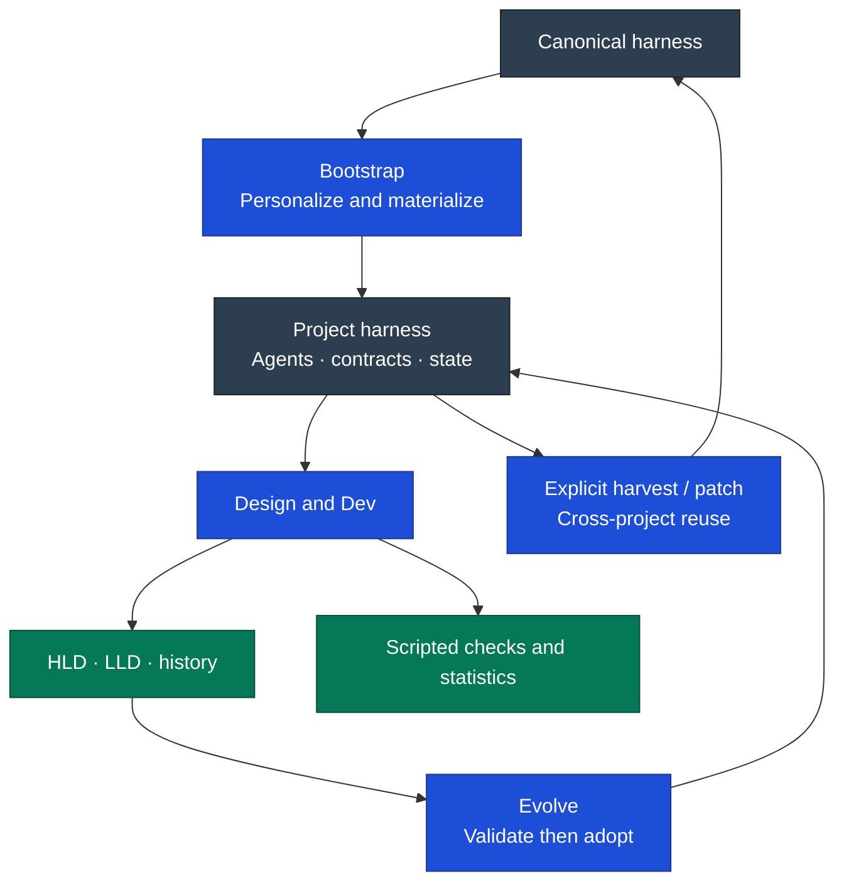

# Artisyn Capability Audit

_17 September 2026. Functional source audit at `8b8625181434ca199275f5686264b3b5628982bc`. This inventories the harness's entry points, supporting contracts, agents, scripts, and distribution mechanisms; it is not a production execution audit._

**Artisyn combines technical design and implementation with persistent architecture governance.** Its scope is broader than a ticket executor, but narrower than full product discovery, portfolio management, or continuous operations. See the [competitor tables](<./02 Feature Comparison.md>) for alternatives.

## Evidence and source authority

The audit follows the seven deployed entry points and their references/templates/scripts, canonical bootstrap definitions, documentation contracts, agents, and release tooling. Patch copies and duplicated templates are not counted as additional features. The older public package was checked for differences; its claims do not override newer executable or canonical sources.

| Key | Source inspected                                                                                                                                                                                                                                                                           | Role                                                    |
| --- | ------------------------------------------------------------------------------------------------------------------------------------------------------------------------------------------------------------------------------------------------------------------------------------------ | ------------------------------------------------------- |
| D   | [Dev skill and references](https://github.com/DataArt/artisyn-harness/tree/8b8625181434ca199275f5686264b3b5628982bc/.claude/skills/dev)                                                                                                                                                    | Six-stage implementation lifecycle                      |
| S   | [Design skill and references](https://github.com/DataArt/artisyn-harness/tree/8b8625181434ca199275f5686264b3b5628982bc/.claude/skills/design)                                                                                                                                              | Seven-stage technical design lifecycle                  |
| E   | [Evolve skill and references](https://github.com/DataArt/artisyn-harness/tree/8b8625181434ca199275f5686264b3b5628982bc/.claude/skills/evolve)                                                                                                                                              | Improvement proposals, validation and adoption          |
| W   | [War skill](https://github.com/DataArt/artisyn-harness/tree/8b8625181434ca199275f5686264b3b5628982bc/.claude/skills/war)                                                                                                                                                                   | Architecture quality/alignment review                   |
| P   | [Where-we-are skill](https://github.com/DataArt/artisyn-harness/tree/8b8625181434ca199275f5686264b3b5628982bc/.claude/skills/where-we-are)                                                                                                                                                 | Designed/implemented/documented comparison              |
| X   | [X-ray skill](https://github.com/DataArt/artisyn-harness/tree/8b8625181434ca199275f5686264b3b5628982bc/.claude/skills/x-ray)                                                                                                                                                               | Independent code-review orchestration                   |
| B   | [Bootstrap source](https://github.com/DataArt/artisyn-harness/tree/8b8625181434ca199275f5686264b3b5628982bc/.canonical-implementation-harness)                                                                                                                                             | Canonical distribution, launch and patches              |
| C   | [Canonical documentation contracts](https://github.com/DataArt/artisyn-harness/tree/8b8625181434ca199275f5686264b3b5628982bc/.canonical-implementation-harness/canonical/docs)                                                                                                             | HLD, LLD, NFR, conventions and lifecycle ownership      |
| A   | [Deployed agents](https://github.com/DataArt/artisyn-harness/tree/8b8625181434ca199275f5686264b3b5628982bc/.claude/agents)                                                                                                                                                                 | Architecture, layer, onboarding, docs and tracker roles |
| M   | [Dev metric scripts](https://github.com/DataArt/artisyn-harness/tree/8b8625181434ca199275f5686264b3b5628982bc/.claude/skills/dev/scripts), [Design metric scripts](https://github.com/DataArt/artisyn-harness/tree/8b8625181434ca199275f5686264b3b5628982bc/.claude/skills/design/scripts) | Executable timing, checks, quality and state validation |
| R   | [Release tooling](https://github.com/DataArt/artisyn-harness/tree/8b8625181434ca199275f5686264b3b5628982bc/scripts/release)                                                                                                                                                                | Versioned bootstrap release packaging                   |

**Workflow** below means an agent-instruction contract. **Script** means executable support exists. **Conditional** means the behavior depends on configuration, supplied evidence, risk, or external tools. Neither a written gate nor a passing unit test proves that an agent follows every instruction.

## Intake, scope, and design

| Feature                        | Delivered mechanism                                                                                                                           | Boundary or limitation                                                             | Evidence |
| ------------------------------ | --------------------------------------------------------------------------------------------------------------------------------------------- | ---------------------------------------------------------------------------------- | -------- |
| Ticket intake                  | Workflow: reads description, acceptance criteria, dependencies and linked design/context                                                      | Tracker access needs configured tools and credentials                              | D, A     |
| Tracker-free intake            | Workflow: free-form intent and stable local `DEV-…` / `DESIGN-…` IDs                                                                          | Local Design publication has a tracker-handling inconsistency below                | D, S     |
| Intent clarification           | Workflow: confirmed intent/proto-spec, outcomes, constraints and open questions                                                               | Clarifies supplied engineering intent; no complete discovery/PRD lifecycle         | D, S     |
| Requirements elaboration       | Workflow: checkable acceptance criteria and proposed missing requirements/evaluation criteria                                                 | Proposed criteria need agreement; not independent discovery of customer needs      | D, S     |
| Lifecycle routing              | Dev stages: context, ceremony, plan, implement, test, document; Design stages: frame, research, evaluate, solution, review, feedback, publish | Stage entry and resumption do not eliminate approval obligations                   | D, S     |
| Design scope                   | Workflow: project architecture or shared product-architecture track                                                                           | Product architecture is not product management or coordinated multi-repo execution | S        |
| Alternatives research          | Workflow: multiple options, evidence and minimal/do-nothing alternatives where appropriate                                                    | Quality depends on agent research and source quality                               | S        |
| Decision evaluation            | Workflow: criteria, tradeoffs, viability questions, assumptions and architecture pillars                                                      | Qualitative decision support, not objective automated scoring                      | S        |
| Integrated technical solution  | Workflow: selected Architecture/Design/Stack/Efforts artifacts with decisions, flows, implications and verification                           | Adaptive artifact selection is inconsistently enforced downstream                  | S        |
| Work breakdown and estimates   | Workflow: implementation slices, dependencies, spikes and effort/capacity assumptions                                                         | Estimates are not measured delivery guarantees                                     | S        |
| Design approval and feedback   | Workflow: independent review, revision loop and manual publication approval                                                                   | Approval is recorded evidence, not a server-enforced authorisation policy          | S        |
| Implementation ticket creation | Conditional workflow: publishes implementation stories from approved design/WBS                                                               | Downstream delivery tickets, not an upstream prioritised product backlog           | S, A     |

## Project context and architecture

| Feature                             | Delivered mechanism                                                                                        | Boundary or limitation                                                                               | Evidence |
| ----------------------------------- | ---------------------------------------------------------------------------------------------------------- | ---------------------------------------------------------------------------------------------------- | -------- |
| Persistent project context          | Workflow: reads approved design, active HLD, relevant LLD, conventions and actual code                     | File selection is agent-led; stale or missing context remains possible                               | D, C     |
| HLD governance                      | Workflow: C4 container scope, boundaries, flows, contracts and constraints; explicit active target/version | Describes approved architectural decisions and the integrated solution; not merely an ADR collection | C, S     |
| Decision provenance                 | Workflow: research/evaluation history links explain choices; HLD records settled target                    | Historical rationale and current architecture are separate artifacts requiring maintenance           | C, S     |
| LLD governance                      | Workflow: C4 component-level, implementation-backed structure, behavior and contracts                      | Does not assume greenfield implementation exists                                                     | C, D     |
| HLD/LLD separation                  | Workflow: target architecture versus actual component implementation; explicit documentation ownership     | A lagging LLD is documentation debt, not automatically an architectural defect                       | C, D     |
| NFRs and sizing                     | Workflow: scope, target, operating conditions, evidence, load assumptions and calculations                 | No benchmark execution or invented targets implied                                                   | C, S     |
| Layer conventions                   | Workflow: applicable UI, backend/data, infrastructure and shared engineering guidance                      | Project-specific content and agent profiles need personalization                                     | C, A, B  |
| Architecture review during delivery | Conditional workflow: reviews consequential boundary/integration/infra changes                             | Mechanical changes can skip; review is model judgment                                                | D, A     |
| Deviation governance                | Workflow plus quality records: stable finding IDs, classification, disposition and approved deviations     | Documents accepted exceptions; does not physically prevent nonconforming code                        | D, M     |
| Architecture quality review         | `/war`: design soundness or implementation alignment, configured pillars, RAG and priorities               | Current configuration uses AWS WAF; no compliance certification or continuous scan                   | W        |
| State reconciliation                | `/where-we-are`: designed versus implemented versus documented, by HLD container                           | LLD presence is not quality; maturity is inferred; unmodeled code may not appear in HLD-led rows     | P        |

## Implementation, verification, and completion

| Feature                       | Delivered mechanism                                                                           | Boundary or limitation                                                                    | Evidence |
| ----------------------------- | --------------------------------------------------------------------------------------------- | ----------------------------------------------------------------------------------------- | -------- |
| Approved execution baseline   | Workflow: immutable confirmed plan; subsequent changes recorded as addenda                    | Plan-mode plus persisted-plan approval introduces multiple gates                          | D        |
| Implementation breakdown      | Workflow: layer/concern steps and independently testable units                                | More layer-oriented than vertical end-to-end ticket slicing                               | D        |
| Specialist execution          | Workflow: delegate to layer agents with bounded context and architect involvement             | Depends on host delegation tools; not proven parallel speedup                             | D, A     |
| Step verification and commits | Workflow: developer signoff after each implementation step and manual commit approval         | Explicit interruption cost; not unattended end-to-end delivery                            | D        |
| Appropriate automated checks  | Workflow invokes real build/type/lint/test targets; script can record exit status             | No blanket TDD requirement; no credit for nonexistent suites                              | D, M     |
| UI verification               | Conditional browser checks for relevant web work                                              | Depends on browser tools, running application and access                                  | D, X     |
| Operational evidence          | Conditional live evidence for applicable infrastructure steps                                 | Credentials/environment required; not a general deployment platform                       | D        |
| Code review                   | Layer and architectural review; `/x-ray` adds independent correctness/convention perspectives | X-ray depends on external base review capability; skipped/blocked review must be explicit | D, X     |
| Review-finding accounting     | Workflow plus script: finding kind, severity, classification, resolution and debt ownership   | Records are supplied by agents/humans, not independently authenticated discoveries        | D, M     |
| Failure handling              | Workflow: diagnose failed checks, record blockers/rework and resume work                      | No guarantee of automated recovery from every tool or environment failure                 | D, M     |
| Documentation completion      | Mandatory workflow: reconcile HLD, update LLD/guide/readmes and review consistency            | Updating HLD cannot silently legitimise an unapproved implementation deviation            | D, C     |
| Delivery handoff              | Workflow: proposed PR content, tracker completion/worklog where configured                    | External actions and human effort attribution require appropriate evidence/authority      | D, S, A  |
| Resumption and task tracking  | Workflow: report state, native tasks or durable fallback; resume/restart paths                | Host context limits and artifact consistency still matter                                 | D, S     |
| Durable work history          | Workflow: archive intent, plan, report, decisions, troubleshooting, debt and statistics       | Files/Git rather than a demonstrated semantic memory service                              | D, S     |

## Statistics and improvement

| Feature                        | Delivered mechanism                                                                       | Boundary or limitation                                                                 | Evidence |
| ------------------------------ | ----------------------------------------------------------------------------------------- | -------------------------------------------------------------------------------------- | -------- |
| Stage/step timing              | Script: attempts, transitions and explicit activity intervals                             | Measures recorded workflow activity, not human effort or CPU/model compute time        | M        |
| Waiting and blockers           | Script: approval/user/external/environment waits; unclassified recovery gaps              | Missing observations remain unknown rather than reconstructed as productive work       | M        |
| Verification outcomes          | Script: wraps commands and records pass/fail/error/cancellation                           | Records exit evidence, not whether tests sufficiently cover behavior                   | M        |
| Quality statistics             | Script: findings, debt and latest nonoverlapping test-case counts                         | Test-case totals differ from check-run counts; unknown remains null                    | M        |
| Rework and first-pass measures | Script: derives rework/timing and coverage-aware first-pass statistics                    | Interpretation requires denominator and coverage; not comparative productivity         | M        |
| Token usage                    | Script: accepts attributed, nonoverlapping provider usage deltas                          | No universal automatic collector, dependable per-step allocation or cost/ROI dashboard | M        |
| State durability               | Script: validation, locking, atomic writes and replay/recovery handling                   | Local artifacts are not a tamper-proof audit service                                   | M        |
| Completion validation          | Script: stage/check/approval consistency, including Design feedback/publication           | Structural checks cannot prove prose is true or every external action occurred         | M        |
| Reflection and triage          | Evolve workflow: evidence capture; create/update/merge/retire/defer candidates            | Capture is not automatic adoption; drafts stay inactive                                | E        |
| Candidate validation           | Workflow: intended behavior, negative triggers, regression cases and recorded evidence    | Some validation can be manual; no proven global evaluation suite for all workflows     | E        |
| Controlled adoption            | Workflow: accepted hashes/baselines, affected callers, verification and rollback material | Local adoption; not autonomous self-learning or automatic cross-project rollout        | E        |

## Adoption, portability, and maintenance

| Feature                        | Delivered mechanism                                                                                | Boundary or limitation                                                                 | Evidence |
| ------------------------------ | -------------------------------------------------------------------------------------------------- | -------------------------------------------------------------------------------------- | -------- |
| Guided project launch          | Workflow: inspect evidence, persist answers, select lifecycles and layer profiles                  | Personalization is still substantive engineering work                                  | B        |
| Existing-codebase adoption     | Workflow: derive LLD from code, review HLD against intent, identify gaps                           | Inferred architecture is not automatically approved future architecture                | B, C     |
| Greenfield setup               | Workflow: scaffold context and architecture from confirmed intent                                  | Does not create product strategy or pretend code exists                                | B        |
| Deterministic materialization  | Script: frozen launch plan, source hashes, copy/specialize/derive treatments and check/write modes | Semantic specialization remains agent work                                             | B        |
| Layer and documentation agents | Workflow: architect/product architect, layer agents, onboarding, documentation and tracker roles   | Current project's agent roster is an instance, not a universal fixed topology          | A, B     |
| Tool/integration setup         | Workflow: configured tracker/docs/browser/MCP mappings and environment references                  | Tool availability, authentication and permissions are external dependencies            | B, A     |
| Multiple agent hosts           | Bootstrap recipes describe host-specific placement/adaptation                                      | Claude-native primitives remain; equivalent behavior on every named host is unverified | B, D     |
| Versioned distribution         | Bootstrap changelog/version plus release ZIP tooling                                               | Not an npm package distribution or proof of migration compatibility                    | B, R     |
| Local baseline registry        | State/index, deployment registry and exact baseline objects                                        | Hash/provenance records do not enforce trust by themselves                             | B        |
| Portable changes               | Patch recipes cover add/update/rename/copy/delete, dependencies, hashes and partial progress       | Primarily orchestrated recipes, not a complete deterministic patch CLI                 | B        |
| Preserve personalization       | Three-way reconciliation against baseline during patch application                                 | Conflicts and semantic adaptations need review                                         | B        |
| Generalise improvements        | Harvest project changes to canonical source; prepare/apply portable patches                        | Explicit process; no demonstrated central fleet orchestration                          | B        |

## Implementation gaps

These are findings about this source snapshot, separate from competitors' strengths. They are not fixed by this documentation change.

| Priority | Observed gap                                            | Evidence and consequence                                                                                                                                       | Recommended action                                                                   |
| -------- | ------------------------------------------------------- | -------------------------------------------------------------------------------------------------------------------------------------------------------------- | ------------------------------------------------------------------------------------ |
| High     | Public package and active/canonical sources disagree    | Public `docs/Harness/package` is older than bootstrap 1.3.0; deployed and canonical skill versions also differ. Readers can infer the wrong capabilities.      | Declare distribution authority; generate a version manifest and freshness checks.    |
| High     | Adaptive Design artifacts meet fixed-file gates         | `design/references/04-solution.md` selects artifacts, while `05-review-gate.md` requires Architecture/Design/Stack/Efforts; Dev intake probes Architecture.md. | Make every consumer use one selected-artifact contract; test minimal valid designs.  |
| High     | Publication completion ordering disagrees with metrics  | `design/references/07-publish.md` sets Complete before later ticket/archive/tracker work; metric rules require successful completion first.                    | Use one finalisation transition after required side effects succeed.                 |
| Medium   | Local Design IDs do not consistently bypass trackers    | Design router accepts local IDs, but Publish's tracker-sync step is unconditional in its wording.                                                              | Carry explicit tracker identity/availability through publication.                    |
| Medium   | Selected-artifact representation is inconsistent        | Design report template describes interface names; references also describe artifact paths.                                                                     | Use one schema with stable names and concrete paths.                                 |
| Medium   | Worklog semantics can confuse AI time with human effort | Design Publish derives a worklog from observed workflow time; statistics do not establish human labour.                                                        | Specify the actor/time basis; require a separate human-effort source.                |
| Medium   | Cross-host portability is largely instructional         | Bootstrap lists several hosts; Dev uses native plan-mode calls and bootstrap workflow tests mock a Claude runtime.                                             | Run real smoke scenarios per supported host and publish exceptions.                  |
| Medium   | Some X-ray capabilities are external or unavailable     | Base code-review skill is an external dependency; interactive-demo is explicitly not deployed.                                                                 | Publish dependency checks and supported fallbacks; do not count the demo as shipped. |
| Medium   | History exists without demonstrated retrieval quality   | Rich archives and context instructions exist, but no measured history-selection quality or semantic retrieval service was found.                               | Benchmark follow-up tasks with relevant and conflicting historical decisions.        |
| Medium   | No demonstrated aggregate operational dashboard         | Per-work-item statistics exist; no reviewed core mechanism establishes portfolio trends, automatic cost attribution or production monitoring.                  | Define aggregation separately and preserve unknowns/source provenance.               |
| Tradeoff | Repeated human gates add process cost                   | Design phase approvals and Dev step/commit signoffs are explicit.                                                                                              | Measure intervention count and support proportionate policies for low-risk work.     |

## What was verified

The deployed Dev/Design metric tests passed **41/41**. Bootstrap checks passed **31 materialization checks** in an isolated project and **61 workflow-contract checks** with a mocked runtime. These validate bounded executable mechanisms, not a live launch, tracker integration, architectural judgment, or full delivery across agent hosts.

The documentation build is checked separately. No head-to-head delivery benchmark, cost study, security certification, or production reliability assessment was performed. Artisyn's distinctive combination is credible at source level; its superiority and the cost of its ceremony remain hypotheses to test.
