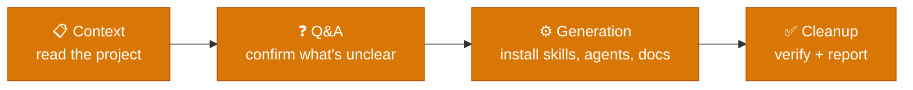

# Quick Start

Bring the harness into a project by pointing an AI coding assistant at `/harness-bootstrap launch`. The assistant installs skills, agents, and guide docs, personalized to that project, from a versioned release package.



## Prerequisites

- A git repository — initialize one first if the project doesn't have one yet.
- An AI coding assistant with skill support: Claude Code, GitHub Copilot, or Codex.
- The released package, `.canonical-implementation-harness/`, extracted into the project root. Pull the latest versioned ZIP from this repo's `releases/harness-bootstrap/`.

## Run it

Invoke the skill in the host's native syntax:

```
/harness-bootstrap launch      # Claude Code or Copilot
$harness-bootstrap launch      # Codex
```

No arguments also triggers launch.

## What to expect

- **Context** — the assistant reads the project: existing docs, code structure, stack.
- **Q&A** — it asks only what it can't determine from context (e.g. which containers exist, where docs should live).
- **Generation** — it installs personalized skills, agents, and guide docs under the project, plus a baseline manifest for future patch operations.
- **Cleanup** — it verifies the install and reports what was created.

Launch runs to completion in one session — it doesn't hand off mid-run and resume later. A dated report under `package:state/` records progress and the answers given.

## After launch

Run a ticket through the lifecycle:

```
/design TKT-XXX <topic>   # solution design
/dev TKT-XXX <task>        # implement a ticket
```

→ See the root [README](../../../README.md) for the full ticket flow, or `@onboarding` inside the assistant for a guided walkthrough.

## Keeping the harness current

`/harness-bootstrap patch` pulls canonical updates into an already-bootstrapped project, or pushes local improvements back into the canonical source:

- `patch harvest [scope]` — generalize a permanent-file improvement into canonical files.
- `patch prepare [scope]` — package a direct canonical edit into a portable bundle.
- `patch apply [scope | bundle path]` — personalize canonical updates into the project.

→ See [03 Lifecycles](<../03 Lifecycles/00 Overview.md>) for how launch and patch fit the harness's other lifecycles.
