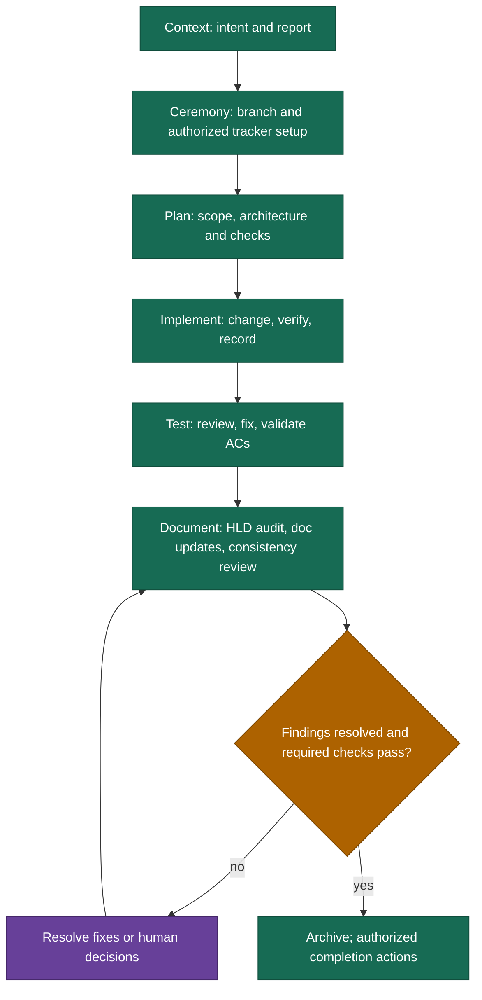

# Dev Lifecycle — Context → Ceremony → Plan → Implement → Test → Document

The dev skill delivers an authorized ticket or local change through planning,
implementation, verification and documentation. `/dev <TICKET> <problem>` runs the
full chain; `/dev context|ceremony|plan|implement|test|document <input>` runs one
stage only. Reuse existing story state on resume and preserve unrelated work.

## Flow

## Stages and artifacts

| Stage     | Required outcome                                                                                                                                                                                                                                                      |
| --------- | --------------------------------------------------------------------------------------------------------------------------------------------------------------------------------------------------------------------------------------------------------------------- |
| Context   | Capture the request, approved design and relevant tracker evidence in `impl/intent.md`; create `2-report.md` and initialize metrics. Ask about material missing/conflicting intent only.                                                                              |
| Ceremony  | Inspect/reuse or create a local feature branch safely. Delegate authorized tracker setup by state name; local DEV IDs do not imply tracker records.                                                                                                                   |
| Plan      | Read the active HLD and relevant LLD/code. Prepare numbered steps, meaningful acceptance criteria and actual available checks. Resolve material design/scope choices; persist `1-plan.md`.                                                                            |
| Implement | Execute logical steps with observed verification. Add/update tests when useful, choosing unit, integration, load or other types to fit the work and project setup. Test-first work is optional; required checks must pass. Record progress, notes, findings and debt. |
| Test      | Run relevant existing checks, conduct scoped PR review, fix in-scope regressions, rerun affected checks and explicitly verify acceptance criteria. Preserve test evidence.                                                                                            |
| Document  | Audit implementation against HLD, update permanent docs, review consistency, resolve findings, and archive only after closure checks.                                                                                                                                 |

The approved plan is immutable. New authorized scope uses an explicit addendum.
Use native Plan Mode when available and respect its write/approval restrictions;
otherwise prepare a reviewable local plan. No stage assumes a framework, test suite,
linter or pre-commit hook that the project has not configured.

## Human decisions

The dev skill's `patterns/approval-sign-off.md` owns authorization boundaries. Routine context
reads, reversible local edits, checks, report updates and stage transitions continue
within scope. Preserve existing authorization across steps and sessions.

Pause for material scope/architecture decisions, real risk acceptance or deferral,
required verification only a human can perform, or an external/destructive action that
has not been authorized. Prepare the concrete result first and combine related decisions.
Respect project guarded commands. Update the report before any commit; developer-run
commits do not block independent local work.

## One findings ledger

`2-report.md` contains one `## Review Findings` table, defined by
`dev/patterns/review-gate.md`. Plan audits, implementation reviews, PR reviews, HLD
audits and documentation consistency reviews upsert stable RF IDs. A recurring issue
keeps one row and accumulates origin/evidence. Kind, deviation type, severity,
classification and resolution are separate dimensions. Record before applying fixes.

The deviation audit compares actual implementation to HLD contracts, boundaries and
NFRs only. LLD lag before Document is a normal doc-update task. A contradiction left
after updates is a docs finding. Target decisions are not silently rewritten to excuse
implementation regressions. Read the active HLD version through its README index.

Tech Debt remains a separate linked ledger for ownership, next action and optional
tracker task creation. A local TD entry can survive declined optional tracker creation;
it cannot silently waive required acceptance criteria. Before archival every finding
must be fixed, accepted, tech-debt or doc-updated with evidence and required attributed
decisions. Critical/high risks cannot be hidden in debt or accepted silently.

## Documentation and completion

Read project documentation principles and placement rules. Include implemented impacts
from approved design in the same update list, then update app READMEs, LLD and Engineering
Guide as appropriate. HLD changes require settled authorized target decisions; routine
LLD updates describe actual built behavior. Review modified docs for contradictions and
stale references. Resolve new findings before closure; escalate after three unsuccessful
review/fix rounds instead of looping indefinitely.

Archive preserves all story artifacts, including `impl/stat.json`. Never overwrite an
archive destination. The full-flow router owns tracker completion exactly once and
keeps lifecycle metrics unfinished while required external completion work remains.
Direct-stage entry reports only its own result; local IDs skip tracker worklogs/transitions.

## Shared patterns

| Pattern                   | Purpose                                                             |
| ------------------------- | ------------------------------------------------------------------- |
| `approval-sign-off.md`    | Fixed, unconditional human sign-off gates across the flow           |
| `approval-intelligent.md` | Optional auto-approve for designated non-material checkpoints       |
| `review-gate.md`          | Stable finding identity, classification and evidence-backed closure |
| `do-report-commit.md`     | Verify and update the report before any authorized commit           |
| `write-confirm.md`        | Batch routine doc edits; ask only for unresolved decisions          |
| `satellite-review.md`     | Scoped architecture review with at most three fix/review rounds     |
| `announce-progress.md`    | Concise progress at completed units and stage transitions           |
| `session-continuity.md`   | Resume current state and authorization without replaying work       |
| `task-tracking.md`        | Six stage tasks and implementation step tasks, with tool fallback   |
| `metrics.md`              | Observed timing, checks, token evidence and quality inventory       |

Patterns are companions under `.claude/skills/dev/patterns/`; stage references own their
trigger conditions. Keep the shared contract in the pattern, not repeated local overrides.

## Delivery and quality metrics

Each ticket keeps `impl/stat.json` beside `2-report.md`. The dependency-free Node.js
CLI `scripts/dev-metrics.mjs` requires an explicit `--dir` and records observed work,
waits, attempts, verification outcomes and available runtime token deltas. Unknown
measurements remain null. Recovery bounds interrupted work at its last checkpoint.
Direct-stage coverage is partial; the router finalizes full-flow completion metrics.

`report` derives `quality` from Review Findings, Tech Debt and numerical Test Results
and renders one summary line beside Stage Metrics. Breakdowns cover kind, deviation
type, impact severity, classification, resolution, PR-origin findings and debt disposition.
Written tests are new cases from the diff; Passed/Failed/Skipped are latest runner case
counts over non-overlapping scopes. Historical failed test runs are separate from case
counts. Unknown counts are unavailable; repeat report generation does not increment them.
These are recorded inventories, not a quality score or an unqualified ticket ranking.

Run `quality validate` before archival to check structural finding closure and recorded
check outcomes. Humans/agents still verify evidence substance and acceptance coverage.
Legacy reports are not automatically rewritten or assigned invented counts.
