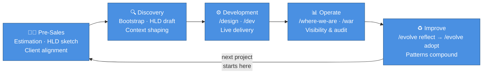

# Adoption Path

_From first client conversation to a continuously improving delivery platform._

---

## The Phases

| Phase                                          | When                           | What happens                                                                | Key output                                                                                                |
| ---------------------------------------------- | ------------------------------ | --------------------------------------------------------------------------- | --------------------------------------------------------------------------------------------------------- |
| **[Pre-Sales](01%20Pre-Sales.md)**             | Before contract · RFP response | Estimation · initial HLD sketch · client alignment                          | Scoped estimate · initial architecture · discovery ready                                                  |
| **[Discovery](02%20Discovery%20Phase.md)**     | Project kick-off               | Bootstrap + HLD draft + context shaping                                     | Repo with architecture, constraints, and backlog seeded                                                   |
| **[Development](03%20Development%20Phase.md)** | Active delivery                | `/design` and `/dev` cycles on real tickets                                 | Code + LLD + story archive per ticket                                                                     |
| **Operate**                                    | Ongoing                        | `/where-we-are` · `/war` audits · CloudWatch via MCP                        | Gap reports · WAF findings · delivery debt visible                                                        |
| **Improve**                                    | After any friction point       | `/evolve reflect` → `/evolve triage` → `/evolve validate` → `/evolve adopt` | Patterns adopted into the project's harness · shareable across projects via `patch harvest`/`patch apply` |

---

## Who Uses It

| Role                   | Entry point              | Primary benefit                                                                |
| ---------------------- | ------------------------ | ------------------------------------------------------------------------------ |
| **Solution Architect** | Discovery phase          | Client-ready HLD from conversations · scoped estimation · seamless dev handoff |
| **Tech Lead**          | Bootstrap + first `/dev` | Consistent agent behaviour from day one · no onboarding overhead per session   |
| **Developer**          | Per-ticket `/dev` cycle  | Scoped agent · approved plan gate · LLD written for you                        |
| **Project Manager**    | `/where-we-are`          | Delivery debt visible on demand · no retrospective needed to surface drift     |

---

## Getting Started

1. **Copy `.harness-bootstrap/`** into the project repo
2. **Open a session** and run: `Initialise the harness for this project. Read and follow .harness-bootstrap/01 Bootstrap.md`
3. **Answer Q1–Q11** — the harness generates skills, agents, CLAUDE.md, Engineering Guide, and HLD scaffold
4. **Run the first `/dev` cycle** on a real ticket — the workflow is live from session one

See **[01 SA Presales](01%20Pre-Sales.md)** for the pre-sales playbook, **[02 Discovery Phase](02%20Discovery%20Phase.md)** for the full discovery flow, and **[03 Development Phase](03%20Development%20Phase.md)** for day-to-day delivery.
