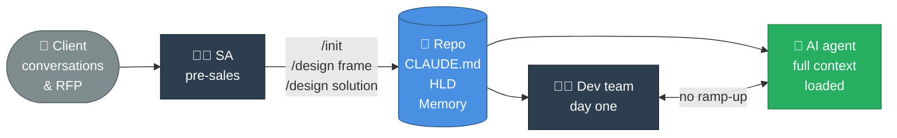
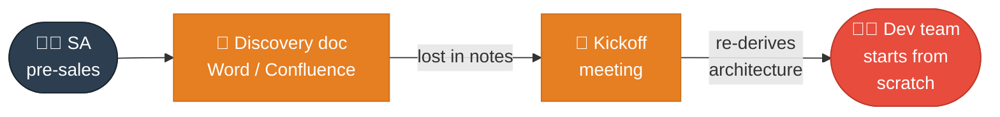
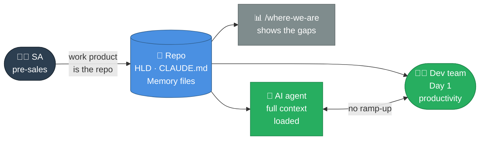
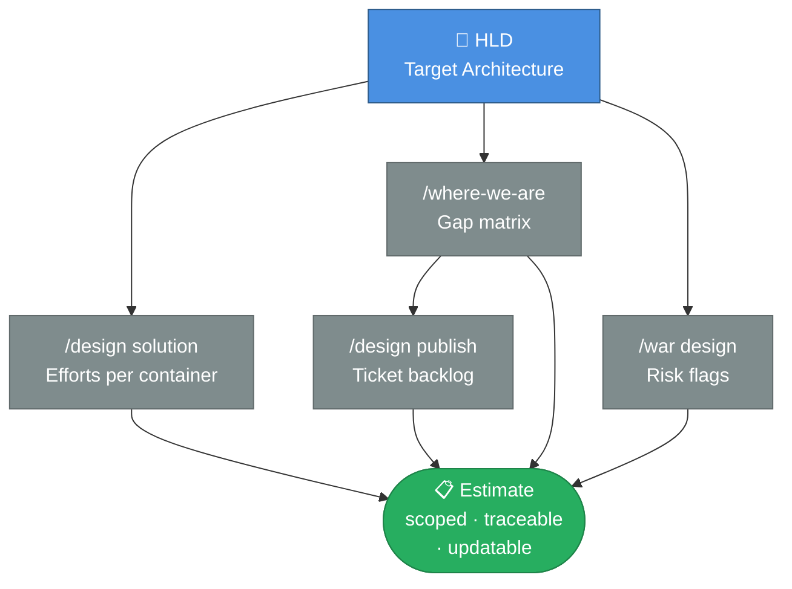

# SA Pre-Sales Playbook

_How Solution Architects use the harness to compress discovery and de-risk delivery from day one._

---

## 1. Early Context Shaping

_Build the project skeleton during pre-sales — before any code is written._

**The traditional problem**

- Discovery produces a Word document that no one reads during development
- Architecture is sketched in Miro and then abandoned
- The dev team starts from scratch on context the SA accumulated over weeks
- AI assistants on the project have no project knowledge and hallucinate

**What the harness changes**

During pre-sales, the SA can:

1. **Bootstrap the repo** — create the harness structure, CLAUDE.md, agent definitions
2. **Draft the HLD** — use `/design frame` and `/design solution` to produce an initial Target Architecture from client conversations and RFP materials
3. **Shape CLAUDE.md** — encode client-specific conventions, tech constraints, compliance requirements, NFRs
4. **Pre-load memory** — capture key decisions, open questions, stakeholder constraints as memory files
5. **Draft a gap report** — use `/where-we-are` to show exactly what is designed vs what still needs to be built

On day one of the engagement, the dev team opens the repo and the AI agent already knows the target architecture, client constraints, open design questions, and tech stack decisions.

> Key talking points: <!-- TODO: quantify ramp-up time saved; discuss HLD fidelity achievable in pre-sales -->

---

## 2. Discovery to Development Handoff

_No context lost between phases — the harness is the handoff._

**Traditional**

**With the harness**

The SA's work product is the repo — not a document that gets filed and forgotten.

| SA artefact            | Harness location                  | Dev team benefit                            |
| ---------------------- | --------------------------------- | ------------------------------------------- |
| Architecture decisions | `docs/Target Architecture (HLD)/` | Agent reads before every planning session   |
| Client constraints     | `CLAUDE.md` conventions section   | Agent enforces them automatically           |
| Tech stack choices     | `CLAUDE.md` architecture table    | Agent uses correct stack without being told |
| Open questions         | Memory files (`project/` type)    | Agent flags them during relevant tasks      |
| NFR targets            | `HLD/Non-Functional Concerns/`    | Agent checks against them in WAR audits     |

> Key talking points: <!-- TODO: what makes a "good" pre-sales HLD — level of detail, what to leave TBD intentionally -->

---

## 3. Estimation

_Effort sizing grounded in a real HLD, not guesswork._

**The problem with traditional estimation**

- Estimates are based on vague scope ("build a product catalog")
- No traceability from estimate to architecture decision
- When scope changes, estimates are re-done from scratch
- AI-assisted estimation without context produces generic numbers

**How the harness improves estimation**

1. `/design solution` — each solution includes an Efforts section with sizing per container and phase
2. `/where-we-are` — the gap matrix shows exactly what is designed vs not yet built, making scope explicit
3. `/war design` — WAF audit flags complexity hotspots that inflate estimates (auth, compliance, network constraints)
4. `/design publish` — creates granular implementation tickets from the solution, each with ACs that bound the estimate

| Artefact        | Command            | Content                                                |
| --------------- | ------------------ | ------------------------------------------------------ |
| Efforts section | `/design solution` | T-shirt sizing per container, per phase                |
| Gap matrix      | `/where-we-are`    | Designed vs built vs documented — shows delivery scope |
| Risk flags      | `/war design`      | WAF findings that drive contingency                    |
| Ticket backlog  | `/design publish`  | Implementation tickets with ACs                        |

> Key talking points: <!-- TODO: HLD fidelity vs estimate confidence; T-shirt vs story points -->
