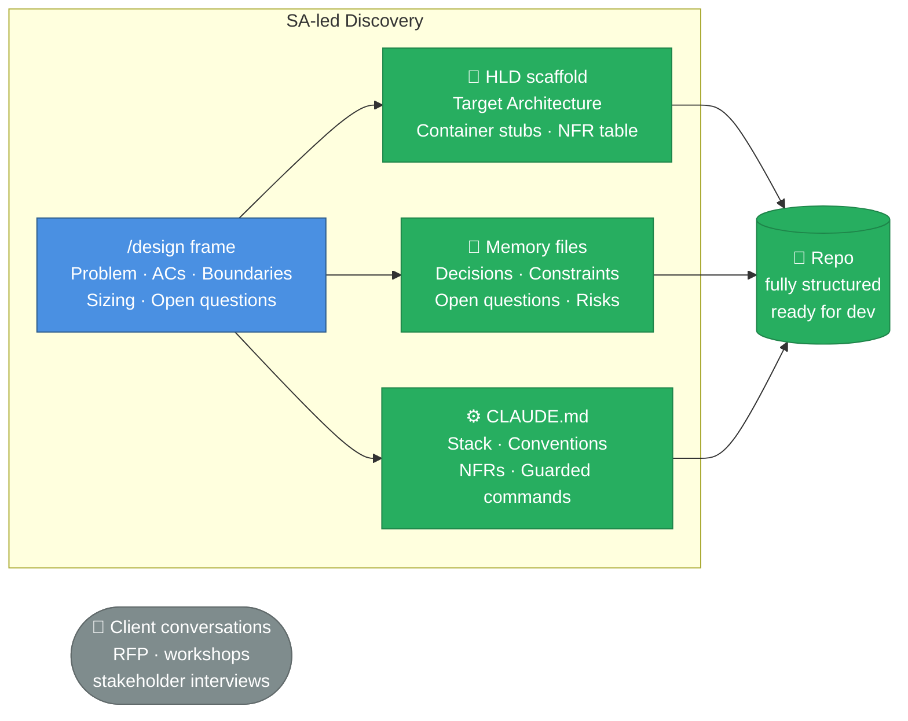

# Discovery Phase

_How the harness compresses client discovery and produces a working project skeleton instead of a Word document._

---

## The Traditional Problem

Discovery is a phase where knowledge is generated and immediately starts decaying.

- Client conversations produce notes, not structure
- Architecture sketches live in Miro, separate from the codebase
- Requirements are written in Confluence, disconnected from implementation
- The output — a discovery document — is read once at kickoff and then ignored
- The dev team re-derives everything the SA already learned, from scratch

> The SA's most expensive work product is a file nobody opens by week two.

---

## What Changes with the Harness

Discovery becomes the first lifecycle — and its output is the repo, not a document.

---

## Discovery Artefacts → Harness Locations

| Discovery output       | Where it lives                    | Who benefits                             |
| ---------------------- | --------------------------------- | ---------------------------------------- |
| Architecture decisions | `docs/Target Architecture (HLD)/` | AI reads before every planning session   |
| Client constraints     | `CLAUDE.md` conventions section   | AI enforces them automatically           |
| Tech stack choices     | `CLAUDE.md` architecture table    | AI uses correct stack without being told |
| NFR targets            | `HLD/Non-Functional Concerns/`    | AI checks against them in `/war` audits  |
| Open questions         | Memory files (`project/` type)    | AI flags them during relevant tasks      |
| Risk flags             | `/war design` output              | Informs estimation and contingency       |

---

## Discovery Lifecycle (SA-Led)

1. **Bootstrap the repo** — copy `.harness-bootstrap/`, answer Q1–Q11 from client context; generates agents, skills, CLAUDE.md, HLD scaffold
2. **Run `/design frame`** on each major capability — structures problem statements, ACs, boundaries from RFP and workshop notes
3. **Draft the HLD** — use `/design solution` to produce an initial Target Architecture from the framed capabilities
4. **Pre-load memory** — capture key decisions, client constraints, open questions, compliance requirements as structured memory files
5. **Run `/where-we-are`** — produces a gap matrix: what is designed, what is TBD, what is out of scope — explicit and shareable with the client

---

## What the Dev Team Inherits on Day One

Not a kickoff meeting. A running project:

- AI agent loaded with the target architecture, client constraints, NFR targets
- Jira backlog seeded with implementation tickets from `/design publish`
- HLD ready to govern implementation — no re-derivation needed
- Open questions flagged in memory — the agent surfaces them when relevant

> The SA's work product is the repo. The repo is the handoff.
