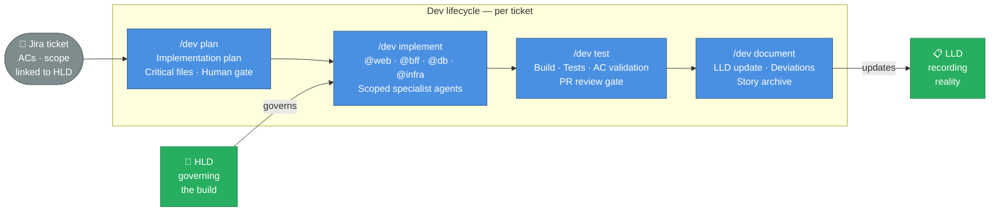

# Development Phase

_How the harness governs day-to-day delivery — keeping AI output consistent, traceable, and aligned with the approved design across every session and every team member._

---

## The Traditional Problem

Development is where context decay becomes a delivery problem.

- Decisions made in discovery are forgotten by sprint three
- Different team members prompt AI differently — inconsistent output across the codebase
- AI sessions are stateless — context built up on Monday is gone on Tuesday
- Implementation diverges silently from the approved design
- Documentation is deferred until the end, then skipped under pressure

> Fast execution without shared context produces a codebase that nobody — human or AI — can fully understand six months later.

---

## What Changes with the Harness

Every dev session starts from the same structured baseline. Every output feeds back into the docs. The AI behaves consistently across sessions and team members because the context it operates from is the same.

---

## How Each Phase Works

### Plan — Human Gate Before Any Code

`/dev plan` reads the Jira ticket and the relevant HLD sections, produces a step-by-step implementation plan, and lists the critical files it will touch. The developer approves before anything is modified.

> No code is written against an unreviewed plan. The gate is non-negotiable.

### Implement — Scoped Specialist Agents

`/dev implement` delegates to the right specialist agent for each container:

| Agent    | Scope                      | What it does                                        |
| -------- | -------------------------- | --------------------------------------------------- |
| `@web`   | `apps/web/`                | React components, routing, styling, WCAG compliance |
| `@bff`   | `apps/bff/`                | NestJS endpoints, TypeORM entities, Swagger docs    |
| `@db`    | `apps/bff/src/migrations/` | PostgreSQL schema, TypeORM migrations, seed data    |
| `@infra` | `apps/infra/`              | AWS CDK constructs, CloudFront, ECS, RDS            |

Each agent sees only its container — no noise from the rest of the stack. The HLD governs every implementation decision; deviations are logged, never silently introduced.

### Test — Quality Gate Before Merge

`/dev test` runs the full quality gate: build check, test suite, AC validation against the original ticket, PR review. Nothing merges without passing.

### Document — LLD Updated as Part of the Cycle

`/dev document` writes what was actually built into the LLD, logs any deviations from the HLD, and archives the story. Documentation is not an afterthought — it is a required output of the cycle.

---

## Consistency Across Sessions and Team Members

Every session reloads the same context: CLAUDE.md + HLD + LLD. Whether it is the same developer on a different day or a new team member joining mid-sprint — the AI starts from the same place.

| What stays consistent  | Why                                                                  |
| ---------------------- | -------------------------------------------------------------------- |
| Architecture decisions | HLD is the single source of truth — agents read it before every task |
| Conventions            | CLAUDE.md encodes them — agents apply them without being told        |
| Current system state   | LLD is updated every cycle — no session inherits a stale picture     |
| Delivery scope         | `/where-we-are` makes the gap visible on demand                      |

---

## Continuous Visibility

At any point in the project:

- **`/where-we-are`** — gap matrix: designed vs implemented vs documented
- **`/war implementation`** — AWS Well-Architected audit of the codebase
- **`/war design`** — WAF audit of the Target Architecture

No retrospective needed to discover drift. No sprint-end scramble to update docs. The project stays legible — to humans and to AI — throughout the delivery.
