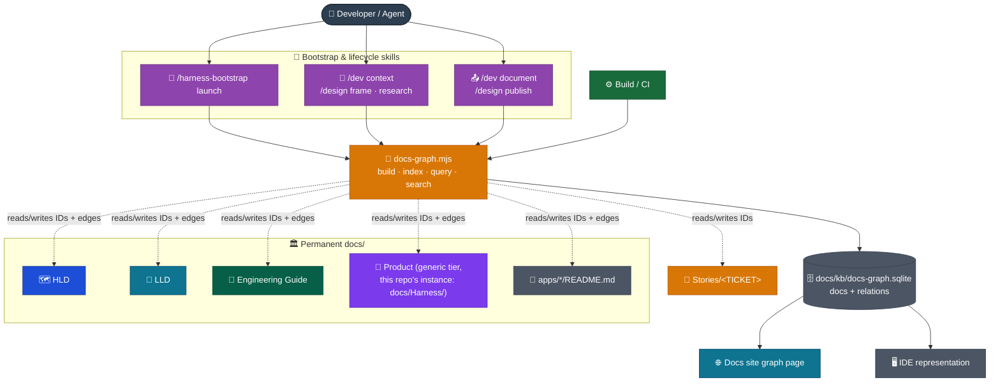
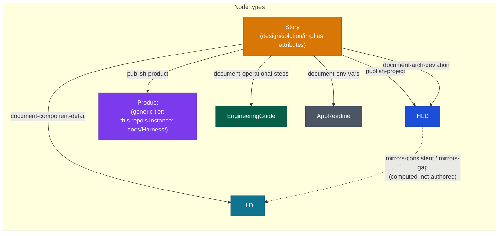
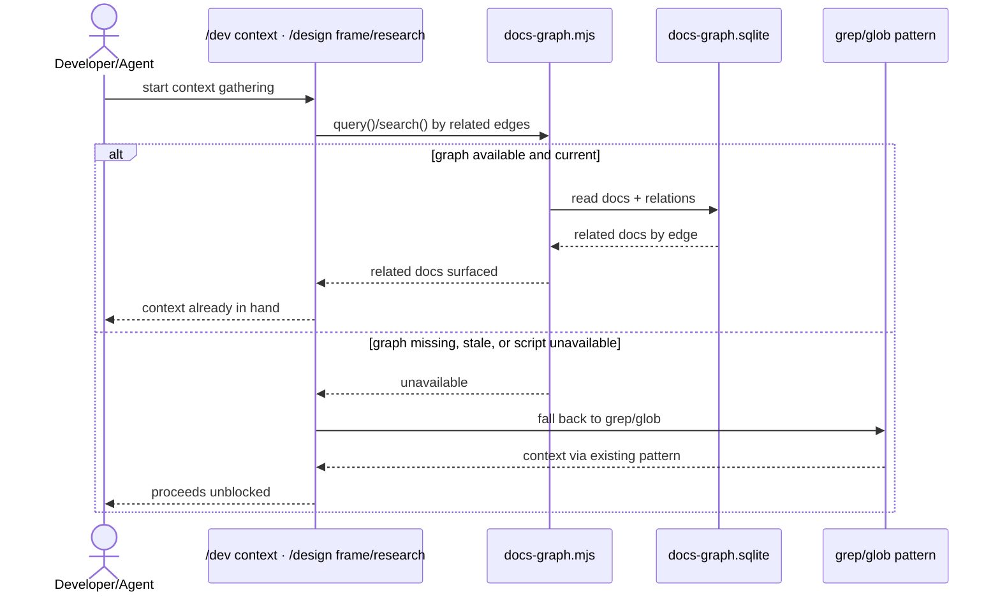
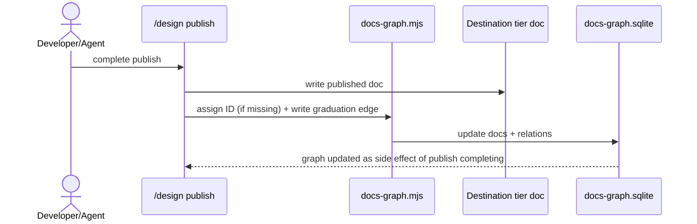
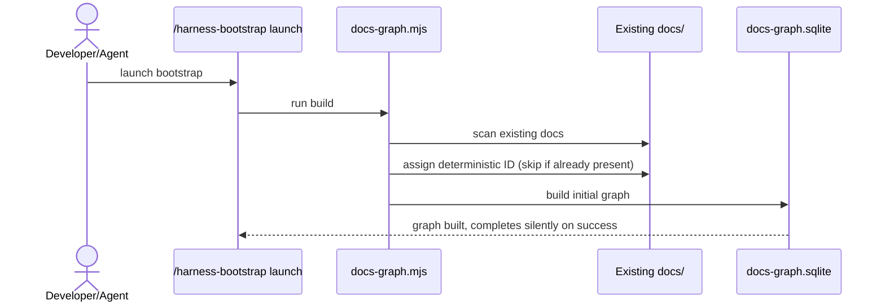

# Ops Model

The knowledge graph is additive tooling: one script (`docs-graph.mjs`) plus one SQLite file (`docs/kb/docs-graph.sqlite`), consumed by the existing docs site build. No new container joins the architecture, and the existing browser-to-hosting data flow is unchanged — the graph page ships as part of the same static build output.

## System context

## Node and edge model

A Story's `design/`, `solution/`, `impl/` subfolders are attributes of its single `Story` node, not separate sub-nodes. Each project bootstrapping the harness instantiates its own `Product` tier under its own name; this repo's instance is `docs/Harness/`.

The six solid edges are the named graduation actions from `03 Lifecycles/05 Documents Flow.md`, each authored as a Story-to-destination-tier edge. The seventh edge, `mirrors-consistent`/`mirrors-gap`, is computed — not authored — by diffing HLD container file names (`Target Architecture (HLD)/<Version>/Containers/<Name>.md`) against LLD folder names (`System Architecture (LLD)/<Name>/`), per the naming convention in `docs/Engineering Guide/Documentation/02 Structure.md`. HLD version supersession is not modeled as a graph edge — the existing folder-per-version/README-router convention already covers it.

## Graph type

Nodes are typed — each is one of the six types above. Edges are typed and directed — each of the seven types above has a defined source-tier → destination-tier meaning. A `derived` flag on each edge distinguishes the six authored edges (written by a lifecycle action) from the one computed edge (`mirrors-consistent`/`mirrors-gap`, derived from file/folder naming, never authored). Cycles are permitted — edges are typed relationship statements, not a dependency or control-flow order, so nothing in this design enforces acyclicity.

## Settled interfaces

| Component                   | Settled interface                                                          |
| --------------------------- | -------------------------------------------------------------------------- |
| `docs-graph.mjs`            | The script. Ships inside `docs/Harness/package/` once that package exists. |
| `docs/kb/docs-graph.sqlite` | The data file. Sole producer and consumer is `docs-graph.mjs`.             |

## Lifecycle wiring

Read is required at Context Gathering/Research (`/dev context`, `/design frame`/`research`), with required fallback to existing grep/glob when the graph is missing, stale, or unavailable.

Write is required but tool-automated, not manually authored, at Document/Publish (`/dev document`, `/design publish`): the same script assigns an ID if missing and writes the corresponding graduation edge as a side effect of completing.

Context Gathering and Research query the graph first, with a required fallback to the existing grep/glob pattern when it isn't available:

## Bootstrap wiring

The script ships inside `docs/Harness/package/` once that package exists. `/harness-bootstrap launch` runs it proactively: it assigns deterministic, collision-safe frontmatter IDs to any doc missing one and builds the initial graph in the same pass, silently on success.

`/harness-bootstrap launch` invokes the same script to seed the graph for an existing doc tree:

## Visualization surface

Both an IDE-side representation and a docs-site graph page exist, sharing one SQLite data source. The docs-site page queries it client-side in the browser. See `03 Visualization Model.md` for the data-access pattern.
