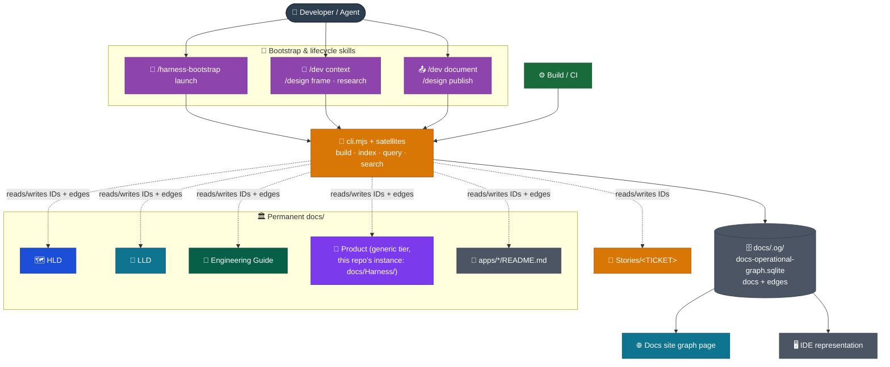
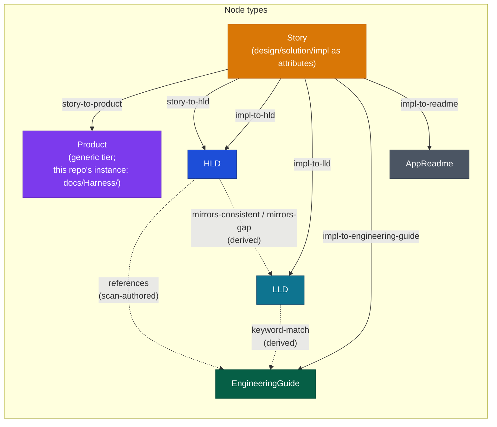
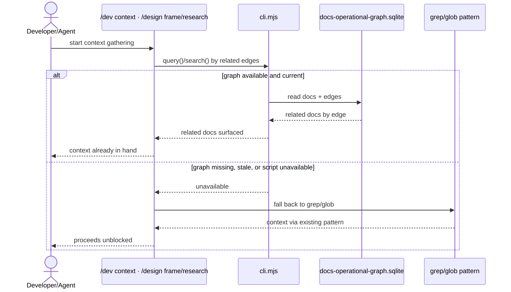
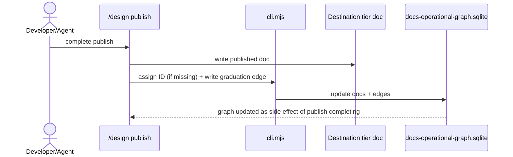
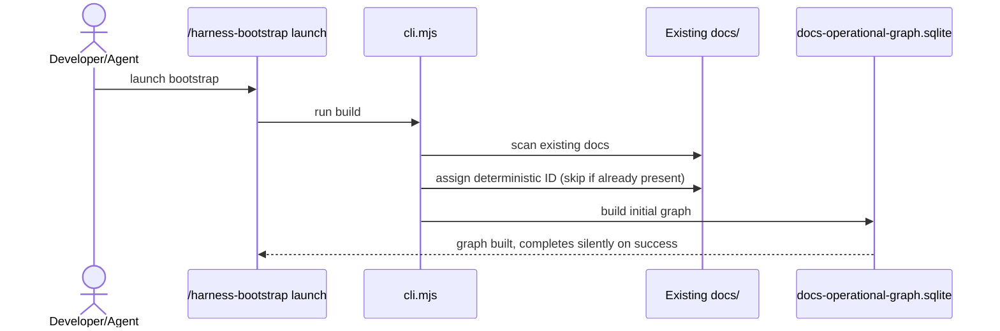

# Ops Model

The knowledge graph is additive tooling: a CLI entry (`cli.mjs`) plus its satellite modules (`constants.mjs`, `utils.mjs`, `docs.mjs`, `edges.mjs`, `schema.mjs`) and one SQLite file (`docs/.og/docs-operational-graph.sqlite`), consumed by the existing docs site build. No new container joins the architecture, and the existing browser-to-hosting data flow is unchanged — the graph page ships as part of the same static build output.

## System context

## Node and edge model

A Story's `design/`, `solution/`, `impl/` subfolders are attributes of its single `Story` node, not separate sub-nodes. Each project bootstrapping the harness instantiates its own `Product` tier under its own name; this repo's instance is `docs/Harness/`.

Ten edge types exist in total, in three families, per `docs/.og/constants.mjs`:

- **`EDGE_TYPES`** (6 types, `derived=0`): `story-to-product`, `story-to-hld`, `impl-to-hld`, `impl-to-lld`, `impl-to-engineering-guide`, `impl-to-readme` — the named graduation actions from `03 Lifecycles/05 Documents Flow.md`, each authored as a Story-to-destination-tier edge by `index()`'s `--edge` flag.
- **`SCAN_EDGE_TYPES`** (1 type, `derived=0`): `references` — a generic content cross-reference, authored by `reindex-graph.md`'s intelligent scan when a doc's content names another doc it references, not a graduation event.
- **`DERIVED_EDGE_TYPES`** (3 types, `derived=1`): `mirrors-consistent`/`mirrors-gap`, computed by diffing HLD container file names (`Target Architecture (HLD)/<Version>/Containers/<Name>.md`) against LLD folder names (`System Architecture (LLD)/<Name>/`), per the naming convention in `docs/Engineering Guide/Documentation/02 Structure.md`; and `keyword-match`, computed from shared `keywords:` frontmatter tokens between any two docs. Neither pair is ever authored.

HLD version supersession is not modeled as a graph edge — the existing folder-per-version/README-router convention already covers it.

The docs-site Graph Explorer groups these ten types into four visual/filter buckets (`cytoscapeStyle.ts`'s `edgeGroup()`): `keyword-match` (automatic, by far the largest group — roughly 503 of this repo's ~660 edges, so it gets the most recessive styling), `references` (scan-authored content links), `graduation` (the six `EDGE_TYPES`), and `mirrors` (the `mirrors-*` pair). See `03 Visualization Model.md`.

## Graph type

Nodes are typed — each is one of the six types above. Edges are typed and directed — each of the ten types above has a defined source-tier → destination-tier meaning, except `references` and `keyword-match`, which may connect any two tiers. A `derived` flag on each edge distinguishes the seven authored edges (the six graduation types plus `references`, written by a lifecycle action or the intelligent scan) from the three computed edges (`mirrors-consistent`, `mirrors-gap`, `keyword-match`, never authored). Cycles are permitted — edges are typed relationship statements, not a dependency or control-flow order, so nothing in this design enforces acyclicity.

## Settled interfaces

| Component                                | Settled interface                                                                                                                                                                                                                                                |
| ---------------------------------------- | ---------------------------------------------------------------------------------------------------------------------------------------------------------------------------------------------------------------------------------------------------------------- |
| `cli.mjs` (+ satellites)                 | The script. Ships from the canonical shipping root `.canonical-implementation-harness/canonical/docs/.og/`, deployed into a project's `docs/.og/` by `/harness-bootstrap launch`'s Materialize stage or the standalone `/harness-bootstrap reindex-graph` route. |
| `docs/.og/docs-operational-graph.sqlite` | The data file. Sole producer and consumer is `cli.mjs`.                                                                                                                                                                                                          |

## Lifecycle wiring

Read is required at Context Gathering/Research (`/dev context`, `/design frame`/`research`), with required fallback to existing grep/glob when the graph is missing, stale, or unavailable.

Write is required but tool-automated, not manually authored, at Document/Publish (`/dev document`, `/design publish`): the same script assigns an ID if missing and writes the corresponding graduation edge as a side effect of completing.

Context Gathering and Research query the graph first, with a required fallback to the existing grep/glob pattern when it isn't available:

## Bootstrap wiring

The script ships from the canonical shipping root `.canonical-implementation-harness/canonical/docs/.og/`. `/harness-bootstrap launch`'s Materialize stage deploys it into the project's `docs/.og/` and runs it proactively: it assigns deterministic, collision-safe frontmatter IDs to any doc missing one and builds the initial graph in the same pass, silently on success. The standalone `/harness-bootstrap reindex-graph` route deploys and runs the same script on demand, without a full launch.

`/harness-bootstrap launch` invokes the same script to seed the graph for an existing doc tree:

## Visualization surface

Both an IDE-side representation and a docs-site graph page exist, sharing one SQLite data source. The docs-site page queries it client-side in the browser. See `03 Visualization Model.md` for the data-access pattern.
