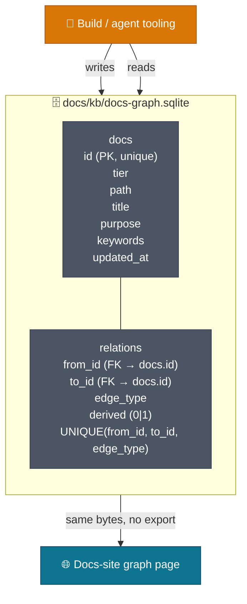
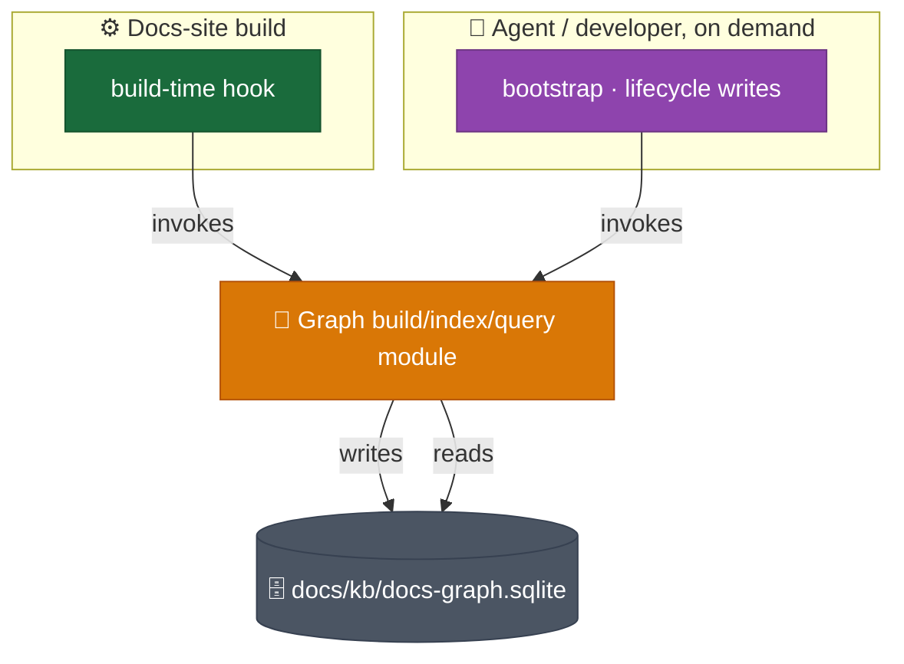

# Storage and Build Model

The graph is one SQLite file, `docs/kb/docs-graph.sqlite`, with two tables — `docs` and `relations`. The same file is read and written from the build/agent tooling and queried directly by the browser, with no export or conversion step between them.

## Schema



| Column       | Description                                                                                                                                   |
| ------------ | --------------------------------------------------------------------------------------------------------------------------------------------- |
| `id`         | Primary key, unique, stable identity.                                                                                                         |
| `tier`       | One of HLD/LLD/EngineeringGuide/Story/Product/AppReadme.                                                                                      |
| `path`       | Relative repo path.                                                                                                                           |
| `title`      | Human-readable title.                                                                                                                         |
| `purpose`    | Nullable — the doc's description; one of two fields allowed to be absent.                                                                     |
| `keywords`   | Nullable — a list of search keywords from frontmatter; the other field allowed to be absent, broadening search beyond title/purpose matching. |
| `updated_at` | Timestamp of the last index run touching the row.                                                                                             |

One row per indexed doc.

| Column      | Description                                                                                                           |
| ----------- | --------------------------------------------------------------------------------------------------------------------- |
| `from_id`   | Foreign key into `docs.id`.                                                                                           |
| `to_id`     | Foreign key into `docs.id`.                                                                                           |
| `edge_type` | One of the seven types in `01 Ops Model.md`'s node and edge model.                                                    |
| `derived`   | Flag distinguishing the six authored graduation edges from the one computed edge, `mirrors-consistent`/`mirrors-gap`. |

One row per typed edge between two doc IDs. Composite uniqueness on `(from_id, to_id, edge_type)` — the same edge between the same two docs is never recorded twice; a repeat write upserts rather than duplicating.

### Why an edge list, not a single parent reference

The relation store is an edge list, not a single parent reference per doc. A doc can have multiple outgoing edges of different types in the same build — for example, one Story doc producing edges to an HLD doc, an LLD doc, and an Engineering Guide doc, all at once, each a different edge type. A single parent reference allows only one parent per doc and cannot represent this, nor the derived mirror edge, which relates two already-existing docs to each other rather than expressing a parent-child relation.

### Example

Sample `docs` rows:

| id                | tier             | path                                             | title         |
| ----------------- | ---------------- | ------------------------------------------------ | ------------- |
| `s-20261102-a1b2` | Story            | `Stories/[ND-42] Example/design/`                | Example Story |
| `hld-web`         | HLD              | `Target Architecture (HLD)/v1/Containers/Web.md` | Web           |
| `lld-web`         | LLD              | `System Architecture (LLD)/Web/00. Overview.md`  | Web Overview  |
| `eg-deploy`       | EngineeringGuide | `Engineering Guide/12 Deploy.md`                 | Deploy        |

Sample `relations` rows:

| from_id           | to_id       | edge_type                    | derived |
| ----------------- | ----------- | ---------------------------- | ------- |
| `s-20261102-a1b2` | `hld-web`   | `document-arch-deviation`    | 0       |
| `s-20261102-a1b2` | `lld-web`   | `document-component-detail`  | 0       |
| `s-20261102-a1b2` | `eg-deploy` | `document-operational-steps` | 0       |
| `hld-web`         | `lld-web`   | `mirrors-consistent`         | 1       |

One Story produces three authored edges to three different destination tiers in the same build; the fourth row is the derived mirror edge between the HLD and LLD docs, computed from their matching names, unrelated to the Story.

## Frontmatter format

Every indexed doc carries this frontmatter block:

```yaml
---
id: <unique-string>
title: <string>
description: <string>
keywords: [<string>, ...]
---
```

| Key           | Required?                                                                                | Maps to         | Fallback if absent                                        |
| ------------- | ---------------------------------------------------------------------------------------- | --------------- | --------------------------------------------------------- |
| `id`          | Required once a doc is indexed. Assigned once, never hand-authored and never reassigned. | `docs.id`       | None — must exist once indexed.                           |
| `title`       | Optional.                                                                                | `docs.title`    | Falls back to the doc's first `# ` heading at index time. |
| `description` | Optional.                                                                                | `docs.purpose`  | Left blank.                                               |
| `keywords`    | Optional.                                                                                | `docs.keywords` | Left blank, same treatment as `description`.              |

### Why a stable string identity, not an internal counter

Each doc's ID is a stable string stored in the doc's own frontmatter, not an internal counter assigned by the data store. This is required because the graph must be deterministically regenerable from frontmatter alone — an internal counter's value would depend on build order and could change on a from-scratch rebuild, breaking the stable-identity requirement — and because the ID must be readable directly from the doc file, without querying the data store first.

## Build mechanism

A single script module is the one producer of `docs-graph.sqlite`. It is invoked two ways, both calling the identical module — there is no second script and no new standing infrastructure.



The first invocation path runs automatically as part of the existing docs-site build. The second is called directly by an agent or developer on demand — bootstrap, and lifecycle writes at Document/Publish time. Both paths call the same module; neither owns a separate copy of the build logic. The same scan that extracts `title` and `purpose` from frontmatter also extracts `keywords`.

## Compatibility rule

The schema is additive-only going forward: future revisions may add nullable columns with defaults. `id` and the `(from_id, to_id, edge_type)` composite uniqueness constraint are stable contracts that any consumer — tooling or browser — can rely on indefinitely.
