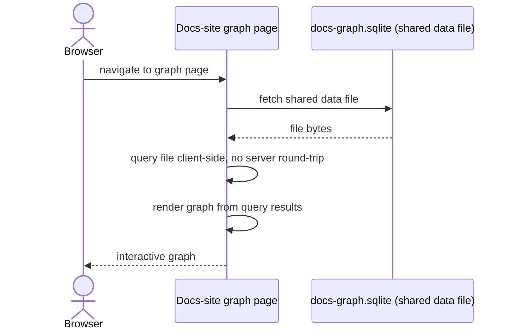

# Visualization Model

An IDE-side representation and a docs-site graph page are both required — neither is optional, and neither is a separate export or derived copy. Both share the one SQLite data file as their single source of truth.

## Data-access pattern

The docs-site page fetches the shared data file and queries it directly in the browser, client-side, with no server round-trip and no separate JSON export. The specific browser-side query technology and the specific graph-rendering library are not fixed by this model.

The IDE-side representation shares the same data source. Its exact rendering mechanism is not fixed by this model either — only that it exists and reads from the same file, not a derived copy.

## Node coloring

The populated graph colors nodes by tier, reusing the palette already established for Mermaid diagrams across this repo:

| Tier             | Color                                                  |
| ---------------- | ------------------------------------------------------ |
| HLD              | `#1D4ED8` (blue)                                       |
| LLD              | `#0E7490` (teal)                                       |
| EngineeringGuide | `#065F46` (green)                                      |
| Story / Product  | `#D97706` (Story, amber) / `#7C3AED` (Product, purple) |
| AppReadme        | `#4B5563` (grey)                                       |

## Compatibility rule

The docs-site page's data-access layer depends only on the stable `docs`/`relations` schema and the `(from_id, to_id, edge_type)` composite-uniqueness contract defined in `02 Storage and Build Model.md`. Additive schema changes do not break this page.
